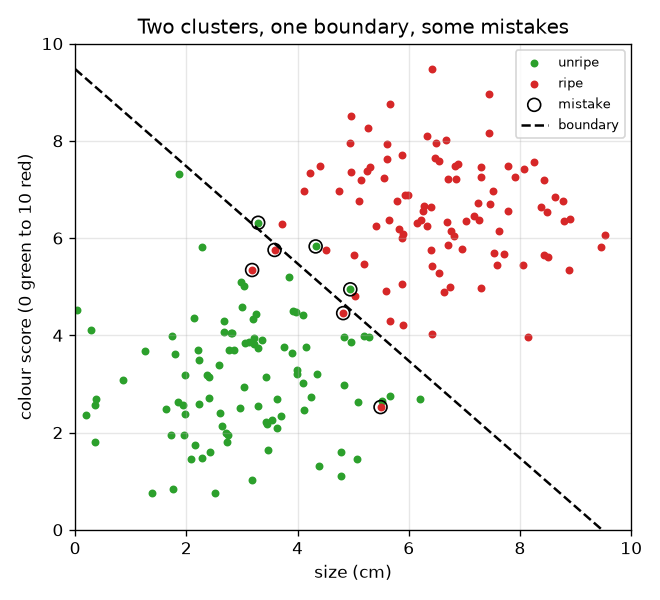
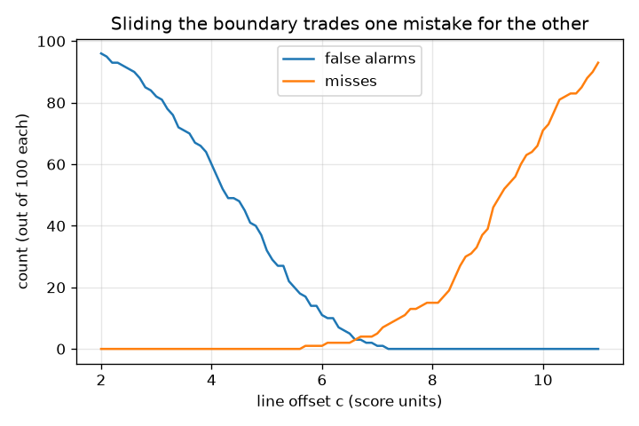

# സെഷൻ 1: രണ്ട് ഗ്രൂപ്പുകളെ വേർതിരിക്കുന്ന ഒരു നിയമം

[Session 1 — हिन्दी](README.hi.md)

*ലെവൽ 1 (ആശയപരമായ ഇന്ററാക്ടീവ് മോഡൽ) · ഏകദേശം 60 മിനിറ്റ് · openclassifier*

> ഇത് പഠനാവശ്യത്തിനുള്ള ലളിതമാക്കിയ ഒരു മോഡലാണ്. ഇത് സാധൂകരിക്കപ്പെട്ട ഒരു ഡിസൈൻ ഉപകരണമല്ല; യഥാർത്ഥ ഘടനകൾ, വൈദ്യുത ഇൻസ്റ്റലേഷനുകൾ, വാഹനങ്ങൾ, വ്യാവസായിക പ്രക്രിയകൾ അല്ലെങ്കിൽ വൈദ്യശാസ്ത്ര തീരുമാനങ്ങൾ എന്നിവയ്ക്കായി ഇത് ഉപയോഗിക്കരുത്.

**മുൻ‌അറിവ് (Prerequisites)**

- ഒരു സ്കാറ്റർ പ്ലോട്ട് (scatter plot) വായിക്കൽ (x കുറുകെ, y മുകളിലേക്ക്).
- നിങ്ങൾ PRIMER.md വായിച്ചിട്ടുണ്ട്, `python start.py 1` ഒരിക്കൽ റൺ ചെയ്തിട്ടുണ്ട്.

**പഠന ലക്ഷ്യങ്ങൾ (Learning objectives).** ഈ സെഷനു ശേഷം നിങ്ങൾക്ക് കഴിയും:

- അളവുകളെ ഒരു അതെ/അല്ല തീരുമാനമാക്കി മാറ്റുന്ന നിയമമായി ഒരു ക്ലാസിഫയറിനെ (classifier) വിശദീകരിക്കാൻ.
- രണ്ട് കൂട്ടങ്ങൾക്കിടയിൽ ഒരു നേരായ തീരുമാന അതിര് (decision boundary) വരയ്ക്കാനും നീക്കാനും.
- ഒരു നിയമത്തിന്റെ രണ്ടുതരം തെറ്റുകൾ, തെറ്റായ അലാറങ്ങളും (false alarms) നഷ്ടങ്ങളും (misses), എണ്ണാൻ.
- അതിര് നീക്കുമ്പോൾ ഒരു തെറ്റ് മറ്റൊന്നിനായി എങ്ങനെ കൈമാറ്റം ചെയ്യപ്പെടുന്നു എന്ന് കാണിക്കുന്ന ഗ്രാഫ് വായിക്കാൻ.

## A. യഥാർത്ഥ ലോക പ്രശ്നം
ഒരു പാക്കിംഗ് ലൈൻ പഴുത്ത പഴങ്ങൾ കടയിലേക്ക് അയയ്ക്കുകയും പഴുക്കാത്തവ തിരികെ വയ്ക്കുകയും വേണം. ഒരു ക്യാമറ ഓരോ പഴത്തിനും രണ്ട് സംഖ്യകൾ അളക്കുന്നു: സെന്റിമീറ്ററിലുള്ള അതിന്റെ വലിപ്പവും 0 (പച്ച) മുതൽ 10 (കടുംചുവപ്പ്) വരെയുള്ള ഒരു നിറ സ്കോറും. പഴുത്തത് എന്നതിന്റെ അർത്ഥം ആരും യന്ത്രത്തോട് പറയുന്നില്ല; നാം അതിന് ഒരു നിയമം നൽകുന്നു. നിയമം എങ്ങനെയിരിക്കണം, നാം അത് എങ്ങനെ വരയ്ക്കും, അത് തെറ്റുന്ന വഴികൾ എങ്ങനെ എണ്ണും? (സാങ്കൽപ്പിക ഡാറ്റ ഉപയോഗിച്ചുള്ള പൊതുവിദ്യാഭ്യാസം.)

## B. ആശയവും സിദ്ധാന്തവും
ഒരു ക്ലാസിഫയർ എന്നത് അളവുകളെ ഒരു ക്ലാസിലേക്ക് (class) മാപ്പ് ചെയ്യുന്ന നിയമമാണ്. ഓരോ പഴവും ഒരു ബിന്ദു (x, y) = (വലിപ്പം, നിറം) ആണ്. ഏറ്റവും ലളിതമായ നിയമം ഒരു സംഖ്യയെക്കുറിച്ച് ഒരു ചോദ്യം ചോദിക്കുന്നു: വലിപ്പം t-ന് മുകളിലാണോ? മെച്ചപ്പെട്ട നിയമം രണ്ട് സംഖ്യകളും കലർത്തുന്നു: x cos(a) + y sin(a) എന്നത് c-യേക്കാൾ വലുതാകുമ്പോൾ അത് പഴത്തെ പഴുത്തത് എന്ന് വിളിക്കുന്നു. ഉത്തരം മാറുന്ന ബിന്ദുക്കളുടെ കൂട്ടമാണ് തീരുമാന അതിര്, ഇവിടെ ഒരു നേർരേഖ; കോൺ a രേഖ ഏത് വശത്തേക്ക് തിരിഞ്ഞിരിക്കുന്നു എന്നും c അത് മൂലബിന്ദുവിൽ നിന്ന് എത്ര അകലെയാണ് എന്നും പറയുന്നു. 'പഴുത്തത്' എന്നതിനെ പോസിറ്റീവ് ക്ലാസ് (positive class) എന്ന് വിളിക്കാം. ഒരു നിയമത്തിന് രണ്ട് വ്യത്യസ്ത രീതികളിൽ തെറ്റാം: ഒരു തെറ്റായ അലാറം (false positive) പഴുക്കാത്ത പഴത്തെ പഴുത്തത് എന്ന് വിളിക്കുന്നു, ഒരു നഷ്ടം (false negative) പഴുത്ത പഴത്തെ പഴുക്കാത്തത് എന്ന് വിളിക്കുന്നു. അവയ്ക്ക് സാധാരണയായി വ്യത്യസ്ത ചെലവുകൾ ഉള്ളതിനാൽ അവ വെവ്വേറെ എണ്ണുന്നു. അതിരിനെ പഴുത്ത കൂട്ടത്തിലേക്ക് നീക്കുന്നത് തെറ്റായ അലാറങ്ങൾ നീക്കം ചെയ്യുന്നു, പക്ഷേ നഷ്ടങ്ങൾ സൃഷ്ടിക്കുന്നു, തിരിച്ചും.

| ചിഹ്നം | അർത്ഥം | യൂണിറ്റ് |
|---|---|---|
| x | പഴത്തിന്റെ വലിപ്പം | cm |
| y | നിറ സ്കോർ (0 പച്ച മുതൽ 10 ചുവപ്പ് വരെ) | സ്കോർ യൂണിറ്റുകൾ |
| a | അതിരിന്റെ ലംബ ദിശയുടെ കോൺ | ഡിഗ്രി |
| c | മൂലബിന്ദുവിൽ നിന്നുള്ള അതിരിന്റെ ഓഫ്സെറ്റ് | സ്കോർ യൂണിറ്റുകൾ |
| FA | തെറ്റായ അലാറങ്ങൾ: പഴുത്തത് എന്ന് വിളിക്കപ്പെട്ട പഴുക്കാത്ത പഴങ്ങൾ | എണ്ണം |
| miss | പഴുക്കാത്തത് എന്ന് വിളിക്കപ്പെട്ട പഴുത്ത പഴങ്ങൾ | എണ്ണം |

**അനുമാനങ്ങൾ (Assumptions)**

- പഴങ്ങളുടെ ഡാറ്റ സാങ്കൽപ്പികമാണ്; യഥാർത്ഥ പഴങ്ങളെക്കുറിച്ച് അവകാശവാദമില്ല.
- അതിര് ഒരു നേർരേഖയാണ്, കൃത്യമായി രേഖയിലുള്ള പഴത്തെ പഴുക്കാത്തത് എന്ന് വിളിക്കുന്നു.
- രണ്ട് ക്ലാസുകൾ മാത്രം.

$$ \text{called ripe}\iff x\cos a+y\sin a>c $$

$$ \text{size-only rule}:\ \text{called ripe}\iff x>t $$

$$ \text{accuracy}=\frac{\text{number correct}}{\text{number of fruit}} $$

## C. ദൃശ്യ വിശദീകരണം
ആദ്യത്തെ ചിത്രം 100 പഴുക്കാത്തതും 100 പഴുത്തതുമായ പഴങ്ങളെ ഒരു ഡാഷ്ഡ് അതിരോടുകൂടിയ രണ്ട് ഓവർലാപ്പിംഗ് കൂട്ടങ്ങളായി കാണിക്കുന്നു; നിയമം തെറ്റിക്കുന്ന പഴങ്ങളെ വളയങ്ങൾ അടയാളപ്പെടുത്തുന്നു. രണ്ടാമത്തെ ചിത്രം അതിര് നീങ്ങുമ്പോൾ തെറ്റായ അലാറങ്ങളും നഷ്ടങ്ങളും എണ്ണുന്നു: c വളരുമ്പോൾ തെറ്റായ അലാറങ്ങൾ കുറയുകയും നഷ്ടങ്ങൾ കൂടുകയും ചെയ്യുന്നു, c = 6.6-ന് അടുത്ത് രണ്ട് എണ്ണങ്ങളും തുല്യമാണ്.

*രണ്ട് ഓവർലാപ്പിംഗ് കൂട്ടങ്ങൾ, ഒരു ഡാഷ്ഡ് അതിര്, നിയമം തെറ്റിക്കുന്ന പഴങ്ങൾക്ക് ചുറ്റും വളയങ്ങൾ.*

*അതിര് നീങ്ങുമ്പോൾ തെറ്റായ അലാറങ്ങളും നഷ്ടങ്ങളും: ഒന്ന് കുറയുമ്പോൾ മറ്റൊന്ന് കൂടുന്നു.*

## D. ഇന്ററാക്ടീവ് സിമുലേഷൻ
പാഠം റൺ ചെയ്യുക (`python start.py 1`), എന്നിട്ട് ലൈവ് ആപ്പ് തുറക്കുക: [സെഷൻ 1: പഴങ്ങൾ തരംതിരിക്കുക](https://krunalpanchal1995.github.io/pan-iit-oss/openclassifier/session-01/) (അല്ലെങ്കിൽ ഈ ഫോൾഡറിലെ `app.html`). കോൺ, ഓഫ്സെറ്റ് സ്ലൈഡറുകൾ നീക്കി ഡാഷ്ഡ് അതിരും വളയമിട്ട തെറ്റുകളും നിരീക്ഷിക്കുക. ഓഫ്സെറ്റിനെതിരെ രണ്ട് എണ്ണങ്ങളും കാണാൻ ട്രേഡ്-ഓഫ് ഗ്രാഫിലേക്കും, നാല് ഫലങ്ങൾ കാണാൻ ടാലി വ്യൂവിലേക്കും മാറുക.

**വെല്ലുവിളി.** പന്ത്രണ്ട് പഴങ്ങളെയും ശരിയായി തരംതിരിക്കുന്ന ഒരു അതിര് കണ്ടെത്തുക (തെറ്റായ അലാറങ്ങളും നഷ്ടങ്ങളും ഇല്ലാതെ).

## E. ചെയ്തുകാണിച്ച ഉദാഹരണവും പരീക്ഷണവും
**പ്രശ്നം.** പന്ത്രണ്ട് പഴങ്ങൾ: പഴുക്കാത്തവ (2, 2), (3, 4), (4, 2), (3.5, 6), (5, 3), (6, 4.5), പഴുത്തവ (4.5, 7), (6, 8), (7, 6), (8, 9), (7.5, 4), (5.5, 5.5). a = 45 ഡിഗ്രിയും c = 7-ഉം ഉള്ള രേഖ ഉപയോഗിക്കുക. ഏതൊക്കെ പഴങ്ങൾ തെറ്റായി തരംതിരിക്കപ്പെട്ടു, കൃത്യത (accuracy) എത്ര?

1. 45 ഡിഗ്രിയിൽ cos = sin = 0.7071, അതിനാൽ നിയമം 0.7071 (x + y) > 7 ആണ്, അതായത് x + y > 9.899.
2. പഴുക്കാത്ത പഴങ്ങളുടെ x + y തുകകൾ: 4, 7, 6, 9.5, 8, 10.5. 10.5 (പഴം (6, 4.5)) മാത്രമാണ് 9.899-ന് മുകളിൽ, അതിനാൽ അത് ഒരു തെറ്റായ അലാറമാണ്.
3. പഴുത്ത പഴങ്ങളുടെ തുകകൾ: 11.5, 14, 13, 17, 11.5, 11. എല്ലാം 9.899-ന് മുകളിലാണ്, അതിനാൽ നഷ്ടങ്ങളില്ല.
4. ശരിയായവ = 12 - 1 - 0 = 11, അതിനാൽ കൃത്യത = 11 / 12 = 0.917.

**ഉത്തരം.** ഒരു തെറ്റായ അലാറം (പഴം (6, 4.5)), നഷ്ടങ്ങളില്ല, കൃത്യത 0.917.

**പരീക്ഷണം.** പന്ത്രണ്ട് ബിന്ദുക്കളും ഗ്രാഫ് പേപ്പറിൽ അടയാളപ്പെടുത്തുക, x + y = 9.9 എന്ന രേഖയിൽ ഒരു റൂളർ വയ്ക്കുക, തെറ്റായ വശത്തുള്ള ബിന്ദുക്കൾ എണ്ണുക; അതേ ഒറ്റ പഴം നിങ്ങൾ കണ്ടെത്തണം. മോഡലും യാഥാർത്ഥ്യവും: യഥാർത്ഥ പഴങ്ങൾ പന്ത്രണ്ട് വൃത്തിയുള്ള ബിന്ദുക്കളല്ല, പഴുപ്പ് കൃത്യമായി അളക്കാവുന്ന ഒരു സംഖ്യയല്ല, ക്യാമറ നോയ്സ് ചേർക്കുന്നു, അതിനാൽ ഒരു യഥാർത്ഥ രേഖ ഈ കളിപ്പാട്ട രേഖയേക്കാൾ കൂടുതൽ തെറ്റുകൾ വരുത്തുന്നു.

## F. മൂല്യനിർണ്ണയവും ഡിസൈൻ വെല്ലുവിളിയും
**ചോദ്യ തരം A: ആശയപരം.** 'തെറ്റുകൾ' മാത്രം എണ്ണുന്നതിന് പകരം തെറ്റായ അലാറങ്ങളും നഷ്ടങ്ങളും വെവ്വേറെ എണ്ണുന്നത് എന്തുകൊണ്ട്? ഒന്ന് മറ്റൊന്നിനേക്കാൾ മോശമായ ഒരു ഉദാഹരണം നൽകുക.

സൂചന

ഓരോ തെറ്റും പാക്കിംഗ് ലൈനിന് എന്ത് ചെലവ് വരുത്തുന്നു എന്ന് ചിന്തിക്കുക.

പടിപടിയായുള്ള പരിഹാരം

രണ്ടും തെറ്റായ തീരുമാനങ്ങളാണ്, പക്ഷേ അവയ്ക്ക് വ്യത്യസ്ത ചെലവുകളുണ്ട്. പഴുക്കാത്ത പഴം കടയിലേക്ക് അയയ്ക്കുന്നത് (തെറ്റായ അലാറം) ഒരു ഉപഭോക്താവിന്റെ വിശ്വാസം നഷ്ടപ്പെടുത്തുന്നു; പഴുത്ത പഴം തിരികെ വയ്ക്കുന്നത് (നഷ്ടം) ഒരു നല്ല പഴം പാഴാക്കുന്നു. ഒരു സ്മോക്ക് അലാറത്തിന് ഒരു നഷ്ടം (തീ, അലാറമില്ല) തെറ്റായ അലാറത്തേക്കാൾ വളരെ മോശമാണ്. തെറ്റുകളുടെ ആകെ എണ്ണം ഇത് മറയ്ക്കുന്നു, അതിനാൽ നാം രണ്ടും റിപ്പോർട്ട് ചെയ്യുന്നു.

**ചോദ്യ തരം B: സംഖ്യാപരം.** ചെയ്തുകാണിച്ച ഉദാഹരണത്തിലെ പന്ത്രണ്ട് പഴങ്ങൾക്ക്, 'വലിപ്പം > 5 ആണെങ്കിൽ പഴുത്തത്' എന്ന വലിപ്പം-മാത്ര നിയമം ഉപയോഗിക്കുക (അതായത് a = 0 ഡിഗ്രി, c = 5). തെറ്റായ അലാറങ്ങൾ, നഷ്ടങ്ങൾ, കൃത്യത എന്നിവ എണ്ണുക.

സൂചന

പഴുക്കാത്തതും പഴുത്തതുമായ പഴങ്ങളുടെ വലിപ്പങ്ങൾ പട്ടികപ്പെടുത്തി ഏതൊക്കെ 5-ന് മുകളിലാണെന്ന് അടയാളപ്പെടുത്തുക.

പടിപടിയായുള്ള പരിഹാരം

പഴുക്കാത്തവയുടെ വലിപ്പങ്ങൾ: 2, 3, 4, 3.5, 5, 6; 6 മാത്രമാണ് 5-ന് മുകളിൽ, അതിനാൽ 1 തെറ്റായ അലാറം (കൃത്യം 5 വലിപ്പം 5-ന് മുകളിലല്ല). പഴുത്തവയുടെ വലിപ്പങ്ങൾ: 4.5, 6, 7, 8, 7.5, 5.5; 4.5 മാത്രമാണ് 5-ന് മുകളിലല്ലാത്തത്, അതിനാൽ 1 നഷ്ടം. ശരിയായവ = 12 - 2 = 10, കൃത്യത = 10 / 12 = 0.833. യുക്തിപരിശോധന: നിറവും ഉപയോഗിച്ചപ്പോൾ (45 ഡിഗ്രി രേഖ) 1 തെറ്റ് മാത്രം, മെച്ചപ്പെട്ട ഫലം.

**ചോദ്യ തരം C: ഗ്രാഫ്, സിമുലേഷൻ വ്യാഖ്യാനം.** 45 ഡിഗ്രി അതിരുള്ള 200 റാൻഡം പഴങ്ങളുടെ ട്രേഡ്-ഓഫ് ഗ്രാഫിൽ, ഓഫ്സെറ്റ് c 2-ൽ നിന്ന് 11-ലേക്ക് കൂടുമ്പോൾ രണ്ട് എണ്ണങ്ങൾക്കും എന്ത് സംഭവിക്കുന്നു? അവ എവിടെ കൂട്ടിമുട്ടുന്നു?

സൂചന

വലിയ c രേഖയെ പഴുത്ത കൂട്ടത്തിലേക്ക് നീക്കുന്നു.

പടിപടിയായുള്ള പരിഹാരം

കുറച്ച് പഴങ്ങളെ മാത്രം പഴുത്തത് എന്ന് വിളിക്കുന്നതിനാൽ തെറ്റായ അലാറങ്ങൾ സ്ഥിരമായി കുറയുന്നു (c = 2-ൽ 96, 0 നഷ്ടങ്ങളോടെ), നഷ്ടങ്ങൾ 0-ൽ നിന്ന് കൂടുന്നു. വക്രങ്ങൾ c = 6.6-ന് അടുത്ത് കൂട്ടിമുട്ടുന്നു, അവിടെ രണ്ട് എണ്ണങ്ങളും ഏകദേശം തുല്യമാണ്. c = 6.7-ൽ നിയമം 200-ൽ 3 തെറ്റായ അലാറങ്ങളും 4 നഷ്ടങ്ങളും വരുത്തുന്നു.

**ചോദ്യ തരം D: ഡിസൈൻ, ഒപ്റ്റിമൈസേഷൻ വെല്ലുവിളി.** ഡിസൈൻ: ഒരു തെറ്റായ അലാറം (ഷെൽഫിലെ പഴുക്കാത്ത പഴം) ഒരു നഷ്ടത്തേക്കാൾ മോശമാണെന്ന് കട പറയുന്നു. അതിരിനെ c = 6.7-ന്റെ ഇടത്തോട്ടോ വലത്തോട്ടോ നീക്കണോ? നിങ്ങൾ എന്ത് ഉപേക്ഷിക്കുന്നു? എത്ര ദൂരം എന്ന് എങ്ങനെ തീരുമാനിക്കും?

സൂചന

ട്രേഡ്-ഓഫ് വക്രങ്ങൾ ഉപയോഗിക്കുക: ഓരോ എണ്ണവും ഏത് വഴിക്ക് നീങ്ങുന്നു?

പടിപടിയായുള്ള പരിഹാരം

വലത്തോട്ട് നീക്കുക (വലിയ c): കുറവ് തെറ്റായ അലാറങ്ങൾ, കൂടുതൽ നഷ്ടങ്ങളുടെ വിലയിൽ, ഇവിടെ അതിനർത്ഥം കൂടുതൽ പഴുത്ത പഴങ്ങൾ തിരികെ വയ്ക്കപ്പെടുന്നു എന്നാണ്. എത്ര ദൂരം എന്ന് തീരുമാനിക്കാൻ, ഓരോ തെറ്റിനും ഒരു ചെലവ് നൽകുക (ഉദാഹരണത്തിന് ഒരു തെറ്റായ അലാറത്തിന് 3, ഒരു നഷ്ടത്തിന് 1), c അക്ഷത്തിലുടനീളം 3 x FA + 1 x miss കണക്കാക്കി ഏറ്റവും താഴ്ന്ന ബിന്ദു എടുക്കുക. അനുമാനം: സാമ്പിൾ യഥാർത്ഥ ലൈനിന്റെ സാധാരണ പ്രതിനിധിയാണ്; 200 പഴങ്ങൾ മാത്രമുള്ളതിനാൽ കൃത്യമായ മികച്ച c അനിശ്ചിതമാണ്.

[RUBRIC.md](../../RUBRIC.md) ഉപയോഗിച്ച് സ്വയം സ്കോർ ചെയ്യുക. കടലാസിൽ പ്രവർത്തിക്കാൻ [ആക്ടിവിറ്റി ഷീറ്റ്](activity_sheet.md) പ്രിന്റ് ചെയ്യുക.

## സാധാരണ തെറ്റിദ്ധാരണകൾ
| സാധാരണ തെറ്റിദ്ധാരണ | യഥാർത്ഥത്തിൽ ശരിയായത് |
|---|---|
| ഏത് തരത്തിലുമുള്ള ഏറ്റവും കുറവ് തെറ്റുകൾ ഉള്ളതാണ് മികച്ച ക്ലാസിഫയർ. | അത് ഓരോ തെറ്റിനും എന്ത് ചെലവ് വരുന്നു എന്നതിനെ ആശ്രയിച്ചിരിക്കുന്നു. ഒരേ ആകെത്തുകയുള്ള രണ്ട് നിയമങ്ങൾക്ക് വളരെ വ്യത്യസ്തമായ തെറ്റായ അലാറങ്ങളും നഷ്ടങ്ങളും ഉണ്ടാകാം. |
| തീരുമാന അതിര് ഡാറ്റയിൽ അടങ്ങിയിരിക്കുന്ന ഒന്നാണ്. | അത് നിയമം എടുക്കുന്ന ഒരു തിരഞ്ഞെടുപ്പാണ്. വ്യത്യസ്ത നിയമങ്ങൾ ഒരേ ബിന്ദുക്കളിലൂടെ വ്യത്യസ്ത അതിരുകൾ വരയ്ക്കുന്നു. |
| ഒരു സവിശേഷത (feature) നല്ലതാണെങ്കിൽ അത് മതി. | വലിപ്പം മാത്രം ഉപയോഗിച്ചപ്പോൾ 200 പഴങ്ങളിൽ 22 തെറ്റുകൾ സംഭവിച്ചു; നിറം ചേർത്തപ്പോൾ അത് 7 ആയി കുറഞ്ഞു. |

## പദാവലി
- **ക്ലാസിഫയർ (classifier)**: അളവുകളെ ഒരു ക്ലാസ് ലേബലാക്കി മാറ്റുന്ന നിയമം
- **തീരുമാന അതിര് (decision boundary)**: നിയമത്തിന്റെ ഉത്തരം മാറുന്ന ബിന്ദുക്കളുടെ കൂട്ടം
- **തെറ്റായ അലാറം (false positive)**: നെഗറ്റീവ് കേസിനെ പോസിറ്റീവ് എന്ന് വിളിക്കൽ
- **നഷ്ടം (false negative)**: പോസിറ്റീവ് കേസിനെ നെഗറ്റീവ് എന്ന് വിളിക്കൽ
- **കൃത്യത (accuracy)**: നിയമം ശരിയാക്കുന്ന കേസുകളുടെ ഭിന്നസംഖ്യ

## പൂർത്തിയാക്കുക
1. [exercises.md](exercises.md)-ലെ മൂന്ന് കോഡിംഗ് ജോലികൾ ചെയ്യുക.
2. നിങ്ങളുടെ മാറ്റങ്ങൾക്ക് ശേഷം `python start.py 1` വീണ്ടും റൺ ചെയ്യുക. അത് ചെക്ക്‌പോയിന്റോടെ അവസാനിക്കുന്നു; അത് `PASS` എന്ന് പ്രിന്റ് ചെയ്യുമ്പോൾ നിങ്ങൾ പൂർത്തിയാക്കി. (ചെക്ക്‌പോയിന്റ് മാത്രം: `python start.py check 1`.)

അടുത്തത്: [സെഷൻ 2](../session-02/README.md)
