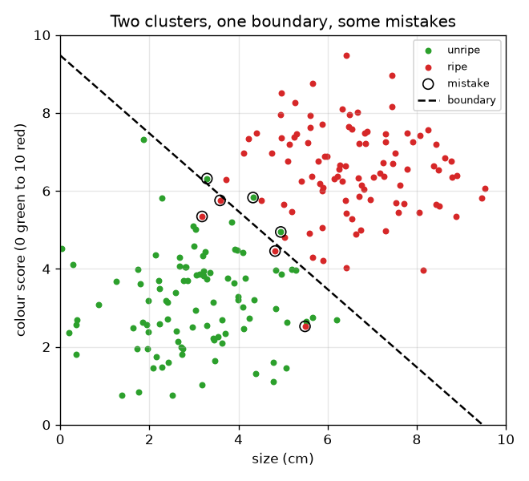
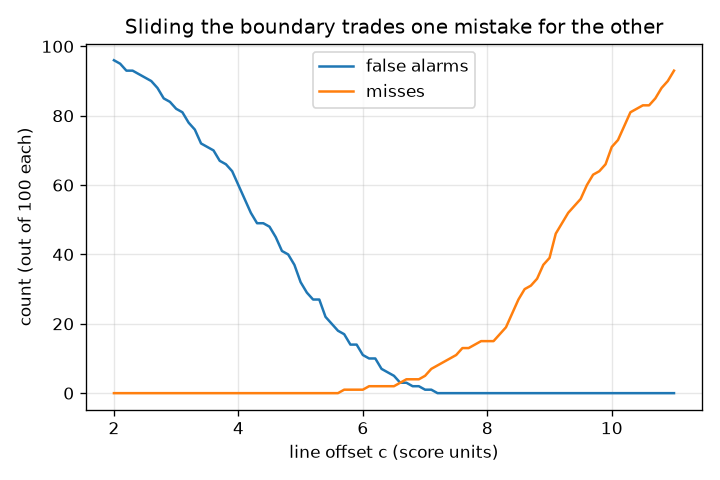

# அமர்வு 1: இரண்டு குழுக்களைப் பிரிக்கும் ஒரு விதி

[Session 1 — हिन्दी](README.hi.md) · [Session 1 — മലയാളം](README.ml.md)

*நிலை 1 (கருத்தியல் ஊடாடும் மாதிரி) · சுமார் 60 நிமிடங்கள் · openclassifier*

> இது கல்விக்கான எளிமைப்படுத்தப்பட்ட மாதிரி. இது சரிபார்க்கப்பட்ட வடிவமைப்புக் கருவி அல்ல; உண்மையான கட்டமைப்புகள், மின் நிறுவல்கள், வாகனங்கள், தொழில்துறை செயல்முறைகள் அல்லது மருத்துவ முடிவுகளுக்கு இதைப் பயன்படுத்தக் கூடாது.

**முன்தேவைகள் (Prerequisites)**

- ஒரு சிதறல் வரைபடத்தைப் (scatter plot) படித்தல் (x குறுக்கே, y மேலே).
- நீங்கள் PRIMER.md படித்து, `python start.py 1` ஒருமுறை இயக்கியுள்ளீர்கள்.

**கற்றல் நோக்கங்கள் (Learning objectives).** இந்த அமர்வுக்குப் பிறகு நீங்கள்:

- அளவீடுகளை ஆம்/இல்லை முடிவாக மாற்றும் விதியாக ஒரு வகைப்படுத்தியை (classifier) விளக்க முடியும்.
- இரண்டு கொத்துகளுக்கு இடையே ஒரு நேரான முடிவு எல்லையை (decision boundary) வரைந்து நகர்த்த முடியும்.
- ஒரு விதியின் இரண்டு வகைத் தவறுகளான தவறான எச்சரிக்கைகள் (false alarms) மற்றும் தவறவிடல்களை (misses) எண்ண முடியும்.
- எல்லையை நகர்த்துவது ஒரு தவறை மற்றொன்றுக்கு எப்படிப் பரிமாறுகிறது என்று காட்டும் வரைபடத்தைப் படிக்க முடியும்.

## A. நிஜ உலகப் பிரச்சினை
ஒரு பொதியிடும் வரிசை பழுத்த பழங்களைக் கடைக்கு அனுப்பி, பழுக்காதவற்றைத் திரும்ப வைக்க வேண்டும். ஒரு கேமரா ஒவ்வொரு பழத்துக்கும் இரண்டு எண்களை அளக்கிறது: சென்டிமீட்டரில் அதன் அளவு மற்றும் 0 (பச்சை) முதல் 10 (அடர் சிவப்பு) வரையிலான ஒரு நிற மதிப்பெண். பழுத்தது என்றால் என்ன என்று யாரும் இயந்திரத்துக்குச் சொல்வதில்லை; நாம் அதற்கு ஒரு விதியைக் கொடுக்கிறோம். விதி எப்படி இருக்க வேண்டும், அதை எப்படி வரைவது, அது தவறும் வழிகளை எப்படி எண்ணுவது? (கற்பனைத் தரவுடன் பொதுக் கல்வி.)

## B. கருத்தும் கோட்பாடும்
வகைப்படுத்தி என்பது அளவீடுகளை ஒரு வகுப்புக்கு (class) இணைக்கும் விதி. ஒவ்வொரு பழமும் ஒரு புள்ளி (x, y) = (அளவு, நிறம்). மிக எளிய விதி ஒரு எண்ணைப் பற்றி ஒரு கேள்வி கேட்கிறது: அளவு t-க்கு மேல் உள்ளதா? சிறந்த விதி இரண்டு எண்களையும் கலக்கிறது: x cos(a) + y sin(a) என்பது c-ஐ விடப் பெரியதாக இருக்கும்போது அது பழத்தைப் பழுத்தது என்கிறது. விடை மாறும் புள்ளிகளின் தொகுப்பே முடிவு எல்லை, இங்கே ஒரு நேர்கோடு; கோணம் a கோடு எந்தப் பக்கம் நோக்குகிறது என்றும் c அது ஆதிப்புள்ளியிலிருந்து எவ்வளவு தொலைவில் உள்ளது என்றும் சொல்கின்றன. 'பழுத்தது' என்பதை நேர்மறை வகுப்பு (positive class) என்போம். ஒரு விதி இரண்டு வெவ்வேறு வழிகளில் தவறலாம்: ஒரு தவறான எச்சரிக்கை (false positive) பழுக்காத பழத்தைப் பழுத்தது என்கிறது, ஒரு தவறவிடல் (false negative) பழுத்த பழத்தைப் பழுக்காதது என்கிறது. அவற்றுக்குப் பொதுவாக வெவ்வேறு விலைகள் இருப்பதால் அவை தனித்தனியாக எண்ணப்படுகின்றன. எல்லையைப் பழுத்த கொத்தை நோக்கி நகர்த்துவது தவறான எச்சரிக்கைகளை நீக்குகிறது, ஆனால் தவறவிடல்களை உருவாக்குகிறது, மறுதலையாகவும்.

| குறியீடு | பொருள் | அலகு |
|---|---|---|
| x | பழத்தின் அளவு | cm |
| y | நிற மதிப்பெண் (0 பச்சை முதல் 10 சிவப்பு வரை) | மதிப்பெண் அலகுகள் |
| a | எல்லையின் செங்குத்துத் திசையின் கோணம் | பாகைகள் |
| c | ஆதிப்புள்ளியிலிருந்து எல்லையின் இடப்பெயர்ச்சி (offset) | மதிப்பெண் அலகுகள் |
| FA | தவறான எச்சரிக்கைகள்: பழுத்தது எனப்பட்ட பழுக்காத பழங்கள் | எண்ணிக்கை |
| miss | பழுக்காதது எனப்பட்ட பழுத்த பழங்கள் | எண்ணிக்கை |

**அனுமானங்கள் (Assumptions)**

- பழத் தரவு கற்பனையானது; உண்மையான பழங்களைப் பற்றி எந்தக் கூற்றும் இல்லை.
- எல்லை ஒரு நேர்கோடு, சரியாகக் கோட்டின் மேலுள்ள பழம் பழுக்காதது எனப்படும்.
- இரண்டு வகுப்புகள் மட்டும்.

$$ \text{called ripe}\iff x\cos a+y\sin a>c $$

$$ \text{size-only rule}:\ \text{called ripe}\iff x>t $$

$$ \text{accuracy}=\frac{\text{number correct}}{\text{number of fruit}} $$

## C. காட்சி விளக்கம்
முதல் படம் 100 பழுக்காத மற்றும் 100 பழுத்த பழங்களை ஒரு கோடிட்ட எல்லையுடன் இரண்டு ஒன்றின் மேல் ஒன்று படியும் கொத்துகளாகக் காட்டுகிறது; விதி தவறாகக் கணிக்கும் பழங்களை வளையங்கள் குறிக்கின்றன. இரண்டாவது படம் எல்லை நகரும்போது தவறான எச்சரிக்கைகளையும் தவறவிடல்களையும் எண்ணுகிறது: c வளரும்போது தவறான எச்சரிக்கைகள் குறைந்து தவறவிடல்கள் உயர்கின்றன, c = 6.6 அருகே இரண்டு எண்ணிக்கைகளும் சமம்.

*ஒன்றின் மேல் ஒன்று படியும் இரண்டு கொத்துகள், ஒரு கோடிட்ட எல்லை, விதி தவறும் பழங்களைச் சுற்றி வளையங்கள்.*

*எல்லை நகரும்போது தவறான எச்சரிக்கைகளும் தவறவிடல்களும்: ஒன்று குறையும்போது மற்றது உயர்கிறது.*

## D. ஊடாடும் உருவகப்படுத்தல்
பாடத்தை இயக்குங்கள் (`python start.py 1`), பிறகு நேரடிச் செயலியைத் திறங்கள்: [அமர்வு 1: பழங்களை வகைப்படுத்துங்கள்](https://krunalpanchal1995.github.io/pan-iit-oss/openclassifier/session-01/) (அல்லது இந்தக் கோப்புறையிலுள்ள `app.html`). கோணம் மற்றும் இடப்பெயர்ச்சி ஸ்லைடர்களை நகர்த்தி கோடிட்ட எல்லையையும் வளையமிட்ட தவறுகளையும் கவனியுங்கள். இடப்பெயர்ச்சிக்கு எதிராக இரண்டு எண்ணிக்கைகளையும் காண சமரச வரைபடத்துக்கும், நான்கு விளைவுகளைக் காண கணக்குக் காட்சிக்கும் மாறுங்கள்.

**சவால்.** பன்னிரண்டு பழங்களையும் சரியாக வகைப்படுத்தும் ஒரு எல்லையைக் கண்டறியுங்கள் (தவறான எச்சரிக்கைகளும் தவறவிடல்களும் இல்லாமல்).

## E. தீர்க்கப்பட்ட எடுத்துக்காட்டும் பரிசோதனையும்
**பிரச்சினை.** பன்னிரண்டு பழங்கள்: பழுக்காதவை (2, 2), (3, 4), (4, 2), (3.5, 6), (5, 3), (6, 4.5) மற்றும் பழுத்தவை (4.5, 7), (6, 8), (7, 6), (8, 9), (7.5, 4), (5.5, 5.5). a = 45 பாகை மற்றும் c = 7 கொண்ட கோட்டைப் பயன்படுத்துங்கள். எந்தப் பழங்கள் தவறாக வகைப்படுத்தப்படுகின்றன, துல்லியம் (accuracy) என்ன?

1. 45 பாகையில் cos = sin = 0.7071, எனவே விதி 0.7071 (x + y) > 7, அதாவது x + y > 9.899.
2. பழுக்காத பழங்களின் x + y கூட்டுத்தொகைகள்: 4, 7, 6, 9.5, 8, 10.5. 10.5 (பழம் (6, 4.5)) மட்டுமே 9.899-க்கு மேல், எனவே அது ஒரு தவறான எச்சரிக்கை.
3. பழுத்த பழங்களின் கூட்டுத்தொகைகள்: 11.5, 14, 13, 17, 11.5, 11. அனைத்தும் 9.899-க்கு மேல், எனவே தவறவிடல்கள் இல்லை.
4. சரியானவை = 12 - 1 - 0 = 11, எனவே துல்லியம் = 11 / 12 = 0.917.

**விடை.** ஒரு தவறான எச்சரிக்கை (பழம் (6, 4.5)), தவறவிடல்கள் இல்லை, துல்லியம் 0.917.

**பரிசோதனை.** பன்னிரண்டு புள்ளிகளையும் வரைபடத் தாளில் குறியுங்கள், x + y = 9.9 கோட்டின் மேல் ஒரு அளவுகோலை வைத்து, தவறான பக்கத்திலுள்ள புள்ளிகளை எண்ணுங்கள்; அதே ஒரே பழத்தை நீங்கள் காண வேண்டும். மாதிரியும் நிஜமும்: உண்மையான பழங்கள் பன்னிரண்டு சுத்தமான புள்ளிகள் அல்ல, பழுப்பு என்பது சரியாக அளக்கக்கூடிய எண் அல்ல, கேமரா இரைச்சலைச் சேர்க்கிறது, எனவே உண்மையான கோடு இந்த விளையாட்டுக் கோட்டை விட அதிகத் தவறுகள் செய்கிறது.

## F. மதிப்பீடும் வடிவமைப்புச் சவாலும்
**கேள்வி வகை A: கருத்தியல்.** வெறுமனே 'தவறுகளை' எண்ணுவதற்குப் பதிலாக தவறான எச்சரிக்கைகளையும் தவறவிடல்களையும் ஏன் தனித்தனியாக எண்ணுகிறோம்? ஒன்று மற்றதை விட மோசமான ஒரு எடுத்துக்காட்டு தாருங்கள்.

குறிப்பு

ஒவ்வொரு தவறும் பொதியிடும் வரிசைக்கு என்ன விலை என்று சிந்தியுங்கள்.

படிப்படியான தீர்வு

இரண்டும் தவறான முடிவுகள், ஆனால் அவற்றின் விலைகள் வேறு. பழுக்காத பழத்தைக் கடைக்கு அனுப்புவது (தவறான எச்சரிக்கை) ஒரு வாடிக்கையாளரின் நம்பிக்கையை இழக்கச் செய்கிறது; பழுத்த பழத்தைத் திரும்ப வைப்பது (தவறவிடல்) ஒரு நல்ல பழத்தை வீணாக்குகிறது. புகை எச்சரிக்கைக் கருவிக்கு ஒரு தவறவிடல் (தீ, எச்சரிக்கை இல்லை) தவறான எச்சரிக்கையை விட மிக மோசம். மொத்தத் தவறுகளின் எண்ணிக்கை இதை மறைக்கிறது, எனவே இரண்டையும் தெரிவிக்கிறோம்.

**கேள்வி வகை B: எண்ணியல்.** தீர்க்கப்பட்ட எடுத்துக்காட்டின் பன்னிரண்டு பழங்களுக்கு, 'அளவு > 5 எனில் பழுத்தது' என்ற அளவு-மட்டும் விதியைப் பயன்படுத்துங்கள் (அதாவது a = 0 பாகை, c = 5). தவறான எச்சரிக்கைகள், தவறவிடல்கள் மற்றும் துல்லியத்தை எண்ணுங்கள்.

குறிப்பு

பழுக்காத மற்றும் பழுத்த பழங்களின் அளவுகளைப் பட்டியலிட்டு எவை 5-க்கு மேல் என்று குறியுங்கள்.

படிப்படியான தீர்வு

பழுக்காதவற்றின் அளவுகள்: 2, 3, 4, 3.5, 5, 6; 6 மட்டுமே 5-க்கு மேல், எனவே 1 தவறான எச்சரிக்கை (சரியாக 5 அளவு 5-க்கு மேல் அல்ல). பழுத்தவற்றின் அளவுகள்: 4.5, 6, 7, 8, 7.5, 5.5; 4.5 மட்டுமே 5-க்கு மேல் இல்லை, எனவே 1 தவறவிடல். சரியானவை = 12 - 2 = 10, துல்லியம் = 10 / 12 = 0.833. சரிபார்ப்பு: நிறத்தையும் பயன்படுத்தியது (45 பாகைக் கோடு) 1 தவறு மட்டுமே செய்து சிறப்பாகச் செயல்பட்டது.

**கேள்வி வகை C: வரைபடம் மற்றும் உருவகப்படுத்தல் விளக்கம்.** 45 பாகை எல்லையுடன் 200 சீரற்ற பழங்களுக்கான சமரச வரைபடத்தில், இடப்பெயர்ச்சி c 2-இலிருந்து 11-க்கு அதிகரிக்கும்போது இரண்டு எண்ணிக்கைகளுக்கும் என்ன ஆகிறது? அவை எங்கே வெட்டிக்கொள்கின்றன?

குறிப்பு

பெரிய c கோட்டைப் பழுத்த கொத்தை நோக்கி நகர்த்துகிறது.

படிப்படியான தீர்வு

குறைவான பழங்களே பழுத்தவை எனப்படுவதால் தவறான எச்சரிக்கைகள் சீராகக் குறைகின்றன (c = 2-இல் 96, 0 தவறவிடல்களுடன்), தவறவிடல்கள் 0-இலிருந்து உயர்கின்றன. வளைவுகள் c = 6.6 அருகே வெட்டிக்கொள்கின்றன, அங்கே இரண்டு எண்ணிக்கைகளும் ஏறக்குறையச் சமம். c = 6.7-இல் விதி 200-இல் 3 தவறான எச்சரிக்கைகளையும் 4 தவறவிடல்களையும் செய்கிறது.

**கேள்வி வகை D: வடிவமைப்பு மற்றும் உகப்பாக்கச் சவால்.** வடிவமைப்பு: ஒரு தவறான எச்சரிக்கை (அலமாரியில் பழுக்காத பழம்) ஒரு தவறவிடலை விட மோசம் என்று கடை சொல்கிறது. எல்லையை c = 6.7-இன் இடப்பக்கமா வலப்பக்கமா நகர்த்த வேண்டும்? நீங்கள் எதை விட்டுக்கொடுக்கிறீர்கள்? எவ்வளவு தூரம் என்று எப்படி முடிவு செய்வீர்கள்?

குறிப்பு

சமரச வளைவுகளைப் பயன்படுத்துங்கள்: ஒவ்வொரு எண்ணிக்கையும் எந்தப் பக்கம் நகர்கிறது?

படிப்படியான தீர்வு

வலப்பக்கம் நகர்த்துங்கள் (பெரிய c): குறைவான தவறான எச்சரிக்கைகள், அதிகத் தவறவிடல்களின் விலையில்; இங்கே அதன் பொருள் அதிகப் பழுத்த பழங்கள் திரும்ப வைக்கப்படுகின்றன. எவ்வளவு தூரம் என்று முடிவு செய்ய, ஒவ்வொரு தவறுக்கும் ஒரு விலை கொடுங்கள் (உதாரணமாக ஒரு தவறான எச்சரிக்கைக்கு 3, ஒரு தவறவிடலுக்கு 1), c அச்சு முழுவதும் 3 x FA + 1 x miss கணக்கிட்டு மிகக் குறைந்த புள்ளியை எடுங்கள். அனுமானம்: மாதிரி உண்மையான வரிசையின் வழக்கமான பிரதிநிதி; 200 பழங்கள் மட்டுமே இருப்பதால் சரியான சிறந்த c நிச்சயமற்றது.

[RUBRIC.md](../../RUBRIC.md) மூலம் உங்களை மதிப்பிடுங்கள். தாளில் வேலை செய்ய [செயல்பாட்டுத் தாளை](activity_sheet.md) அச்சிடுங்கள்.

## பொதுவான தவறான கருத்துகள்
| பொதுவான தவறான கருத்து | உண்மையில் சரியானது |
|---|---|
| எந்த வகையிலும் மிகக் குறைந்த தவறுகள் செய்வதே சிறந்த வகைப்படுத்தி. | அது ஒவ்வொரு தவறின் விலையைப் பொறுத்தது. ஒரே மொத்தம் கொண்ட இரண்டு விதிகளுக்கு மிக வேறுபட்ட தவறான எச்சரிக்கைகளும் தவறவிடல்களும் இருக்கலாம். |
| முடிவு எல்லை என்பது தரவில் அடங்கியுள்ள ஒன்று. | அது விதி எடுக்கும் ஒரு தேர்வு. வெவ்வேறு விதிகள் அதே புள்ளிகள் வழியாக வெவ்வேறு எல்லைகளை வரைகின்றன. |
| ஒரு அம்சம் (feature) நல்லதாக இருந்தால் அது போதும். | அளவை மட்டும் பயன்படுத்தியது 200 பழங்களில் 22 தவறுகள் செய்தது; நிறத்தைச் சேர்த்தது அதை 7 ஆகக் குறைத்தது. |

## சொற்களஞ்சியம்
- **வகைப்படுத்தி (classifier)**: அளவீடுகளை ஒரு வகுப்புச் சிட்டையாக மாற்றும் விதி
- **முடிவு எல்லை (decision boundary)**: விதியின் விடை மாறும் புள்ளிகளின் தொகுப்பு
- **தவறான எச்சரிக்கை (false positive)**: எதிர்மறை நிகழ்வை நேர்மறை என்று சொல்வது
- **தவறவிடல் (false negative)**: நேர்மறை நிகழ்வை எதிர்மறை என்று சொல்வது
- **துல்லியம் (accuracy)**: விதி சரியாகச் சொல்லும் நிகழ்வுகளின் பின்னம்

## முடிவு
1. [exercises.md](exercises.md)-இல் உள்ள மூன்று நிரலாக்கப் பணிகளைச் செய்யுங்கள்.
2. உங்கள் மாற்றங்களுக்குப் பிறகு `python start.py 1` மீண்டும் இயக்குங்கள். அது சோதனைச் சாவடியுடன் முடிகிறது; அது `PASS` என்று அச்சிடும்போது நீங்கள் முடித்துவிட்டீர்கள். (சோதனைச் சாவடி மட்டும்: `python start.py check 1`.)

அடுத்து: [அமர்வு 2](../session-02/README.md)
