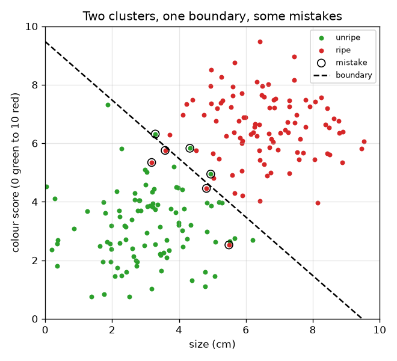
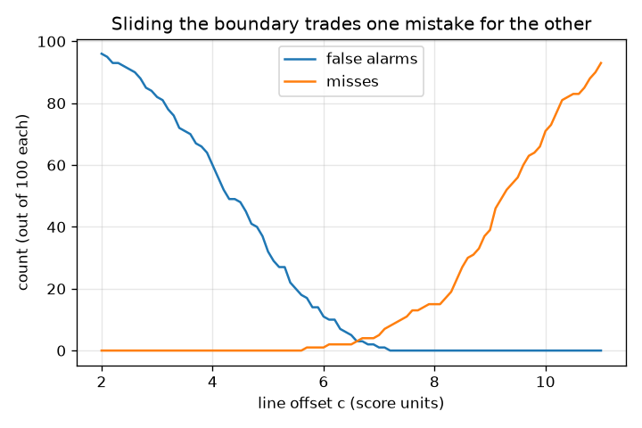

# సెషన్ 1: రెండు సమూహాలను విభజించే ఒక నియమం

[Session 1 — हिन्दी](README.hi.md) · [Session 1 — മലയാളം](README.ml.md) · [Session 1 — தமிழ்](README.ta.md)

*స్థాయి 1 (భావనాత్మక ఇంటరాక్టివ్ నమూనా) · సుమారు 60 నిమిషాలు · openclassifier*

> ఇది విద్య కోసం సరళీకరించిన నమూనా. ఇది ధ్రువీకరించబడిన డిజైన్ సాధనం కాదు; నిజమైన నిర్మాణాలు, విద్యుత్ ఇన్‌స్టలేషన్లు, వాహనాలు, పారిశ్రామిక ప్రక్రియలు లేదా వైద్య నిర్ణయాల కోసం దీనిని ఉపయోగించకూడదు.

**ముందస్తు అవసరాలు (Prerequisites)**

- ఒక స్కాటర్ ప్లాట్ (scatter plot) చదవడం (x అడ్డంగా, y పైకి).
- మీరు PRIMER.md చదివి, `python start.py 1` ఒకసారి రన్ చేశారు.

**అభ్యసన లక్ష్యాలు (Learning objectives).** ఈ సెషన్ తర్వాత మీరు:

- కొలతలను అవును/కాదు నిర్ణయంగా మార్చే నియమంగా వర్గీకరణి (classifier)ని వివరించగలరు.
- రెండు గుంపుల మధ్య ఒక సరళ నిర్ణయ సరిహద్దు (decision boundary)ను గీసి కదిలించగలరు.
- ఒక నియమం యొక్క రెండు రకాల తప్పులు, తప్పుడు హెచ్చరికలు (false alarms) మరియు మిస్‌లు (misses), లెక్కించగలరు.
- సరిహద్దును జరపడం ఒక తప్పును మరొకదానికి ఎలా మారుస్తుందో చూపే గ్రాఫ్‌ను చదవగలరు.

## A. నిజ జీవిత సమస్య
ఒక ప్యాకింగ్ లైన్ పండిన పండ్లను దుకాణానికి పంపి, పండని వాటిని వెనక్కి ఉంచాలి. ఒక కెమెరా ప్రతి పండుకు రెండు సంఖ్యలను కొలుస్తుంది: సెంటీమీటర్లలో దాని పరిమాణం మరియు 0 (ఆకుపచ్చ) నుండి 10 (ముదురు ఎరుపు) వరకు ఒక రంగు స్కోరు. పండినది అంటే ఏమిటో యంత్రానికి ఎవరూ చెప్పరు; మనం దానికి ఒక నియమాన్ని ఇస్తాం. నియమం ఎలా ఉండాలి, దానిని ఎలా గీస్తాం, అది తప్పు జరిగే మార్గాలను ఎలా లెక్కిస్తాం? (కల్పిత డేటాతో సాధారణ విద్య.)

## B. భావన మరియు సిద్ధాంతం
వర్గీకరణి అంటే కొలతలను ఒక తరగతి (class)కి అనుసంధానించే నియమం. ప్రతి పండు ఒక బిందువు (x, y) = (పరిమాణం, రంగు). అత్యంత సరళమైన నియమం ఒక సంఖ్య గురించి ఒక ప్రశ్న అడుగుతుంది: పరిమాణం t కంటే ఎక్కువా? మెరుగైన నియమం రెండు సంఖ్యలనూ కలుపుతుంది: x cos(a) + y sin(a) అనేది c కంటే ఎక్కువైనప్పుడు అది పండును పండినది అంటుంది. సమాధానం మారే బిందువుల సమితి నిర్ణయ సరిహద్దు, ఇక్కడ ఒక సరళ రేఖ; కోణం a రేఖ ఏ వైపుకు తిరిగి ఉందో, c అది మూలబిందువు నుండి ఎంత దూరంలో ఉందో చెబుతాయి. 'పండినది' ని ధనాత్మక తరగతి (positive class) అందాం. ఒక నియమం రెండు వేర్వేరు విధాలుగా తప్పు కావచ్చు: ఒక తప్పుడు హెచ్చరిక (false positive) పండని పండును పండినది అంటుంది, ఒక మిస్ (false negative) పండిన పండును పండనిది అంటుంది. వాటికి సాధారణంగా వేర్వేరు ఖర్చులు ఉంటాయి కాబట్టి వాటిని విడివిడిగా లెక్కిస్తారు. సరిహద్దును పండిన గుంపు వైపు జరపడం తప్పుడు హెచ్చరికలను తొలగిస్తుంది కానీ మిస్‌లను సృష్టిస్తుంది, మరియు వ్యతిరేకంగా కూడా.

| గుర్తు | అర్థం | యూనిట్ |
|---|---|---|
| x | పండు పరిమాణం | cm |
| y | రంగు స్కోరు (0 ఆకుపచ్చ నుండి 10 ఎరుపు వరకు) | స్కోరు యూనిట్లు |
| a | సరిహద్దు లంబ దిశ కోణం | డిగ్రీలు |
| c | మూలబిందువు నుండి సరిహద్దు ఆఫ్‌సెట్ | స్కోరు యూనిట్లు |
| FA | తప్పుడు హెచ్చరికలు: పండినవిగా పిలవబడిన పండని పండ్లు | సంఖ్య |
| miss | పండనివిగా పిలవబడిన పండిన పండ్లు | సంఖ్య |

**ఊహలు (Assumptions)**

- పండ్ల డేటా కల్పితం; నిజమైన పండ్ల గురించి ఎలాంటి వాదన లేదు.
- సరిహద్దు ఒక సరళ రేఖ, సరిగ్గా రేఖపై ఉన్న పండును పండనిది అంటారు.
- రెండు తరగతులు మాత్రమే.

$$ \text{called ripe}\iff x\cos a+y\sin a>c $$

$$ \text{size-only rule}:\ \text{called ripe}\iff x>t $$

$$ \text{accuracy}=\frac{\text{number correct}}{\text{number of fruit}} $$

## C. దృశ్య వివరణ
మొదటి చిత్రం 100 పండని మరియు 100 పండిన పండ్లను ఒక డ్యాష్డ్ సరిహద్దుతో రెండు ఒకదానిపై ఒకటి పడే గుంపులుగా చూపిస్తుంది; నియమం తప్పుగా చెప్పే పండ్లను వలయాలు గుర్తిస్తాయి. రెండవ చిత్రం సరిహద్దు జరుగుతున్నప్పుడు తప్పుడు హెచ్చరికలను మరియు మిస్‌లను లెక్కిస్తుంది: c పెరిగే కొద్దీ తప్పుడు హెచ్చరికలు తగ్గి మిస్‌లు పెరుగుతాయి, c = 6.6 దగ్గర రెండు లెక్కలు సమానం.

*ఒకదానిపై ఒకటి పడే రెండు గుంపులు, ఒక డ్యాష్డ్ సరిహద్దు, నియమం తప్పుగా చెప్పే పండ్ల చుట్టూ వలయాలు.*

*సరిహద్దు జరుగుతున్నప్పుడు తప్పుడు హెచ్చరికలు మరియు మిస్‌లు: ఒకటి తగ్గుతుంటే మరొకటి పెరుగుతుంది.*

## D. ఇంటరాక్టివ్ సిమ్యులేషన్
పాఠాన్ని రన్ చేయండి (`python start.py 1`), తర్వాత లైవ్ యాప్ తెరవండి: [సెషన్ 1: పండ్లను వర్గీకరించండి](https://krunalpanchal1995.github.io/pan-iit-oss/openclassifier/session-01/) (లేదా ఈ ఫోల్డర్‌లోని `app.html`). కోణం మరియు ఆఫ్‌సెట్ స్లైడర్లను కదిలించి డ్యాష్డ్ సరిహద్దును మరియు వలయం గీసిన తప్పులను గమనించండి. ఆఫ్‌సెట్‌కు వ్యతిరేకంగా రెండు లెక్కలను చూడటానికి ట్రేడ్-ఆఫ్ గ్రాఫ్‌కు, నాలుగు ఫలితాలను చూడటానికి టాలీ వ్యూకు మారండి.

**సవాలు.** పన్నెండు పండ్లనూ సరిగ్గా వర్గీకరించే ఒక సరిహద్దును కనుగొనండి (తప్పుడు హెచ్చరికలు మరియు మిస్‌లు లేకుండా).

## E. సాధించిన ఉదాహరణ మరియు ప్రయోగం
**సమస్య.** పన్నెండు పండ్లు: పండనివి (2, 2), (3, 4), (4, 2), (3.5, 6), (5, 3), (6, 4.5) మరియు పండినవి (4.5, 7), (6, 8), (7, 6), (8, 9), (7.5, 4), (5.5, 5.5). a = 45 డిగ్రీలు మరియు c = 7 ఉన్న రేఖను ఉపయోగించండి. ఏ పండ్లు తప్పుగా వర్గీకరించబడ్డాయి, ఖచ్చితత్వం (accuracy) ఎంత?

1. 45 డిగ్రీల వద్ద cos = sin = 0.7071, కాబట్టి నియమం 0.7071 (x + y) > 7, అంటే x + y > 9.899.
2. పండని పండ్ల x + y మొత్తాలు: 4, 7, 6, 9.5, 8, 10.5. 10.5 (పండు (6, 4.5)) మాత్రమే 9.899 కంటే ఎక్కువ, కాబట్టి అది ఒక తప్పుడు హెచ్చరిక.
3. పండిన పండ్ల మొత్తాలు: 11.5, 14, 13, 17, 11.5, 11. అన్నీ 9.899 కంటే ఎక్కువ, కాబట్టి మిస్‌లు లేవు.
4. సరైనవి = 12 - 1 - 0 = 11, కాబట్టి ఖచ్చితత్వం = 11 / 12 = 0.917.

**సమాధానం.** ఒక తప్పుడు హెచ్చరిక (పండు (6, 4.5)), మిస్‌లు లేవు, ఖచ్చితత్వం 0.917.

**ప్రయోగం.** పన్నెండు బిందువులను గ్రాఫ్ కాగితంపై గుర్తించండి, x + y = 9.9 రేఖపై ఒక స్కేలు ఉంచి, తప్పు వైపు ఉన్న బిందువులను లెక్కించండి; అదే ఒక్క పండును మీరు కనుగొనాలి. నమూనా వర్సెస్ వాస్తవం: నిజమైన పండ్లు పన్నెండు శుభ్రమైన బిందువులు కావు, పక్వత అనేది ఖచ్చితంగా కొలవగల సంఖ్య కాదు, కెమెరా శబ్దాన్ని (noise) జోడిస్తుంది, కాబట్టి నిజమైన రేఖ ఈ బొమ్మ రేఖ కంటే ఎక్కువ తప్పులు చేస్తుంది.

## F. మూల్యాంకనం మరియు డిజైన్ సవాలు
**ప్రశ్న రకం A: భావనాత్మక.** కేవలం 'తప్పులు' లెక్కించడానికి బదులు తప్పుడు హెచ్చరికలను మరియు మిస్‌లను విడివిడిగా ఎందుకు లెక్కిస్తాం? ఒకటి మరొకదాని కంటే చెడ్డదైన ఉదాహరణ ఇవ్వండి.

సూచన

ప్రతి తప్పు ప్యాకింగ్ లైన్‌కు ఎంత ఖర్చవుతుందో ఆలోచించండి.

దశలవారీ పరిష్కారం

రెండూ తప్పుడు నిర్ణయాలే, కానీ వాటి ఖర్చులు వేరు. పండని పండును దుకాణానికి పంపడం (తప్పుడు హెచ్చరిక) కస్టమర్ నమ్మకాన్ని కోల్పోయేలా చేస్తుంది; పండిన పండును వెనక్కి ఉంచడం (మిస్) ఒక మంచి పండును వృథా చేస్తుంది. పొగ అలారానికి ఒక మిస్ (మంట, అలారం లేదు) తప్పుడు హెచ్చరిక కంటే చాలా చెడ్డది. మొత్తం తప్పుల సంఖ్య దీనిని దాచిపెడుతుంది, కాబట్టి మనం రెండింటినీ నివేదిస్తాం.

**ప్రశ్న రకం B: సంఖ్యాత్మక.** సాధించిన ఉదాహరణలోని పన్నెండు పండ్లకు, 'పరిమాణం > 5 అయితే పండినది' అనే పరిమాణం-మాత్రమే నియమాన్ని ఉపయోగించండి (అంటే a = 0 డిగ్రీలు, c = 5). తప్పుడు హెచ్చరికలు, మిస్‌లు మరియు ఖచ్చితత్వాన్ని లెక్కించండి.

సూచన

పండని మరియు పండిన పండ్ల పరిమాణాలను జాబితా చేసి ఏవి 5 కంటే ఎక్కువో గుర్తించండి.

దశలవారీ పరిష్కారం

పండని వాటి పరిమాణాలు: 2, 3, 4, 3.5, 5, 6; 6 మాత్రమే 5 కంటే ఎక్కువ, కాబట్టి 1 తప్పుడు హెచ్చరిక (సరిగ్గా 5 పరిమాణం 5 కంటే ఎక్కువ కాదు). పండిన వాటి పరిమాణాలు: 4.5, 6, 7, 8, 7.5, 5.5; 4.5 మాత్రమే 5 కంటే ఎక్కువ కాదు, కాబట్టి 1 మిస్. సరైనవి = 12 - 2 = 10, ఖచ్చితత్వం = 10 / 12 = 0.833. సరిచూపు: రంగును కూడా ఉపయోగించడం (45 డిగ్రీల రేఖ) కేవలం 1 తప్పుతో మెరుగ్గా పనిచేసింది.

**ప్రశ్న రకం C: గ్రాఫ్ మరియు సిమ్యులేషన్ వ్యాఖ్యానం.** 45 డిగ్రీల సరిహద్దుతో 200 యాదృచ్ఛిక పండ్ల ట్రేడ్-ఆఫ్ గ్రాఫ్‌లో, ఆఫ్‌సెట్ c 2 నుండి 11 కి పెరిగినప్పుడు రెండు లెక్కలకు ఏమి జరుగుతుంది? అవి ఎక్కడ ఖండించుకుంటాయి?

సూచన

పెద్ద c రేఖను పండిన గుంపు వైపు జరుపుతుంది.

దశలవారీ పరిష్కారం

తక్కువ పండ్లను పండినవిగా పిలవడం వల్ల తప్పుడు హెచ్చరికలు స్థిరంగా తగ్గుతాయి (c = 2 వద్ద 96, 0 మిస్‌లతో), మిస్‌లు 0 నుండి పెరుగుతాయి. వక్రాలు c = 6.6 దగ్గర ఖండించుకుంటాయి, అక్కడ రెండు లెక్కలు దాదాపు సమానం. c = 6.7 వద్ద నియమం 200 లో 3 తప్పుడు హెచ్చరికలు మరియు 4 మిస్‌లు చేస్తుంది.

**ప్రశ్న రకం D: డిజైన్ మరియు ఆప్టిమైజేషన్ సవాలు.** డిజైన్: ఒక తప్పుడు హెచ్చరిక (షెల్ఫ్‌పై పండని పండు) ఒక మిస్ కంటే చెడ్డదని దుకాణం చెబుతుంది. సరిహద్దును c = 6.7 కి ఎడమకా కుడికా జరపాలా? మీరు ఏమి వదులుకుంటారు? ఎంత దూరం అని ఎలా నిర్ణయిస్తారు?

సూచన

ట్రేడ్-ఆఫ్ వక్రాలను ఉపయోగించండి: ప్రతి లెక్క ఏ వైపుకు కదులుతుంది?

దశలవారీ పరిష్కారం

కుడికి జరపండి (పెద్ద c): తక్కువ తప్పుడు హెచ్చరికలు, ఎక్కువ మిస్‌ల ఖర్చుతో, ఇక్కడ దాని అర్థం ఎక్కువ పండిన పండ్లు వెనక్కి ఉంచబడతాయి. ఎంత దూరం అని నిర్ణయించడానికి, ప్రతి తప్పుకు ఒక ఖర్చు ఇవ్వండి (ఉదాహరణకు తప్పుడు హెచ్చరికకు 3, మిస్‌కు 1), c అక్షం వెంట 3 x FA + 1 x miss లెక్కించి అత్యల్ప బిందువును తీసుకోండి. ఊహ: నమూనా నిజమైన లైన్‌కు సాధారణ ప్రతినిధి; 200 పండ్లు మాత్రమే ఉన్నందున ఖచ్చితమైన ఉత్తమ c అనిశ్చితం.

[RUBRIC.md](../../RUBRIC.md) తో మిమ్మల్ని మీరు స్కోర్ చేసుకోండి. కాగితంపై పని చేయడానికి [కార్యాచరణ పత్రం](activity_sheet.md) ప్రింట్ చేయండి.

## సాధారణ అపోహలు
| సాధారణ అపోహ | నిజానికి ఏది సరైనది |
|---|---|
| ఏ రకమైనవైనా అతి తక్కువ తప్పులు చేసేదే ఉత్తమ వర్గీకరణి. | అది ప్రతి తప్పు ఖర్చుపై ఆధారపడి ఉంటుంది. ఒకే మొత్తం ఉన్న రెండు నియమాలకు చాలా భిన్నమైన తప్పుడు హెచ్చరికలు మరియు మిస్‌లు ఉండవచ్చు. |
| నిర్ణయ సరిహద్దు అనేది డేటాలో ఉండే విషయం. | అది నియమం చేసే ఎంపిక. వేర్వేరు నియమాలు అవే బిందువుల గుండా వేర్వేరు సరిహద్దులను గీస్తాయి. |
| ఒక లక్షణం (feature) మంచిదైతే అది సరిపోతుంది. | పరిమాణాన్ని మాత్రమే ఉపయోగించడం 200 పండ్లలో 22 తప్పులు చేసింది; రంగును జోడించడం దానిని 7 కి తగ్గించింది. |

## పదకోశం
- **వర్గీకరణి (classifier)**: కొలతలను ఒక తరగతి లేబుల్‌గా మార్చే నియమం
- **నిర్ణయ సరిహద్దు (decision boundary)**: నియమం సమాధానం మారే బిందువుల సమితి
- **తప్పుడు హెచ్చరిక (false positive)**: రుణాత్మక కేసును ధనాత్మకమని చెప్పడం
- **మిస్ (false negative)**: ధనాత్మక కేసును రుణాత్మకమని చెప్పడం
- **ఖచ్చితత్వం (accuracy)**: నియమం సరిగ్గా చెప్పే కేసుల భిన్నం

## ముగింపు
1. [exercises.md](exercises.md) లోని మూడు కోడింగ్ పనులు చేయండి.
2. మీ మార్పుల తర్వాత `python start.py 1` మళ్లీ రన్ చేయండి. అది చెక్‌పాయింట్‌తో ముగుస్తుంది; అది `PASS` అని ప్రింట్ చేసినప్పుడు మీరు పూర్తి చేశారు. (చెక్‌పాయింట్ మాత్రమే: `python start.py check 1`.)

తర్వాత: [సెషన్ 2](../session-02/README.md)
