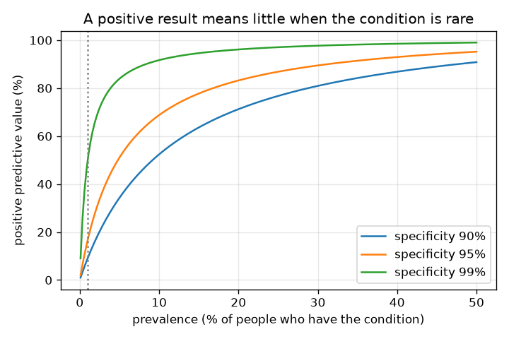
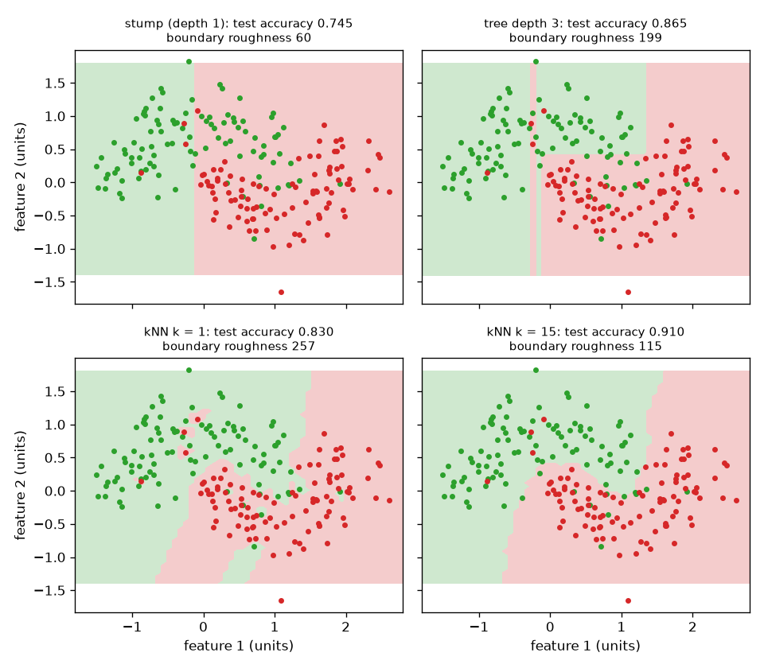
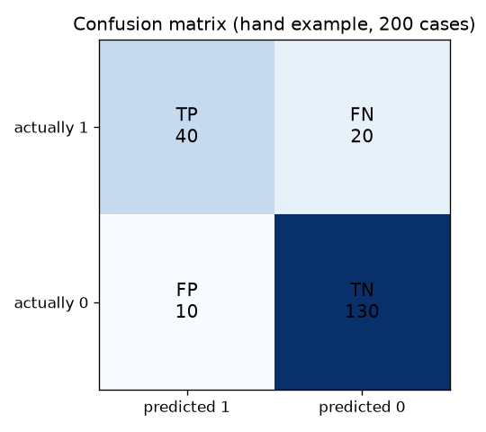

# Session 2: Trees, neighbours and the confusion matrix

*Level 2 (mathematical engineering model) · about 90 minutes · openclassifier*

> This is a simplified educational model. It is not a validated design tool and must not be used for real structures, electrical installations, vehicles, industrial processes or medical decisions.

**Prerequisites**

- Session 1: boundaries, false alarms and misses.
- Fractions and percentages; the idea of probability as a fraction.

**Learning objectives.** After this session you can:

- Compute Gini impurity and find the best split of a node with a search written in NumPy.
- Build a small decision tree and a k-nearest-neighbour classifier and see how k and depth change the boundary.
- Fill a confusion matrix and compute accuracy, precision, recall and F1 from scratch.
- Use Bayes' rule to explain why a rare condition makes most positive results false, and choose a threshold for given costs.

## A. Real-world problem
A screening test for a rare condition is described as 'more than 99 percent reliable'. You test positive. How worried should you be? Surprisingly, the honest answer can be 'about one chance in six', and the reason is not the test but how rare the condition is. To see why, we need a classifier that outputs a decision, a table that counts its four outcomes, and Bayes' rule. (General education only, with made-up numbers: never personal medical advice.)

## B. Concept and theory
A decision tree classifies by asking a chain of yes/no questions of the form 'is feature j at most t?'. Which question? The one that makes the two resulting groups as pure as possible. For a group with a fraction p1 of class 1 and p0 = 1 - p1 of class 0, the Gini impurity is 1 - p0^2 - p1^2: 0 for a pure group and 0.5 for a 50/50 group. A split is scored by the weighted Gini of the two halves, and the best split is found by trying every feature and every midpoint between sorted values. Repeat inside each half down to a maximum depth; a depth-1 tree is a stump. k nearest neighbours keeps all the training points and votes among the k closest ones to a new point: small k gives a ragged boundary, large k a smooth one. The confusion matrix counts true positives (TP), false positives (FP), false negatives (FN) and true negatives (TN). Accuracy = (TP + TN) / total, precision = TP / (TP + FP) (of those flagged, how many were right), recall = TP / (TP + FN) (of the real positives, how many were found), and F1 = 2 TP / (2 TP + FP + FN), the harmonic mean of precision and recall. For a test with sensitivity (recall on positives) and specificity (rate of correct negatives) applied to a population with prevalence q, Bayes' rule gives the positive predictive value PPV = q sens / (q sens + (1 - q)(1 - spec)). When mistakes cost different amounts, give a score and call a case positive at or above a threshold; if the score were the true probability p, calling positive is cheaper when p is above c_fp / (c_fp + c_fn).

| Symbol | Meaning | Unit |
|---|---|---|
| p1 | fraction of class 1 in a group | no unit |
| G | Gini impurity of a group | no unit |
| k | number of neighbours in the vote | count |
| TP, FP, FN, TN | confusion matrix counts | count |
| q | prevalence: fraction of the population that has the condition | no unit |
| sens, spec | sensitivity and specificity of the test | no unit |
| c_fn, c_fp | cost of a miss and of a false alarm | cost units |

**Assumptions**

- Two classes and two numeric features in the tree and neighbour demos.
- Training and test data are drawn from the same synthetic distribution.
- Sensitivity and specificity do not depend on who is tested.
- Costs are made-up numbers, not real prices.

$$ G = 1 - p_0^2 - p_1^2 $$

$$ G_{\text{split}} = \frac{n_L\,G_L + n_R\,G_R}{n_L+n_R} $$

$$ \text{precision}=\frac{TP}{TP+FP},\quad \text{recall}=\frac{TP}{TP+FN},\quad F_1=\frac{2TP}{2TP+FP+FN} $$

$$ \text{PPV}=\frac{q\cdot\text{sens}}{q\cdot\text{sens}+(1-q)(1-\text{spec})} $$

$$ \text{call positive when } p>\frac{c_{fp}}{c_{fp}+c_{fn}} $$

## C. Visual explanation
The first figure shows four classifiers on the same curved two-moon data: a stump (a single straight cut), a depth-3 tree (rectangular blocks), k = 1 (a ragged boundary that wraps every point) and k = 15 (a smooth boundary). The second figure is the confusion matrix of a hand example as a heat map. The third plots the positive predictive value against prevalence for three specificities: every curve is low on the left, where the condition is rare, and rises as it becomes common.

*Positive predictive value against prevalence for three specificities: rare conditions give low PPV.*

*The same curved data with a stump, a depth-3 tree, k = 1 and k = 15; the title gives test accuracy and boundary roughness.*

*A hand-worked confusion matrix as a heat map (TP 40, FN 20, FP 10, TN 130).*

## D. Interactive simulation
Run the lesson (`python start.py 2`), then open the live app: [Session 2: the base-rate trap](https://krunalpanchal1995.github.io/pan-iit-oss/openclassifier/session-02/) (or `app.html` in this folder). Set the prevalence, sensitivity and specificity sliders. In the first view see the bar of everyone who tests positive split into true and false positives; in the second see the PPV curve against prevalence and watch the red dot move.

**Challenge.** Make a positive result more likely right than wrong (a positive predictive value of at least 50 percent).

## E. Worked example and experiment
**Problem.** A condition has prevalence 1 percent. The test has sensitivity 99 percent and specificity 95 percent. Of 10000 people tested, how many test positive, and what fraction of those truly have the condition?

1. Have the condition: 1 percent of 10000 = 100 people. The test finds 99 percent of them: TP = 99, FN = 1.
2. Do not have it: 9900 people. The test wrongly flags 5 percent of them: FP = 0.05 x 9900 = 495, and TN = 9900 - 495 = 9405.
3. Everyone who tests positive: 99 + 495 = 594 people.
4. PPV = 99 / 594 = 0.1667, about 16.7 percent. By Bayes: 0.01 x 0.99 / (0.01 x 0.99 + 0.99 x 0.05) = 0.0099 / 0.0594 = 0.1667. The two methods agree.
5. The overall accuracy is (99 + 9405) / 10000 = 95.04 percent, yet five of every six positives are false alarms.

**Answer.** 594 people test positive, only 99 of them truly have the condition: PPV = 16.7 percent.

**Experiment.** Take a deck of 100 cards and mark one as 'sick'. A friend plays the test: they say 'positive' for the sick card always, and for each of the other 99 cards they roll a 20-sided die and say 'positive' on a 1 (a 5 percent false-alarm rate). Repeat 50 times and count positives that were the sick card. You will see most positives are false. Model versus reality: real tests have sensitivity and specificity that depend on the person and the setting, and prevalence is rarely known exactly, so PPV is an estimate, not a diagnosis.

## F. Assessment and design challenge
**Question type A: Conceptual.** A friend says: 'The test is 95 percent accurate, so a positive result means a 95 percent chance of having the condition.' What is wrong with this?

Hint

Compare accuracy, specificity and positive predictive value.

Step-by-step solution

Accuracy, sensitivity and specificity describe how the test behaves on people whose true state is known. A positive result asks the reverse question: given the test result, what is the true state? That is the PPV, and it depends on prevalence as well. With 1 percent prevalence the PPV is 16.7 percent even though the overall accuracy is 95.04 percent.

**Question type B: Numerical.** A classifier produces TP = 40, FP = 10, FN = 20 and TN = 130 on 200 cases. Compute accuracy, precision, recall and F1.

Hint

Total = 200. Use the four formulas in Section B.

Step-by-step solution

Accuracy = (40 + 130) / 200 = 0.85. Precision = 40 / 50 = 0.8. Recall = 40 / 60 = 0.667. F1 = 2 x 40 / (2 x 40 + 10 + 20) = 80 / 110 = 0.727. Sanity check: F1 lies between precision and recall.

**Question type C: Graph and simulation interpretation.** On the PPV graph at prevalence 1 percent, what PPV do specificities of 90, 95 and 99 percent give (sensitivity 99 percent)? At what prevalence does a 95 percent specificity reach a PPV above 80 percent?

Hint

Read the three curves at the x value 1; use the PPV formula to check.

Step-by-step solution

At 1 percent prevalence the PPV is 9.1 percent for specificity 90 percent, 16.7 percent for 95 percent and 50 percent for 99 percent. At 20 percent prevalence a specificity of 95 percent gives a PPV of 83 percent, so the curve passes 80 percent a little below a prevalence of 20 percent. The lesson: improving specificity helps most when the condition is rare.

**Question type D: Design and optimisation challenge.** Design: a miss costs 10 units and a false alarm costs 1 unit. You have a classifier that gives scores between 0 and 1. Why should the threshold be below 0.5, how low would the theory put it if the scores were true probabilities, and how should you choose it in practice?

Hint

Compare the expected cost of saying positive with that of saying negative; then think about which data you may use to choose.

Step-by-step solution

For a case with true probability p, saying positive costs (1 - p) x 1 and saying negative costs p x 10; positive is cheaper when p > 1 / 11 = 0.0909. Real scores are not perfect probabilities, so search the thresholds on a separate validation set. In the code, a threshold of 4/15 = 0.267 for a k = 15 neighbour classifier gave a test cost of 55, against 90 at the default 0.5. Trade-off: a low threshold buys fewer misses with more false alarms. Assumption: the costs are right and the validation set resembles future cases.

Score yourself with [RUBRIC.md](../../RUBRIC.md). Print the [activity sheet](activity_sheet.md) to work on paper.

## Common misconceptions
| Common misconception | What is actually true |
|---|---|
| A test that is 99 percent accurate is right 99 percent of the time it says positive. | That needs the prevalence. A rare condition makes most positives false even for an excellent test. |
| A smaller k always gives a better classifier because it fits the data more closely. | k = 1 fits every training point and gives a ragged boundary; on the test data k = 15 was better (0.910) than k = 1 (0.830). |
| Precision and recall measure the same thing. | Precision asks about the cases flagged; recall asks about the real positives. A classifier can have one high and the other low. |
| The threshold 0.5 is always right. | It is right only when both mistakes cost the same and the scores are calibrated. |

## Glossary
- **Gini impurity**: 1 - p0^2 - p1^2: 0 for a pure group, 0.5 for a 50/50 group
- **stump**: a decision tree with one split
- **confusion matrix**: a table of true and false positives and negatives
- **precision**: TP / (TP + FP): how many flagged cases are real
- **recall (sensitivity)**: TP / (TP + FN): how many real cases are found
- **specificity**: TN / (TN + FP): how many healthy cases are cleared
- **PPV**: positive predictive value: the chance a positive result is a true case
- **prevalence**: the fraction of a population that has the condition

## Finish
1. Do the three coding tasks in [exercises.md](exercises.md).
2. Run `python start.py 2` again after your changes. It ends with the checkpoint; when it prints `PASS`, you are done. (Checkpoint only: `python start.py check 2`.)

Next: [Session 3](../session-03/README.md)
