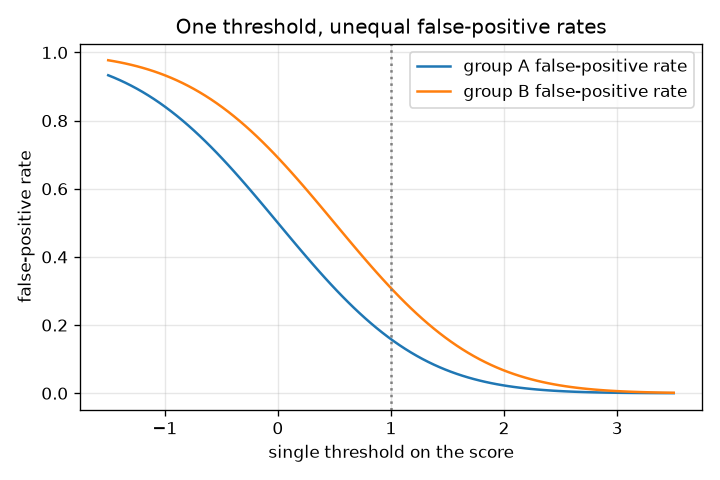
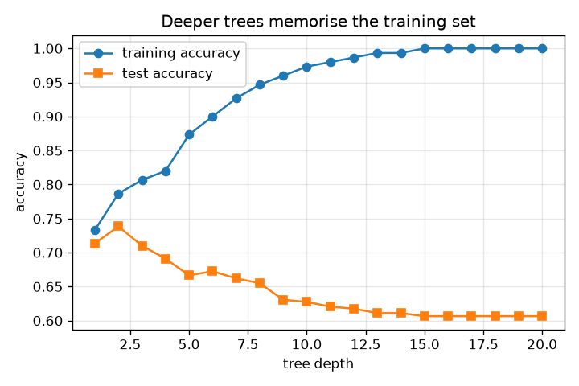
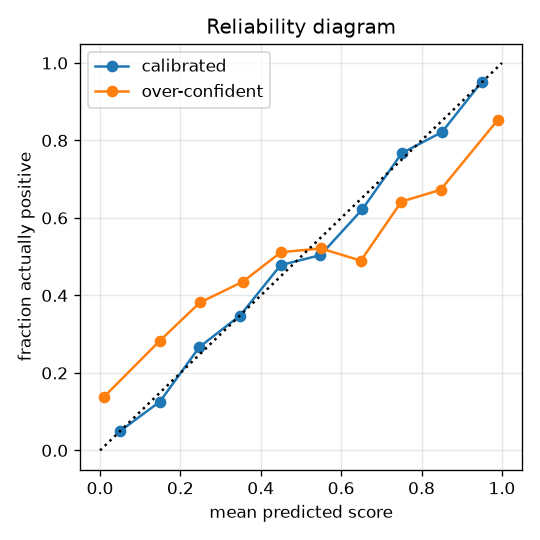
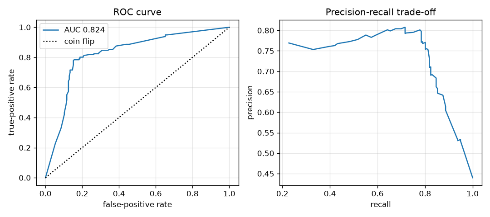

# Session 3: Judging a classifier honestly

*Level 3 (simulation and validation) · about 90 minutes · openclassifier*

> This is a simplified educational model. It is not a validated design tool and must not be used for real structures, electrical installations, vehicles, industrial processes or medical decisions.

**Prerequisites**

- Session 2: confusion matrix, trees, thresholds.
- Averages and the idea of a probability distribution (the bell curve).

**Learning objectives.** After this session you can:

- Build a ROC curve and AUC from scores, and verify that AUC is the probability that a random positive outranks a random negative.
- Show with measurements that a forest of bagged trees is more stable than one tree, and that deeper trees overfit.
- Write k-fold cross-validation and use it to estimate accuracy on unseen data.
- Compare error rates across two groups and demonstrate data leakage and the accuracy paradox as failure cases.

## A. Real-world problem
A model that scores 100 percent on its own training data can fail on new cases; a model can be accurate overall while flagging one group of people far more often than another; and a model can look brilliant only because of a bookkeeping slip. How do we judge a classifier honestly? The tools are held-out data, the ROC curve, cross-validation, group-wise error rates, and a habit of asking how a number could be fooling us. (All data are synthetic; nothing here says anything about real people.)

## B. Concept and theory
Most classifiers output a score and call a case positive at or above a threshold. Lower the threshold and the true-positive rate TPR = TP / (TP + FN) rises, but so does the false-positive rate FPR = FP / (FP + TN). The ROC curve plots TPR against FPR for every threshold; the area under it (AUC) equals the probability that a randomly chosen positive case scores higher than a randomly chosen negative case (ties count one half). A random forest averages many trees, each grown on a bootstrap sample (n cases drawn with replacement) and combined by majority vote; individual trees are unstable but their vote is steadier. A deeper tree can memorise noise: its training accuracy rises to 100 percent while accuracy on new data falls. K-fold cross-validation shuffles the cases into k folds and, for each fold, trains on the rest and tests on that fold, so every case is tested once. A score is calibrated if, among cases scored near 0.7, about 70 percent are positive. For fairness, compare error rates by group: if group B's scores are all shifted up by s but the ranking inside each group is the same, then with one threshold t the false-positive rates are 1 - Phi(t) and 1 - Phi(t - s), different even though AUC is equal. Two failure cases: leakage (using test data when scaling or choosing features inflates accuracy) and class imbalance (accuracy hides a useless classifier when positives are rare).

| Symbol | Meaning | Unit |
|---|---|---|
| TPR | true-positive rate (recall) | no unit |
| FPR | false-positive rate | no unit |
| AUC | area under the ROC curve | no unit |
| t | decision threshold on the score | score units |
| d | separation between class centres, in score spreads | no unit |
| s | upward shift of group B's scores | score units |
| Phi | the standard normal cumulative distribution function | no unit |
| k | number of cross-validation folds | count |

**Assumptions**

- All data are synthetic; the fairness demo says nothing about real people or real systems.
- Scores in the group demo are normal with spread 1: negatives centred at 0, positives at d.
- Bootstrap bagging only; real random forests also pick random feature subsets at each split.
- Test data are never used to build the model, except in the deliberate leakage demo.

$$ \text{TPR}=\frac{TP}{TP+FN},\qquad \text{FPR}=\frac{FP}{FP+TN} $$

$$ \text{AUC}=\int_0^1 \text{TPR}\,d(\text{FPR})=P\big(\text{score}_{+}>\text{score}_{-}\big) $$

$$ \text{FPR}_A=1-\Phi(t),\qquad \text{FPR}_B=1-\Phi(t-s),\qquad \text{TPR}_g=1-\Phi(t-s_g-d) $$

$$ \text{AUC}=\Phi\!\left(\frac{d}{\sqrt{2}}\right) $$

## C. Visual explanation
The first figure shows a ROC curve (with the diagonal for a coin flip) and a precision-recall curve for the same scores: moving along the ROC curve trades false alarms for catches, and precision falls as recall rises. The second figure plots training and test accuracy against tree depth: the training curve climbs to 1.0 while the test curve peaks at depth 2 and then falls. The third is a reliability diagram: honest probabilities hug the diagonal, over-confident ones bend away from it. The fourth shows the false-positive rate of two groups against one threshold: the curves are parallel but apart.

*One threshold, two groups: the false-positive rate curves are parallel but apart.*

*Training accuracy climbs to 1.0 while test accuracy peaks at depth 2 and then falls.*

*Reliability diagram: honest probabilities follow the diagonal, over-confident ones do not.*

*ROC curve (left) and precision-recall curve (right) from the same scores.*

## D. Interactive simulation
Run the lesson (`python start.py 3`), then open the live app: [Session 3: one threshold, two groups](https://krunalpanchal1995.github.io/pan-iit-oss/openclassifier/session-03/) (or `app.html` in this folder). Slide the threshold and watch both groups' operating points move along one ROC curve; open the rates view and the per-1000 confusion matrices, then raise the shift and see the gap in false-positive rates grow.

**Challenge.** Make the false-positive rates of the two groups differ by at most 0.05 while group A's true-positive rate stays at least 0.6.

## E. Worked example and experiment
**Problem.** Four cases have scores 0.1, 0.4, 0.35, 0.8 and true labels 0, 0, 1, 1. Build the ROC curve and compute the AUC by area and as a probability.

1. Sort by score, highest first: 0.8 (positive), 0.4 (negative), 0.35 (positive), 0.1 (negative). There are 2 positives and 2 negatives.
2. Lower the threshold past each score and update (FPR, TPR): start (0, 0); after 0.8 -> (0, 0.5); after 0.4 -> (0.5, 0.5); after 0.35 -> (0.5, 1); after 0.1 -> (1, 1).
3. Area under the curve by trapezoids: 0 + 0.5 x 0.5 + 0 + 0.5 x 1 = 0.25 + 0.5 = 0.75.
4. Pairs (positive, negative): 0.35 > 0.1 yes, 0.35 > 0.4 no, 0.8 > 0.1 yes, 0.8 > 0.4 yes: 3 of 4 pairs, probability 0.75. The two methods agree.

**Answer.** AUC = 0.75, both from the area under the ROC curve and as the probability that a random positive outranks a random negative.

**Experiment.** Write each case's score on a card, shuffle, and repeatedly draw one positive and one negative card; count how often the positive card has the higher score. After 100 draws you should be near 0.75. Model versus reality: real scores come from a model fitted to finite data, so a ROC curve measured on a small test set is itself uncertain (a bootstrap interval would show how much).

## Real-world application and mini-project: Choose a model and a threshold for a synthetic screening problem
A clinic-style screening problem, entirely synthetic: 5 percent of cases are positive, a miss costs 20 units and a false alarm costs 1 unit. Use `make_screening`, `grow_tree`, `fit_forest`, `pick_threshold` and `cost_and_confusion` from Session 3. For each of three models (a depth-3 tree, a depth-8 tree and a 25-tree forest of depth 6), choose the threshold that minimises the cost on a validation set, then report the confusion matrix and the cost on a separate test set. General education only: this is not a medical tool.

**Deliverable:** A script that prints, for each model, the chosen threshold, the validation cost, the test cost and the test confusion matrix (TP, FP, FN, TN), names the model you would pick, and saves a bar chart of the test costs next to the cost of flagging nobody.

**Success looks like:** The test set holds 115 positives, so flagging nobody costs 2300. The forest is picked with a test cost of 1230 and confusion matrix (TP, FP, FN, TN) = (76, 450, 39, 2435); the depth-3 tree costs 1360 and the depth-8 tree costs 1685, which shows overfitting. Your write-up says why the threshold is chosen on validation data and not on test data.

## F. Assessment and design challenge
**Question type A: Conceptual.** Why can training accuracy reach 100 percent while test accuracy falls as a tree gets deeper? Why does a forest of trees help?

Hint

Think about what a leaf holding a single noisy case has learned.

Step-by-step solution

A deep tree keeps splitting until every leaf is pure, so it memorises the training labels, including the noise from flipped labels; that memorised noise does not repeat in new data. A single tree is also unstable: a different training set gives a very different tree. A forest averages many trees grown on bootstrap samples, so the wobble of individual trees partly cancels, and predictions change less from one training set to the next.

**Question type B: Numerical.** Group B's scores are shifted up by 0.5 relative to group A, negatives are centred at 0 and the threshold is 1.0. Compute each group's false-positive rate with Phi(1) = 0.8413 and Phi(0.5) = 0.6915.

Hint

FPR_A = 1 - Phi(t) and FPR_B = 1 - Phi(t - s).

Step-by-step solution

FPR_A = 1 - Phi(1.0) = 1 - 0.8413 = 0.1587. FPR_B = 1 - Phi(1.0 - 0.5) = 1 - Phi(0.5) = 1 - 0.6915 = 0.3085. Group B's false-positive rate is about twice group A's. Sanity check: shifting B's scores up pushes more of its negatives over the threshold.

**Question type C: Graph and simulation interpretation.** In the overfitting figure, which depth would you choose and why? What does the gap between the two curves tell you?

Hint

Never choose by training accuracy; read the test curve.

Step-by-step solution

Choose depth 2, where test accuracy peaks (0.7385). Beyond it the training accuracy keeps rising (100 percent by depth 15) while test accuracy falls to 0.6065 at depth 20. The widening gap between the curves is the overfitting. In practice you would pick the depth by cross-validation on the training data, not by looking at the test set.

**Question type D: Design and optimisation challenge.** Design: a screening problem has 5 percent positives; a miss costs 20 and a false alarm costs 1. You may choose a depth-3 tree, a depth-8 tree or a 25-tree forest and a threshold. Which would you pick and how do you justify it?

Hint

Choose the threshold on a validation set for each model, then compare the models on a separate test set.

Step-by-step solution

For each model pick the cheapest threshold on the validation set, then measure the cost on the test set. On the shipped data the test costs are 1360 (depth 3), 1685 (depth 8) and 1230 (forest), against 2300 for flagging nobody. Pick the forest: the deeper single tree overfits and costs more. Its confusion matrix (TP, FP, FN, TN) is (76, 450, 39, 2435): it accepts many false alarms because they are 20 times cheaper than misses. Assumptions: the costs are right and future data look like the test set.

Score yourself with [RUBRIC.md](../../RUBRIC.md). Print the [activity sheet](activity_sheet.md) to work on paper.

## Common misconceptions
| Common misconception | What is actually true |
|---|---|
| High accuracy means a good classifier. | With 1 percent positives, always answering 'negative' is 99 percent accurate and finds no positive at all (recall 0). |
| Choosing features on all the data and then cross-validating is fine. | That is leakage: on pure noise it reads 0.825 accuracy against 0.452 when features are chosen inside each fold; the true value is 0.5. |
| If AUC is the same for two groups, the classifier treats them equally. | AUC only measures ranking inside a group. One shared threshold can still give very different false-positive rates. |
| A random forest has no overfitting problem. | It reduces the instability of single trees but can still overfit; always judge it on held-out data. |

## Glossary
- **ROC curve**: true-positive rate against false-positive rate over all thresholds
- **AUC**: area under the ROC curve; the chance a random positive outranks a random negative
- **bootstrap sample**: n cases drawn with replacement from n cases
- **random forest**: many trees grown on bootstrap samples, combined by majority vote
- **overfitting**: fitting the training data's noise, so new data are predicted worse
- **cross-validation**: testing on each of k held-out folds in turn
- **calibration**: scores that match the real fraction of positives
- **data leakage**: using information from test cases while building the model
- **accuracy paradox**: high accuracy from a classifier that ignores the rare class

## Finish
1. Do the three coding tasks in [exercises.md](exercises.md).
2. Run `python start.py 3` again after your changes. It ends with the checkpoint; when it prints `PASS`, you are done. (Checkpoint only: `python start.py check 3`.)

Next: [Session 4: Tune the forest by cross-validation](../session-04/README.md).
