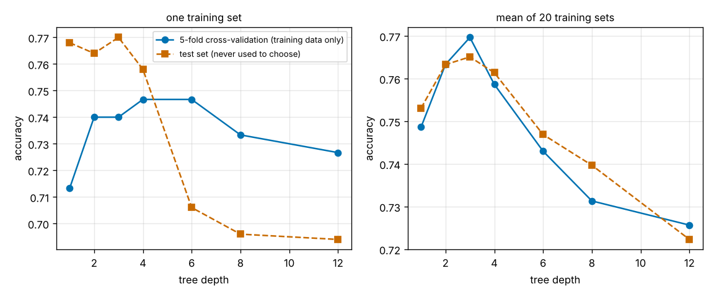
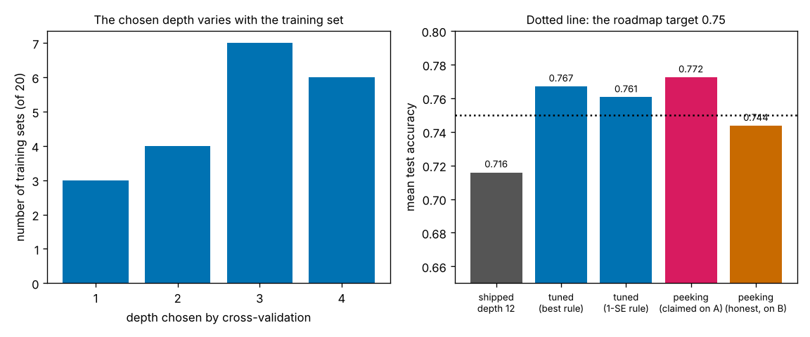
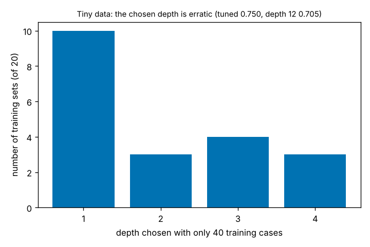

# Session 4: Tune the forest by cross-validation

*Level 3 (simulation and validation) · about 90 minutes · openclassifier*

> This is a simplified educational model. It is not a validated design tool and must not be used for real structures, electrical installations, vehicles, industrial processes or medical decisions.

**Prerequisites**

- Session 3: the forest, the depth curve and k-fold cross-validation.
- Mean, standard deviation and standard error (explained in Section B).

**Learning objectives.** After this session you can:

- Choose a hyperparameter (the tree depth) by k-fold cross-validation on the training data only, keeping the test set locked until the choice is made.
- Add random feature subsets to a bagged forest and tune it with a grid over depth.
- Compare two choice rules (best score, one standard error) and report the gain over the shipped forest with an error bar.
- Measure the optimism of peeking and of the best cross-validation score with a fresh test set.
- Recognise the failure cases: tiny data, an invalid k, and a test set that is an easy draw.

## A. Real-world problem
In Session 3 the forest of depth 12 scored 0.716 on new cases, and the depth curve showed that a shallow tree does better. So choose the depth that scores best, no? Not on the test set: if the setting that scores best on the test set is the one you keep, the test set has helped build the model, and its score is no longer an honest forecast of future cases. Students ask how to choose the tree depth without peeking at the test set. Today we choose the depth with k-fold cross-validation on the training data only, add random feature subsets at each split, and measure two things: what the choice buys (accuracy) and what it cannot promise (the size of the error bar of a 500-case test set). All data are synthetic, and nothing here says anything about real people.

## B. Concept and theory
A **parameter** is learned from the data (a threshold in a tree); a **hyperparameter** is a setting chosen before learning (the depth). Hyperparameters need a third kind of data. The training set fits the model; the test set judges the final model once; and the choice of hyperparameter needs its own judge that is neither of those. Cross-validation provides it from the training data: cut the training cases into k folds, and for each depth train on k - 1 folds and score on the fold held out, rotating. The k scores of a depth give a mean and a standard error SE = s / sqrt(k), where s is their standard deviation. The **best rule** takes the depth with the highest mean (the shallower on a tie). The **one-standard-error rule** takes the shallowest depth whose mean is within one SE of the best, because scores that close cannot be told apart and simpler is safer. A real random forest also draws a random subset of the features at each split; here with two features one feature is drawn per split. Every measured accuracy has a sampling error: for p measured on n cases the standard error is sqrt(p (1 - p) / n), which is 0.019 for 500 cases. Finally the best of several noisy scores is biased upwards (a maximum is bigger than a typical value), so the winning score is optimistic. The remedy is to report the test score of the final model, measured once on cases that played no part in the choice, with its error bar.

| Symbol | Meaning | Unit |
|---|---|---|
| k | number of folds | no unit |
| a_d,i | accuracy of depth d on held-out fold i | no unit |
| mean, SE | mean fold score and its standard error | no unit |
| p, n | accuracy and number of test cases | no unit and count |
| max_features | features examined at each split | count |

**Assumptions**

- Synthetic data as in Session 3: two overlapping classes in 2D and 15 percent of the labels flipped.
- A forest of 25 bagged trees; one feature drawn per split; folds cut with a fixed seed.
- The test sets (A with 500 cases, B with 500 fresh cases) are independent draws from the same source.

$$ \bar a_d=\frac1k\sum_{i=1}^{k}a_{d,i},\qquad \mathrm{SE}_d=\frac{s_d}{\sqrt k},\qquad d^\ast_{\text{one-SE}}=\min\{d:\ \bar a_d\ge \max_{d'}\bar a_{d'}-\mathrm{SE}_{\text{best}}\} $$

$$ \mathrm{SE}(\text{accuracy})=\sqrt{\frac{p\,(1-p)}{n_{\text{test}}}} $$

## C. Visual explanation
The first figure shows, for one training set (left) and on average over 20 training sets (right), the cross-validation score and the test score against depth. The two curves find the same neighbourhood (depth 2 to 4 is best, depth 12 is worse), and the cross-validation curve is the one that does not touch the test set. The second figure shows the 20 chosen depths (they vary with the training set) and the mean test accuracy of five choices: the shipped depth-12 forest (0.716), the forest tuned by the best rule (0.767) and by the one-SE rule (0.761), and the peeking choice claimed on set A (0.772) against its honest score on fresh set B (0.744). The third figure repeats the experiment with only 40 training cases: the chosen depth is erratic, but tuning still beats the deep forest.

*Left: one training set; right: the mean of 20 training sets. Cross-validation (blue) against the test set (orange).*

*The 20 chosen depths and the mean test accuracy of the five choices.*

*With 40 training cases the chosen depth is erratic.*

## D. Interactive simulation
Run the lesson (`python start.py 4`), then open the live app: [Session 4: tune the forest by cross-validation](https://krunalpanchal1995.github.io/pan-iit-oss/openclassifier/session-04/) (or `app.html` in this folder). The app holds the real results of the 20 training sets of this lesson (it does not train forests in the browser). Pick a training set and a rule: the first view shows the cross-validation curve with its error bars next to the two test curves, the second the averages over all 20 sets, the third the chosen depths.

**Challenge.** With the best-CV rule, find a training set where the cross-validation score of the chosen depth is at least 0.08 above the accuracy of that depth on the fresh test set B.

## E. Worked example and experiment
**Problem.** Four depths are cross-validated with 5 folds and give the fold scores: depth 1: 0.70, 0.74, 0.72, 0.70, 0.74; depth 2: 0.80, 0.78, 0.78, 0.78, 0.78; depth 3: 0.82, 0.76, 0.80, 0.78, 0.79; depth 4: 0.77, 0.75, 0.74, 0.76, 0.73. Find the mean of each depth, the standard error of the best, and the depth chosen by the best rule and by the one-SE rule.

1. The means are 0.720 (depth 1), 0.784 (depth 2), 0.790 (depth 3) and 0.750 (depth 4).
2. The best mean is 0.790 at depth 3; the best rule chooses depth 3.
3. The standard deviation of the depth-3 scores: the deviations from 0.79 are 0.03, -0.03, 0.01, -0.01, 0, so s = sqrt((0.0009 + 0.0009 + 0.0001 + 0.0001) / 4) = 0.0224.
4. SE = s / sqrt(5) = 0.0224 / 2.236 = 0.0100.
5. The one-SE threshold is 0.790 - 0.010 = 0.780. Depth 1 (0.720) fails; depth 2 (0.784) passes, so the one-SE rule chooses the shallowest passing depth, 2.

**Answer.** Means 0.720, 0.784, 0.790, 0.750; SE of the best 0.010; the best rule chooses depth 3 and the one-SE rule depth 2.

**Experiment.** Take any labelled data set of a few hundred rows (for example a table of measurements with a yes/no outcome from your own lab or from a public repository). Keep 20 percent of the rows locked away as the test set. Cross-validate several depths on the rest, choose a depth by each rule, and then score the choice once on the locked rows. Repeat with three different seeds for cutting the folds: if the chosen depth changes, you have seen the noise of the choice. The synthetic data of the lesson have a known answer; your data do not, so expect larger error bars.

## Real-world application and mini-project: Report the tuned forest honestly
Use the Session 3 experiment (20 training sets of 150 cases, test set A of 500 cases, 15 percent label noise) with the lesson's `tuning_table`, `shipped_accuracy`, `honest_report` and `small_data_study`. The roadmap target is a mean test accuracy of at least 0.75 for the tuned forest (the shipped depth-12 forest gives 0.716).

**Deliverable:** A script that picks the depth of each of the 20 training sets by 5-fold cross-validation with both rules, prints the chosen depths and the mean test accuracy next to the shipped forest, counts on how many training sets tuning wins and gives the mean gain with its standard error, repeats the comparison on a fresh test set B, measures the optimism of peeking and of the best cross-validation score, states the standard error of a 500-case accuracy, and repeats the whole thing with 40 training cases. It saves the graph of the cross-validation and test curves.

**Success looks like:** The best rule gives 0.767 and the one-SE rule 0.761, both above the target 0.75; tuning wins on 19 of 20 sets with a mean gain of 0.051 (standard error 0.007); the chosen depths are all between 1 and 4. On the fresh set B the tuned forest scores 0.741 against 0.696 for the shipped one, so the gain holds although every number is lower. Peeking claims 0.772 but scores 0.744 on set B; the best cross-validation score averages 0.780. Your report says that 0.767 has a standard error of 0.019, larger than its margin of 0.017 over the target, and that the gain over the shipped forest is the safer claim. With 40 training cases the chosen depth is erratic but tuned (0.750) still beats the deep forest (0.705).

## F. Assessment and design challenge
**Question type A: Conceptual.** Why must the test set not be used to choose the tree depth, and what role does each of the three sets (the training folds, the held-out fold, the test set) play when the depth is chosen by cross-validation?

Hint

What does a score on the test set mean if the test set has already decided which model you are looking at?

Step-by-step solution

A test score is only an honest forecast if the test cases played no part in building the model. Choosing the depth that scores best on the test set uses the test cases to build the model: among several depths, the winner is partly the one that was lucky on those 500 cases, so its score on them is too high (0.772 claimed against 0.744 on a fresh set in the lesson). Cross-validation moves the choice into the training data. The training folds fit each forest, the held-out fold judges it, and rotating the roles gives k scores per depth. The test set is not touched until one depth has been chosen; it is used once, for the final report.

**Question type B: Numerical.** An accuracy of 0.767 is measured on 500 test cases. Give its standard error and a 95 percent interval (about plus or minus two standard errors). How many test cases would give a standard error of 0.005?

Hint

SE = sqrt(p (1 - p) / n). Solve the same formula for n.

Step-by-step solution

SE = sqrt(0.767 x 0.233 / 500) = sqrt(3.57e-4) = 0.0189, so the 95 percent interval is about 0.767 plus or minus 0.038, that is 0.729 to 0.805. For SE = 0.005: n = p (1 - p) / SE^2 = 0.1787 / 0.000025 = 7149, about 7100 test cases. This is why the lesson's 500-case test set can show that tuning beats the shipped forest (a paired comparison on the same cases) but cannot show that the tuned forest reaches 0.75: its margin of 0.017 is smaller than one standard error.

**Question type C: Graph and simulation interpretation.** In the left panel of Figure 1 (training set 1) the cross-validation score is highest at depths 4 and 6, but test set A prefers depth 3 and the one-SE rule would take depth 2. Is cross-validation wrong here? What do the error bars say?

Hint

How long are the error bars compared with the differences between the depths from 2 to 12?

Step-by-step solution

No. The cross-validation scores for depths 2 to 12 lie within about 0.02 of each other and the one-standard-error bars (about 0.03 long) overlap all of them, so the data cannot tell these depths apart. The argmax simply takes the top of a flat curve (4, the shallower of the tied 4 and 6), and the test curve, which has its own noise, peaks at another point of the same plateau. Choosing 4 instead of 3 costs 0.012 on test set A, which is within the noise. What cross-validation does reliably is to rule out depth 1 and the deep forests (8, 12). The one-SE rule says this openly by choosing the shallowest depth on the plateau.

**Question type D: Design and optimisation challenge.** Design: you have only 40 labelled cases and must choose the tree depth and make an honest statement about the accuracy. What do you do, and what do you tell the client?

Hint

Use the 40-case study of Figure 3: how erratic is the chosen depth, and what is the risk of the deep forest?

Step-by-step solution

Do not trust the argmax of a 5-fold score with 8 cases per fold: over 20 such data sets the chosen depth took four different values from 1 to 4. Still, tuning matters more than the exact depth: shallow forests reached 0.750 on a 2000-case test set, while the depth-12 forest got 0.705, so any depth from 1 to 4 chosen by the one-SE rule (shallowest on the plateau) is safe, and a depth chosen by the test set would be worse than useless. Report the accuracy with an error bar: an accuracy estimated from 40 cases has a standard error of about sqrt(0.75 x 0.25 / 40) = 0.07, so say 'about 0.75, give or take 0.14 (two standard errors)', and tell the client that more labelled data is the real remedy. Assumption: the same synthetic problem with 15 percent label noise.

Score yourself with [RUBRIC.md](../../RUBRIC.md). Print the [activity sheet](activity_sheet.md) to work on paper.

## Common misconceptions
| Common misconception | What is actually true |
|---|---|
| The best cross-validation score is the accuracy I will see on new data. | It is the maximum of several noisy numbers, so it is flattered by luck: over the 20 training sets the best score averages 0.780, while the chosen forests score 0.741 on a fresh test set. Report the test score of the final model, with its error bar, not the winning CV score. |
| Choosing the depth on the test set is fine if I report it openly. | It is fine as an exploration, but the number is then no forecast: claimed 0.772 against 0.744 on a set nobody had looked at. The test set must be kept for one use after the choice is made. |
| A deeper tree or forest is always at least as accurate. | With 15 percent label noise the depth-12 forest scores 0.716 and a depth-3 forest 0.765: the deep trees memorise the flipped labels. The best depth is a property of the data, which is why we tune it. |
| 0.767 is above the target of 0.75, so the target is certainly met. | A test accuracy measured on 500 cases has a standard error of 0.019, larger than the margin of 0.017. On a fresh test set the same method scores 0.741. What is certain is the paired gain of about 0.05 over the shipped forest, which holds on both sets. |

## Glossary
- **hyperparameter**: a setting chosen before training, such as the depth of a tree
- **cross-validation**: testing each setting on held-out folds of the training data
- **fold**: one of the k parts the training data is cut into
- **one-standard-error rule**: choose the simplest setting whose score is within one standard error of the best
- **random feature subset**: a split looks at only some of the features, chosen at random
- **peeking**: letting the test set influence which model is chosen
- **optimism**: how much a reported score exceeds the score on new data
- **standard error**: the typical size of the sampling error of a measured accuracy

## Finish
1. Do the three coding tasks in [exercises.md](exercises.md).
2. Run `python start.py 4` again after your changes. It ends with the checkpoint; when it prints `PASS`, you are done. (Checkpoint only: `python start.py check 4`.)

Next: [Session 5: A threshold for each group](../session-05/README.md).
