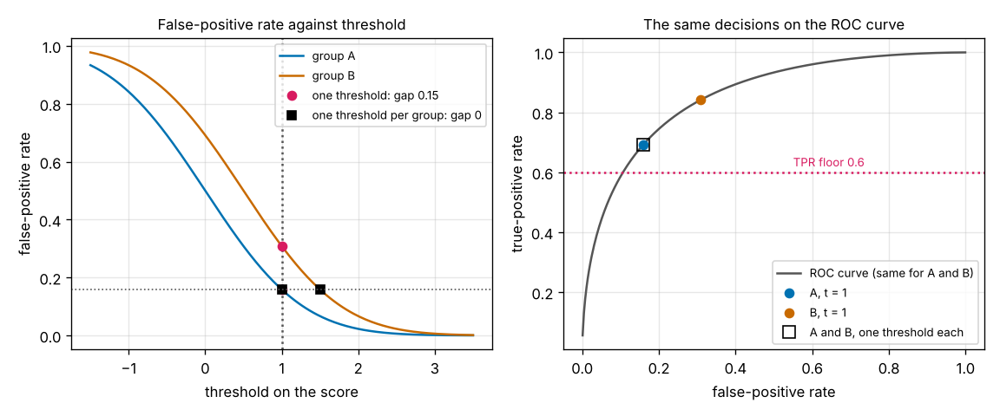
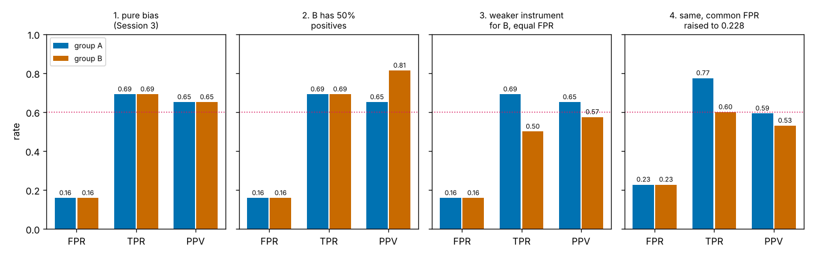
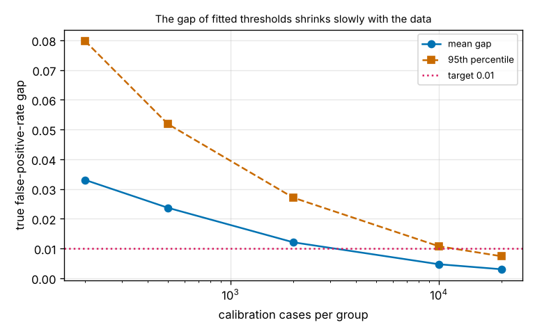

# Session 5: A threshold for each group

*Level 3 (simulation and validation) · about 90 minutes · openclassifier*

> This is a simplified educational model. It is not a validated design tool and must not be used for real structures, electrical installations, vehicles, industrial processes or medical decisions.

**Prerequisites**

- Session 3: ROC curves, the two-group experiment and the false-positive rate.
- Session 4 is helpful (honest evaluation on separate data) but not required.
- The normal curve Phi (explained in Section B).

**Learning objectives.** After this session you can:

- Compute the error rates of a group from its share of positives, the quality of its instrument and its shift, and invert them to find the threshold for a wanted false-positive rate.
- Build a tool that picks one threshold per group so that the false-positive rates agree, and reports both groups' error rates.
- Explain with the odds form of Bayes' rule why equal FPR, equal TPR and equal PPV cannot all hold when the groups differ in prevalence.
- Price the repair in three situations (free, a PPV gap, a TPR floor) in errors and false alarms per 1000 people.
- Set thresholds from data on a calibration set and say how many cases it takes.

## A. Real-world problem
In Session 3 one threshold on the score gave group A a false-positive rate of 0.159 and group B a rate of 0.309, twice as many false alarms, because B's measuring instrument reads 0.5 too high. Session 3 showed the gap and stopped. Students ask the natural question: so set a separate threshold for each group, and is that the end of it? Today we build the tool that does it and then look at what it costs. In the Session 3 setting the repair is free and removes the gap completely. It stops being free when the groups differ in how common the condition is, or in how good the instrument is, and then no choice of thresholds can satisfy every fairness definition at once. We also measure how many cases it takes to set the thresholds from data, which is more than most people expect. All data are synthetic, and nothing here says anything about real people.

## B. Concept and theory
A group is described by three numbers: the share of positive cases (prevalence, pi), the quality of the instrument (d, the distance between the scores of positives and negatives, in units of their spread) and the shift s, how much the instrument reads too high. With a threshold t the rates follow from the normal curve Phi: FPR = 1 - Phi(t - s) and TPR = 1 - Phi(t - s - d). The share of flagged people who really are positive, PPV, is pi x TPR divided by the flagged share. To set a wanted false-positive rate f, invert the curve: t = s + Phi^-1(1 - f). Applying this to each group with the same f is the repair: **one threshold per group**. In the Session 3 setting B's scores are A's plus 0.5, so B's threshold is A's plus 0.5 and every rate becomes equal.

Three other wishes compete with equal FPR: equal TPR, equal PPV, and a floor under every group's TPR (here 0.6). Bayes' rule gives the odds form PPV / (1 - PPV) = pi / (1 - pi) x TPR / FPR for every group. If two groups have equal TPR and FPR but a different pi, the PPV must differ. This is the heart of the impossibility result: **with different prevalence, equal FPR, equal TPR and equal PPV cannot all hold** (except for a perfect classifier). A weaker instrument for one group gives a second, separate problem: its ROC curve lies lower, so at equal FPR its TPR is lower, and reaching the floor means a higher common FPR, paid for by both groups.

In practice d and s are unknown, so each threshold is fitted from labelled data: the threshold with FPR f is the (1 - f) quantile of the group's negative scores. The fit is noisy, with standard error sqrt(f (1 - f) / n_neg) for the FPR of each group, where n_neg is the number of negative cases in the calibration set. Judge the result on cases that did not take part in the fit.

| Symbol | Meaning | Unit |
|---|---|---|
| t, s | threshold and instrument shift | score units |
| d | instrument quality (larger is better) | score units |
| pi | share of positive cases (prevalence) | fraction |
| FPR, TPR, PPV | false-positive rate, true-positive rate, positive predictive value | no unit |
| f | wanted false-positive rate | no unit |
| n_neg | number of negative cases in a calibration set | count |

**Assumptions**

- Scores are normal with spread 1: negatives centred at s, positives at s + d.
- Group A has prevalence 0.3, d = 1.5 and no shift; group B differs as stated in each situation.
- The thresholds are fitted on a calibration set and judged on separate cases (the Session 3 data: 20000 cases per group).
- Education only, synthetic data, no claim about real people. Using a person's group in a decision can be restricted by law; the lesson is about the numbers.

$$ \mathrm{FPR}_g=1-\Phi(t_g-s_g),\qquad \mathrm{TPR}_g=1-\Phi(t_g-s_g-d_g),\qquad t_g=s_g+\Phi^{-1}(1-f) $$

$$ \frac{\mathrm{PPV}_g}{1-\mathrm{PPV}_g}=\frac{\pi_g}{1-\pi_g}\cdot\frac{\mathrm{TPR}_g}{\mathrm{FPR}_g},\qquad \mathrm{SE}(\widehat{\mathrm{FPR}})=\sqrt{\frac{f\,(1-f)}{n_{\text{neg}}}} $$

## C. Visual explanation
The first figure shows the false-positive rate of both groups against the threshold. At one threshold (t = 1) the two curves are 0.15 apart; with one threshold per group (1.0 and 1.5) the two operating points lie at the same height. On the ROC curve, right, the two operating points of the single threshold lie at different places, and the repaired points coincide. The second figure shows four situations side by side, each with FPR, TPR and PPV for both groups: pure bias (everything equal), different prevalence (PPV differs), a weaker instrument (B's TPR falls to 0.50, below the floor), and the same with the common FPR raised to 0.228 (the floor is met, both groups pay with false alarms). The third figure shows the gap of fitted thresholds against the number of calibration cases.

*Left: false-positive rate against threshold. Right: the same decisions on the ROC curve.*

*FPR, TPR and PPV of both groups in four situations.*

*The gap of fitted thresholds against the number of calibration cases.*

## D. Interactive simulation
Run the lesson (`python start.py 5`), then open the live app: [Session 5: a threshold for each group](https://krunalpanchal1995.github.io/pan-iit-oss/openclassifier/session-05/) (or `app.html` in this folder). Choose the policy (one threshold, one per group, one per group with the TPR floor) and change group B's share of positives, instrument quality and shift. The first graph shows FPR, TPR and PPV of both groups, the second the ROC curves with the operating points, the third the total errors under each policy. The five presets reproduce the situations of the lesson.

**Challenge.** With one threshold per group (policy 1), choose the settings of group B so that the false-positive rates agree but the PPV of the two groups differs by at least 0.15.

## E. Worked example and experiment
**Problem.** Groups A and B both have d = 1.5; B's scores are shifted up by 0.5. A single threshold t = 1 gives A a false-positive rate of 0.159. Find the threshold for B that gives it the same rate, and the true-positive rate of both groups there.

1. For A at t = 1: FPR = 1 - Phi(1) = 0.1587.
2. For B we need 1 - Phi(t - 0.5) = 0.1587, so t - 0.5 = 1 and t = 1.5.
3. TPR of A at t = 1: 1 - Phi(1 - 1.5) = 1 - Phi(-0.5) = 0.6915.
4. TPR of B at t = 1.5: 1 - Phi(1.5 - 0.5 - 1.5) = 1 - Phi(-0.5) = 0.6915.
5. Both are above the floor 0.6, and the gap in the false-positive rates is 0.

**Answer.** B's threshold is 1.5; both groups have FPR 0.159 and TPR 0.691.

**Experiment.** Take any data set with a score, a yes/no outcome and a group column (for example readings from two instruments in your own lab, with a reference result). Keep half of each group's cases as a test set. On the other half, find each group's threshold as the quantile of its negative scores for the same wanted false-positive rate. Report both groups' FPR, TPR and PPV on the test half, with the number of negative cases behind each. Repeat with three different random halves: the spread of the gap is the noise of the thresholds. The synthetic data of the lesson have a known answer; your data do not, so expect larger gaps.

## Real-world application and mini-project: A tool that picks one threshold per group
Use the Session 3 settings (group A: no shift; group B: shift 0.5; d = 1.5; prevalence 0.3; 20000 cases per group) with the lesson's `threshold_tool`, `three_situations` and `gap_study`. The roadmap target is a false-positive-rate gap of at most 0.01 while both true-positive rates stay at least 0.6 (the single threshold of Session 3 gives a gap of 0.15).

**Deliverable:** A script that fits one threshold per group from a calibration set, prints both groups' FPR, TPR, PPV and errors per 1000 people on the test data for the single threshold and for the per-group thresholds, repeats the analysis for a different prevalence and for a weaker instrument (with and without the TPR floor), states the cost of each repair, and measures how the gap of fitted thresholds depends on the number of calibration cases. It saves the graph of the false-positive rate against the threshold.

**Success looks like:** With the exact thresholds 1.0 and 1.5 the gap is 0 and both TPR are 0.691. Fitted from 20000 calibration cases per group the thresholds are 1.012 and 1.514, and on the Session 3 test data the gap falls from 0.152 to 0.005 with TPR 0.684 and 0.689. The errors of B fall from 264 to 204 per 1000 people. With 50 percent positives in B, PPV is 0.651 against 0.813 at equal FPR and TPR; equal PPV would need B's TPR to be 0.296. With a weaker instrument B's TPR is 0.50; the floor needs a common FPR of 0.228, which costs A 69 more false alarms per 1000 negative cases. The gap of fitted thresholds is at most 0.01 in 22 of 100 repeats with 200 cases per group, 41 with 2000, 91 with 10000 and 98 with 20000. Your report says that the target is met on this test set but that it is a statement about 20000 cases per group, and that a small group cannot promise it.

## F. Assessment and design challenge
**Question type A: Conceptual.** Two groups have different shares of positive cases. Why can a classifier not give them equal false-positive rates, equal true-positive rates and equal PPV all at once, and which of the three should a clinic give up?

Hint

Write the PPV of a group in terms of prevalence, TPR and FPR (the odds form of Section B). What happens to the right-hand side when only the prevalence changes?

Step-by-step solution

Bayes' rule gives PPV / (1 - PPV) = prev / (1 - prev) x TPR / FPR for every group. If two groups have equal TPR and equal FPR but different prevalence, the factor prev / (1 - prev) differs, so their PPV must differ: in the lesson 0.651 against 0.813 for prevalences 0.3 and 0.5. Forcing equal PPV at equal FPR changes a TPR instead, and the lesson shows the price: B's TPR would have to fall to 0.296. The only escapes are equal prevalence or a perfect classifier (FPR = 0 and TPR = 1), neither of which is on offer. There is no neutral answer to which to give up: it depends on which error hurts more, a missed positive (TPR), a false alarm (FPR) or a flag that means less in one group (PPV). That is a decision for the people who bear the consequences, not for the script, and the honest report shows all three numbers for both groups.

**Question type B: Numerical.** Group C has prevalence 0.2, group D prevalence 0.4. Both have d = 1.5 and no shift, and both are judged at the threshold 1.0. Find the FPR, TPR and PPV of each. What TPR would D need, at the same FPR, to have the PPV of C?

Hint

FPR = 1 - Phi(1) and TPR = 1 - Phi(-0.5) are the same for both groups. Then PPV = prev x TPR / (prev x TPR + (1 - prev) x FPR).

Step-by-step solution

FPR = 1 - Phi(1) = 0.1587 and TPR = 1 - Phi(-0.5) = 0.6915 for both. Group C: flagged = 0.2 x 0.6915 + 0.8 x 0.1587 = 0.1383 + 0.1269 = 0.2652, so PPV = 0.1383 / 0.2652 = 0.521. Group D: flagged = 0.4 x 0.6915 + 0.6 x 0.1587 = 0.2766 + 0.0952 = 0.3718, so PPV = 0.2766 / 0.3718 = 0.744. The same instrument and the same threshold flag a group of 40 percent positives with a precision of 0.74 and a group of 20 percent with 0.52. For equal PPV at FPR 0.1587 the odds must match: D needs TPR = [0.521 / 0.479] x [0.6 / 0.4] x 0.1587 = 1.0898 x 1.5 x 0.1587 = 0.259, far below the 0.6 floor.

**Question type C: Graph and simulation interpretation.** In the third panel of Figure 2 the two groups have the same false-positive rate and B's true-positive rate is 0.50 against 0.69 for A. In the fourth panel the common false-positive rate is raised to 0.228. Who gains, who pays, and why can no choice of thresholds remove the difference?

Hint

Find the two operating points on the two ROC curves (in the app, the second graph with the second preset).

Step-by-step solution

B gains: moving up its ROC curve from FPR 0.159 to 0.228 lifts its TPR from 0.50 to 0.60, exactly the floor. Both groups pay: with equal FPR both groups get the same 0.228, so A also receives 69 more false alarms per 1000 negative cases, although A's own TPR rises (0.69 to 0.77), and its PPV falls from 0.65 to 0.59. B's PPV falls from 0.58 to 0.53. The difference cannot be removed by thresholds because B's ROC curve lies below A's (AUC 0.76 against 0.86): at every FPR B's TPR is lower, so equal FPR and equal TPR cannot both hold. Only a better instrument for B (a larger d) changes that. The alternative of lowering A's TPR to match B (levelling down) makes the numbers equal and the service worse for everyone, which is why it is a poor remedy.

**Question type D: Design and optimisation challenge.** Design: a clinic has only 300 labelled cases from group B (prevalence 0.3) and 20000 from group A. It wants B's false-positive rate to match A's within 0.01. What do you build, and what do you promise the clinic?

Hint

How many negative cases does B have, and what is the standard error of an FPR estimated from them? Use Figure 3.

Step-by-step solution

B has about 210 negative cases, so the FPR at any fitted threshold has a standard error of sqrt(0.159 x 0.841 / 210) = 0.025, two and a half times the tolerance. Figure 3 and the checkpoint show the same: with 200 cases per group the gap of fitted thresholds is at most 0.01 in only 22 of 100 repeats (mean gap 0.033), and about 10000 cases per group are needed to reach 91 of 100. So build the tool as in the lesson (fit each group's threshold as a quantile of its negative scores on a calibration set, judge it on separate cases) but do not promise 0.01. Promise an interval: 'B's false-positive rate will match A's to within about plus or minus 0.05 (two standard errors)', and recommend collecting more labelled B cases, or fitting a model with fewer parameters (a normal curve for the negatives) if the assumption can be defended. Also tell the clinic that using group membership in a decision is a policy and legal question, not only a technical one. Assumption: the synthetic setting of the lesson.

Score yourself with [RUBRIC.md](../../RUBRIC.md). Print the [activity sheet](activity_sheet.md) to work on paper.

## Common misconceptions
| Common misconception | What is actually true |
|---|---|
| Equal false-positive rates mean the system is fair. | It is one definition among several. With different prevalence the same repair leaves different PPV (0.651 against 0.813 in the lesson), and forcing PPV equal costs B's true-positive rate (0.296). A fairness report states which rates it equalised and shows the others. |
| A separate threshold for each group always costs accuracy. | In the Session 3 setting, where B's instrument only reads 0.5 too high, the repair is free: the errors of B fall from 264 to 204 per 1000 people and A's do not change. It costs something only when the groups differ in instrument quality (a TPR floor then raises both false-alarm rates by 0.069) or in prevalence (PPV). |
| If the gap is zero on my calibration data it will be zero on new data. | A threshold fitted from data is a noisy quantile. With 20000 cases per group the true gap is at most 0.01 in 98 of 100 repeats; with 200 cases per group in only 22 of 100. Report how many cases the thresholds rest on. |
| Equalising the rates fixes the instrument. | It repairs the decisions, not the measurement. If B's instrument is weaker (d = 1.0 against 1.5) B still has the lower true-positive rate at the same false-positive rate (0.50 against 0.69). The remedy for that is a better instrument, or more false alarms for everyone. |

## Glossary
- **threshold**: the score above which a case is flagged
- **false-positive rate (FPR)**: the share of negative cases that are flagged
- **true-positive rate (TPR)**: the share of positive cases that are flagged
- **PPV**: the share of flagged cases that are truly positive
- **prevalence**: the share of positive cases in a group
- **calibration set**: cases used to fit the thresholds, kept apart from the cases used to judge them
- **quantile**: the value below which a given share of the cases lies
- **TPR floor**: a minimum true-positive rate that no group may fall below

## Finish
1. Do the three coding tasks in [exercises.md](exercises.md).
2. Run `python start.py 5` again after your changes. It ends with the checkpoint; when it prints `PASS`, you are done. (Checkpoint only: `python start.py check 5`.)

Next: the [roadmap](../../promo/roadmap.md). Session 6 is yours to build.
