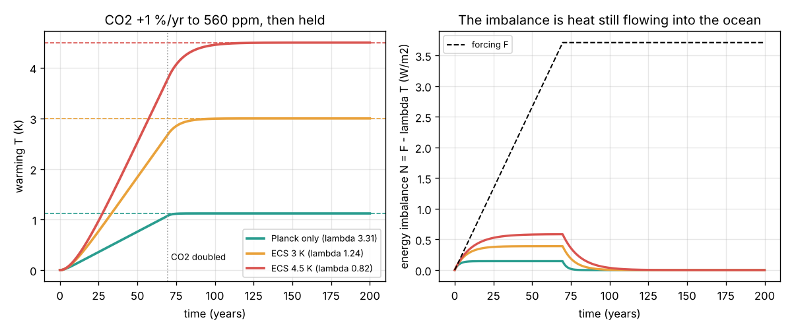
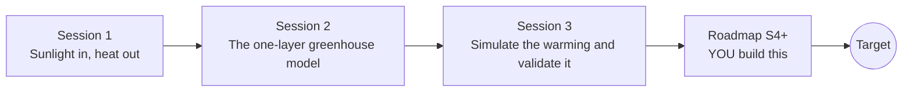

# openclimate

[](https://github.com/KrunalPanchal1995/pan-iit-oss/actions/workflows/tests.yml)   [](https://colab.research.google.com/github/KrunalPanchal1995/pan-iit-oss/blob/main/openclimate/sessions/session-01/lesson.ipynb) [](https://krunalpanchal1995.github.io/pan-iit-oss/openclimate/)

**Explain the greenhouse effect with a simple energy-balance model, in three sessions.**

openclimate teaches why greenhouse gases warm the Earth, from the balance of sunlight in and heat out to a one-layer atmosphere and a time-stepping model of warming under rising CO2, using only Python and a browser.

- **Start from zero.** Session 1 needs only school arithmetic: sunlight in, heat out, and a fourth root.
- **See the energy flow.** Every session ships a slider app that runs in the browser, with arrows as thick as the energy flows and labelled graphs.
- **Know you got it right.** Each session ends with a checkpoint that prints PASS or FAIL against hand calculations and energy conservation.
- **Build the missing half.** The repo stops at Session 3 on purpose; the roadmap shows the path to the Target.

[Target](#the-target) · [Who is this for](#who-is-this-for) · [Quick start](#quick-start) · [Sessions](#sessions) · [Roadmap](#roadmap) · [Contribute](#contribute) · [Explainer PDF](docs/explainer.pdf)

> **This repo is incomplete on purpose.** Sessions 1 to 3 are here and fully working. The finished Target below is a preview of what the community can build next. We show you the path, not the code. Sessions 4 and up are yours.

## The Target

A small climate model that you can trust and explain: the energy balance of Sessions 1 to 3, extended with a deep ocean, separate water-vapour, ice and cloud feedbacks, and the real forcing record (CO2, methane, aerosols, volcanoes and the Sun) from 1850 to today. It reproduces the observed warming of about 1.2 K, shows how much warming is still in the pipeline, and runs future CO2 paths side by side. The figure below is where Session 3 leaves you: CO2 rising 1 percent a year to doubling, the surface warming for three feedback strengths, and the energy imbalance that keeps heating the ocean. Your goal over the coming sessions: add the deep ocean and the historical forcing, and check your model against the thermometer record.



*Target starting point: CO2 rising 1 percent a year to doubling, warming for three feedback strengths and the energy imbalance*

Try it live:

- [Session 3 app: a warming planet over time](https://krunalpanchal1995.github.io/pan-iit-oss/openclimate/session-03/)
- [Math Visual Studio](https://krunalpanchal1995.github.io/studio/)

How the Target is reached is shown only as a path in [promo/roadmap.md](promo/roadmap.md).

## Who is this for
**secondary to diploma / undergraduate (levels 3-5).** Topic area: Geography, Climate, Environment and Earth Science.

Prerequisites:

- School arithmetic, powers and fourth roots; the idea of energy per second (watts) and temperature in kelvin.
- Python 3.10 or newer; if `python --version` works, you are ready. PRIMER.md explains the rest.
- No prior GitHub, physics of radiation or calculus experience is needed; Session 3 explains the time-stepping it uses.

New to Python? Read [PRIMER.md](PRIMER.md) first (10 minutes).

## Quick start

No installation knowledge needed. You need [Git](https://git-scm.com/downloads) and [Python 3.10+](https://www.python.org/downloads/) (Windows: tick "Add Python to PATH"). On Mac and Linux type `python3` wherever this page says `python`.

```bash
git clone https://github.com/KrunalPanchal1995/pan-iit-oss.git
cd pan-iit-oss/openclimate
python start.py 1
```

`start.py` creates a private environment, installs what is needed and runs Session 1 with its checkpoint. Next: `python start.py 2`, `python start.py 3`, or `python start.py test` to check everything. Only a checkpoint: `python start.py check 1`.

<!-- friendly-help -->
<details>
<summary><b>Not working? Common fixes (no Git, "python not found", no internet)</b></summary>

- **No Git?** You do not need it. On the main page of this collection click the green **Code** button, then **Download ZIP**, unzip it, open a terminal inside the folder `pan-iit-oss-main/openclimate` and run `python start.py 1`. The ZIP holds every project, so it is large; the live apps need no download at all.
- **"python is not recognized" or "command not found".** On Windows try `py start.py 1`. On Mac and Linux try `python3 start.py 1`. If neither works, install Python from [python.org](https://www.python.org/downloads/) and tick "Add Python to PATH".
- **Needs internet once.** The first run downloads NumPy and Matplotlib into a private folder (`.venv`); after that it works offline.
- **Rather not install anything?** Open the [live apps](https://krunalpanchal1995.github.io/pan-iit-oss/openclimate/) in your browser, or use the Colab badge at the top of this page.
- **Still stuck?** [Open an issue](https://github.com/KrunalPanchal1995/pan-iit-oss/issues/new?title=%5Bopenclimate%5D%20) with your operating system and the message you see. Questions from beginners are welcome.

</details>

Four lines turn the idea of Session 2 into a result (they work as they are): Save it as `try.py` and run it with `python start.py run try.py` (this uses the private environment, where NumPy is installed):

```python
import numpy as np
te = (1361 * (1 - 0.30) / 4 / 5.67e-8) ** 0.25    # bare Earth, K
print(np.round(te, 1))                             # -> 254.6  (-18.6 C, frozen)
print(np.round(te * (2 / (2 - 0.78)) ** 0.25, 1))  # -> 288.1  one infrared-absorbing layer
```

Every session also opens in your browser with sliders (no install): [live apps](https://krunalpanchal1995.github.io/pan-iit-oss/openclimate/). Or use the Colab badge above for the notebook.

## Sessions

| # | Session | Model level | Time | Live app |
|---|---|---|---|---|
| 1 | [Sunlight in, heat out](sessions/session-01/README.md) | Level 1: conceptual interactive model | 60 min | [open](https://krunalpanchal1995.github.io/pan-iit-oss/openclimate/session-01/) |
| 2 | [The one-layer greenhouse model](sessions/session-02/README.md) | Level 2: mathematical model | 75 min | [open](https://krunalpanchal1995.github.io/pan-iit-oss/openclimate/session-02/) |
| 3 | [Simulate the warming and validate it](sessions/session-03/README.md) | Level 3: simulation and validation | 90 min | [open](https://krunalpanchal1995.github.io/pan-iit-oss/openclimate/session-03/) |

Each session follows the same six steps: A real-world problem, B concept and theory, C visual explanation, D interactive simulation, E worked example and experiment, F assessment and design challenge. Each ends with `checkpoint.py`, which prints `PASS` or `FAIL` against reference numbers. Session 3 also contains the real-world mini-project: **A CO2 ceiling for a 2 K limit**.

## Architecture



| Folder or file | What is inside |
|---|---|
| `sessions/` | three sessions: README (A-F), `lesson.py`, notebook, live app, exercises, activity sheet, checkpoint |
| `promo/` | the Target: media, live links, and the roadmap (path only) |
| `docs/` | `explainer.tex` and the built `explainer.pdf` |
| `tests/` | runs every lesson and checkpoint headless |
| `start.py` | one command to set up and run anything |
| `QUALITY.md`, `RUBRIC.md` | the quality checklist and the scoring rubric |
| `.github/` | CI, PDF build, Pages deploy, issue and PR templates |

## Roadmap

| Milestone | What you will build | Difficulty |
|---|---|---|
| Session 4: A two-box ocean | Add a deep ocean that slowly takes heat from the surface layer. | intermediate |
| Session 5: Feedbacks one by one | Split lambda into Planck, water vapour, lapse rate, ice-albedo and cloud parts. | intermediate |
| Session 6: Other gases and aerosols | Forcing from methane, nitrous oxide and sulfate aerosols next to CO2. | intermediate |
| Session 7: The historical record, 1850 to today | Drive the model with real forcing and compare with the thermometer record. | advanced |
| Session 8: Carbon budgets and future paths | Link emissions to CO2 with a simple carbon cycle and run future scenarios. | advanced |

Full detail with a checkpoint per milestone: [promo/roadmap.md](promo/roadmap.md).

## Contribute
New to GitHub? Read [CONTRIBUTING.md](CONTRIBUTING.md); it starts from zero. Pick an issue labelled `good first issue`. Translations into Hindi, Telugu, Tamil and Malayalam are welcome.

<details>
<summary>Development</summary>

```bash
python start.py test        # runs every lesson and checkpoint
```
Lessons use `# %%` cell markers so they open as notebooks in VS Code. See [QUALITY.md](QUALITY.md) for the standard every session meets.
</details>

## License
MIT. See [LICENSE](LICENSE). Media in `promo/media` is (c) Krunal Panchal, CC BY 4.0.

## Acknowledgments
Part of the [PAN IIT OSS](https://hellofoss.tech-iitb.org/projects) open-source teaching collection, modelled on the structure of [openspline](https://github.com/openspline/openspline). Built on ideas from the Math Visual Studio at https://krunalpanchal1995.github.io/studio/. Planetary values from the NASA planetary fact sheets; the CO2 forcing law from Myhre et al. (1998); climate sensitivity ranges from the IPCC Sixth Assessment Report (2021).
