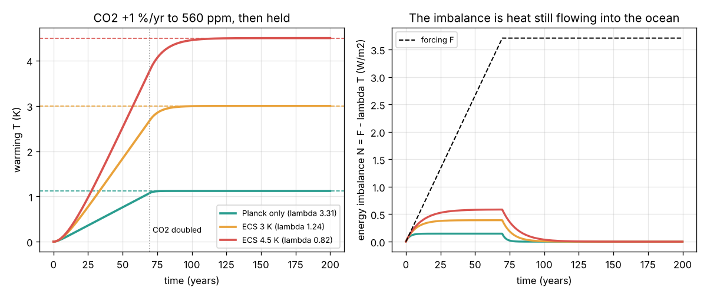

# What you are building toward

A small climate model that you can trust and explain: the energy balance of Sessions 1 to 3, extended with a deep ocean, separate water-vapour, ice and cloud feedbacks, and the real forcing record (CO2, methane, aerosols, volcanoes and the Sun) from 1850 to today. It reproduces the observed warming of about 1.2 K, shows how much warming is still in the pipeline, and runs future CO2 paths side by side. The figure below is where Session 3 leaves you: CO2 rising 1 percent a year to doubling, the surface warming for three feedback strengths, and the energy imbalance that keeps heating the ocean. Your goal over the coming sessions: add the deep ocean and the historical forcing, and check your model against the thermometer record.

*Target starting point: CO2 rising 1 percent a year to doubling, warming for three feedback strengths and the energy imbalance*

The finished Target comes from a private reference build. The code is not published; the roadmap shows the path so you can build your own.

Live links:

- [Session 3 app: a warming planet over time](https://krunalpanchal1995.github.io/pan-iit-oss/openclimate/session-03/)
- [Math Visual Studio](https://krunalpanchal1995.github.io/studio/)
