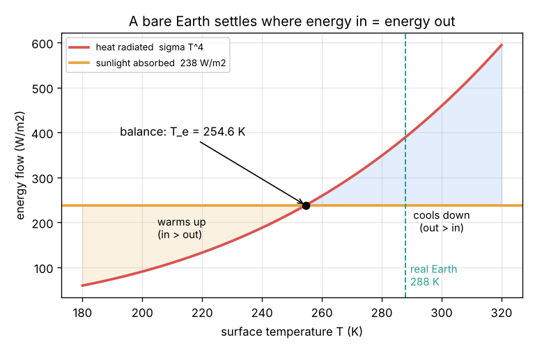
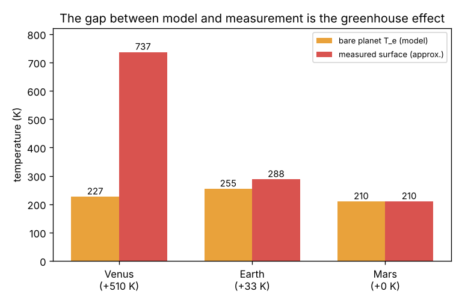

# Session 1: Sunlight in, heat out

*Level 1 (conceptual interactive model) · about 60 minutes · openclimate*

> This is a simplified educational model. It is not a validated climate projection tool and must not be used for policy, construction, insurance, farming or health decisions.

**Prerequisites**

- School arithmetic, powers and fourth roots (what 2 to the power 4 and the fourth root of 81 mean).
- You have read PRIMER.md and run `python start.py 1` once.

**Learning objectives.** After this session you can:

- Explain why the average sunlight on each square metre of Earth is S / 4, and what the albedo does.
- Use the Stefan-Boltzmann law sigma T^4 with temperatures in kelvin.
- Balance energy in against energy out to find a planet's equilibrium temperature.
- Show that a bare Earth would be about 33 K colder than the real one, and name this gap the greenhouse effect.

## A. Real-world problem
The Sun delivers energy to the Earth every second, yet the Earth does not keep heating up year after year. Something must carry the same amount of energy away again. What is it, and at what temperature does the planet settle? If we do the sum for an Earth with no atmosphere, do we get the 15 degrees C (288 K) that we actually live at? (General education only: this is a simplified model, not a climate prediction.)

## B. Concept and theory
Sunlight reaches the top of the atmosphere with a power S of about 1361 W on every square metre facing the Sun (the solar constant). The Earth intercepts it on a disc of area pi R^2 but, because it spins, spreads it over its whole surface 4 pi R^2, so the average is S / 4 = 340 W/m2. Clouds, ice and deserts reflect a share alpha (the albedo, about 0.30) straight back to space; the rest, S (1 - alpha) / 4 = 238 W/m2, is absorbed. Every warm object radiates infrared light; the Stefan-Boltzmann law says a perfect radiator at absolute temperature T sends out sigma T^4 per square metre, with sigma = 5.67 x 10^-8 W/(m2 K4). If the planet absorbs more than it radiates it warms, radiates more, and so settles at the temperature where energy in equals energy out: the equilibrium (or effective) temperature T_e. For a bare Earth this is about 255 K (-18 C). The real surface averages about 288 K. The 33 K difference is the greenhouse effect, which Session 2 explains.

| Symbol | Meaning | Unit |
|---|---|---|
| S | solar constant: sunlight on a surface facing the Sun | W/m2 |
| alpha | albedo: share of sunlight reflected back to space | no unit |
| sigma | Stefan-Boltzmann constant, 5.67 x 10^-8 | W/(m2 K4) |
| T | absolute temperature (K = degrees C + 273.15) | K |
| T_e | equilibrium temperature of a bare planet | K |
| epsilon | emissivity of the surface (1 for a perfect radiator) | no unit |

**Assumptions**

- One temperature for the whole planet: averages over day and night, poles and equator, and the whole year.
- The surface radiates as a perfect black body (emissivity 1) in the infrared.
- No atmosphere: all the infrared from the ground escapes to space.
- The albedo is fixed; it does not change with temperature (no melting ice).

$$ \text{absorbed} = \frac{S\,(1-\alpha)}{4} $$

$$ \text{emitted} = \varepsilon\,\sigma\,T^4 $$

$$ \frac{S\,(1-\alpha)}{4} = \sigma\,T_e^4 \quad\Rightarrow\quad T_e = \left[\frac{S\,(1-\alpha)}{4\,\sigma}\right]^{1/4} $$

## C. Visual explanation
The first figure plots the two sides of the balance against temperature: absorbed sunlight is a flat line at 238 W/m2, while the heat radiated grows steeply as T^4. Below the crossing the planet gains energy and warms; above it the planet loses energy and cools, so it always moves back to the crossing at 254.6 K. The real Earth (dashed line, 288 K) sits well to the right. The second figure repeats the calculation for Venus, Earth and Mars: the bare model gets Mars right (210 K against 210 K, thin atmosphere), misses Earth by 33 K and misses Venus by about 510 K (very thick CO2 atmosphere).

*Absorbed sunlight against heat radiated: they balance at 254.6 K, far below the real 288 K.*

*Bare-planet model against measured surface temperature for Venus, Earth and Mars.*

## D. Interactive simulation
Run the lesson (`python start.py 1`), then open the live app: [Session 1: sunlight in, heat out](https://krunalpanchal1995.github.io/pan-iit-oss/openclimate/session-01/) (or `app.html` in this folder). Change the solar constant and the albedo and watch the arrows (as thick as the energy flows) and the balance point move. Open the balance graph to see the flat sunlight line cross the T^4 curve, and use the planet presets.

**Challenge.** Using the bare-planet model, find an albedo that puts the Earth (S = 1361 W/m2) at or above 273 K, the freezing point of water.

## E. Worked example and experiment
**Problem.** For the Earth, S = 1361 W/m2 and alpha = 0.30. Find the absorbed sunlight, the bare-planet temperature, and how much the real 288 K surface radiates. How large is the greenhouse effect?

1. Average sunlight per square metre: 1361 / 4 = 340.25 W/m2.
2. Absorbed: 340.25 x (1 - 0.30) = 238.2 W/m2.
3. Balance: T_e^4 = 238.2 / (5.67 x 10^-8) = 4.20 x 10^9 K^4, so T_e = fourth root = 254.6 K (-18.6 C).
4. The real surface at 288 K radiates 5.67 x 10^-8 x 288^4 = 390.1 W/m2, which is 152 W/m2 more than the planet absorbs from the Sun.
5. Greenhouse effect: 288 - 254.6 = 33.4 K.

**Answer.** Absorbed 238.2 W/m2; bare Earth 254.6 K (-18.6 C); the real surface radiates 390.1 W/m2; the greenhouse effect is about 33 K.

**Experiment.** On a sunny day, put a black and a white sheet of paper (or two cans painted black and white) in the sun with a thermometer under each. The black one, with a lower albedo, gets warmer. Then compare a clear night with a cloudy night: clear nights cool much faster because more infrared escapes. The model has one temperature for the whole planet, so it cannot show day and night, but it shows the same two ideas: reflecting less means absorbing more, and anything that stops infrared from escaping keeps the surface warmer.

## F. Assessment and design challenge
**Question type A: Conceptual.** Why do we divide the solar constant by 4, and not by 2 (only half the Earth is lit at a time)?

Hint

Compare the area that catches the sunlight with the area that radiates heat away.

Step-by-step solution

The Earth catches sunlight like a flat disc of area pi R^2 (its shadow). It radiates heat from its whole surface, a sphere of area 4 pi R^2, day and night. The ratio is pi R^2 / (4 pi R^2) = 1 / 4. Dividing by 2 would count the day side as if it faced the Sun straight on everywhere; in fact the sunlight is slanted near the edges, and that slant brings the day-side average down to S / 2 and the whole-sphere average to S / 4.

**Question type B: Numerical.** Mars receives S = 586 W/m2 and has albedo 0.25. Find the absorbed sunlight and the bare-planet temperature. Check against the measured mean of about 210 K.

Hint

Absorbed = S (1 - alpha) / 4, then take the fourth root of absorbed / sigma.

Step-by-step solution

Absorbed = 586 x 0.75 / 4 = 109.9 W/m2. T^4 = 109.9 / 5.67 x 10^-8 = 1.94 x 10^9 K^4, so T = 209.8 K. This is within 1 K of the measured 210 K: Mars has a very thin atmosphere, so its greenhouse effect is tiny and the bare model works well.

**Question type C: Graph and simulation interpretation.** In the balance graph, the planet is at 230 K. Is it warming or cooling, and why? What happens to the gap between the two lines as it moves?

Hint

Read the absorbed line and the T^4 curve at 230 K.

Step-by-step solution

At 230 K the planet radiates 5.67 x 10^-8 x 230^4 = 158.7 W/m2 but absorbs 238.2 W/m2, so it gains 79.5 W/m2 and warms. As T rises the T^4 curve climbs toward the flat line and the gap shrinks to zero at 254.6 K, where the warming stops. From above (say 280 K) the gap is negative and the planet cools back to the same point: the balance is stable.

**Question type D: Design and optimisation challenge.** Design: a bare Earth (S = 1361 W/m2) should have an equilibrium temperature of at least 273 K so that water does not freeze. What albedo is needed? Is that realistic? And what albedo makes a "snowball Earth" at 221 K?

Hint

Invert: 1 - alpha = 4 sigma T^4 / S.

Step-by-step solution

1 - alpha = 4 x 5.67 x 10^-8 x 273^4 / 1361 = 0.926, so alpha must be at most 0.074, darker than the open ocean almost everywhere and with no clouds at all. That is not realistic: clouds alone reflect about 0.2. So a bare Earth would be frozen, and the warmth we enjoy needs the atmosphere. For alpha = 0.60 (mostly ice and snow) the model gives 221 K. Trade-off: a darker planet is warmer, but albedo alone cannot explain 288 K.

Score yourself with [RUBRIC.md](../../RUBRIC.md). Print the [activity sheet](activity_sheet.md) to work on paper.

## Common misconceptions
| Common misconception | What is actually true |
|---|---|
| The Earth is warm because it keeps the heat from the Sun. | It does not keep it. In equilibrium every watt absorbed is radiated away again; the temperature sets how fast it leaves. |
| The Stefan-Boltzmann law works in degrees Celsius. | It needs kelvin. 15 C must become 288 K; using 15 gives a meaningless 0.003 W/m2. |
| The Earth only radiates heat on the day side. | Every part of the surface radiates all the time, day and night, which is why we divide by the whole area 4 pi R^2. |
| If the Sun gives 1361 W/m2, each square metre of ground gets 1361 W/m2. | Averaged over the sphere, day and night, it is a quarter of that, 340 W/m2, and only 238 W/m2 is absorbed. |

## Glossary
- **solar constant**: sunlight power on one square metre facing the Sun at Earth's distance, about 1361 W/m2
- **albedo**: the share of sunlight a planet reflects straight back to space
- **Stefan-Boltzmann law**: a black body at temperature T radiates sigma T^4 watts per square metre
- **equilibrium temperature**: the temperature at which energy in equals energy out
- **greenhouse effect**: the warming of a surface by an atmosphere that absorbs infrared, about 33 K on Earth

## Finish
1. Do the three coding tasks in [exercises.md](exercises.md).
2. Run `python start.py 1` again after your changes. It ends with the checkpoint; when it prints `PASS`, you are done. (Checkpoint only: `python start.py check 1`.)

Next: [Session 2](../session-02/README.md)
