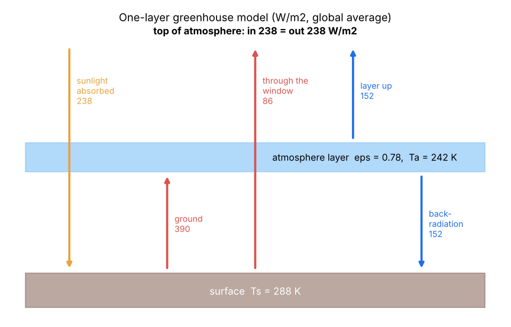
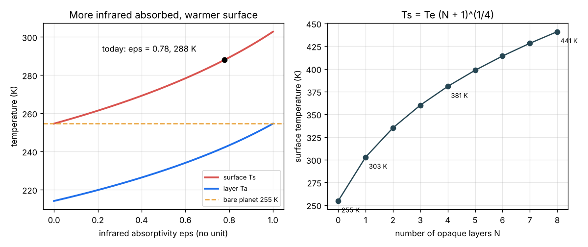

# Session 2: The one-layer greenhouse model

*Level 2 (mathematical model) · about 75 minutes · openclimate*

> This is a simplified educational model. It is not a validated climate projection tool and must not be used for policy, construction, insurance, farming or health decisions.

**Prerequisites**

- Session 1: absorbed sunlight S (1 - alpha) / 4, the law sigma T^4 and the bare-planet temperature.
- Solving two simple equations together; fourth roots.

**Learning objectives.** After this session you can:

- Explain why air that lets sunlight through but absorbs infrared warms the surface.
- Write the three energy balances of the one-layer model and solve them by hand.
- Find the infrared absorptivity epsilon that gives today's 288 K, and the energy flows in W/m2.
- Extend to N opaque layers, estimate Venus, and compute the radiative forcing of a small rise in epsilon.

## A. Real-world problem
Session 1 found that a bare Earth would sit at about 255 K (-18 C), but the real surface averages about 288 K (15 C). Nitrogen and oxygen let both sunlight and infrared pass, but water vapour and carbon dioxide (CO2), although only a small part of the air, absorb much of the infrared that the warm ground sends up. How much of that infrared must the air absorb to explain the missing 33 K, and what happens to the surface temperature if a little more is absorbed? (Simplified model of a global average; not a climate prediction.)

## B. Concept and theory
Put one thin layer of air above the surface. It is transparent to sunlight but absorbs a share epsilon of the infrared from the ground; the rest, (1 - epsilon), escapes through the "window". By Kirchhoff's law a layer that absorbs a share epsilon also emits epsilon sigma Ta^4 from each face, one up to space and one down to the ground. Three balances hold in equilibrium. Layer: it absorbs epsilon sigma Ts^4 and emits 2 epsilon sigma Ta^4, so sigma Ta^4 = sigma Ts^4 / 2 and Ta = Ts / 2^(1/4) whatever epsilon is. Top of the atmosphere: sunlight absorbed = window + layer up = (1 - epsilon / 2) sigma Ts^4. Surface: sunlight + back-radiation = sigma Ts^4, which then holds automatically. Solving gives Ts = Te [2 / (2 - epsilon)]^(1/4). With epsilon = 0 we get back Session 1; with epsilon = 1 the surface is 2^(1/4) = 1.19 times warmer, 302.7 K. Today's 288 K needs epsilon = 0.78. The key idea: the surface receives the back-radiation from the air as well as the sunlight, so it must get warmer to radiate it all away. With N layers that each absorb all infrared, Ts = Te (N + 1)^(1/4). A small rise in epsilon (more CO2) first cuts the outgoing infrared by sigma Ts^4 d(epsilon) / 2 before anything warms; this deficit is the radiative forcing.

| Symbol | Meaning | Unit |
|---|---|---|
| epsilon | infrared absorptivity (= emissivity) of the layer | no unit |
| Ts, Ta | surface and layer temperature | K |
| Te | bare-planet temperature from Session 1 (254.6 K) | K |
| OLR | outgoing longwave (infrared) radiation at the top | W/m2 |
| N | number of fully absorbing layers | no unit |
| F | radiative forcing: drop in OLR when epsilon rises | W/m2 |

**Assumptions**

- Global and annual averages; one surface temperature and one layer temperature.
- The layer is fully transparent to sunlight; all sunlight absorbed is absorbed at the surface.
- Kirchhoff's law: in the infrared the layer emits as well as it absorbs (absorptivity = emissivity).
- Only radiation carries energy; convection and evaporation are ignored, so the layer temperature is not realistic.

$$ \text{layer:}\quad \varepsilon\,\sigma T_s^4 = 2\,\varepsilon\,\sigma T_a^4 \;\Rightarrow\; T_a = T_s/2^{1/4} $$

$$ \text{top:}\quad \frac{S(1-\alpha)}{4} = (1-\varepsilon)\,\sigma T_s^4 + \varepsilon\,\sigma T_a^4 = \left(1-\frac{\varepsilon}{2}\right)\sigma T_s^4 $$

$$ T_s = T_e\left(\frac{2}{2-\varepsilon}\right)^{1/4} \qquad \varepsilon = 2\left[1-\left(\frac{T_e}{T_s}\right)^4\right] $$

$$ T_s = T_e\,(N+1)^{1/4}\ \text{(N opaque layers)} \qquad F = \tfrac12\,\sigma T_s^4\,\Delta\varepsilon $$

## C. Visual explanation
The first figure is the energy-flow diagram for today's Earth (epsilon = 0.78): 238 W/m2 of sunlight is absorbed by the ground; the ground radiates 390 W/m2; 86 W/m2 escapes through the window and 304 W/m2 is absorbed by the layer, which sends 152 W/m2 up and 152 W/m2 back down. At the top, 86 + 152 = 238 W/m2 leaves, exactly what came in. At the ground, 238 + 152 = 390 W/m2 arrives, exactly what leaves. The second figure shows the surface and layer temperatures against epsilon (the surface rises from 255 K to 303 K, the layer always stays colder) and the surface temperature under N opaque layers.

*Energy flows of the one-layer model for today's Earth, in W/m2.*

*Left: surface and layer temperature against epsilon. Right: surface temperature under N opaque layers.*

## D. Interactive simulation
Run the lesson (`python start.py 2`), then open the live app: [Session 2: the one-layer greenhouse](https://krunalpanchal1995.github.io/pan-iit-oss/openclimate/session-02/) (or `app.html` in this folder). Move epsilon, the albedo and the number of layers. Watch the arrows in the energy-flow picture change thickness and read the balances. Switch to the temperature graph to see where today's Earth sits.

**Challenge.** With one layer and S = 1361 W/m2, find an albedo and epsilon that give a surface between 287 and 289 K with the albedo at 0.35 or higher (a cloudier Earth).

## E. Worked example and experiment
**Problem.** For the Earth (S = 1361 W/m2, alpha = 0.30) find the epsilon that gives a 288 K surface, the layer temperature, and every energy flow. Check all three balances.

1. From Session 1, Te = 254.6 K. (Te / Ts)^4 = (254.6 / 288)^4 = 0.6105.
2. epsilon = 2 (1 - 0.6105) = 0.779.
3. Ta = 288 / 2^(1/4) = 288 / 1.1892 = 242.2 K.
4. Ground: sigma 288^4 = 390.1 W/m2. Window: (1 - 0.779) x 390.1 = 86.2 W/m2. Layer emission per face: 0.779 x sigma 242.2^4 = 0.779 x 195.1 = 151.9 W/m2.
5. Top: 86.2 + 151.9 = 238.1, about 238.2 W/m2 absorbed (rounding). Layer: absorbs 0.779 x 390.1 = 303.9 = 151.9 + 151.9 emitted. Surface: 238.2 + 151.9 = 390.1 = ground emission.

**Answer.** epsilon = 0.779, Ta = 242.2 K; flows: ground 390.1, window 86.2, layer up 151.9, back-radiation 151.9 W/m2; all three balances close.

**Experiment.** On a clear evening, point an infrared (non-contact) thermometer straight up at the sky and then at the ground. The sky reads far colder than the ground, often below 0 C, yet it is not 3 K like outer space: that reading is the back-radiation of water vapour and CO2. Under clouds the sky reading rises sharply. The model's single layer is far too cold compared with the real lower air (242 K against about 280 K) because real air is also heated by rising warm air and evaporation, which the model leaves out. Compare published global energy budgets: their back-radiation is about 340 W/m2, larger than our 152, for the same reason.

## F. Assessment and design challenge
**Question type A: Conceptual.** The layer emits only 152 W/m2 down, yet the surface is 33 K warmer than with no layer. Where does the extra warmth come from, if the Sun's input is unchanged?

Hint

Write the surface balance with and without the layer.

Step-by-step solution

Without the layer the ground receives only 238 W/m2 and must radiate 238, so it sits at 255 K. With the layer it receives 238 from the Sun plus 152 back from the layer, 390 W/m2 in all, and must radiate 390, which needs 288 K. No energy is created: the layer recycles part of the ground's own infrared. At the top of the atmosphere the planet still sends 238 W/m2 to space, the same as it absorbs.

**Question type B: Numerical.** Find Ts and Ta for epsilon = 0.5 (S = 1361 W/m2, alpha = 0.30). Then find the epsilon needed for Ts = 290 K.

Hint

Ts = 254.6 x (2 / (2 - eps))^(1/4); invert with eps = 2 (1 - (Te / Ts)^4).

Step-by-step solution

eps = 0.5: 2 / 1.5 = 1.333, fourth root 1.0746, so Ts = 254.6 x 1.0746 = 273.6 K and Ta = 273.6 / 1.1892 = 230.0 K. For 290 K: (254.6 / 290)^4 = 0.5939, so eps = 2 x 0.4061 = 0.812. Sanity check: 0.812 lies between 0.779 (288 K) and 1, as it must.

**Question type C: Graph and simulation interpretation.** In the temperature graph, how much warmer can the surface get if epsilon goes from today's 0.78 all the way to 1? Why can one layer never give more?

Hint

Read Ts at eps = 1 and compare with the N-layer panel.

Step-by-step solution

At eps = 1, Ts = 2^(1/4) x 254.6 = 302.7 K, only 14.7 K more than 288 K. A single layer that absorbs everything can at most send back half of what it absorbs, so the surface flux is at most twice the solar input and Ts at most 2^(1/4) Te. More warming needs more layers (or a thicker atmosphere): the N-layer panel shows 335 K for N = 2 and 381 K for N = 4.

**Question type D: Design and optimisation challenge.** Design: the planet Venus receives S = 2601 W/m2, reflects 77 percent and has a surface at about 737 K. How many opaque layers does the N-layer model need? Then: for the Earth with N = 1, what must epsilon be for 288 K if clouds raise the albedo to 0.35?

Hint

N = (Ts / Te)^4 - 1, with Te from Session 1 for Venus.

Step-by-step solution

Venus: absorbed = 2601 x 0.23 / 4 = 149.6 W/m2, Te = 226.6 K. (737 / 226.6)^4 = 111.9, so N = about 111 layers: a very thick, infrared-opaque atmosphere. Earth with alpha = 0.35: Te = 249.9 K, (249.9 / 288)^4 = 0.567, eps = 2 x 0.433 = 0.87. Trade-off: a brighter, cloudier Earth absorbs less sunlight, so it needs a stronger greenhouse to stay at 288 K. The real atmosphere is not a stack of layers, but the count shows how opaque Venus's air is.

Score yourself with [RUBRIC.md](../../RUBRIC.md). Print the [activity sheet](activity_sheet.md) to work on paper.

## Common misconceptions
| Common misconception | What is actually true |
|---|---|
| Greenhouse gases trap heat so it can never leave. | In equilibrium the planet still sends exactly as much energy to space as it absorbs (238 W/m2); the gases make the surface warmer before that balance is reached. |
| The greenhouse effect works like a glass greenhouse, by stopping warm air from rising. | A glass greenhouse mostly stops convection; the atmospheric effect is about infrared absorption and emission. The name is historical. |
| Greenhouse gases warm the Earth by absorbing sunlight. | They let most sunlight through; they absorb the infrared that the ground emits. |
| The greenhouse effect is bad. | Without it the Earth would be about 255 K and frozen. The concern is about strengthening it quickly by adding more gas. |

## Glossary
- **absorptivity**: the share of incoming radiation that a layer absorbs
- **Kirchhoff's law**: a body absorbs and emits radiation of a given kind equally well
- **back-radiation**: infrared emitted downward by the atmosphere toward the ground
- **atmospheric window**: the infrared that escapes straight from the ground to space
- **radiative forcing**: the change in energy balance at the top of the atmosphere caused by a change such as more CO2, before temperatures respond

## Finish
1. Do the three coding tasks in [exercises.md](exercises.md).
2. Run `python start.py 2` again after your changes. It ends with the checkpoint; when it prints `PASS`, you are done. (Checkpoint only: `python start.py check 2`.)

Next: [Session 3](../session-03/README.md)
