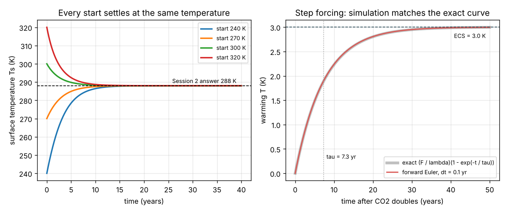
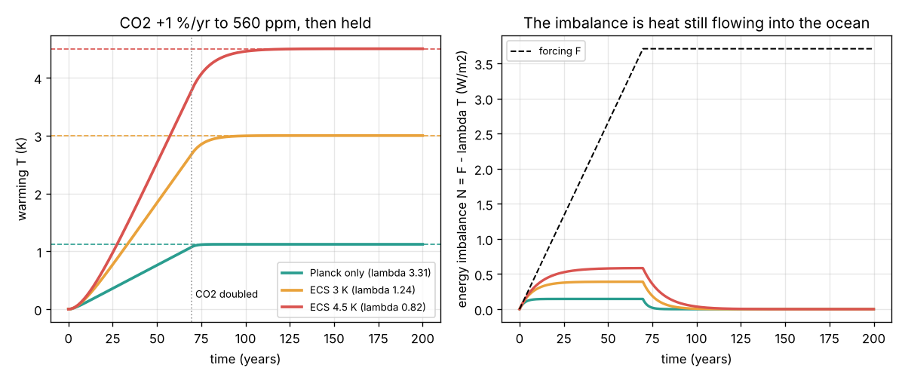
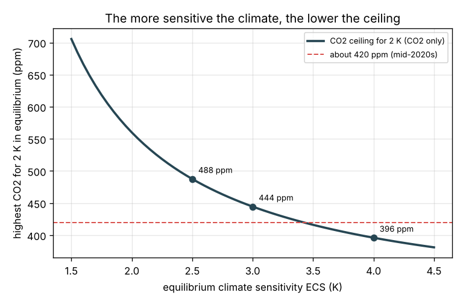

# Session 3: Simulate the warming and validate it

*Level 3 (simulation and validation) · about 90 minutes · openclimate*

> This is a simplified educational model. It is not a validated climate projection tool and must not be used for policy, construction, insurance, farming or health decisions.

**Prerequisites**

- Session 1: energy balance and sigma T^4.
- Session 2: the one-layer model, the outgoing infrared (1 - epsilon / 2) sigma Ts^4 and radiative forcing.
- Idea of stepping forward in time (new value = old value + rate x time step); explained in Section B.

**Learning objectives.** After this session you can:

- Step the energy balance forward in time with an ocean heat capacity (forward Euler).
- Validate the simulation against the Session 2 equilibrium, the exact step response and energy conservation.
- Use the CO2 forcing 5.35 ln(C / 280) and the feedback parameter lambda to get equilibrium and transient warming.
- Explain "warming in the pipeline" and find the CO2 level that keeps equilibrium warming below 2 K.

## A. Real-world problem
Session 2 says that more infrared-absorbing gas means a warmer surface in equilibrium. But the ocean stores an enormous amount of heat, so the Earth cannot jump to its new temperature at once. If CO2 rises, how fast does the surface warm? How much warming is still to come after the CO2 stops rising? And what CO2 level would keep the long-term warming below 2 K? We build a step-by-step simulation, check it against exact answers, and then use it. (A simplified teaching model, not a climate projection.)

## B. Concept and theory
The top layer of the ocean (about 70 m, mixed by wind and waves) has a heat capacity C = rho c_p h: 1025 kg/m3 x 3990 J/(kg K) x 70 m = 2.86 x 10^8 J/(m2 K), or 9.07 W yr/(m2 K) when divided by the seconds in a year. Any imbalance between absorbed sunlight and outgoing infrared warms it: C dTs/dt = S (1 - alpha) / 4 - (1 - epsilon / 2) sigma Ts^4. We step this forward with forward Euler, T_new = T + dt x (in - out) / C. Near equilibrium we write T for the warming above the starting state: C dT/dt = F - lambda T. The forcing of CO2 grows with the logarithm of its concentration, F = 5.35 ln(CO2 / 280) W/m2 (Myhre et al. 1998), giving F2x = 3.71 W/m2 for doubled CO2. The feedback parameter lambda says how many extra W/m2 a 1 K warmer planet sheds. A planet that only radiates more (the Planck response) has lambda = 4 OLR / Ts = 3.3 W/(m2 K); water vapour, melting ice and clouds weaken this, and the IPCC's best estimate of the equilibrium climate sensitivity ECS = F2x / lambda is about 3 K (likely range 2.5 to 4 K), so lambda is about 1.24. For a sudden constant forcing the exact answer is T = (F / lambda)(1 - exp(-t / tau)) with time constant tau = C / lambda, which we use to test the code. While T is below F / lambda the planet still takes in N = F - lambda T: that heat goes into the ocean, and the warming it will still cause is "in the pipeline".

| Symbol | Meaning | Unit |
|---|---|---|
| C | heat capacity of the ocean mixed layer per square metre | W yr/(m2 K) |
| T | warming above the starting equilibrium | K |
| F | radiative forcing (F2x for doubled CO2) | W/m2 |
| lambda | feedback parameter: extra outgoing energy per kelvin of warming | W/(m2 K) |
| ECS | equilibrium climate sensitivity, F2x / lambda | K |
| tau | time constant C / lambda | yr |
| N | energy imbalance F - lambda T, heat going into the ocean | W/m2 |
| dt | time step of the simulation | yr |

**Assumptions**

- One well-mixed ocean slab of fixed depth (70 m) under a global-mean atmosphere; no deep ocean.
- All feedbacks (water vapour, ice, clouds) are lumped into one constant lambda.
- Only CO2 is forced; other gases, aerosols, the Sun and volcanoes are left out.
- The log forcing law is a fit valid for roughly 200 to 2000 ppm.

$$ C\,\frac{dT_s}{dt} = \frac{S(1-\alpha)}{4} - \left(1-\frac{\varepsilon}{2}\right)\sigma T_s^4 $$

$$ C\,\frac{dT}{dt} = F(t) - \lambda\,T,\qquad F = 5.35\,\ln\frac{\mathrm{CO_2}}{280} $$

$$ T_{\mathrm{eq}} = \frac{F}{\lambda},\qquad \mathrm{ECS} = \frac{F_{2\times}}{\lambda},\qquad \tau = \frac{C}{\lambda} $$

$$ T(t) = \frac{F}{\lambda}\left(1 - e^{-t/\tau}\right)\ \text{(step forcing)},\qquad T_{n+1} = T_n + \frac{\Delta t}{C}\,(F_n - \lambda T_n) $$

## C. Visual explanation
Figure 1 validates the code. Left: the nonlinear one-layer model, started at 240, 270, 300 or 320 K, always settles at Session 2's 288 K within about 15 years. Right: for a sudden doubling of CO2 with ECS = 3 K, the Euler simulation (red) lies on top of the exact curve (grey); the warming reaches 63 percent of 3 K after tau = 7.3 years. Figure 2 runs the standard test: CO2 grows by 1 percent a year until it doubles (year 70), then stays. At doubling the warming is 1.08, 2.68 and 3.79 K for the Planck-only, 3 K and 4.5 K cases, below their equilibria (1.12, 3.00, 4.50 K); the gap closes after the CO2 stops rising. The right panel shows the energy imbalance N, the heat still flowing into the ocean. Figure 3 is the mini-project: the highest CO2 that keeps equilibrium warming at 2 K falls from 488 ppm (ECS 2.5 K) to 444 ppm (3 K) and 396 ppm (4 K), compared with about 420 ppm in the mid-2020s.

*Left: the one-layer model relaxes to 288 K from any start. Right: Euler simulation against the exact step response.*

*CO2 rising 1 percent a year to doubling: warming and energy imbalance for three feedback strengths.*

*Mini-project: the CO2 ceiling for 2 K of equilibrium warming against climate sensitivity.*

## D. Interactive simulation
Run the lesson (`python start.py 3`), then open the live app: [Session 3: a warming planet over time](https://krunalpanchal1995.github.io/pan-iit-oss/openclimate/session-03/) (or `app.html` in this folder). Set the CO2 growth rate, the ceiling, the climate sensitivity and the ocean depth. Watch the warming curve, the dashed equilibrium line and the energy imbalance. The time slider moves a marker through the run and the planet picture shows the energy flows at that moment.

**Challenge.** With ECS = 3 K and CO2 growing at 1 percent a year, choose a CO2 ceiling that keeps the warming after 200 years at or below 2.0 K while allowing at least 420 ppm.

## E. Worked example and experiment
**Problem.** A 70 m ocean layer, ECS = 3 K. CO2 doubles overnight and then stays. Find C, lambda, tau, the warming after 10 years and the final warming; check the simulation and the energy balance.

1. C = 1025 x 3990 x 70 / 3.156 x 10^7 = 9.07 W yr/(m2 K).
2. F2x = 5.35 x ln 2 = 3.708 W/m2; lambda = 3.708 / 3 = 1.236 W/(m2 K).
3. tau = C / lambda = 9.07 / 1.236 = 7.34 years.
4. After 10 years: T = 3 x (1 - exp(-10 / 7.34)) = 3 x (1 - 0.256) = 2.23 K. The Euler simulation with dt = 0.1 yr gives 2.24 K (error 0.007 K; it halves when dt halves).
5. Final warming F / lambda = 3.00 K. Energy check: heat stored C x T equals the sum of the imbalance N x dt over the run (27.185 W yr/m2 at 50 years, to round-off).

**Answer.** C = 9.07 W yr/(m2 K), lambda = 1.236 W/(m2 K), tau = 7.3 yr; 2.23 K after 10 years, 3.00 K in the end; simulation and energy balance agree.

**Experiment.** Download the global mean temperature record (for example NASA GISTEMP or HadCRUT, both free) and the Mauna Loa CO2 record. Plot the temperature anomaly against 5.35 ln(CO2 / 280). Over recent decades the points lie close to a straight line with a slope of roughly 0.6 K per W/m2, smaller than 1 / lambda = 0.8 for ECS 3 K. The model differs from reality for three reasons: the deep ocean is still absorbing heat (the observed warming is transient, not equilibrium), aerosols from pollution cool the planet, and other gases (methane, nitrous oxide) add forcing. Each is a step on the roadmap.

## Real-world application and mini-project: A CO2 ceiling for a 2 K limit
A policy team asks: if the world wants long-term warming from CO2 of no more than 2 K above pre-industrial, what is the highest CO2 concentration it can stabilise at? Use `max_co2_for_limit`, `lambda_for_ecs` and `run_linear_model` from Session 3 (70 m ocean, CO2 growing 1 percent a year from 280 ppm up to the ceiling, then held). Because the climate sensitivity is uncertain, answer for ECS = 2.5, 3 and 4 K. These numbers are for teaching; real budgets also count other gases, aerosols and the slow deep ocean.

**Deliverable:** A script that prints, for each ECS, the CO2 ceiling for 2 K, the forcing at that ceiling, and the simulated warming after 200 years, and saves a figure of the ceiling against ECS with today's level (about 420 ppm) marked.

**Success looks like:** Ceilings of 488, 444 and 396 ppm; each with forcing 2 lambda (3.0, 2.5 and 1.9 W/m2); simulated warming after 200 years within 0.01 K of 2 K; the report notes that for ECS = 4 K today's CO2 is already above the ceiling.

## F. Assessment and design challenge
**Question type A: Conceptual.** When CO2 stops rising, why does the Earth keep warming for a while? Use the energy imbalance N in your answer.

Hint

What is N = F - lambda T on the day the CO2 stops rising?

Step-by-step solution

On that day F is at its final value but T is still below F / lambda, because the ocean needs time to heat up. So N = F - lambda T is still positive: the planet absorbs more than it sends out. That extra energy keeps warming the ocean until lambda T = F and N = 0. In the 3 K case the warming at year 70 is 2.68 K, so about 0.3 K more is "in the pipeline". In the real world the deep ocean makes this tail last centuries.

**Question type B: Numerical.** With a 100 m ocean layer and ECS = 3 K, find C and tau. What share of the final warming is reached after one tau?

Hint

C scales with depth; at t = tau the factor is 1 - exp(-1).

Step-by-step solution

C = 1025 x 3990 x 100 / 3.156 x 10^7 = 12.96 W yr/(m2 K). tau = 12.96 / 1.236 = 10.5 years. After one tau the warming is 1 - exp(-1) = 0.632 of its final value, 63 percent (1.90 K of 3 K). A deeper layer warms more slowly but to the same final temperature.

**Question type C: Graph and simulation interpretation.** In the scenario figure, why does the ECS 4.5 K curve take longer to settle after year 70 than the Planck-only curve? Read the approximate times.

Hint

tau = C / lambda: which case has the smaller lambda?

Step-by-step solution

tau = 9.07 / 3.31 = 2.7 yr for Planck only, but 9.07 / 0.82 = 11 yr for ECS 4.5 K. A small lambda means the planet sheds little extra heat per kelvin, so the imbalance closes slowly. In the figure the Planck curve settles a few years after year 70; the 4.5 K curve takes about 40 to 50 years (several tau). A more sensitive climate warms more and also takes longer to show it.

**Question type D: Design and optimisation challenge.** Design: choose a CO2 ceiling (ppm) so that the equilibrium warming stays at or below 2 K for ECS = 2.5, 3 and 4 K. Which ceiling is safe for all three? Compare with about 420 ppm today.

Hint

CO2_max = 280 exp(2 lambda / 5.35) with lambda = 3.708 / ECS.

Step-by-step solution

ECS 2.5 K: lambda = 1.483, CO2_max = 280 exp(0.554) = 488 ppm. ECS 3 K: lambda = 1.236, 280 exp(0.462) = 444 ppm. ECS 4 K: lambda = 0.927, 280 exp(0.347) = 396 ppm. Only 396 ppm is safe for all three, and today's level is already above it. Trade-off: planning for the central estimate (444 ppm) leaves a real chance of exceeding 2 K; the model also ignores other gases, which add forcing, and aerosols, which remove some.

Score yourself with [RUBRIC.md](../../RUBRIC.md). Print the [activity sheet](activity_sheet.md) to work on paper.

## Common misconceptions
| Common misconception | What is actually true |
|---|---|
| A simulation is right because the curve looks smooth. | It must be validated: here against the Session 2 equilibrium, the exact step response and energy conservation (heat stored = imbalance integrated). |
| If CO2 stopped rising today, warming would stop today. | The ocean is still catching up; while the energy imbalance is positive, the surface keeps warming. |
| Doubling CO2 doubles the forcing every time you add the same amount. | Forcing grows with the logarithm: each doubling adds about 3.7 W/m2, so 280 to 560 ppm adds the same as 560 to 1120 ppm. |
| Feedbacks are extra heat sources. | Feedbacks change lambda, how strongly a warmer planet sheds heat; water vapour and ice loss weaken that shedding, so the same forcing gives more warming. |

## Glossary
- **heat capacity**: energy needed to warm something by 1 K; here per square metre of ocean
- **forward Euler**: the simplest time-stepping method: new value = old value + time step x rate of change
- **feedback parameter**: how many extra W/m2 the planet sends to space per kelvin of warming
- **climate sensitivity (ECS)**: the equilibrium warming for doubled CO2
- **energy imbalance**: absorbed minus outgoing energy at the top of the atmosphere; the heat going into the ocean

## Finish
1. Do the three coding tasks in [exercises.md](exercises.md).
2. Run `python start.py 3` again after your changes. It ends with the checkpoint; when it prints `PASS`, you are done. (Checkpoint only: `python start.py check 3`.)

Next: the [roadmap](../../promo/roadmap.md). Session 4 is yours to build.
