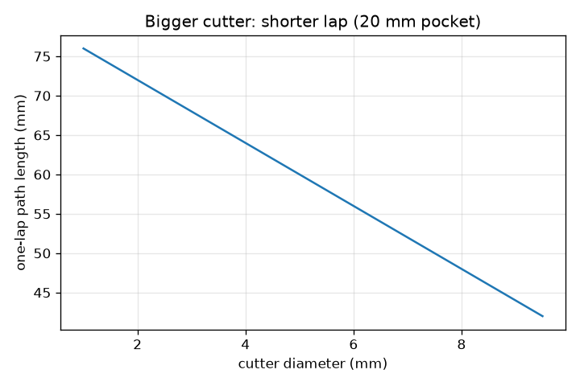
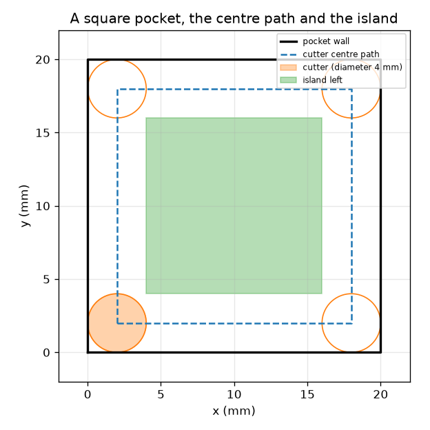

# सत्र 1: कटर एक पथ का अनुसरण करता है

*स्तर 1 (वैचारिक इंटरैक्टिव मॉडल) · लगभग 60 मिनट · opencncpath*

> यह एक सरलीकृत शैक्षिक मॉडल है। यह कोई प्रमाणित डिज़ाइन उपकरण नहीं है और इसका उपयोग वास्तविक संरचनाओं, विद्युत संस्थापनों, वाहनों, औद्योगिक प्रक्रियाओं या चिकित्सा निर्णयों के लिए नहीं किया जाना चाहिए।

**पूर्वापेक्षाएँ (Prerequisites)**

- दो बिंदुओं के बीच की दूरी; वर्ग का परिमाप (perimeter)।
- आपने PRIMER.md पढ़ लिया है और एक बार `python start.py 1` चला लिया है।

**सीखने के उद्देश्य (Learning objectives)।** इस सत्र के बाद आप:

- समझा सकेंगे कि CNC मशीन एक कटर (cutter) को निर्देशांकों (coordinates) की सूची के साथ वैसे ही चलाती है, जैसे प्लॉटर (plotter) एक पेन को चलाता है।
- एक वर्गाकार पॉकेट (pocket) के लिए कटर केंद्र का पथ ज्ञात कर सकेंगे: दीवार को एक कटर त्रिज्या (radius) अंदर खिसकाया गया।
- अनुमान लगा सकेंगे कि एक चक्कर (lap) के बाद बीच में कौन-सा द्वीप (island) बचता है।
- पथ की लंबाई और फ़ीड (feed) से उस पथ का समय निकाल सकेंगे।

## A. वास्तविक दुनिया की समस्या
एक प्लॉटर पेन को निर्देशांकों तक ले जाकर चित्र बनाता है। एक CNC (कंप्यूटर न्यूमेरिकल कंट्रोल, computer numerical control) मिलिंग मशीन यही काम एक घूमते कटर से करती है, जो स्याही के बजाय सामग्री को काटता है। एक वर्गाकार पॉकेट काटने के लिए मशीन को कटर केंद्र के बिंदुओं की सूची चाहिए, दीवार के बिंदुओं की नहीं। केंद्र को कहाँ जाना चाहिए ताकि कटर का किनारा ठीक दीवार को छुए, और एक चक्कर में कितना समय लगता है? केवल शैक्षिक ज्यामिति: वास्तविक मशीनिंग के लिए प्रशिक्षित ऑपरेटरों, मशीन-विशिष्ट पोस्ट-प्रोसेसिंग (post-processing) और सुरक्षा जाँचों की आवश्यकता होती है।

## B. अवधारणा और सिद्धांत
ऊपर से देखने पर कटर व्यास (diameter) d और त्रिज्या r = d/2 वाली एक डिस्क है। यदि उसका किनारा दीवार को छूना चाहिए, तो उसका केंद्र दीवार से r दूर रहना चाहिए: केंद्र पथ दीवार को r अंदर खिसकाने से बनता है, भुजा (side - 2r) = (side - d) वाला एक छोटा वर्ग। डिस्क अपने केंद्र से r के भीतर सब कुछ हटा देती है, इसलिए एक चक्कर हर दीवार के साथ 2r = d चौड़ी पट्टी साफ़ करता है (अंदर के चारों कोने थोड़े गोल रह जाते हैं)। बीच में जो बचता है वह एक द्वीप है, भुजा (side - 4r) = (side - 2d) वाला वर्ग, यदि यह धनात्मक हो। फ़ीड F पथ के साथ mm प्रति मिनट में गति है, इसलिए लंबाई L वाले पथ में L / F मिनट लगते हैं।

| प्रतीक | अर्थ | इकाई |
|---|---|---|
| side | वर्गाकार पॉकेट की भुजा | mm |
| d | कटर व्यास | mm |
| r | कटर त्रिज्या, d/2 | mm |
| F | फ़ीड दर (feed rate) (पथ के साथ गति) | mm/min |
| L | कटर-केंद्र पथ की लंबाई | mm |
| t | पथ का समय | s |

**मान्यताएँ (Assumptions)**

- ऊपर से देखने पर कटर एक सपाट डिस्क है और स्थिर फ़ीड से चलता है।
- केवल एक चक्कर; कोई प्लंजिंग (plunging) नहीं, कोई त्वरण (acceleration) नहीं, कोई तेज़ चाल (rapid moves) नहीं।
- पॉकेट एक पूर्ण वर्ग है जिसका कोना (0, 0) पर है।
- शैक्षिक ज्यामिति: यह मशीनिंग की कोई विधि नहीं है।

$$ r=\frac d2,\qquad L=4\,(\text{side}-d) $$

$$ t=\frac{L}{F}\cdot 60\ \text{s}\quad(F\ \text{in mm/min}) $$

$$ \text{island side}=\max(0,\ \text{side}-4r)=\max(0,\ \text{side}-2d) $$

## C. दृश्य व्याख्या
पहला चित्र 4 mm कटर के साथ 20 mm का वर्गाकार पॉकेट दिखाता है: काली दीवार, वह डैश वाला वर्ग जिसका कटर केंद्र अनुसरण करता है (2 mm से 18 mm तक), और बचा हुआ हरा द्वीप। दूसरा चित्र 20 mm पॉकेट के लिए कटर व्यास के सापेक्ष एक चक्कर के पथ की लंबाई दिखाता है: बड़ा कटर छोटे वर्ग का अनुसरण करता है, इसलिए चक्कर छोटा होता है और द्वीप भी छोटा।

*20 mm पॉकेट के लिए कटर व्यास के सापेक्ष एक चक्कर के पथ की लंबाई।*

*एक 20 mm पॉकेट: दीवार, कटर केंद्र पथ (2 से 18 mm), कटर और 12 mm का द्वीप।*

## D. इंटरैक्टिव सिमुलेशन
पाठ चलाएँ (`python start.py 1`), फिर लाइव ऐप खोलें: [सत्र 1: कटर एक पथ का अनुसरण करता है](https://krunalpanchal1995.github.io/pan-iit-oss/opencncpath/session-01/) (या इस फ़ोल्डर में `app.html`)। पॉकेट का आकार, कटर व्यास और फ़ीड बदलें। डैश वाले पथ और हरे द्वीप को बदलते देखें, फिर समय वाले दृश्य पर जाएँ और देखें कि फ़ीड बढ़ने पर समय कैसे घटता है।

**चुनौती।** 20 mm पॉकेट को एक ही चक्कर में पूरी तरह (बिना द्वीप के) 20 s से कम में साफ़ करें।

## E. हल किया गया उदाहरण और प्रयोग
**समस्या।** एक 20 mm वर्गाकार पॉकेट को 4 mm कटर से 120 mm/min पर काटा जाता है। केंद्र पथ, उसकी लंबाई, एक चक्कर का समय और बचा हुआ द्वीप ज्ञात करें।

1. त्रिज्या r = 4 / 2 = 2 mm। केंद्र पथ x और y में 2 mm से 18 mm तक का वर्ग है, जिसकी भुजा 16 mm है।
2. लंबाई L = 4 * 16 = 64 mm।
3. समय = 64 / 120 min = 0.533 min = 32.0 s।
4. द्वीप की भुजा = 20 - 4 * 2 = 12 mm: बीच में 12 mm का एक वर्ग अछूता रहता है।

**उत्तर।** कटर केंद्र 16 mm के वर्ग (64 mm लंबा) का अनुसरण करता है; एक चक्कर में 32.0 s लगते हैं और 12 mm का वर्गाकार द्वीप बचता है।

**प्रयोग।** खानेदार काग़ज़ पर 20 mm का वर्ग बनाएँ, कटर के मॉडल के रूप में कार्ड की 4 mm चौड़ी पट्टी काटें, उसे दीवार के अंदर-अंदर घुमाएँ और 2 mm की वह रेखा चिह्नित करें जिसका उसका केंद्र अनुसरण करता है। अछूते बीच के भाग को मापें: लगभग 12 mm। एक वास्तविक मशीन को 32.0 s से थोड़ा अधिक समय लगेगा क्योंकि वह कोनों पर धीमी होती है, और वास्तविक कटाई औज़ार के निशान छोड़ती है; मॉडल में गति स्थिर है और डिस्क सटीक है।

## F. मूल्यांकन और डिज़ाइन चुनौती
**प्रश्न प्रकार A: वैचारिक।** कटर केंद्र को दीवार से एक त्रिज्या अंदर वाले पथ का अनुसरण क्यों करना पड़ता है, और एक बड़े पॉकेट का एक चक्कर द्वीप क्यों छोड़ता है?

संकेत

कटर का किनारा उसके केंद्र के सापेक्ष कहाँ है? कटर पथ से कितनी दूर तक पहुँचता है?

चरण-दर-चरण हल

कटर का किनारा उसके केंद्र से एक त्रिज्या दूर है, इसलिए किनारे के दीवार को छूने के लिए केंद्र को दीवार से एक त्रिज्या दूर होना चाहिए। कटर केवल अपने केंद्र से एक त्रिज्या के भीतर की सामग्री हटाता है, इसलिए एक चक्कर दीवार के साथ 2r = d चौड़ी पट्टी साफ़ करता है; यदि पॉकेट 4r से चौड़ा है, तो बीच का भाग पहुँच से बाहर रहता है और द्वीप के रूप में बचा रहता है।

**प्रश्न प्रकार B: संख्यात्मक।** एक 30 mm वर्गाकार पॉकेट को 6 mm कटर से 150 mm/min पर काटा जाता है। पथ की लंबाई, एक चक्कर का समय और द्वीप की भुजा ज्ञात करें।

संकेत

L = 4 (side - d); t = L / F * 60; island = side - 2d.

चरण-दर-चरण हल

L = 4 * (30 - 6) = 96 mm। समय = 96 / 150 * 60 = 38.4 s। द्वीप की भुजा = 30 - 12 = 18 mm। सामान्य जाँच (sanity check): पथ पॉकेट की भुजा के 3 गुने से थोड़ा अधिक है, और धीमी फ़ीड (150 mm/min यानी 2.5 mm प्रति सेकंड) से दसियों सेकंड लगते हैं।

**प्रश्न प्रकार C: ग्राफ़ और सिमुलेशन की व्याख्या।** समय वाले ग्राफ़ में फ़ीड बढ़ने पर वक्र नीचे जाता है। यदि 64 mm पथ के लिए फ़ीड को 120 से आधा करके 60 mm/min कर दिया जाए, तो समय का क्या होता है? वक्र का आकार क्या बताता है?

संकेत

t = L / F * 60.

चरण-दर-चरण हल

समय 32 s से दोगुना होकर 64 s हो जाता है। वक्र एक अतिपरवलय (hyperbola) है (समय फ़ीड के व्युत्क्रमानुपाती है): कम फ़ीड पर तीव्र, ऊँची फ़ीड पर सपाट, इसलिए फ़ीड में पहली बढ़ोतरी से सबसे अधिक समय बचता है।

**प्रश्न प्रकार D: डिज़ाइन और अनुकूलन (optimisation) चुनौती।** डिज़ाइन: एक कटर व्यास और एक फ़ीड चुनें जिससे 20 mm पॉकेट एक चक्कर में, बिना द्वीप के, 20 s से कम में साफ़ हो जाए। क्या फ़ीड की कोई सीमा है?

संकेत

बिना द्वीप के लिए side <= 2d चाहिए। फिर t = 4 (side - d) / F * 60 < 20.

चरण-दर-चरण हल

Side <= 2d के लिए d >= 10 mm चाहिए; d = 10 mm लें। पथ 4 * (20 - 10) = 40 mm है। 20 s से कम समय के लिए F को 40 / 20 * 60 = 120 mm/min से ऊपर होना चाहिए (120 पर ठीक 20.0 s); 12.0 s के लिए 200 mm/min चुनें। समझौता (trade-off): सबसे बड़ा कटर और तेज़ फ़ीड समय बचाते हैं, लेकिन वास्तविक कटरों की एक अधिकतम फ़ीड होती है जो मशीन, सामग्री और कटर से तय होती है, और 10 mm कटर 5 mm त्रिज्या से तीखा अंदरूनी कोना नहीं काट सकता।

[RUBRIC.md](../../RUBRIC.md) से स्वयं को अंक दें। काग़ज़ पर काम करने के लिए [गतिविधि पत्रक](activity_sheet.md) प्रिंट करें।

## सामान्य भ्रांतियाँ (Common misconceptions)
| सामान्य भ्रांति | वास्तव में क्या सही है |
|---|---|
| कटर केंद्र दीवार का अनुसरण करता है। | केंद्र दीवार से एक त्रिज्या अंदर वाले पथ का अनुसरण करता है; किनारा दीवार का अनुसरण करता है। |
| एक चक्कर पूरे पॉकेट को साफ़ कर देता है। | एक चक्कर हर तरफ़ कटर व्यास के बराबर चौड़ी पट्टी साफ़ करता है; 4 त्रिज्याओं से चौड़े पॉकेट में द्वीप बचता है। |
| फ़ीड का अर्थ है स्पिंडल (spindle) कितनी तेज़ी से घूमता है। | फ़ीड पथ के साथ कटर की गति है (mm/min); स्पिंडल गति एक अलग संख्या है (rev/min)। |
| बड़ा कटर हमेशा लंबा काम होता है। | बड़ा कटर छोटे वर्ग का अनुसरण करता है, इसलिए चक्कर छोटा होता है; सीमा यह है कि उसे पॉकेट और कोनों में समाना चाहिए। |

## शब्दावली (Glossary)
- **CNC**: कंप्यूटर न्यूमेरिकल कंट्रोल (computer numerical control): एक मशीन जो किसी प्रोग्राम से मिले निर्देशांकों का अनुसरण करती है
- **टूलपाथ (toolpath)**: कटर जिन स्थितियों से गुज़रता है उनकी सूची
- **कटर केंद्र पथ (cutter centre path)**: कटर के मध्य भाग का पथ; दीवार को त्रिज्या जितना अंदर खिसकाया गया
- **फ़ीड (feed)**: पथ के साथ कटर की गति, mm प्रति मिनट में
- **द्वीप (island)**: पथ के अंदर बिना कटी बची सामग्री

## समापन
1. [exercises.md](exercises.md) में दिए तीन कोडिंग कार्य करें।
2. अपने बदलावों के बाद `python start.py 1` फिर से चलाएँ। यह चेकपॉइंट (checkpoint) के साथ समाप्त होता है; जब यह `PASS` प्रिंट करे, तो आपका काम पूरा है। (केवल चेकपॉइंट: `python start.py check 1`।)

आगे: [सत्र 2](../session-02/README.md)
