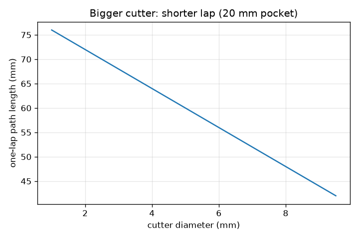
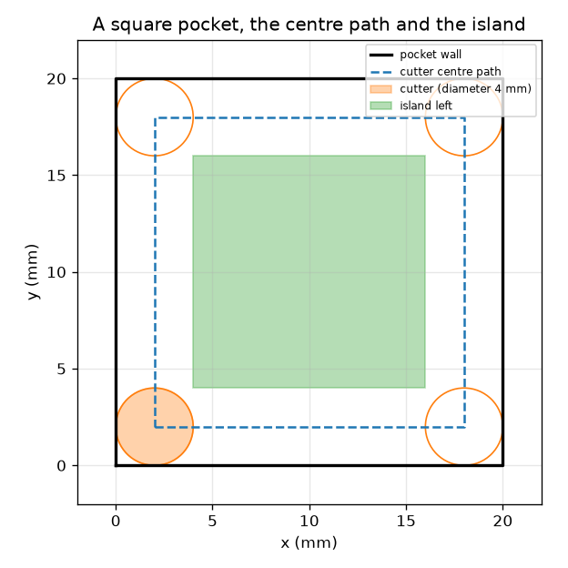

# സെഷൻ 1: ഒരു കട്ടർ ഒരു പാത പിന്തുടരുന്നു

[Session 1 — हिन्दी](README.hi.md)

*ലെവൽ 1 (ആശയപരമായ ഇന്ററാക്ടീവ് മോഡൽ) · ഏകദേശം 60 മിനിറ്റ് · opencncpath*

> ഇത് ലളിതമാക്കിയ ഒരു വിദ്യാഭ്യാസ മോഡൽ മാത്രമാണ്. ഇത് സാധൂകരിച്ച ഒരു ഡിസൈൻ ഉപകരണമല്ല; യഥാർത്ഥ നിർമ്മിതികൾ, വൈദ്യുത സംവിധാനങ്ങൾ, വാഹനങ്ങൾ, വ്യാവസായിക പ്രക്രിയകൾ അല്ലെങ്കിൽ മെഡിക്കൽ തീരുമാനങ്ങൾ എന്നിവയ്ക്ക് ഇത് ഉപയോഗിക്കരുത്.

**മുൻ‌അറിവ് (Prerequisites)**

- രണ്ട് ബിന്ദുക്കൾ തമ്മിലുള്ള ദൂരം; ഒരു സമചതുരത്തിന്റെ ചുറ്റളവ്.
- നിങ്ങൾ PRIMER.md വായിക്കുകയും `python start.py 1` ഒരിക്കൽ പ്രവർത്തിപ്പിക്കുകയും ചെയ്തിട്ടുണ്ട്.

**പഠന ലക്ഷ്യങ്ങൾ (Learning objectives).** ഈ സെഷനു ശേഷം നിങ്ങൾക്ക് കഴിയും:

- ഒരു പ്ലോട്ടർ പേന നീക്കുന്നതുപോലെ, ഒരു CNC മെഷീൻ കോർഡിനേറ്റുകളുടെ (coordinates) ഒരു പട്ടികയിലൂടെ കട്ടർ നീക്കുന്നു എന്ന് വിശദീകരിക്കാൻ.
- ഒരു സമചതുര പോക്കറ്റിന് (pocket) കട്ടർ കേന്ദ്രത്തിന്റെ പാത കണ്ടെത്താൻ: ഭിത്തി ഒരു കട്ടർ ആരം (radius) ഉള്ളിലേക്ക് നീക്കിയത്.
- ഒരു ചുറ്റ് (lap) നടുവിൽ ബാക്കിവയ്ക്കുന്ന ദ്വീപ് (island) പ്രവചിക്കാൻ.
- ഒരു പാതയുടെ നീളത്തിൽ നിന്നും ഫീഡിൽ (feed) നിന്നും അതിന്റെ സമയം കണക്കാക്കാൻ.

## A. യഥാർത്ഥ ലോക പ്രശ്നം
ഒരു പ്ലോട്ടർ പേന കോർഡിനേറ്റുകളിലേക്ക് നീക്കി വരയ്ക്കുന്നു. ഒരു CNC (computer numerical control) മില്ലിംഗ് മെഷീൻ മഷിക്കു പകരം വസ്തു കൊത്തിയെടുക്കുന്ന കറങ്ങുന്ന ഒരു കട്ടർ ഉപയോഗിച്ച് ഇതുതന്നെ ചെയ്യുന്നു. ഒരു സമചതുര പോക്കറ്റ് കൊത്താൻ, മെഷീന് ഭിത്തിക്കല്ല, കട്ടർ കേന്ദ്രത്തിനുള്ള ബിന്ദുക്കളുടെ പട്ടിക വേണം. കട്ടറിന്റെ അറ്റം ഭിത്തിയെ തൊട്ടുനിൽക്കാൻ കേന്ദ്രം എവിടെ പോകണം, ഒരു ചുറ്റിന് എത്ര സമയമെടുക്കും? വിദ്യാഭ്യാസപരമായ ജ്യാമിതി മാത്രം: യഥാർത്ഥ മെഷീനിംഗിന് പരിശീലനം ലഭിച്ച ഓപ്പറേറ്റർമാരും മെഷീനിനനുസരിച്ചുള്ള പോസ്റ്റ്-പ്രോസസ്സിംഗും സുരക്ഷാ പരിശോധനകളും ആവശ്യമാണ്.

## B. ആശയവും സിദ്ധാന്തവും
മുകളിൽ നിന്ന് നോക്കുമ്പോൾ കട്ടർ d വ്യാസമുള്ള (diameter), r = d/2 ആരമുള്ള ഒരു ഡിസ്ക് ആണ്. അതിന്റെ അറ്റം ഭിത്തിയെ തൊടണമെങ്കിൽ, അതിന്റെ കേന്ദ്രം ഭിത്തിയിൽ നിന്ന് r അകലെ നിൽക്കണം: കേന്ദ്രപാത ഭിത്തി r ഉള്ളിലേക്ക് നീക്കിയതാണ്, (side - 2r) = (side - d) വശമുള്ള ഒരു ചെറിയ സമചതുരം. ഡിസ്ക് അതിന്റെ കേന്ദ്രത്തിൽ നിന്ന് r-നുള്ളിലുള്ളതെല്ലാം നീക്കം ചെയ്യുന്നു, അതിനാൽ ഒരു ചുറ്റ് ഓരോ ഭിത്തിക്കും സമാന്തരമായി 2r = d വീതിയുള്ള ഒരു പട്ട വൃത്തിയാക്കുന്നു (നാല് ഉൾമൂലകൾ ചെറുതായി ഉരുണ്ടിരിക്കും). നടുവിൽ ബാക്കിയാകുന്നത് ഒരു ദ്വീപാണ്, (side - 4r) = (side - 2d) വശമുള്ള ഒരു സമചതുരം, അത് പോസിറ്റീവ് ആണെങ്കിൽ. ഫീഡ് F പാതയിലൂടെയുള്ള വേഗതയാണ്, mm / മിനിറ്റിൽ, അതിനാൽ L നീളമുള്ള ഒരു പാതയ്ക്ക് L / F മിനിറ്റ് എടുക്കും.

| ചിഹ്നം | അർത്ഥം | യൂണിറ്റ് |
|---|---|---|
| side | സമചതുര പോക്കറ്റിന്റെ വശം | mm |
| d | കട്ടർ വ്യാസം | mm |
| r | കട്ടർ ആരം, d/2 | mm |
| F | ഫീഡ് നിരക്ക് (പാതയിലൂടെയുള്ള വേഗത) | mm/min |
| L | കട്ടർ-കേന്ദ്ര പാതയുടെ നീളം | mm |
| t | പാതയ്ക്കുള്ള സമയം | s |

**അനുമാനങ്ങൾ (Assumptions)**

- മുകളിൽ നിന്ന് കാണുന്ന ഒരു പരന്ന ഡിസ്ക് ആണ് കട്ടർ, അത് സ്ഥിരമായ ഫീഡിൽ നീങ്ങുന്നു.
- ഒരു ചുറ്റ് മാത്രം; താഴേക്ക് ഇറക്കൽ (plunging) ഇല്ല, ത്വരണം (acceleration) ഇല്ല, വേഗ നീക്കങ്ങൾ (rapid moves) ഇല്ല.
- പോക്കറ്റ് (0, 0)-ൽ മൂലയുള്ള ഒരു തികഞ്ഞ സമചതുരമാണ്.
- വിദ്യാഭ്യാസപരമായ ജ്യാമിതി: ഇത് ഒരു മെഷീനിംഗ് പാചകക്കുറിപ്പ് അല്ല.

$$ r=\frac d2,\qquad L=4\,(\text{side}-d) $$

$$ t=\frac{L}{F}\cdot 60\ \text{s}\quad(F\ \text{in mm/min}) $$

$$ \text{island side}=\max(0,\ \text{side}-4r)=\max(0,\ \text{side}-2d) $$

## C. ദൃശ്യ വിശദീകരണം
ആദ്യ ചിത്രം 4 mm കട്ടറുള്ള 20 mm സമചതുര പോക്കറ്റ് കാണിക്കുന്നു: കറുത്ത ഭിത്തി, കട്ടർ കേന്ദ്രം പിന്തുടരുന്ന ഡാഷ് ചെയ്ത സമചതുരം (2 mm മുതൽ 18 mm വരെ), ബാക്കിയാകുന്ന പച്ച ദ്വീപ്. രണ്ടാമത്തെ ചിത്രം 20 mm പോക്കറ്റിന് കട്ടർ വ്യാസത്തിനെതിരെ ഒരു ചുറ്റിന്റെ പാതാനീളം പ്ലോട്ട് ചെയ്യുന്നു: വലിയ കട്ടർ ചെറിയ സമചതുരം പിന്തുടരുന്നു, അതിനാൽ ചുറ്റ് ചെറുതും ദ്വീപ് ചെറുതുമാകുന്നു.

*20 mm പോക്കറ്റിന് കട്ടർ വ്യാസത്തിനെതിരെ ഒരു ചുറ്റിന്റെ പാതാനീളം.*

*ഒരു 20 mm പോക്കറ്റ്: ഭിത്തി, കട്ടർ കേന്ദ്രപാത (2 മുതൽ 18 mm വരെ), കട്ടർ, 12 mm ദ്വീപ്.*

## D. ഇന്ററാക്ടീവ് സിമുലേഷൻ
പാഠം പ്രവർത്തിപ്പിക്കുക (`python start.py 1`), തുടർന്ന് ലൈവ് ആപ്പ് തുറക്കുക: [സെഷൻ 1: ഒരു കട്ടർ ഒരു പാത പിന്തുടരുന്നു](https://krunalpanchal1995.github.io/pan-iit-oss/opencncpath/session-01/) (അല്ലെങ്കിൽ ഈ ഫോൾഡറിലെ `app.html`). പോക്കറ്റിന്റെ വലുപ്പം, കട്ടർ വ്യാസം, ഫീഡ് എന്നിവ മാറ്റുക. ഡാഷ് ചെയ്ത പാതയും പച്ച ദ്വീപും മാറുന്നത് ശ്രദ്ധിക്കുക, തുടർന്ന് സമയ വ്യൂവിലേക്ക് മാറി ഫീഡ് കൂടുമ്പോൾ സമയം കുറയുന്നത് കാണുക.

**വെല്ലുവിളി.** 20 s-ൽ താഴെ സമയത്തിൽ ഒരു ചുറ്റിൽ 20 mm പോക്കറ്റ് പൂർണ്ണമായി (ദ്വീപില്ലാതെ) വൃത്തിയാക്കുക.

## E. ചെയ്തുകാണിച്ച ഉദാഹരണവും പരീക്ഷണവും
**പ്രശ്നം.** ഒരു 20 mm സമചതുര പോക്കറ്റ് 4 mm കട്ടർ ഉപയോഗിച്ച് 120 mm/min-ൽ മുറിക്കുന്നു. കേന്ദ്രപാത, അതിന്റെ നീളം, ഒരു ചുറ്റിനുള്ള സമയം, ബാക്കിയാകുന്ന ദ്വീപ് എന്നിവ കണ്ടെത്തുക.

1. ആരം r = 4 / 2 = 2 mm. കേന്ദ്രപാത x-ലും y-ലും 2 mm മുതൽ 18 mm വരെയുള്ള, 16 mm വശമുള്ള സമചതുരമാണ്.
2. നീളം L = 4 * 16 = 64 mm.
3. സമയം = 64 / 120 min = 0.533 min = 32.0 s.
4. ദ്വീപിന്റെ വശം = 20 - 4 * 2 = 12 mm: നടുവിലെ 12 mm സമചതുരം സ്പർശിക്കപ്പെടുന്നില്ല.

**ഉത്തരം.** കട്ടർ കേന്ദ്രം 16 mm സമചതുരം (64 mm നീളം) പിന്തുടരുന്നു; ഒരു ചുറ്റിന് 32.0 s എടുക്കുന്നു, 12 mm സമചതുര ദ്വീപ് ബാക്കിയാക്കുന്നു.

**പരീക്ഷണം.** ചതുരക്കള്ളി പേപ്പറിൽ 20 mm സമചതുരം വരയ്ക്കുക, കട്ടറിന്റെ മാതൃകയായി 4 mm വീതിയുള്ള ഒരു കാർഡ് പട്ട മുറിക്കുക, അത് ഭിത്തിയുടെ ഉൾവശത്തുകൂടി നീക്കി അതിന്റെ കേന്ദ്രം പിന്തുടരുന്ന 2 mm രേഖ അടയാളപ്പെടുത്തുക. തൊടാത്ത നടുഭാഗം അളക്കുക: ഏകദേശം 12 mm. ഒരു യഥാർത്ഥ മെഷീന് 32.0 s-നേക്കാൾ അൽപ്പം കൂടുതൽ വേണ്ടിവരും, കാരണം അത് മൂലകളിൽ വേഗത കുറയ്ക്കുന്നു, യഥാർത്ഥ മുറിക്കൽ ടൂൾ അടയാളങ്ങൾ ബാക്കിവയ്ക്കുന്നു; മോഡലിന് സ്ഥിര വേഗതയും കൃത്യമായ ഡിസ്കുമാണ്.

## F. വിലയിരുത്തലും ഡിസൈൻ വെല്ലുവിളിയും
**ചോദ്യ തരം A: ആശയപരം.** കട്ടർ കേന്ദ്രം ഭിത്തിക്ക് ഒരു ആരം ഉള്ളിലുള്ള പാത പിന്തുടരേണ്ടത് എന്തുകൊണ്ട്, ഒരു വലിയ പോക്കറ്റിന്റെ ഒരു ചുറ്റ് ദ്വീപ് ബാക്കിവയ്ക്കുന്നത് എന്തുകൊണ്ട്?

സൂചന

കട്ടറിന്റെ അറ്റം അതിന്റെ കേന്ദ്രത്തിൽ നിന്ന് എവിടെയാണ്? പാതയിൽ നിന്ന് കട്ടർ എത്ര ദൂരം എത്തുന്നു?

ഘട്ടം ഘട്ടമായുള്ള പരിഹാരം

കട്ടറിന്റെ അറ്റം അതിന്റെ കേന്ദ്രത്തിൽ നിന്ന് ഒരു ആരം അകലെയാണ്, അതിനാൽ അറ്റം ഭിത്തിയെ തൊടാൻ കേന്ദ്രം ഭിത്തിയിൽ നിന്ന് ഒരു ആരം അകലെയായിരിക്കണം. കട്ടർ അതിന്റെ കേന്ദ്രത്തിൽ നിന്ന് ഒരു ആരത്തിനുള്ളിലുള്ള വസ്തു മാത്രമേ നീക്കം ചെയ്യൂ, അതിനാൽ ഒരു ചുറ്റ് ഭിത്തിക്കരികിൽ 2r = d വീതിയുള്ള പട്ട വൃത്തിയാക്കുന്നു; പോക്കറ്റ് 4r-നേക്കാൾ വീതിയുള്ളതാണെങ്കിൽ, നടുഭാഗം എത്തിപ്പെടാത്തതാണ്, അത് ദ്വീപായി നിലനിൽക്കുന്നു.

**ചോദ്യ തരം B: സംഖ്യാപരം.** ഒരു 30 mm സമചതുര പോക്കറ്റ് 6 mm കട്ടർ ഉപയോഗിച്ച് 150 mm/min-ൽ മുറിക്കുന്നു. പാതാനീളം, ഒരു ചുറ്റിനുള്ള സമയം, ദ്വീപിന്റെ വശം എന്നിവ കണ്ടെത്തുക.

സൂചന

L = 4 (side - d); t = L / F * 60; island = side - 2d.

ഘട്ടം ഘട്ടമായുള്ള പരിഹാരം

L = 4 * (30 - 6) = 96 mm. സമയം = 96 / 150 * 60 = 38.4 s. ദ്വീപിന്റെ വശം = 30 - 12 = 18 mm. യുക്തിപരിശോധന: പാത പോക്കറ്റ് വശത്തിന്റെ 3 മടങ്ങിൽ അൽപ്പം കൂടുതൽ, മന്ദഗതിയിലുള്ള ഫീഡ് (150 mm/min എന്നാൽ സെക്കൻഡിൽ 2.5 mm) പത്തുകണക്കിന് സെക്കൻഡുകൾ നൽകുന്നു.

**ചോദ്യ തരം C: ഗ്രാഫും സിമുലേഷനും വ്യാഖ്യാനിക്കൽ.** സമയ ഗ്രാഫിൽ ഫീഡ് കൂടുമ്പോൾ വക്രം താഴുന്നു. 64 mm പാതയ്ക്ക് ഫീഡ് 120-ൽ നിന്ന് 60 mm/min ആയി പകുതിയാക്കിയാൽ സമയത്തിന് എന്ത് സംഭവിക്കും? വക്രത്തിന്റെ ആകൃതി എന്ത് പറയുന്നു?

സൂചന

t = L / F * 60.

ഘട്ടം ഘട്ടമായുള്ള പരിഹാരം

സമയം 32 s-ൽ നിന്ന് 64 s ആയി ഇരട്ടിക്കുന്നു. വക്രം ഒരു ഹൈപ്പർബോള (hyperbola) ആണ് (സമയം ഫീഡിന് വിപരീതാനുപാതത്തിൽ): കുറഞ്ഞ ഫീഡിൽ കുത്തനെ, ഉയർന്ന ഫീഡിൽ പരന്നത്, അതിനാൽ ഫീഡിലെ ആദ്യ വർദ്ധനകളാണ് ഏറ്റവും കൂടുതൽ സമയം ലാഭിക്കുന്നത്.

**ചോദ്യ തരം D: ഡിസൈനും ഒപ്റ്റിമൈസേഷൻ (optimisation) വെല്ലുവിളിയും.** ഡിസൈൻ: ഒരു 20 mm പോക്കറ്റ് ഒരു ചുറ്റിൽ, ദ്വീപില്ലാതെ, 20 s-ൽ താഴെ വൃത്തിയാക്കാൻ ഒരു കട്ടർ വ്യാസവും ഫീഡും തിരഞ്ഞെടുക്കുക. ഫീഡിന് ഒരു പരിധിയുണ്ടോ?

സൂചന

ദ്വീപില്ലാതിരിക്കാൻ side <= 2d വേണം. തുടർന്ന് t = 4 (side - d) / F * 60 < 20.

ഘട്ടം ഘട്ടമായുള്ള പരിഹാരം

Side <= 2d ആകാൻ d >= 10 mm വേണം; d = 10 mm എടുക്കുക. പാത 4 * (20 - 10) = 40 mm ആണ്. 20 s-ൽ താഴെ സമയത്തിന് F 40 / 20 * 60 = 120 mm/min-ന് മുകളിലായിരിക്കണം (120-ൽ കൃത്യം 20.0 s); 12.0 s-ന് 200 mm/min തിരഞ്ഞെടുക്കുക. വിട്ടുവീഴ്ച (trade-off): ഏറ്റവും വലിയ കട്ടറും വേഗതയേറിയ ഫീഡും സമയം ലാഭിക്കുന്നു, എന്നാൽ യഥാർത്ഥ കട്ടറുകൾക്ക് മെഷീൻ, വസ്തു, കട്ടർ എന്നിവ നിശ്ചയിക്കുന്ന പരമാവധി ഫീഡ് ഉണ്ട്, ഒരു 10 mm കട്ടറിന് 5 mm ആരത്തേക്കാൾ മൂർച്ചയുള്ള ഉൾമൂല മുറിക്കാൻ കഴിയില്ല.

[RUBRIC.md](../../RUBRIC.md) ഉപയോഗിച്ച് സ്വയം സ്കോർ ചെയ്യുക. പേപ്പറിൽ ചെയ്യാൻ [പ്രവർത്തന ഷീറ്റ്](activity_sheet.md) പ്രിന്റ് ചെയ്യുക.

## സാധാരണ തെറ്റിദ്ധാരണകൾ
| സാധാരണ തെറ്റിദ്ധാരണ | യഥാർത്ഥത്തിൽ ശരിയായത് |
|---|---|
| കട്ടർ കേന്ദ്രം ഭിത്തി പിന്തുടരുന്നു. | കേന്ദ്രം ഭിത്തിക്ക് ഒരു ആരം ഉള്ളിലുള്ള പാത പിന്തുടരുന്നു; അറ്റം ഭിത്തി പിന്തുടരുന്നു. |
| ഒരു ചുറ്റ് മുഴുവൻ പോക്കറ്റും വൃത്തിയാക്കുന്നു. | ഒരു ചുറ്റ് ഓരോ വശത്തും കട്ടർ വ്യാസത്തിന് തുല്യമായ വീതിയുള്ള പട്ട വൃത്തിയാക്കുന്നു; 4 ആരത്തേക്കാൾ വീതിയുള്ള പോക്കറ്റിൽ ഒരു ദ്വീപ് നിലനിൽക്കും. |
| ഫീഡ് എന്നാൽ സ്പിൻഡിൽ (spindle) എത്ര വേഗത്തിൽ കറങ്ങുന്നു എന്നതാണ്. | ഫീഡ് പാതയിലൂടെയുള്ള കട്ടറിന്റെ വേഗതയാണ് (mm/min); സ്പിൻഡിൽ വേഗത മറ്റൊരു സംഖ്യയാണ് (rev/min). |
| വലിയ കട്ടർ എന്നാൽ എപ്പോഴും നീണ്ട ജോലി. | വലിയ കട്ടർ ചെറിയ സമചതുരം പിന്തുടരുന്നു, അതിനാൽ ചുറ്റ് ചെറുതാണ്; പരിധി എന്തെന്നാൽ അത് പോക്കറ്റിലും മൂലകളിലും ഒതുങ്ങണം. |

## പദാവലി (Glossary)
- **CNC**: computer numerical control: ഒരു പ്രോഗ്രാമിൽ നിന്നുള്ള കോർഡിനേറ്റുകൾ പിന്തുടരുന്ന ഒരു മെഷീൻ
- **ടൂൾപാത്ത് (toolpath)**: കട്ടർ എടുക്കുന്ന സ്ഥാനങ്ങളുടെ പട്ടിക
- **കട്ടർ കേന്ദ്രപാത (cutter centre path)**: കട്ടറിന്റെ മധ്യഭാഗത്തിന്റെ പാത; ഭിത്തി ആരത്തോളം ഉള്ളിലേക്ക് നീക്കിയത്
- **ഫീഡ് (feed)**: പാതയിലൂടെയുള്ള കട്ടറിന്റെ വേഗത, mm / മിനിറ്റിൽ
- **ദ്വീപ് (island)**: ഒരു പാതയ്ക്കുള്ളിൽ മുറിക്കാതെ ബാക്കിയാകുന്ന വസ്തു

## പൂർത്തിയാക്കൽ
1. [exercises.md](exercises.md)-ലെ മൂന്ന് കോഡിംഗ് ടാസ്കുകൾ ചെയ്യുക.
2. നിങ്ങളുടെ മാറ്റങ്ങൾക്കു ശേഷം `python start.py 1` വീണ്ടും പ്രവർത്തിപ്പിക്കുക. അത് ചെക്ക്‌പോയിന്റിൽ (checkpoint) അവസാനിക്കുന്നു; അത് `PASS` എന്ന് പ്രിന്റ് ചെയ്യുമ്പോൾ നിങ്ങൾ പൂർത്തിയാക്കി. (ചെക്ക്‌പോയിന്റ് മാത്രം: `python start.py check 1`.)

അടുത്തത്: [സെഷൻ 2](../session-02/README.md)
