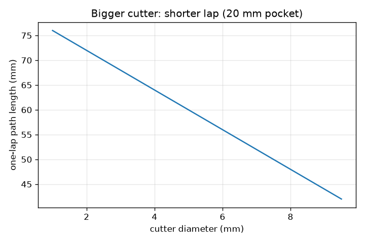
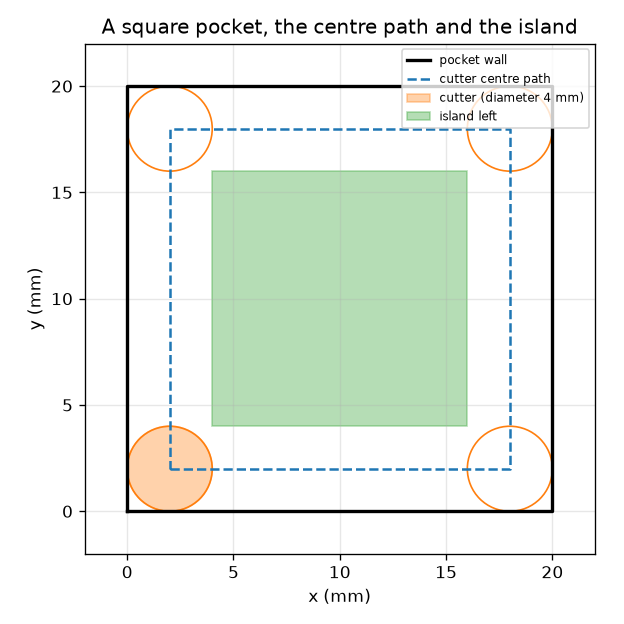

# அமர்வு 1: ஒரு வெட்டி (cutter) ஒரு பாதையைப் பின்தொடர்கிறது

[Session 1 — हिन्दी](README.hi.md)

*நிலை 1 (கருத்தியல் ஊடாடும் மாதிரி) · சுமார் 60 நிமிடங்கள் · opencncpath*

> இது எளிமைப்படுத்தப்பட்ட ஒரு கல்வி மாதிரி மட்டுமே. இது சரிபார்க்கப்பட்ட வடிவமைப்புக் கருவி அல்ல; உண்மையான கட்டமைப்புகள், மின் நிறுவல்கள், வாகனங்கள், தொழில்துறை செயல்முறைகள் அல்லது மருத்துவ முடிவுகளுக்கு இதைப் பயன்படுத்தக் கூடாது.

**முன்தேவைகள் (Prerequisites)**

- இரண்டு புள்ளிகளுக்கு இடையிலான தூரம்; ஒரு சதுரத்தின் சுற்றளவு.
- நீங்கள் PRIMER.md படித்து, `python start.py 1` ஒருமுறை இயக்கியிருக்க வேண்டும்.

**கற்றல் நோக்கங்கள் (Learning objectives).** இந்த அமர்வுக்குப் பிறகு உங்களால் முடியும்:

- ஒரு பிளாட்டர் பேனாவை நகர்த்துவது போல, ஒரு CNC இயந்திரம் ஆயத்தொலைவுகளின் (coordinates) ஒரு பட்டியலில் வெட்டியை நகர்த்துகிறது என்று விளக்க.
- ஒரு சதுரப் பள்ளத்துக்கு (pocket) வெட்டி மையத்தின் பாதையைக் கண்டறிய: சுவர் ஒரு வெட்டி ஆரம் (radius) உள்நோக்கி நகர்த்தப்பட்டது.
- ஒரு சுற்று (lap) நடுவில் விட்டுச் செல்லும் தீவைக் (island) கணிக்க.
- ஒரு பாதையின் நீளம் மற்றும் ஊட்டத்திலிருந்து (feed) அதன் நேரத்தைக் கணக்கிட.

## A. நிஜ உலகப் பிரச்சினை
ஒரு பிளாட்டர் பேனாவை ஆயத்தொலைவுகளுக்கு நகர்த்தி வரைகிறது. ஒரு CNC (computer numerical control) அரைக்கும் (milling) இயந்திரம் மைக்குப் பதிலாகப் பொருளைச் செதுக்கும் சுழலும் வெட்டியுடன் இதையே செய்கிறது. ஒரு சதுரப் பள்ளத்தைச் செதுக்க, இயந்திரத்துக்குச் சுவருக்கு அல்ல, வெட்டி மையத்துக்கான புள்ளிகளின் பட்டியல் தேவை. வெட்டியின் விளிம்பு சுவரைத் தொட்டுக்கொண்டிருக்க மையம் எங்கே செல்ல வேண்டும், ஒரு சுற்றுக்கு எவ்வளவு நேரம் ஆகும்? கல்விக்கான வடிவியல் மட்டுமே: உண்மையான இயந்திர வேலைக்குப் பயிற்சி பெற்ற இயக்குநர்கள், இயந்திரத்துக்கேற்ற பின்-செயலாக்கம் (post-processing) மற்றும் பாதுகாப்புச் சோதனைகள் தேவை.

## B. கருத்தும் கோட்பாடும்
மேலிருந்து பார்க்கும்போது வெட்டி d விட்டம் (diameter), r = d/2 ஆரம் கொண்ட ஒரு வட்டு. அதன் விளிம்பு சுவரைத் தொட வேண்டுமென்றால், அதன் மையம் சுவரிலிருந்து r தொலைவில் இருக்க வேண்டும்: மையப் பாதை என்பது சுவர் r உள்நோக்கி நகர்த்தப்பட்டது, (side - 2r) = (side - d) பக்கம் கொண்ட ஒரு சிறிய சதுரம். வட்டு அதன் மையத்திலிருந்து r-க்குள் உள்ள அனைத்தையும் நீக்குகிறது, எனவே ஒரு சுற்று ஒவ்வொரு சுவரையும் ஒட்டி 2r = d அகலமுள்ள ஒரு பட்டையைச் சுத்தம் செய்கிறது (நான்கு உள் மூலைகளும் சற்று வளைவாக இருக்கும்). நடுவில் மீதமிருப்பது ஒரு தீவு, (side - 4r) = (side - 2d) பக்கம் கொண்ட சதுரம், அது நேர்மமாக இருந்தால். ஊட்டம் F என்பது பாதையில் வேகம், mm / நிமிடத்தில், எனவே L நீளமுள்ள பாதைக்கு L / F நிமிடங்கள் ஆகும்.

| குறியீடு | பொருள் | அலகு |
|---|---|---|
| side | சதுரப் பள்ளத்தின் பக்கம் | mm |
| d | வெட்டி விட்டம் | mm |
| r | வெட்டி ஆரம், d/2 | mm |
| F | ஊட்ட வீதம் (பாதையில் வேகம்) | mm/min |
| L | வெட்டி-மையப் பாதையின் நீளம் | mm |
| t | பாதைக்கான நேரம் | s |

**அனுமானங்கள் (Assumptions)**

- வெட்டி மேலிருந்து பார்க்கப்படும் ஒரு தட்டையான வட்டு, மாறாத ஊட்டத்தில் நகர்கிறது.
- ஒரு சுற்று மட்டும்; கீழிறக்கம் (plunging) இல்லை, முடுக்கம் (acceleration) இல்லை, விரைவு நகர்வுகள் (rapid moves) இல்லை.
- பள்ளம் (0, 0)-இல் மூலையுடைய ஒரு முழுமையான சதுரம்.
- கல்விக்கான வடிவியல்: இது இயந்திர வேலைக்கான செய்முறை அல்ல.

$$ r=\frac d2,\qquad L=4\,(\text{side}-d) $$

$$ t=\frac{L}{F}\cdot 60\ \text{s}\quad(F\ \text{in mm/min}) $$

$$ \text{island side}=\max(0,\ \text{side}-4r)=\max(0,\ \text{side}-2d) $$

## C. காட்சி விளக்கம்
முதல் படம் 4 mm வெட்டியுடன் 20 mm சதுரப் பள்ளத்தைக் காட்டுகிறது: கருப்புச் சுவர், வெட்டி மையம் பின்தொடரும் கோடிட்ட சதுரம் (2 mm முதல் 18 mm வரை), மீதமிருக்கும் பச்சைத் தீவு. இரண்டாவது படம் 20 mm பள்ளத்துக்கு வெட்டி விட்டத்துக்கு எதிராக ஒரு சுற்றின் பாதை நீளத்தை வரைகிறது: பெரிய வெட்டி சிறிய சதுரத்தைப் பின்தொடர்கிறது, எனவே சுற்று குறுகியதாகவும் தீவு சிறியதாகவும் ஆகிறது.

*20 mm பள்ளத்துக்கு வெட்டி விட்டத்துக்கு எதிராக ஒரு சுற்றின் பாதை நீளம்.*

*ஒரு 20 mm பள்ளம்: சுவர், வெட்டி மையப் பாதை (2 முதல் 18 mm வரை), வெட்டி மற்றும் 12 mm தீவு.*

## D. ஊடாடும் உருவகப்படுத்தல் (Interactive simulation)
பாடத்தை இயக்குங்கள் (`python start.py 1`), பின்னர் நேரடிச் செயலியைத் திறங்கள்: [அமர்வு 1: ஒரு வெட்டி ஒரு பாதையைப் பின்தொடர்கிறது](https://krunalpanchal1995.github.io/pan-iit-oss/opencncpath/session-01/) (அல்லது இந்தக் கோப்புறையில் உள்ள `app.html`). பள்ளத்தின் அளவு, வெட்டி விட்டம், ஊட்டம் ஆகியவற்றை மாற்றுங்கள். கோடிட்ட பாதையும் பச்சைத் தீவும் மாறுவதைக் கவனியுங்கள், பின்னர் நேரக் காட்சிக்கு மாறி ஊட்டம் அதிகரிக்கும்போது நேரம் குறைவதைப் பாருங்கள்.

**சவால்.** 20 s-க்குள் ஒரே சுற்றில் 20 mm பள்ளத்தை முழுமையாக (தீவு இல்லாமல்) சுத்தம் செய்யுங்கள்.

## E. செய்து காட்டிய எடுத்துக்காட்டும் சோதனையும்
**பிரச்சினை.** ஒரு 20 mm சதுரப் பள்ளம் 4 mm வெட்டியால் 120 mm/min-இல் வெட்டப்படுகிறது. மையப் பாதை, அதன் நீளம், ஒரு சுற்றுக்கான நேரம், மீதமிருக்கும் தீவு ஆகியவற்றைக் கண்டறியுங்கள்.

1. ஆரம் r = 4 / 2 = 2 mm. மையப் பாதை x-இலும் y-இலும் 2 mm முதல் 18 mm வரையிலான, 16 mm பக்கம் கொண்ட சதுரம்.
2. நீளம் L = 4 * 16 = 64 mm.
3. நேரம் = 64 / 120 min = 0.533 min = 32.0 s.
4. தீவின் பக்கம் = 20 - 4 * 2 = 12 mm: நடுவில் உள்ள 12 mm சதுரம் தொடப்படுவதில்லை.

**விடை.** வெட்டி மையம் 16 mm சதுரத்தை (64 mm நீளம்) பின்தொடர்கிறது; ஒரு சுற்றுக்கு 32.0 s ஆகிறது, 12 mm சதுரத் தீவை விட்டுச் செல்கிறது.

**சோதனை.** சதுரக் கட்டத் தாளில் 20 mm சதுரத்தை வரையுங்கள், வெட்டியின் மாதிரியாக 4 mm அகலமுள்ள ஒரு அட்டைப் பட்டையை வெட்டுங்கள், அதைச் சுவரின் உட்புறமாகச் சுற்றி நகர்த்தி, அதன் மையம் பின்தொடரும் 2 mm கோட்டைக் குறியுங்கள். தொடப்படாத நடுப்பகுதியை அளவிடுங்கள்: சுமார் 12 mm. ஒரு உண்மையான இயந்திரத்துக்கு 32.0 s-ஐ விடச் சற்று அதிகம் தேவைப்படும், ஏனெனில் அது மூலைகளில் வேகம் குறைகிறது, உண்மையான வெட்டு கருவித் தடங்களை விட்டுச் செல்கிறது; மாதிரியில் மாறாத வேகமும் துல்லியமான வட்டும் உள்ளன.

## F. மதிப்பீடும் வடிவமைப்புச் சவாலும்
**கேள்வி வகை A: கருத்தியல்.** வெட்டி மையம் சுவருக்கு ஒரு ஆரம் உள்ளே உள்ள பாதையைப் பின்தொடர வேண்டியது ஏன், ஒரு பெரிய பள்ளத்தின் ஒரு சுற்று ஏன் தீவை விட்டுச் செல்கிறது?

குறிப்பு

வெட்டியின் விளிம்பு அதன் மையத்திலிருந்து எங்கே உள்ளது? பாதையிலிருந்து வெட்டி எவ்வளவு தூரம் எட்டுகிறது?

படிப்படியான தீர்வு

வெட்டியின் விளிம்பு அதன் மையத்திலிருந்து ஒரு ஆரம் தொலைவில் உள்ளது, எனவே விளிம்பு சுவரைத் தொட மையம் சுவரிலிருந்து ஒரு ஆரம் தொலைவில் இருக்க வேண்டும். வெட்டி அதன் மையத்திலிருந்து ஒரு ஆரத்துக்குள் உள்ள பொருளை மட்டுமே நீக்குகிறது, எனவே ஒரு சுற்று சுவரை ஒட்டி 2r = d அகலமுள்ள பட்டையைச் சுத்தம் செய்கிறது; பள்ளம் 4r-ஐ விட அகலமாக இருந்தால், நடுப்பகுதி எட்டாத தூரத்தில் இருந்து தீவாக நிலைக்கிறது.

**கேள்வி வகை B: எண்ணியல்.** ஒரு 30 mm சதுரப் பள்ளம் 6 mm வெட்டியால் 150 mm/min-இல் வெட்டப்படுகிறது. பாதை நீளம், ஒரு சுற்றுக்கான நேரம், தீவின் பக்கம் ஆகியவற்றைக் கண்டறியுங்கள்.

குறிப்பு

L = 4 (side - d); t = L / F * 60; island = side - 2d.

படிப்படியான தீர்வு

L = 4 * (30 - 6) = 96 mm. நேரம் = 96 / 150 * 60 = 38.4 s. தீவின் பக்கம் = 30 - 12 = 18 mm. நியாயச் சோதனை: பாதை பள்ளப் பக்கத்தின் 3 மடங்கை விடச் சற்று அதிகம், மெதுவான ஊட்டம் (150 mm/min என்பது வினாடிக்கு 2.5 mm) பத்துகளில் வினாடிகளைத் தருகிறது.

**கேள்வி வகை C: வரைபடம் மற்றும் உருவகப்படுத்தல் விளக்கம்.** நேர வரைபடத்தில் ஊட்டம் அதிகரிக்கும்போது வளைவு கீழிறங்குகிறது. 64 mm பாதைக்கு ஊட்டம் 120-இலிருந்து 60 mm/min ஆகப் பாதியாக்கப்பட்டால் நேரத்துக்கு என்ன ஆகும்? வளைவின் வடிவம் என்ன சொல்கிறது?

குறிப்பு

t = L / F * 60.

படிப்படியான தீர்வு

நேரம் 32 s-இலிருந்து 64 s ஆக இரட்டிப்பாகிறது. வளைவு ஒரு அதிபரவளையம் (hyperbola) (நேரம் ஊட்டத்துக்கு எதிர்விகிதத்தில்): குறைந்த ஊட்டத்தில் செங்குத்தானது, அதிக ஊட்டத்தில் தட்டையானது, எனவே ஊட்டத்தின் முதல் அதிகரிப்புகளே அதிக நேரத்தைச் சேமிக்கின்றன.

**கேள்வி வகை D: வடிவமைப்பு மற்றும் உகப்பாக்கம் (optimisation) சவால்.** வடிவமைப்பு: ஒரு 20 mm பள்ளத்தை ஒரே சுற்றில், தீவு இல்லாமல், 20 s-க்குள் சுத்தம் செய்ய ஒரு வெட்டி விட்டத்தையும் ஊட்டத்தையும் தேர்ந்தெடுங்கள். ஊட்டத்துக்கு வரம்பு உண்டா?

குறிப்பு

தீவு இல்லாமல் இருக்க side <= 2d தேவை. பின்னர் t = 4 (side - d) / F * 60 < 20.

படிப்படியான தீர்வு

Side <= 2d-க்கு d >= 10 mm தேவை; d = 10 mm எடுங்கள். பாதை 4 * (20 - 10) = 40 mm. 20 s-க்குக் குறைவான நேரத்துக்கு F 40 / 20 * 60 = 120 mm/min-ஐ விட அதிகமாக இருக்க வேண்டும் (120-இல் சரியாக 20.0 s); 12.0 s-க்கு 200 mm/min தேர்ந்தெடுங்கள். சமரசம் (trade-off): மிகப் பெரிய வெட்டியும் வேகமான ஊட்டமும் நேரத்தைச் சேமிக்கின்றன, ஆனால் உண்மையான வெட்டிகளுக்கு இயந்திரம், பொருள், வெட்டி ஆகியவற்றால் நிர்ணயிக்கப்படும் அதிகபட்ச ஊட்டம் உண்டு, மேலும் 10 mm வெட்டி 5 mm ஆரத்தை விடக் கூர்மையான உள் மூலையை வெட்ட முடியாது.

[RUBRIC.md](../../RUBRIC.md) மூலம் உங்களுக்கு நீங்களே மதிப்பெண் இடுங்கள். தாளில் செய்ய [செயல்பாட்டுத் தாளை](activity_sheet.md) அச்சிடுங்கள்.

## பொதுவான தவறான எண்ணங்கள்
| பொதுவான தவறான எண்ணம் | உண்மையில் சரியானது |
|---|---|
| வெட்டி மையம் சுவரைப் பின்தொடர்கிறது. | மையம் சுவருக்கு ஒரு ஆரம் உள்ளே உள்ள பாதையைப் பின்தொடர்கிறது; விளிம்பு சுவரைப் பின்தொடர்கிறது. |
| ஒரு சுற்று முழுப் பள்ளத்தையும் சுத்தம் செய்கிறது. | ஒரு சுற்று ஒவ்வொரு பக்கத்திலும் வெட்டி விட்டத்துக்குச் சமமான அகலமுள்ள பட்டையைச் சுத்தம் செய்கிறது; 4 ஆரங்களை விட அகலமான பள்ளத்தில் ஒரு தீவு நிலைக்கும். |
| ஊட்டம் என்பது சுழல்தண்டு (spindle) எவ்வளவு வேகமாகச் சுழல்கிறது என்பது. | ஊட்டம் என்பது பாதையில் வெட்டியின் வேகம் (mm/min); சுழல்தண்டு வேகம் வேறு ஒரு எண் (rev/min). |
| பெரிய வெட்டி என்றால் எப்போதும் நீண்ட வேலை. | பெரிய வெட்டி சிறிய சதுரத்தைப் பின்தொடர்கிறது, எனவே சுற்று குறுகியது; வரம்பு என்னவென்றால் அது பள்ளத்திலும் மூலைகளிலும் பொருந்த வேண்டும். |

## சொற்களஞ்சியம் (Glossary)
- **CNC**: computer numerical control: ஒரு நிரலிலிருந்து ஆயத்தொலைவுகளைப் பின்தொடரும் ஒரு இயந்திரம்
- **கருவிப் பாதை (toolpath)**: வெட்டி எடுக்கும் நிலைகளின் பட்டியல்
- **வெட்டி மையப் பாதை (cutter centre path)**: வெட்டியின் நடுப்பகுதியின் பாதை; சுவர் ஆரம் அளவு உள்நோக்கி நகர்த்தப்பட்டது
- **ஊட்டம் (feed)**: பாதையில் வெட்டியின் வேகம், mm / நிமிடத்தில்
- **தீவு (island)**: ஒரு பாதைக்குள் வெட்டப்படாமல் மீதமிருக்கும் பொருள்

## நிறைவு
1. [exercises.md](exercises.md)-இல் உள்ள மூன்று நிரலாக்கப் பணிகளைச் செய்யுங்கள்.
2. உங்கள் மாற்றங்களுக்குப் பிறகு `python start.py 1` மீண்டும் இயக்குங்கள். அது சோதனைச்சாவடியுடன் (checkpoint) முடிகிறது; அது `PASS` என்று அச்சிடும்போது நீங்கள் முடித்துவிட்டீர்கள். (சோதனைச்சாவடி மட்டும்: `python start.py check 1`.)

அடுத்தது: [அமர்வு 2](../session-02/README.md)
