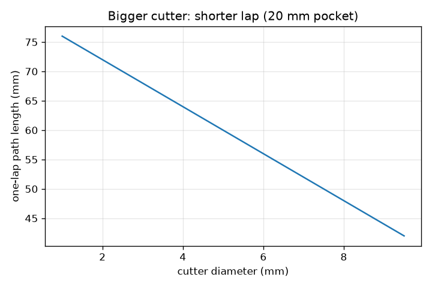
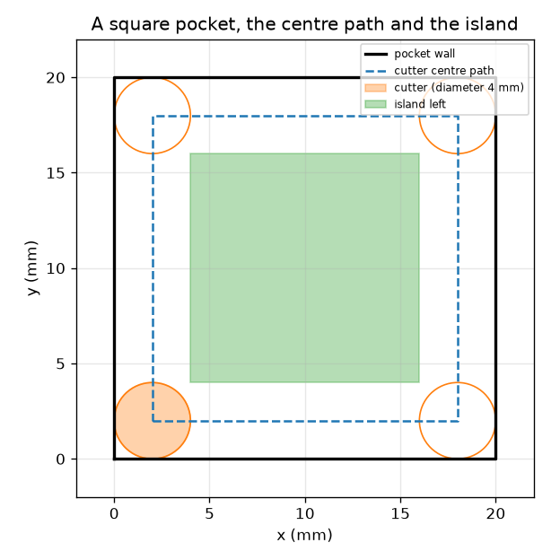

# సెషన్ 1: ఒక కట్టర్ ఒక మార్గాన్ని అనుసరిస్తుంది

[Session 1 — हिन्दी](README.hi.md)

*స్థాయి 1 (భావనాత్మక ఇంటరాక్టివ్ మోడల్) · సుమారు 60 నిమిషాలు · opencncpath*

> ఇది సరళీకరించిన విద్యా మోడల్ మాత్రమే. ఇది ధృవీకరించిన డిజైన్ సాధనం కాదు; నిజమైన నిర్మాణాలు, విద్యుత్ వ్యవస్థలు, వాహనాలు, పారిశ్రామిక ప్రక్రియలు లేదా వైద్య నిర్ణయాల కోసం దీన్ని ఉపయోగించకూడదు.

**ముందస్తు అవసరాలు (Prerequisites)**

- రెండు బిందువుల మధ్య దూరం; ఒక చతురస్రం చుట్టుకొలత.
- మీరు PRIMER.md చదివి, `python start.py 1` ఒకసారి నడిపి ఉండాలి.

**అభ్యాస లక్ష్యాలు (Learning objectives).** ఈ సెషన్ తర్వాత మీరు చేయగలరు:

- ప్లాటర్ పెన్నును కదిలించినట్లే, ఒక CNC యంత్రం నిరూపకాల (coordinates) జాబితా వెంట కట్టర్‌ను కదిలిస్తుందని వివరించడం.
- ఒక చతురస్ర పాకెట్ (pocket) కోసం కట్టర్ కేంద్రం మార్గాన్ని కనుగొనడం: గోడను ఒక కట్టర్ వ్యాసార్థం (radius) లోపలికి జరిపినది.
- ఒక రౌండ్ (lap) మధ్యలో వదిలివేసే ద్వీపాన్ని (island) ఊహించడం.
- ఒక మార్గం పొడవు మరియు ఫీడ్ (feed) నుండి దాని సమయాన్ని లెక్కించడం.

## A. నిజ జీవిత సమస్య
ఒక ప్లాటర్ పెన్నును నిరూపకాలకు కదిలించి గీస్తుంది. ఒక CNC (computer numerical control) మిల్లింగ్ యంత్రం సిరాకు బదులు పదార్థాన్ని చెక్కే తిరిగే కట్టర్‌తో ఇదే చేస్తుంది. ఒక చతురస్ర పాకెట్‌ను చెక్కడానికి, యంత్రానికి గోడ కోసం కాదు, కట్టర్ కేంద్రం కోసం బిందువుల జాబితా కావాలి. కట్టర్ అంచు గోడను తాకుతూ ఉండాలంటే కేంద్రం ఎక్కడికి వెళ్ళాలి, ఒక రౌండ్‌కు ఎంత సమయం పడుతుంది? విద్యా జ్యామితి మాత్రమే: నిజమైన మెషినింగ్‌కు శిక్షణ పొందిన ఆపరేటర్లు, యంత్రానికి తగిన పోస్ట్-ప్రాసెసింగ్ మరియు భద్రతా తనిఖీలు అవసరం.

## B. భావన మరియు సిద్ధాంతం
పై నుండి చూస్తే కట్టర్ d వ్యాసం (diameter), r = d/2 వ్యాసార్థం గల ఒక డిస్క్. దాని అంచు గోడను తాకాలంటే, దాని కేంద్రం గోడ నుండి r దూరంలో ఉండాలి: కేంద్ర మార్గం అంటే గోడను r లోపలికి జరిపినది, (side - 2r) = (side - d) భుజం గల ఒక చిన్న చతురస్రం. డిస్క్ దాని కేంద్రం నుండి r లోపల ఉన్న ప్రతిదాన్నీ తొలగిస్తుంది, కాబట్టి ఒక రౌండ్ ప్రతి గోడ వెంట 2r = d వెడల్పు గల పట్టీని శుభ్రం చేస్తుంది (నాలుగు లోపలి మూలలు కొద్దిగా గుండ్రంగా ఉంటాయి). మధ్యలో మిగిలేది ఒక ద్వీపం, (side - 4r) = (side - 2d) భుజం గల చతురస్రం, అది ధనాత్మకమైతే. ఫీడ్ F అంటే మార్గం వెంట వేగం, mm / నిమిషంలో, కాబట్టి L పొడవు గల మార్గానికి L / F నిమిషాలు పడుతుంది.

| చిహ్నం | అర్థం | యూనిట్ |
|---|---|---|
| side | చతురస్ర పాకెట్ భుజం | mm |
| d | కట్టర్ వ్యాసం | mm |
| r | కట్టర్ వ్యాసార్థం, d/2 | mm |
| F | ఫీడ్ రేటు (మార్గం వెంట వేగం) | mm/min |
| L | కట్టర్-కేంద్ర మార్గం పొడవు | mm |
| t | మార్గానికి సమయం | s |

**ఊహలు (Assumptions)**

- కట్టర్ పై నుండి చూసే ఒక చదునైన డిస్క్, స్థిరమైన ఫీడ్‌తో కదులుతుంది.
- ఒక రౌండ్ మాత్రమే; కిందికి దించడం (plunging) లేదు, త్వరణం (acceleration) లేదు, వేగవంతమైన కదలికలు (rapid moves) లేవు.
- పాకెట్ (0, 0) వద్ద మూల గల పరిపూర్ణ చతురస్రం.
- విద్యా జ్యామితి: ఇది మెషినింగ్ వంటకం కాదు.

$$ r=\frac d2,\qquad L=4\,(\text{side}-d) $$

$$ t=\frac{L}{F}\cdot 60\ \text{s}\quad(F\ \text{in mm/min}) $$

$$ \text{island side}=\max(0,\ \text{side}-4r)=\max(0,\ \text{side}-2d) $$

## C. దృశ్య వివరణ
మొదటి చిత్రం 4 mm కట్టర్‌తో 20 mm చతురస్ర పాకెట్‌ను చూపిస్తుంది: నల్లని గోడ, కట్టర్ కేంద్రం అనుసరించే డాష్ చతురస్రం (2 mm నుండి 18 mm వరకు), మిగిలిన ఆకుపచ్చ ద్వీపం. రెండవ చిత్రం 20 mm పాకెట్ కోసం కట్టర్ వ్యాసానికి వ్యతిరేకంగా ఒక రౌండ్ మార్గం పొడవును ప్లాట్ చేస్తుంది: పెద్ద కట్టర్ చిన్న చతురస్రాన్ని అనుసరిస్తుంది, కాబట్టి రౌండ్ చిన్నదిగా, ద్వీపం చిన్నదిగా అవుతుంది.

*20 mm పాకెట్ కోసం కట్టర్ వ్యాసానికి వ్యతిరేకంగా ఒక రౌండ్ మార్గం పొడవు.*

*ఒక 20 mm పాకెట్: గోడ, కట్టర్ కేంద్ర మార్గం (2 నుండి 18 mm), కట్టర్ మరియు 12 mm ద్వీపం.*

## D. ఇంటరాక్టివ్ సిమ్యులేషన్
పాఠాన్ని నడపండి (`python start.py 1`), తర్వాత లైవ్ యాప్‌ను తెరవండి: [సెషన్ 1: ఒక కట్టర్ ఒక మార్గాన్ని అనుసరిస్తుంది](https://krunalpanchal1995.github.io/pan-iit-oss/opencncpath/session-01/) (లేదా ఈ ఫోల్డర్‌లోని `app.html`). పాకెట్ పరిమాణం, కట్టర్ వ్యాసం, ఫీడ్‌లను మార్చండి. డాష్ మార్గం, ఆకుపచ్చ ద్వీపం మారడం గమనించండి, తర్వాత సమయ వ్యూకి మారి ఫీడ్ పెరిగినప్పుడు సమయం తగ్గడం చూడండి.

**సవాలు.** 20 s లోపు ఒకే రౌండ్‌లో 20 mm పాకెట్‌ను పూర్తిగా (ద్వీపం లేకుండా) శుభ్రం చేయండి.

## E. సాధించిన ఉదాహరణ మరియు ప్రయోగం
**సమస్య.** ఒక 20 mm చతురస్ర పాకెట్‌ను 4 mm కట్టర్‌తో 120 mm/min వద్ద కత్తిరిస్తారు. కేంద్ర మార్గం, దాని పొడవు, ఒక రౌండ్‌కు సమయం, మిగిలే ద్వీపం కనుగొనండి.

1. వ్యాసార్థం r = 4 / 2 = 2 mm. కేంద్ర మార్గం x మరియు y లో 2 mm నుండి 18 mm వరకు ఉన్న, 16 mm భుజం గల చతురస్రం.
2. పొడవు L = 4 * 16 = 64 mm.
3. సమయం = 64 / 120 min = 0.533 min = 32.0 s.
4. ద్వీపం భుజం = 20 - 4 * 2 = 12 mm: మధ్యలోని 12 mm చతురస్రం తాకబడదు.

**సమాధానం.** కట్టర్ కేంద్రం 16 mm చతురస్రాన్ని (64 mm పొడవు) అనుసరిస్తుంది; ఒక రౌండ్‌కు 32.0 s పడుతుంది, 12 mm చతురస్ర ద్వీపాన్ని వదిలివేస్తుంది.

**ప్రయోగం.** గ్రాఫ్ కాగితంపై 20 mm చతురస్రం గీయండి, కట్టర్ నమూనాగా 4 mm వెడల్పు గల కార్డు పట్టీ కత్తిరించండి, దాన్ని గోడ లోపలి వైపున చుట్టూ జరిపి దాని కేంద్రం అనుసరించే 2 mm రేఖను గుర్తించండి. తాకని మధ్య భాగాన్ని కొలవండి: సుమారు 12 mm. నిజమైన యంత్రానికి 32.0 s కంటే కొంచెం ఎక్కువ కావాలి, ఎందుకంటే అది మూలల వద్ద నెమ్మదిస్తుంది, నిజమైన కోత టూల్ గుర్తులను వదిలివేస్తుంది; మోడల్‌లో స్థిర వేగం, ఖచ్చితమైన డిస్క్ ఉన్నాయి.

## F. మూల్యాంకనం మరియు డిజైన్ సవాలు
**ప్రశ్న రకం A: భావనాత్మక.** కట్టర్ కేంద్రం గోడకు ఒక వ్యాసార్థం లోపల ఉన్న మార్గాన్ని ఎందుకు అనుసరించాలి, పెద్ద పాకెట్ యొక్క ఒక రౌండ్ ద్వీపాన్ని ఎందుకు వదిలివేస్తుంది?

సూచన

కట్టర్ అంచు దాని కేంద్రం నుండి ఎక్కడ ఉంది? మార్గం నుండి కట్టర్ ఎంత దూరం చేరుతుంది?

దశలవారీ పరిష్కారం

కట్టర్ అంచు దాని కేంద్రం నుండి ఒక వ్యాసార్థం దూరంలో ఉంటుంది, కాబట్టి అంచు గోడను తాకాలంటే కేంద్రం గోడ నుండి ఒక వ్యాసార్థం దూరంలో ఉండాలి. కట్టర్ దాని కేంద్రం నుండి ఒక వ్యాసార్థం లోపల ఉన్న పదార్థాన్ని మాత్రమే తొలగిస్తుంది, కాబట్టి ఒక రౌండ్ గోడ వెంట 2r = d వెడల్పు గల పట్టీని శుభ్రం చేస్తుంది; పాకెట్ 4r కంటే వెడల్పుగా ఉంటే, మధ్య భాగం అందుబాటులో ఉండదు, అది ద్వీపంగా మిగులుతుంది.

**ప్రశ్న రకం B: సంఖ్యాత్మక.** ఒక 30 mm చతురస్ర పాకెట్‌ను 6 mm కట్టర్‌తో 150 mm/min వద్ద కత్తిరిస్తారు. మార్గం పొడవు, ఒక రౌండ్‌కు సమయం, ద్వీపం భుజం కనుగొనండి.

సూచన

L = 4 (side - d); t = L / F * 60; island = side - 2d.

దశలవారీ పరిష్కారం

L = 4 * (30 - 6) = 96 mm. సమయం = 96 / 150 * 60 = 38.4 s. ద్వీపం భుజం = 30 - 12 = 18 mm. సహేతుకత తనిఖీ: మార్గం పాకెట్ భుజానికి 3 రెట్ల కంటే కొంచెం ఎక్కువ, నెమ్మదైన ఫీడ్ (150 mm/min అంటే సెకనుకు 2.5 mm) పదుల సెకన్లు ఇస్తుంది.

**ప్రశ్న రకం C: గ్రాఫ్ మరియు సిమ్యులేషన్ వ్యాఖ్యానం.** సమయ గ్రాఫ్‌లో ఫీడ్ పెరిగినప్పుడు వక్రం పడిపోతుంది. 64 mm మార్గానికి ఫీడ్ 120 నుండి 60 mm/min కి సగం చేస్తే సమయానికి ఏమవుతుంది? వక్రం ఆకారం ఏమి చెబుతుంది?

సూచన

t = L / F * 60.

దశలవారీ పరిష్కారం

సమయం 32 s నుండి 64 s కి రెట్టింపు అవుతుంది. వక్రం ఒక అతిపరావలయం (hyperbola) (సమయం ఫీడ్‌కు విలోమానుపాతంలో): తక్కువ ఫీడ్ వద్ద నిటారుగా, ఎక్కువ ఫీడ్ వద్ద చదునుగా, కాబట్టి ఫీడ్‌లో మొదటి పెంపులే ఎక్కువ సమయాన్ని ఆదా చేస్తాయి.

**ప్రశ్న రకం D: డిజైన్ మరియు ఆప్టిమైజేషన్ (optimisation) సవాలు.** డిజైన్: ఒక 20 mm పాకెట్‌ను ఒకే రౌండ్‌లో, ద్వీపం లేకుండా, 20 s లోపు శుభ్రం చేయడానికి కట్టర్ వ్యాసం మరియు ఫీడ్ ఎంచుకోండి. ఫీడ్‌కు పరిమితి ఉందా?

సూచన

ద్వీపం లేకుండా ఉండాలంటే side <= 2d కావాలి. తర్వాత t = 4 (side - d) / F * 60 < 20.

దశలవారీ పరిష్కారం

Side <= 2d కావాలంటే d >= 10 mm కావాలి; d = 10 mm తీసుకోండి. మార్గం 4 * (20 - 10) = 40 mm. 20 s లోపు సమయానికి F 40 / 20 * 60 = 120 mm/min కంటే ఎక్కువ ఉండాలి (120 వద్ద సరిగ్గా 20.0 s); 12.0 s కోసం 200 mm/min ఎంచుకోండి. రాజీ (trade-off): అతి పెద్ద కట్టర్ మరియు వేగవంతమైన ఫీడ్ సమయాన్ని ఆదా చేస్తాయి, కానీ నిజమైన కట్టర్లకు యంత్రం, పదార్థం, కట్టర్ నిర్ణయించే గరిష్ఠ ఫీడ్ ఉంటుంది, మరియు 10 mm కట్టర్ 5 mm వ్యాసార్థం కంటే పదునైన లోపలి మూలను కత్తిరించలేదు.

[RUBRIC.md](../../RUBRIC.md) తో మీకు మీరే స్కోర్ ఇవ్వండి. కాగితంపై పని చేయడానికి [కార్యకలాప పత్రాన్ని](activity_sheet.md) ప్రింట్ చేయండి.

## సాధారణ అపోహలు
| సాధారణ అపోహ | నిజంగా సరైనది |
|---|---|
| కట్టర్ కేంద్రం గోడను అనుసరిస్తుంది. | కేంద్రం గోడకు ఒక వ్యాసార్థం లోపల ఉన్న మార్గాన్ని అనుసరిస్తుంది; అంచు గోడను అనుసరిస్తుంది. |
| ఒక రౌండ్ మొత్తం పాకెట్‌ను శుభ్రం చేస్తుంది. | ఒక రౌండ్ ప్రతి వైపున కట్టర్ వ్యాసానికి సమానమైన వెడల్పు గల పట్టీని శుభ్రం చేస్తుంది; 4 వ్యాసార్థాల కంటే వెడల్పైన పాకెట్‌లో ద్వీపం మిగులుతుంది. |
| ఫీడ్ అంటే స్పిండిల్ (spindle) ఎంత వేగంగా తిరుగుతుందో. | ఫీడ్ అంటే మార్గం వెంట కట్టర్ వేగం (mm/min); స్పిండిల్ వేగం వేరే సంఖ్య (rev/min). |
| పెద్ద కట్టర్ అంటే ఎల్లప్పుడూ పొడవైన పని. | పెద్ద కట్టర్ చిన్న చతురస్రాన్ని అనుసరిస్తుంది, కాబట్టి రౌండ్ చిన్నది; పరిమితి ఏమిటంటే అది పాకెట్‌లో, మూలల్లో సరిపోవాలి. |

## పదకోశం (Glossary)
- **CNC**: computer numerical control: ఒక ప్రోగ్రామ్ నుండి నిరూపకాలను అనుసరించే యంత్రం
- **టూల్‌పాత్ (toolpath)**: కట్టర్ తీసుకునే స్థానాల జాబితా
- **కట్టర్ కేంద్ర మార్గం (cutter centre path)**: కట్టర్ మధ్య భాగం యొక్క మార్గం; గోడను వ్యాసార్థం మేర లోపలికి జరిపినది
- **ఫీడ్ (feed)**: మార్గం వెంట కట్టర్ వేగం, mm / నిమిషంలో
- **ద్వీపం (island)**: ఒక మార్గం లోపల కత్తిరించకుండా మిగిలిన పదార్థం

## ముగింపు
1. [exercises.md](exercises.md) లోని మూడు కోడింగ్ పనులు చేయండి.
2. మీ మార్పుల తర్వాత `python start.py 1` మళ్ళీ నడపండి. అది చెక్‌పాయింట్‌ (checkpoint) తో ముగుస్తుంది; అది `PASS` అని ప్రింట్ చేసినప్పుడు మీరు పూర్తి చేశారు. (చెక్‌పాయింట్ మాత్రమే: `python start.py check 1`.)

తర్వాత: [సెషన్ 2](../session-02/README.md)
