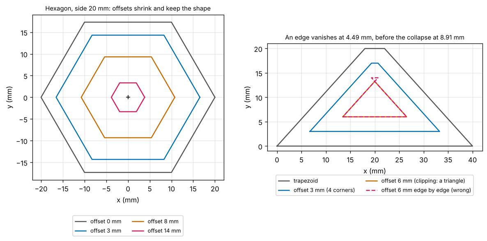
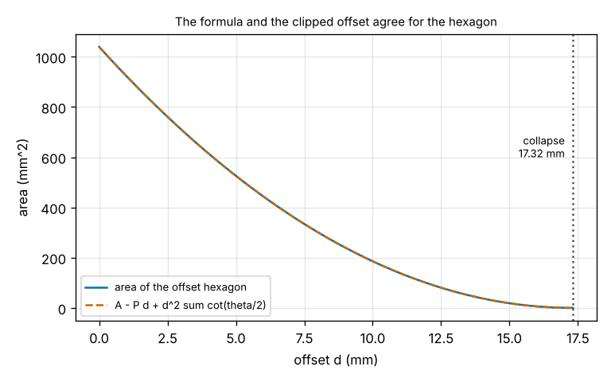
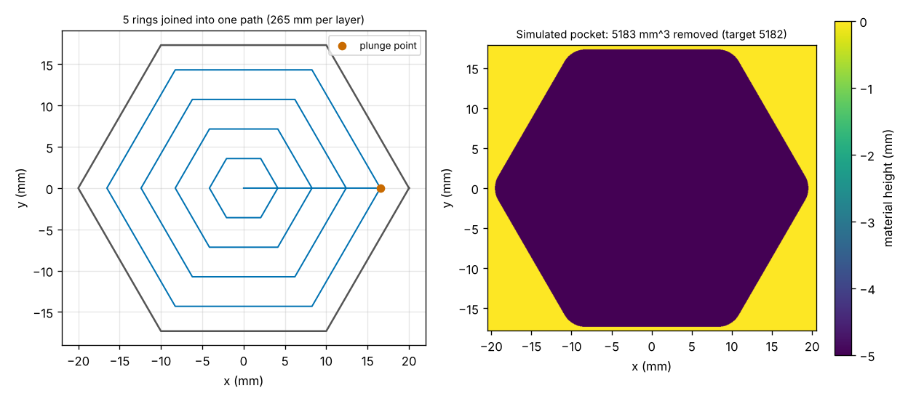

# Session 4: Offset any convex polygon

*Level 3 (simulation and validation) · about 90 minutes · opencncpath*

> This is a simplified educational model. It is not a validated design tool and must not be used for real structures, electrical installations, vehicles, industrial processes or medical decisions.

**Prerequisites**

- Session 2: the offset of a rectangle, G-code lines and layers.
- Session 3: the height-map simulation and the contour-parallel path.
- Sine, cotangent and the interior angle of a polygon (explained in Section B).

**Learning objectives.** After this session you can:

- Offset a convex polygon inwards edge by edge and compute the corner shift d / sin(theta / 2), the new edge lengths and the new area.
- Find the distance at which the offset collapses (the inscribed circle) and the distance at which an edge vanishes first.
- Compute the offset robustly as the intersection of shifted half-planes, and show where the edge-by-edge recipe fails.
- Build the rings and a one-plunge-per-layer path for a hexagonal pocket, write its G-code, read it back and check the removed volume.
- Detect the failure cases: a polygon that is not convex, a negative offset, a cutter that does not fit and a stepover that is too large.

## A. Real-world problem
Sessions 2 and 3 could offset only a rectangle: shrink each side by the cutter radius. A hexagonal pocket (a nut seat, a bolt-head recess) has six sides at 120 degrees, and the rectangle recipe does not carry over. How far does each corner of the cutter-centre path move? What happens when the offset is larger than the pocket allows? Can the same idea give a complete pocket path? Today we offset a convex polygon edge by edge, find the distance at which the offset collapses, repair the case where one edge disappears before the others, and cut a hexagonal pocket whose G-code we read back and simulate. Educational toolpath geometry only.

## B. Concept and theory
A convex polygon is listed counter-clockwise, so that its inside is on the left of every edge, and every turn is to the left. At a corner the interior angle theta is the angle between the two edges, measured inside. The **inward offset** by d moves every edge d along its inward normal; two neighbouring shifted lines meet in a new corner. That corner lies on the bisector of the old one, d / sin(theta / 2) away from it. Each edge keeps its direction and changes its length to L' = L - d (cot(theta_a / 2) + cot(theta_b / 2)), and while no edge has vanished the area is A(d) = A - P d + d^2 sum of cot(theta_i / 2), with P the perimeter. For the hexagon of side 20 mm and d = 3 mm the corner shift is 3.464 mm, the new side is 16.536 mm and the area is 710.41 mm^2.

The recipe breaks when an edge reaches length zero before the others: the two neighbouring shifted lines then cross behind each other and the result has a reversed edge. The correct offset is the **intersection of the shifted half-planes**: the part of the polygon that is at least d from every edge line. We compute it by clipping the polygon against one shifted line after another. An edge that vanishes simply drops out; when nothing is left the offset has **collapsed**. The collapse distance is the radius of the largest circle inside the polygon; for a regular polygon it is the apothem a / (2 tan(pi / n)), 17.32 mm for the hexagon of side 20 mm.

A cutter of diameter D (radius r) keeps its centre at least r from every wall, so its centre path is the polygon offset by r. To clear the pocket, cut rings at the offsets r, r + s, ... up to the collapse distance rho, with the stepover s at most D: n = ceil((rho - r) / s) + 1 rings, spaced evenly so that the last ring sits exactly at the collapse. The rings are cut from the wall inwards and joined by short straight links inside the area already cleared, so the cutter plunges once per layer. A round cutter cannot reach into a sharp corner: each corner of interior angle theta keeps r^2 (cot(theta / 2) - (pi - theta) / 2) of leftover area.

| Symbol | Meaning | Unit |
|---|---|---|
| d | inward offset distance | mm |
| theta | interior angle at a corner | radians |
| L, L' | edge length before and after the offset | mm |
| A, P | polygon area and perimeter | mm^2 and mm |
| rho | collapse distance (inscribed-circle radius) | mm |
| r, D | cutter radius and diameter | mm |
| s | stepover between rings | mm |

**Assumptions**

- A flat-end cutter, a convex polygon listed counter-clockwise, a flat pocket floor.
- Cutting moves are straight G1 lines; feed 300 mm/min, plunge 100 mm/min and rapids at 3000 mm/min are teaching numbers.
- The height-map has a cell size of 0.05 mm, so volumes are accurate to a fraction of a percent.

$$ \Delta_{\text{corner}}=\frac{d}{\sin(\theta/2)},\qquad L'=L-d\left(\cot\frac{\theta_a}{2}+\cot\frac{\theta_b}{2}\right),\qquad A(d)=A-Pd+d^{2}\sum_i\cot\frac{\theta_i}{2} $$

$$ \rho_{\text{regular}}=\frac{a}{2\tan(\pi/n)},\qquad n_{\text{rings}}=\left\lceil\frac{\rho-r}{s}\right\rceil+1,\qquad \text{leftover per corner}=r^{2}\left(\cot\frac{\theta}{2}-\frac{\pi-\theta}{2}\right) $$

## C. Visual explanation
The first figure has two panels. On the left the hexagon of side 20 mm is offset by 0, 3, 8 and 14 mm: every offset is again a hexagon, smaller and with the same shape, until it shrinks to a point at 17.32 mm. On the right a trapezoid (base 40 mm, top 4 mm, height 20 mm) shows the failure: at 3 mm the offset is still a four-cornered shape, at 6 mm the correct offset is a triangle (the top edge has vanished), and the dashed outline from the edge-by-edge recipe has a hook. The second figure compares the clipped area with the formula for the hexagon: they agree because all edges vanish together at the collapse. The third figure shows the five rings of the hexagon pocket joined into one path and the height-map after simulating the G-code.

*Left: hexagon offsets. Right: a trapezoid whose top edge vanishes before the collapse.*

*Area of the offset hexagon against the offset: clipping and formula.*

*The ring path of the hexagon pocket and the simulated height-map.*

## D. Interactive simulation
Run the lesson (`python start.py 4`), then open the live app: [Session 4: offset any convex polygon](https://krunalpanchal1995.github.io/pan-iit-oss/opencncpath/session-04/) (or `app.html` in this folder). Choose a regular polygon (3 to 8 sides) or a trapezoid and move the offset slider. The first graph draws the outline and its offset, with the wrong edge-by-edge outline in dashed magenta once an edge has vanished. The second graph plots the area against the offset with the formula, the first vanishing edge and the collapse. The third shows the ring path for the cutter diameter and stepover you choose, with the number of rings, the length of one layer and the cutting time of three layers.

**Challenge.** Choose the trapezoid (shape 1) and an offset d so that the offset still exists but has only 3 corners: one edge has vanished before the collapse.

## E. Worked example and experiment
**Problem.** A regular hexagon has side 20 mm. Offset it inwards by 3 mm. Find the corner shift, the new side length, the new area and the distance at which the offset collapses.

1. The interior angle is 120 degrees, so theta / 2 = 60 degrees.
2. The corner shift is d / sin 60 = 3 / 0.8660 = 3.4641 mm.
3. The new side is 20 - 3 (cot 60 + cot 60) = 20 - 3 x 1.1547 = 16.5359 mm.
4. The new area is (3 sqrt 3 / 2) x 16.5359^2 = 710.41 mm^2; the formula gives 1039.23 - 120 x 3 + 9 x 6 x 0.5774 = 710.41 mm^2.
5. The offset collapses at the apothem 20 / (2 tan 30) = 17.3205 mm; for a larger d nothing is left.

**Answer.** The corners move 3.464 mm, the new side is 16.536 mm, the new area is 710.41 mm^2 and the collapse is at 17.32 mm.

**Experiment.** Cut a regular hexagon of side 40 mm from card. With a ruler and a sharp pencil draw a line 6 mm inside every edge, parallel to it, and mark where neighbouring lines meet. Measure the new side with a ruler: the prediction is 40 - 6 x 1.1547 = 33.07 mm. Measure how far each new corner is from the old corner: the prediction is 6 / sin 60 = 6.93 mm. Repeat with a trapezoid cut from card (base 40 mm, top 4 mm, height 20 mm): at 6 mm the lines drawn from the two slanted sides meet in a triangle, and the line from the top side lies outside it, which is the failure the lesson describes. Expect rulers and pencils to give about 0.5 mm of scatter.

## Real-world application and mini-project: Offset any convex polygon and cut a hexagonal pocket
Use the lesson's `offset_polygon`, `collapse_distance`, `ring_offsets`, `pocket_path` and `pocket_gcode`. The roadmap target is that every corner of the offset hexagon (side 20 mm, offset 3 mm) lies 3 mm from its two neighbouring edges within 1e-6 mm (the shipped Sessions 2 and 3 code offsets only rectangles).

**Deliverable:** A script that returns the inward offset of any convex polygon (or None when it has collapsed), checks every corner of the offset hexagon against its two neighbouring edges, prints the collapse distance and the first distance at which an edge vanishes, writes the G-code of a hexagonal pocket (side 20 mm, 5 mm deep, 6 mm cutter, stepover 4 mm, depth of cut 2 mm), reads it back, and compares the simulated volume with the analytic one. It saves the graph of the offsets.

**Success looks like:** The six corners of the offset hexagon are 3 mm from their two neighbouring edges to within 5e-15 mm (needed: 1e-6 mm) and farther from the other four. The collapse is at 17.3205 mm, the apothem. The trapezoid loses its top edge at 4.49 mm and collapses at 8.91 mm; at 6 mm the edge-by-edge outline has a reversed edge of -1.34 mm and an area of 46.845 mm^2, against 47.347 mm^2 for the triangle from clipping. The pocket has 5 rings at offsets 3.0, 6.58, 10.16, 13.74 and 17.32 mm, a path of 264.6 mm per layer, 3 layers with 3 plunges, a cutting time of 166.5 s (167.9 s with rapids), a simulated volume of 5182.7 mm^3 against 5181.6 mm^3 analytic (+0.02 percent) and 2.90 mm^2 of corner leftover.

## F. Assessment and design challenge
**Question type A: Conceptual.** Why does a corner of the offset hexagon move by more than the offset distance, and why does the edge-by-edge recipe work for the hexagon but fail for the trapezoid of Figure 1?

Hint

Where is the point that is exactly d from both edges at a corner? Then compare when each edge of the two shapes reaches length zero.

Step-by-step solution

The new corner is the point at distance d from both edges, and it lies on the bisector of the corner, d / sin(theta / 2) away from the old one. The sharper the corner, the further it moves: 3.46 mm for the 120 degree corners of the hexagon at d = 3 mm, 4.24 mm for a square corner. Each edge also shortens by d (cot(theta_a / 2) + cot(theta_b / 2)). The recipe (shift every edge, intersect neighbours) is right as long as every edge still has positive length. In a regular polygon all edges reach length zero at the same distance, the collapse at the apothem, so the recipe holds up to the collapse. In the trapezoid the short top edge (4 mm) reaches zero at d = 4.49 mm, long before the collapse at 8.91 mm; beyond that the neighbouring lines cross behind each other, the top edge is reversed and the result is wrong. Clipping the polygon against the shifted half-planes has no such limit, because an edge that vanishes simply drops out.

**Question type B: Numerical.** A regular octagon has side 10 mm. Offset it inwards by 2 mm. Find the interior angle, how far the corners move, the new side length, the area of the offset octagon and the distance at which it collapses.

Hint

The interior angle of a regular n-gon is 180 - 360 / n degrees. Use d / sin(theta / 2), L - 2 d cot(theta / 2) and A - P d + d^2 sum cot(theta / 2).

Step-by-step solution

Interior angle 135 degrees, so theta / 2 = 67.5 degrees. Corner shift = 2 / sin 67.5 = 2.165 mm. New side = 10 - 2 x 2 x cot 67.5 = 10 - 4 x 0.4142 = 8.343 mm. The octagon has area A = 2 (1 + sqrt 2) x 100 = 482.84 mm^2 and perimeter P = 80 mm; sum of cot(theta / 2) over 8 corners = 3.314. A(2) = 482.84 - 80 x 2 + 4 x 3.314 = 336.10 mm^2, which equals 2 (1 + sqrt 2) x 8.343^2 = 336.10. It collapses at the apothem a / (2 tan(pi / 8)) = 10 / (2 x 0.4142) = 12.07 mm.

**Question type C: Graph and simulation interpretation.** In the right panel of Figure 1 (and in the app, with the trapezoid and d = 6 mm) the dashed outline has a small hook at the top. What went wrong, and how far from the right-hand wall are the two hook corners? What would a cutter of radius 6 mm do if it followed that outline?

Hint

Each corner of the dashed outline is the intersection of two shifted lines. Which wall's shifted line is it not on?

Step-by-step solution

At d = 6 mm the top edge has already vanished (it did so at 4.49 mm), so the two shifted slanted lines cross below the shifted top line. The corners of the dashed outline are the intersections of the shifted top line with one shifted slanted line each: (19.33, 14) is 6 mm from the top and from the left wall but only 5.00 mm from the right-hand wall, and (20.67, 14) is the mirror image. A cutter of radius 6 mm centred there reaches 1.0 mm into the wall: a gouge. The top edge of the dashed outline is also reversed (length -1.34 mm), which is the hook. The correct offset is the triangle with its apex at (20, 13.25), 6 mm from all three walls.

**Question type D: Design and optimisation challenge.** Design: a hexagonal recess for a nut, 24 mm across the flats, 5 mm deep, to be cut with a 6 mm cutter. Plan it: the side length, the number of rings for a stepover of 40 percent of the diameter, the layers, the cutting time (feed 300 mm/min, plunge 100 mm/min), and what the nut will see in the corners.

Hint

Across the flats is twice the apothem. Use n = ceil((rho - r) / s) + 1 rings, and the corner leftover r^2 (cot(theta / 2) - (pi - theta) / 2) per corner.

Step-by-step solution

Across the flats 24 mm means apothem 12 mm, so the side is 24 tan 30 = 13.86 mm and the pocket collapses at 12 mm. The cutter radius is 3 mm and the stepover is 0.4 x 6 = 2.4 mm. Rings: n = ceil((12 - 3) / 2.4) + 1 = 5 at offsets 3, 5.25, 7.5, 9.75 and 12 mm (spacing 2.25 mm, below 2.4). One layer is 166.3 mm of path; with 3 layers (5 mm at a depth of cut of 2 mm) the simulated program takes about 109 s including rapids, and removes 2480 mm^3 (analytic 2479.6). The six corners keep 2.90 mm^2 of leftover, a corner radius of about 3 mm, so a nut with sharp corners will not sit fully down. Options: a smaller cutter for a rest pass (the roadmap's Session 6), or accept the radius if the nut's corners are chamfered. The largest cutter that fits (24 mm) would give a single ring but about 11.6 mm^2 of leftover, which is why the cutter is chosen from the corner tolerance, not from the largest circle.

Score yourself with [RUBRIC.md](../../RUBRIC.md). Print the [activity sheet](activity_sheet.md) to work on paper.

## Common misconceptions
| Common misconception | What is actually true |
|---|---|
| Offsetting a polygon by d moves every corner by d. | Every edge moves by d, but a corner moves d / sin(theta / 2) along its bisector: 3.46 mm for the 120 degree corners of the hexagon at d = 3 mm and 4.24 mm for a square corner. |
| Shifting each edge and intersecting the neighbours always gives the offset. | Only until an edge has vanished. In the 40 / 4 / 20 mm trapezoid the top edge vanishes at 4.49 mm; at 6 mm the recipe gives a reversed edge and a path that gouges the wall by 1.0 mm. The clipped offset (intersection of the shifted half-planes) is always right. |
| A cutter fits if it is smaller than the shortest side. | It fits if its diameter is at most that of the largest circle inside the pocket (twice the collapse distance). The hexagon of side 20 mm takes a cutter up to 34.64 mm, and the trapezoid with a 4 mm top edge takes one of 17.8 mm. |
| Every ring needs its own plunge and its own lift. | The rings are nested, so a short straight link from the end of one ring to the start of the next stays inside the cleared area. The hexagon pocket has 5 rings per layer and needs one plunge per layer: 3 plunges in all. |

## Glossary
- **offset**: a curve moved by a fixed distance, here into the polygon
- **convex**: every turn goes the same way; no inside corner pokes in
- **interior angle**: the angle between two edges, measured inside the polygon
- **inscribed circle**: the largest circle that fits inside the polygon
- **collapse**: the offset distance beyond which nothing is left
- **apothem**: distance from the centre of a regular polygon to the middle of a side
- **half-plane**: all points on one side of a line
- **ring**: one closed outline of the cutter-centre path, at one offset

## Finish
1. Do the three coding tasks in [exercises.md](exercises.md).
2. Run `python start.py 4` again after your changes. It ends with the checkpoint; when it prints `PASS`, you are done. (Checkpoint only: `python start.py check 4`.)

Next: [Session 5: A pocket with a boss, cut without lifting](../session-05/README.md).
