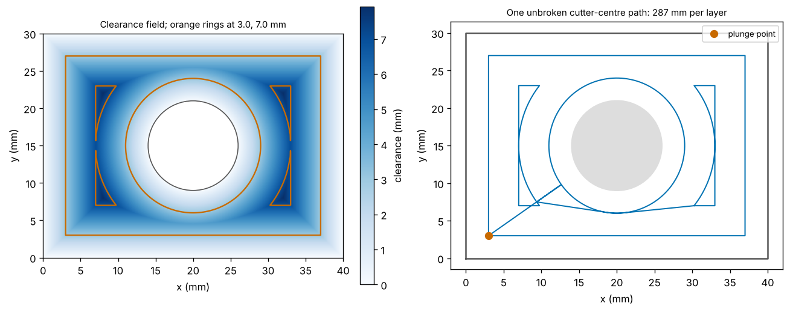
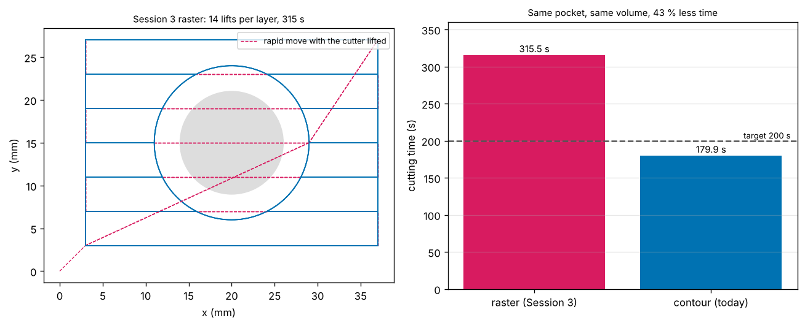
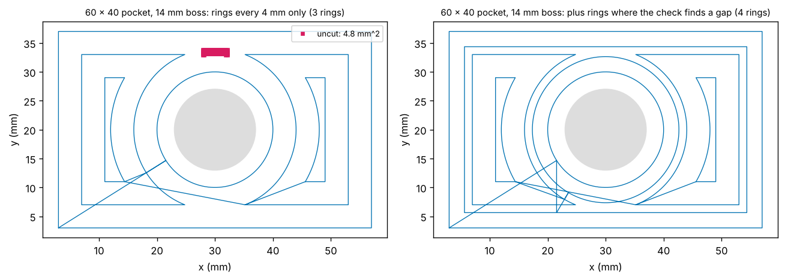
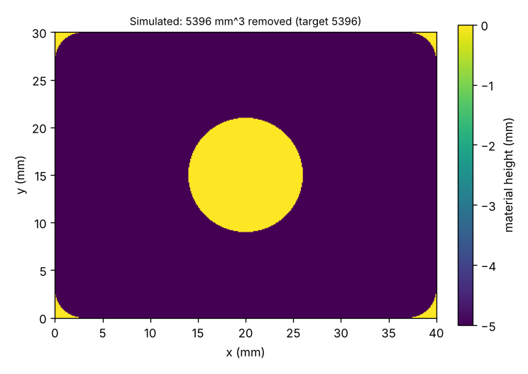

# Session 5: A pocket with a boss, cut without lifting

*Level 3 (simulation and validation) · about 90 minutes · opencncpath*

> This is a simplified educational model. It is not a validated design tool and must not be used for real structures, electrical installations, vehicles, industrial processes or medical decisions.

**Prerequisites**

- Session 3: the boss pocket, the height-map simulation and the G-code reader.
- Session 4: offsetting a polygon and cutting its rings in one path.
- Circles: the equation of a circle and a tangent line (explained in Section B).

**Learning objectives.** After this session you can:

- Compute the clearance of a point in a pocket with a boss, the largest clearance and the clearance at which a passage closes.
- Build the ring at a given clearance from line and arc pieces, and chain the pieces into closed loops.
- Arrange the rings of one layer as a tree and walk it into one unbroken path, with tangent links round the boss.
- Write the path as G1 and G2 code, read it back, and check the cutting time against 200 s and the volume against the analytic one.
- Check the coverage of the path, and detect the failure cases: a boss that blocks the cutter, a boss at a wall, a stepover that is too large.

## A. Real-world problem
The Session 3 program for the 40 x 30 mm pocket with a 12 mm boss cuts it in rows. Every row that meets the boss is cut in two pieces, and every piece is a lift, a rapid move and a plunge: 14 plunges per layer and 42 in all, and 315.5 s of cutting. A contour-parallel path follows the walls and the boss at a steady distance and can be one unbroken cut. The hard part is the join: as the rings move inward they touch the ring round the boss, split into two crescents at the narrow neck, and finally shrink to four points. Today we build that path from the clearance field (how far the cutter centre is from the nearest wall or the boss), cut it with straight moves and arcs, and check the time, the volume and the coverage. Educational toolpath geometry only.

## B. Concept and theory
The cutter centre may stand at a point only if the whole cutter fits: at least r from every wall and at least r_b + r from the boss centre. The **clearance** of a point is its distance to the nearest wall or to the boss surface, and the centre may stand where the clearance is at least r. The set of points with a given clearance l is the **ring** at l, a closed outline of the cutter-centre path: the boundary of the rectangle shrunk by l, minus a disc of radius r_b + l round the boss centre. It consists of **line pieces** (the sides of the shrunk rectangle that are outside the disc) and **arc pieces** (the circle where it is inside the rectangle). The first ring is at l = r, where the cutter touches the walls. Rings farther in have a larger l, up to the **largest clearance** rho, the clearance of the point deepest inside the pocket; the 40 x 30 mm pocket with the 12 mm boss has rho = 7.9546 mm.

The rings change shape as l grows. At first the ring is one rectangle with the boss circle as a hole. When the passage between the boss and a wall closes, at l = gap / 2 (4.5 mm at the top and bottom), the ring falls into pieces: a left and a right crescent. Further in, the crescents shrink to the four points where two walls and the boss are equally far. Every piece of a ring lies inside exactly one piece of the previous ring, so the pieces form a **tree**; a depth-first walk of the tree visits every piece, and between pieces the cutter moves along a **link**: a straight line if that stays outside the circle of radius r_b + r round the boss centre, otherwise a tangent line to that circle, an arc along it and a tangent line off it. All of this is in the space where the cutter centre may stand, which is cut anyway, so the cutter never has to lift inside a layer.

The rings are placed at l = r, r + s, r + 2 s, ... (stepover s, at most D), and a last ring at rho is added if the cutter, which reaches r past the last ring, would not reach it. That is not enough where a ring splits: the point in the middle of a closing passage is far from the ring on either side. So the planner checks the coverage on a grid of 0.25 mm and adds a ring just below the worst uncovered point, until every point of the pocket is within r of the path (except the rounded leftovers in the four corners). The path is written as G1 for the lines and G2 (clockwise) or G3 for the arcs.

| Symbol | Meaning | Unit |
|---|---|---|
| w, h | pocket width and height | mm |
| c, r_b | boss centre and radius | mm |
| r, D | cutter radius and diameter | mm |
| s | stepover between rings | mm |
| l (ell) | clearance of a ring | mm |
| rho | largest clearance | mm |
| R | radius of the link circle, r_b + r | mm |

**Assumptions**

- A flat-end cutter, a rectangular pocket with one round boss that does not touch a wall, a flat floor.
- Cutting moves are G1 and G2/G3 at 300 mm/min and plunges at 100 mm/min, three layers of 5/3 mm; these are teaching numbers. Whether to cut climb or conventional is not decided here.
- The height-map has a cell size of 0.1 mm, so volumes are accurate to a fraction of a percent.

$$ \varphi(x,y)=\min\Big(x,\; w-x,\; y,\; h-y,\; \lVert (x,y)-c\rVert - r_b\Big),\qquad \text{ring at clearance } \ell:\ \varphi=\ell,\qquad \text{centre may stand where } \varphi\ge r $$

$$ \ell_{\text{neck}}=\tfrac12\,\text{gap},\qquad \rho_{\max}=(c_x+c_y+r_b)-\sqrt{(c_x+c_y+r_b)^2-(c_x^2+c_y^2-r_b^2)},\qquad \text{link}=\sqrt{d_p^2-R^2}+\sqrt{d_q^2-R^2}+R\,\Delta\alpha $$

## C. Visual explanation
The first figure shows the clearance field of the roadmap pocket as a heat map with the two rings of the schedule (3 mm and 7 mm) in orange, and next to it the one-layer path made of them: the rectangle, the circle round the boss, the two crescents at 7 mm and the links between them. The second figure compares the Session 3 raster program (dashed magenta lines are the moves with the cutter lifted) with the contour program in cutting time. The third figure shows what goes wrong where a ring splits, and how the coverage check repairs it. The fourth is the height-map after simulating the G-code.

*Left: clearance of every point with the rings at 3 and 7 mm. Right: the one-layer path with its plunge point.*

*Left: the raster program of Session 3 with its lifts. Right: cutting time of the raster and the contour program.*

*Left: rings every 4 mm leave a block above the boss. Right: a ring added by the coverage check.*

*The simulated pocket: 5396 mm^3 removed.*

## D. Interactive simulation
Run the lesson (`python start.py 5`), then open the live app: [Session 5: a pocket with a boss](https://krunalpanchal1995.github.io/pan-iit-oss/opencncpath/session-05/) (or `app.html` in this folder). Move the boss, change its diameter, the cutter and the stepover. The first graph draws the rings, one colour for the planned ones and another for a ring added by the coverage check. The second shows the one-layer path with its plunge point and the cutting time of three layers against the Session 3 raster program. The third plots the cutting time of both programs against the stepover. If the boss leaves less room than the cutter needs, the app says why there is no path.

**Challenge.** Find a pocket where rings every stepover leave an uncut strip, so that the planner has to add a ring (hint: a wide pocket with a boss a little too big for the gap above it).

## E. Worked example and experiment
**Problem.** The 40 x 30 mm pocket has a round boss of diameter 12 mm at (20, 15). The cutter is 6 mm, the stepover 4 mm. Find the clearance at which the passage above the boss closes, the largest clearance, and the ring schedule.

1. The boss radius is 6 mm and its top is at y = 21 mm; the top wall is at y = 30 mm, so the gap is 9 mm.
2. The passage closes when the two rings use it up: 2 l = 9 mm, so l = 4.5 mm.
3. The deepest points are the corners: (20 - l)^2 + (15 - l)^2 = (6 + l)^2, so l^2 - 82 l + 589 = 0 and l = 41 - sqrt(1092) = 7.9546 mm.
4. The rings are at r = 3 mm and r + s = 7 mm. The next would be 11 mm, beyond 7.9546 mm. The cutter reaches 3 mm past the ring at 7 mm, which is 10 mm, beyond 7.9546 mm, so no last ring is needed.

**Answer.** The passage closes at 4.5 mm, the largest clearance is 7.9546 mm and the rings are at 3 mm and 7 mm.

**Experiment.** On card, draw a rectangle of 80 x 60 mm and cut a hole for a coin of 24 mm diameter placed in the middle. With a ruler and a compass draw the ring at clearance 6 mm: a rectangle 6 mm inside the edges and a circle of radius 12 + 6 = 18 mm round the coin centre. Draw the ring at 12 mm. The passage above the coin is 30 - 12 = 18 mm wide, so it should close at 9 mm: check that the ring at 12 mm is already in two pieces, one on each side of the coin. Expect rulers and compasses to give about 0.5 mm of scatter.

## Real-world application and mini-project: Contour-parallel pocket with a boss
The roadmap pocket: 40 x 30 mm, 5 mm deep, a boss of diameter 12 mm at (20, 15), a 6 mm cutter, stepover 4 mm, depth of cut 2 mm, feed 300 mm/min, plunge 100 mm/min. Use the lesson's `plan_pocket`, `contour_gcode` and `simulate_contour`, and the Session 3 `boss_pocket_gcode` as the baseline. The roadmap target is a cutting time (G1, G2, G3 and plunge moves) under 200 s and a simulated volume within 0.5 percent of 5395.9 mm^3, with no retract inside a layer (the shipped program needs 315.5 s).

**Deliverable:** A script that plans the path, writes the G-code, reads it back, prints the cutting time, the number of plunges and lifts, and the simulated and analytic volumes with their difference, compares them with the Session 3 raster program, and saves the pictures.

**Success looks like:** The largest clearance is 7.9546 mm and the rings are at 3 mm and 7 mm. One layer is 286.9 mm and the cutting time is 179.9 s (181.5 s with rapids) against 315.5 s for the raster program, with 3 plunges (one per layer) against 42. The simulated volume is 5396.2 mm^3 against 5395.9 mm^3 analytic (+0.006 percent) and nothing is cut inside the boss. The cutter centre never gets closer than 3.000 mm to a wall or 9.000 mm to the boss centre, and the coverage check finds no uncut point. For the 60 x 40 mm pocket with a 14 mm boss it finds a 4.75 mm^2 block, adds a ring at 5.64 mm and the volume is again within 0.006 percent.

## F. Assessment and design challenge
**Question type A: Conceptual.** In the 40 x 30 mm pocket with the 12 mm boss and a 6 mm cutter, the ring at clearance 4.4 mm is one closed outline with the boss circle as a hole, but the ring at 4.6 mm is in two pieces. Why does the split happen between those values, and why do the rings end in four points at 7.95 mm?

Hint

Look at the strip of free space between the boss and the top wall. How wide is the gap between them, and how much of it does each ring use up?

Step-by-step solution

A ring at clearance l is the boundary of the rectangle shrunk by l, minus a disc of radius 6 + l around the boss centre. Between the boss (top at y = 21 mm) and the top wall (y = 30 mm) there is a gap of 9 mm, and the ring uses l of it from the wall and l from the boss. The two sides of the gap meet when 2 l = 9 mm, so l = 4.5 mm: below that the ring passes through the gap and goes all the way round the boss; above it the passage is closed and the ring falls into a left and a right piece (the crescents). The pieces keep shrinking until they reach the points that are the same distance from two walls and from the boss. At a corner that point is (l, l) with (20 - l)^2 + (15 - l)^2 = (6 + l)^2, which gives l = 7.9546 mm, the largest clearance. A ring beyond it would be empty, so the rings end there.

**Question type B: Numerical.** A 50 x 30 mm pocket has a round boss of diameter 10 mm at its centre (25, 15) and is cut with a 6 mm cutter and a stepover of 4 mm. Find the clearance at which the passage above the boss closes, the largest clearance, the length of the first ring, and the clearance of every ring.

Hint

The gap above the boss is 15 - 5 mm. For the largest clearance use the corner point (l, l) with the distance to the boss centre equal to 5 + l. The first ring is a 44 x 24 mm rectangle and a circle.

Step-by-step solution

The gap between boss and wall is 15 - 5 = 10 mm, so the passage closes at l = 5.0 mm. For the corner point, with the centre at (25, 15) and boss radius 5: (25 - l)^2 + (15 - l)^2 = (5 + l)^2, so l^2 - 90 l + 825 = 0 and l = 45 - sqrt(1200) = 10.359 mm. The first ring is at l = 3 mm: a rectangle of (50 - 6) x (30 - 6) = 44 x 24 mm, perimeter 136 mm, with a circle of radius 5 + 3 = 8 mm, circumference 50.27 mm, as a hole, 186.27 mm in all (plus the links). The rings are at 3 mm, then every 4 mm: 7 mm; the next would be 11 mm, which is beyond 10.359 mm. The cutter reaches 3 mm past the ring at 7 mm, to 10 mm, which is short of 10.359 mm, so a last ring is added at the largest clearance, as a point in each corner. Rings: 3, 7 and 10.359 mm.

**Question type C: Graph and simulation interpretation.** In the left panel of Figure 3 (a 60 x 40 mm pocket with a 14 mm boss) the rings are 4 mm apart, yet there is a pink block of uncut material above the boss. How wide and how high is it, and why do rings that are at most the stepover apart leave it? What does the repair in the right panel cost?

Hint

Where is the passage between the boss and the top wall narrowest, and what is its clearance? Which rings come within the cutter radius of that point?

Step-by-step solution

The block is roughly 4 mm wide (x from 27.9 to 32.1 mm) and 1 mm high (y from 32.9 to 33.9 mm), with an area of 4.75 mm^2. The boss has radius 7 mm and its top is at y = 27 mm; the gap to the top wall (y = 40 mm) is 13 mm, so the passage closes at l = 6.5 mm and the point in its middle has a clearance of 6.5 mm. The ring at 3 mm is 3.5 mm away from it, which is more than the cutter radius of 3 mm, and the ring at 7 mm no longer passes through the closed passage: it is in two pieces on either side. The spacing of 4 mm only helps where the next ring is actually next door. The coverage check finds the points, and the planner adds a ring at 5.64 mm, just below the worst point. That removes the block but lengthens one layer from 578.3 to 828.0 mm (+43 percent): the cutting time of 3 layers goes from 354.8 s to 504.6 s. A short straight cut across the neck (an exercise below) would be far cheaper.

**Question type D: Design and optimisation challenge.** Design: cut the 50 x 30 mm pocket with the 10 mm boss of question B, 5 mm deep, with a 6 mm cutter, depth of cut 2 mm, stepover 4 mm, feed 300 mm/min and plunge 100 mm/min. Plan it with the contour planner and compare it with the Session 3 raster program: layers, plunges, cutting time and volume.

Hint

Use plan_pocket and simulate_contour for the new program and boss_pocket_gcode with read_moves for the old one. The analytic volume is (area - boss - corner leftovers) x depth.

Step-by-step solution

There are ceil(5 / 2) = 3 layers. The planner gives rings at 3, 7 and 10.359 mm, a path of 364.0 mm per layer, 3 plunges and no lift inside a layer. The cutting time is 3 x 364.0 / 300 x 60 + 13.0 / 100 x 60 = 226.2 s. The raster program has 36 plunges (12 per layer) and takes 363.9 s, so the contour path saves 38 percent. The simulated volume is 7068.4 mm^3 against an analytic (1500 - 78.54 - 7.73) x 5 = 7068.7 mm^3 (-0.004 percent). Rings that are 4 mm apart are enough here because the passage above the boss, at 5 mm, closes before the ring at 7 mm, and the point in its middle (clearance 5) is only 2 mm from the ring at 3 mm. The saving is smaller than in the 40 x 30 mm pocket (43 percent).

Score yourself with [RUBRIC.md](../../RUBRIC.md). Print the [activity sheet](activity_sheet.md) to work on paper.

## Common misconceptions
| Common misconception | What is actually true |
|---|---|
| A pocket with a boss is the offset of the outline plus a circle around the boss. | Only for the first ring. When the two curves touch, the ring becomes one boundary of line and arc pieces; at 4.5 mm in the roadmap pocket it falls into two crescents, and later into four corner points. The planner follows that tree. |
| Rings that are at most one stepover apart clear everything between them. | Not where a ring splits. In a 60 x 40 mm pocket with a 14 mm boss the rings at 3 mm and 7 mm leave a 4.75 mm^2 block above the boss, because the passage closes at 6.5 mm and both rings are more than the cutter radius from its middle. The coverage check finds such places. |
| To get from one ring to the next the cutter has to lift. | The rings are in the free space for the cutter centre, so a short straight link inside it never gouges anything. If the straight line would cross the boss, the link goes tangent, along the circle of radius (boss radius + cutter radius) and off again: 35.58 mm instead of 30 mm between (5, 15) and (35, 15). |
| A boss that fits in the pocket can always be cut round in one pass. | Only if the cutter fits between the boss and every wall. In a 40 x 30 mm pocket a 20 mm boss leaves gaps of 5 mm above and below, narrower than a 6 mm cutter, and the free space has two separate parts: any path has to lift once. |

## Glossary
- **clearance**: the distance from a point to the nearest wall or to the boss
- **level set (ring)**: all the points with the same clearance: one closed outline of the cutter-centre path
- **largest clearance**: the clearance of the point deepest inside the pocket; beyond it the rings are empty
- **neck**: a narrow passage between the boss and a wall; the ring splits where it closes
- **tree**: the pieces of every ring, each linked to the piece of the previous ring that contains it
- **link**: the straight or curved move that joins the end of one loop to the start of the next
- **tangent**: a line that touches a circle in one point without crossing it
- **G2 / G3**: clockwise and counter-clockwise arc moves in G-code

## Finish
1. Do the three coding tasks in [exercises.md](exercises.md).
2. Run `python start.py 5` again after your changes. It ends with the checkpoint; when it prints `PASS`, you are done. (Checkpoint only: `python start.py check 5`.)

Next: the [roadmap](../../promo/roadmap.md). Session 6 is yours to build.

**Honest limits.** The planner handles one round boss that lies wholly inside a rectangular pocket and leaves room for the cutter on every side that matters; it refuses a boss that closes off part of the pocket (the cutter would have to lift) and does not decide climb or conventional cutting. The coverage repair costs a whole ring and a cheaper local fix is left as an exercise.
