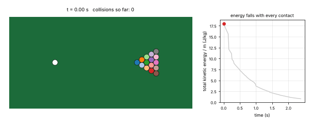
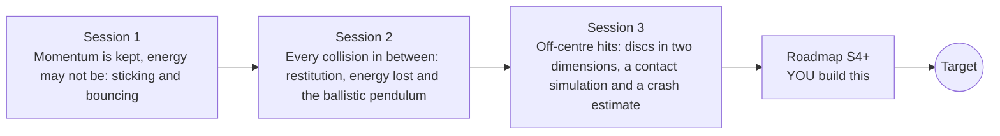

# opencollisions

[](https://github.com/KrunalPanchal1995/pan-iit-oss/actions/workflows/tests.yml)   [](https://colab.research.google.com/github/KrunalPanchal1995/pan-iit-oss/blob/main/opencollisions/sessions/session-01/lesson.ipynb) [](https://krunalpanchal1995.github.io/pan-iit-oss/opencollisions/)

**Predict what happens in collisions with momentum and energy, in three sessions.**

opencollisions teaches how two bodies move after they hit: momentum conservation for sticking and bouncing, the coefficient of restitution and the energy lost, and off-centre collisions of two discs checked against a time-stepping contact simulation, using only Python and a browser.

- **Start from the question.** Session 1 asks what is the same in a sticking and a bouncing collision, using only momentum and energy.
- **See it move.** Every session ships a slider app that runs in the browser, with labelled graphs and bar charts.
- **Know you got it right.** Each session ends with a checkpoint that prints PASS or FAIL against hand calculations, conservation laws and an independent simulation.
- **Build the missing half.** The repo stops at Session 3 on purpose; the roadmap shows the path to the Target.

[Target](#the-target) · [Who is this for](#who-is-this-for) · [Quick start](#quick-start) · [Sessions](#sessions) · [Roadmap](#roadmap) · [Contribute](#contribute) · [Explainer PDF](docs/explainer.pdf)

> **This repo is incomplete on purpose.** Sessions 1 to 3 are here and fully working. The finished Target below is a preview of what the community can build next. We show you the path, not the code. Sessions 4 and up are yours.

## The Target
A cue ball strikes a triangle of fifteen discs on a table with cushions. Every contact between two discs uses the normal-impulse rule of Session 3 with a coefficient of restitution of 0.95, the cushions take a little energy at each bounce and a small rolling resistance slows everything down. On the left, the discs scatter across the table; on the right, the total kinetic energy and the running count of collisions are plotted against time. The Target uses a richer model than the repo (many bodies, cushions and rolling resistance); your goal over the coming sessions is to build it yourself.



*Target: a cue ball breaks a triangle of 15 discs on a table; total kinetic energy falls with every contact*

How the Target was made is shown only as a path in [promo/roadmap.md](promo/roadmap.md).

## Who is this for
**secondary to diploma/undergrad (levels 3-5).** Topic area: Physics and the Science of Motion.

Prerequisites:

- Speed, mass and force at school level; kinetic energy 1/2 m v^2 is explained in Session 1.
- Vectors in a plane (components and the dot product) at school level for Session 3.
- Python 3.10 or newer; if `python --version` works, you are ready. PRIMER.md explains the rest.
- No prior GitHub or mechanics experience is needed.

New to Python? Read [PRIMER.md](PRIMER.md) first (10 minutes).

## Quick start

No installation knowledge needed. You need [Git](https://git-scm.com/downloads) and [Python 3.10+](https://www.python.org/downloads/) (Windows: tick "Add Python to PATH"). On Mac and Linux type `python3` wherever this page says `python`.

```bash
git clone https://github.com/KrunalPanchal1995/pan-iit-oss.git
cd pan-iit-oss/opencollisions
python start.py 1
```

`start.py` creates a private environment, installs what is needed and runs Session 1 with its checkpoint. Next: `python start.py 2`, `python start.py 3`, or `python start.py test` to check everything. Only a checkpoint: `python start.py check 1`.

<!-- friendly-help -->
<details>
<summary><b>Not working? Common fixes (no Git, "python not found", no internet)</b></summary>

- **No Git?** You do not need it. On the main page of this collection click the green **Code** button, then **Download ZIP**, unzip it, open a terminal inside the folder `pan-iit-oss-main/opencollisions` and run `python start.py 1`. The ZIP holds every project, so it is large; the live apps need no download at all.
- **"python is not recognized" or "command not found".** On Windows try `py start.py 1`. On Mac and Linux try `python3 start.py 1`. If neither works, install Python from [python.org](https://www.python.org/downloads/) and tick "Add Python to PATH".
- **Needs internet once.** The first run downloads NumPy and Matplotlib into a private folder (`.venv`); after that it works offline.
- **Rather not install anything?** Open the [live apps](https://krunalpanchal1995.github.io/pan-iit-oss/opencollisions/) in your browser, or use the Colab badge at the top of this page.
- **Still stuck?** [Open an issue](https://github.com/KrunalPanchal1995/pan-iit-oss/issues/new?title=%5Bopencollisions%5D%20) with your operating system and the message you see. Questions from beginners are welcome.

</details>

Four lines turn the idea of Session 1 into a result (they work as they are). Save them as `try.py` and run it with `python start.py run try.py`:

```python
m1, v1, m2 = 2.0, 4.0, 1.0                 # kg, m/s, kg (body 2 at rest)
v = m1 * v1 / (m1 + m2)                     # momentum is kept when the bodies stick
print(round(v, 3))                          # -> 2.667 m/s
print(round(0.5 * m1 * v1**2 - 0.5 * (m1 + m2) * v**2, 2))  # -> 5.33 J of kinetic energy lost
```

Every session also opens in your browser with sliders (no install): [live apps](https://krunalpanchal1995.github.io/pan-iit-oss/opencollisions/). Or use the Colab badge above for the notebook.

## Sessions

| # | Session | Model level | Time | Live app |
|---|---|---|---|---|
| 1 | [Momentum is kept, energy may not be: sticking and bouncing](sessions/session-01/README.md) | Level 1: conceptual interactive model | 60 min | [open](https://krunalpanchal1995.github.io/pan-iit-oss/opencollisions/session-01/) |
| 2 | [Every collision in between: restitution, energy lost and the ballistic pendulum](sessions/session-02/README.md) | Level 2: mathematical engineering model | 75 min | [open](https://krunalpanchal1995.github.io/pan-iit-oss/opencollisions/session-02/) |
| 3 | [Off-centre hits: discs in two dimensions, a contact simulation and a crash estimate](sessions/session-03/README.md) | Level 3: simulation and validation | 90 min | [open](https://krunalpanchal1995.github.io/pan-iit-oss/opencollisions/session-03/) |

Each session follows the same six steps: A real-world problem, B concept and theory, C visual explanation, D interactive simulation, E worked example and experiment, F assessment and design challenge. Each ends with `checkpoint.py`, which prints `PASS` or `FAIL` against reference numbers. Session 3 also contains the real-world mini-project: **Estimate the average force and deceleration of a car stopping against a wall**.

## Architecture



| Folder or file | What is inside |
|---|---|
| `sessions/` | three sessions: README (A-F), `lesson.py`, notebook, live app, exercises, activity sheet, checkpoint |
| `promo/` | the Target: media and the roadmap (path only) |
| `docs/` | `explainer.tex` and the built `explainer.pdf` |
| `tests/` | runs every lesson and checkpoint headless, and checks every live app |
| `start.py` | one command to set up and run anything |
| `QUALITY.md`, `RUBRIC.md` | the quality checklist and the scoring rubric |
| `.github/` | CI, PDF build, Pages deploy, issue and PR templates |

## Roadmap

| Milestone | What you will build | Difficulty |
|---|---|---|
| Session 4: Friction and spin between discs | Add a friction impulse along the contact surface (Coulomb friction with a given coefficient) and a spin for each disc. | intermediate |
| Session 5: Many bodies: Newton's cradle | A time-stepping simulation of five equal balls in a row with a restitution coefficient, using the Session 2 rule for every contact. | intermediate |
| Session 6: Rotating bodies and angular momentum | A collision of a point mass with a free rod, using conservation of linear and angular momentum. | advanced |
| Session 7: A better crumple zone | Replace the constant average force of Session 3 by a force that grows linearly with the crumple distance, and compute the peak force and the stopping distance. | intermediate |
| Session 8: A ball bouncing in a box | A ball bouncing on a floor with restitution e, with the time and speed of every bounce computed exactly. | advanced |

Full detail with a checkpoint per milestone: [promo/roadmap.md](promo/roadmap.md).

## Contribute
New to GitHub? Read [CONTRIBUTING.md](CONTRIBUTING.md); it starts from zero. Pick an issue labelled `good first issue`. Translations into Hindi, Telugu, Tamil and Malayalam are welcome.

<details>
<summary>Development</summary>

```bash
python start.py test        # runs every lesson and checkpoint, and checks every live app
```
Lessons use `# %%` cell markers so they open as notebooks in VS Code. See [QUALITY.md](QUALITY.md) for the standard every session meets.
</details>

## License
MIT. See [LICENSE](LICENSE). Media in `promo/media` is (c) Krunal Panchal, CC BY 4.0.

## Acknowledgments
Part of the [PAN IIT OSS](https://hellofoss.tech-iitb.org/projects) open-source teaching collection, modelled on the structure of [openspline](https://github.com/openspline/openspline).
