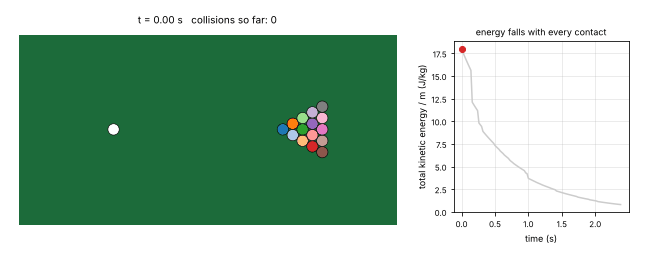

# What you are building toward

A cue ball strikes a triangle of fifteen discs on a table with cushions. Every contact between two discs uses the normal-impulse rule of Session 3 with a coefficient of restitution of 0.95, the cushions take a little energy at each bounce and a small rolling resistance slows everything down. On the left, the discs scatter across the table; on the right, the total kinetic energy and the running count of collisions are plotted against time. The Target uses a richer model than the repo (many bodies, cushions and rolling resistance); your goal over the coming sessions is to build it yourself.

*Target: a cue ball breaks a triangle of 15 discs on a table; total kinetic energy falls with every contact*

The code behind the Target is not published; the roadmap shows the path so you can build your own.
