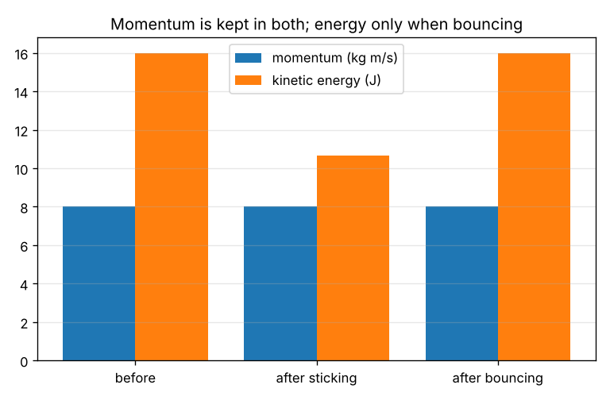
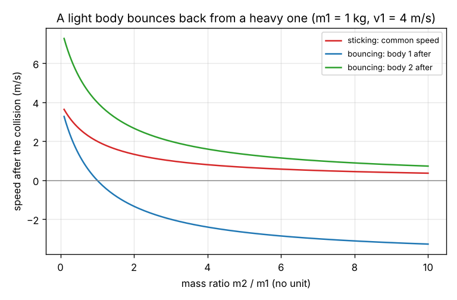

# Session 1: Momentum is kept, energy may not be: sticking and bouncing

*Level 1 (conceptual interactive model) · about 60 minutes · opencollisions*

> This is a simplified educational model. It is not a validated design tool and must not be used for real structures, electrical installations, vehicles, industrial processes or medical decisions.

**Prerequisites**

- Mass, speed and the idea of kinetic energy at school level.
- A positive direction and negative speeds (a body moving the other way) are explained in Section B.

**Learning objectives.** After this session you can:

- Compute the momentum and the kinetic energy of one body and of a pair.
- Find the speeds after a sticking collision and after a perfectly bouncing collision on a line.
- State what is conserved in each kind of collision and what is not.
- Predict how the speeds depend on the mass ratio.

## A. Real-world problem
Two carts roll toward each other on a smooth track. In one collision they stick together, in another they bounce apart. What happens to their speeds afterwards, and what is the same in both collisions? Where does the kinetic energy go when the carts stick?

## B. Concept and theory
Choose one direction as positive; a body moving the other way has a negative speed. The momentum of a body is p = m v and its kinetic energy is KE = 1/2 m v^2. During the short collision the two bodies push on each other with equal and opposite forces for the same time, so the momentum one gains the other loses: the total momentum of the pair is the same before and after. In a sticking collision (perfectly inelastic) the bodies leave together, v = (m1 v1 + m2 v2) / (m1 + m2), and some kinetic energy is turned into heat, sound and deformation. In a perfectly bouncing collision (perfectly elastic) the kinetic energy is also kept; together with momentum this gives v1' = ((m1 - m2) v1 + 2 m2 v2) / (m1 + m2) and v2' = ((m2 - m1) v2 + 2 m1 v1) / (m1 + m2). Real collisions lie between the two. Momentum is conserved in all of them, as long as no outside force acts during the collision.

| Symbol | Meaning | Unit |
|---|---|---|
| m1, m2 | masses of the two bodies | kg |
| v1, v2 | speeds before the collision (negative if moving in the negative direction) | m/s |
| v1', v2' | speeds after a bouncing collision | m/s |
| v | common speed after a sticking collision | m/s |
| p | momentum, m v | kg m/s |
| KE | kinetic energy, 1/2 m v^2 | J |

**Assumptions**

- Two bodies on a straight, frictionless line.
- No outside force acts during the collision (it is short and the bodies push on each other much harder than anything else does).
- The collision is instant: the speeds change at once.

$$ p = m v,\qquad KE = \tfrac{1}{2} m v^{2},\qquad m_1 v_1 + m_2 v_2 = m_1 v_1' + m_2 v_2' $$

$$ v = \frac{m_1 v_1 + m_2 v_2}{m_1 + m_2}\ \text{(sticking)} $$

$$ v_1' = \frac{(m_1 - m_2) v_1 + 2 m_2 v_2}{m_1 + m_2},\qquad v_2' = \frac{(m_2 - m_1) v_2 + 2 m_1 v_1}{m_1 + m_2}\ \text{(bouncing)} $$

## C. Visual explanation
The first figure compares three states of the same collision: the momentum is identical before, after sticking and after bouncing, but the kinetic energy only stays the same after bouncing. The second figure plots the speeds after the collision against the mass ratio m2 / m1 for a body 1 of 1 kg moving at 4 m/s and a body 2 at rest: for a heavy target (large ratio) body 1 bounces back with a negative speed, and for equal masses it stops.

*Momentum and kinetic energy before, after sticking and after bouncing.*

*Speeds after the collision against the mass ratio m2 / m1.*

## D. Interactive simulation
Run the lesson (`python start.py 1`), then open the live app: [Session 1: sticking and bouncing](https://krunalpanchal1995.github.io/pan-iit-oss/opencollisions/session-01/) (or `app.html` in this folder). Change the masses and speeds and watch the momentum bars stay equal while the energy bars change. Make body 2 much heavier and see body 1 bounce back.

**Challenge.** With body 2 at rest, make a sticking collision lose at least 75 percent of the kinetic energy.

## E. Worked example and experiment
**Problem.** A 2 kg cart moving at 4 m/s hits a 1 kg cart at rest. Find the speeds if they stick, and if they bounce perfectly. In each case, check the momentum and find the kinetic energy lost.

1. Before: p = 2 x 4 + 1 x 0 = 8 kg m/s and KE = 1/2 x 2 x 16 = 16 J.
2. Sticking: v = 8 / 3 = 2.667 m/s. After: KE = 1/2 x 3 x 2.667^2 = 10.67 J, so 5.33 J are lost (one third).
3. Bouncing: v1' = (2 - 1) x 4 / 3 = 1.333 m/s and v2' = 2 x 2 x 4 / 3 = 5.333 m/s.
4. Check momentum: 2 x 1.333 + 1 x 5.333 = 8.00 kg m/s.
5. Check energy: 1/2 x 2 x 1.333^2 + 1/2 x 1 x 5.333^2 = 16.00 J, equal to the 16 J before.

**Answer.** Sticking: 2.667 m/s and 5.33 J lost. Bouncing: 1.333 m/s and 5.333 m/s, with no energy lost. Momentum is 8 kg m/s in both.

**Experiment.** Put two identical coins on a flat table, flick one at the other and watch: the moving coin stops and the other one leaves (equal masses). Then repeat with a coin hitting a heavy coin or a small box of the same material: the coin bounces back. Real collisions lose some energy, so the second coin never leaves with exactly the speed of the first. The model leaves out friction with the table, spin and the deformation of the coins.

## F. Assessment and design challenge
**Question type A: Conceptual.** Why is the momentum of the pair conserved in a collision even when the kinetic energy is not?

Hint

Think of the forces the two bodies exert on each other, and of how long they act.

Step-by-step solution

The bodies push on each other with forces that are equal and opposite and act for the same short time, so the impulses are equal and opposite: what one body gains in momentum the other loses. The total momentum cannot change. Kinetic energy is different: it is not a vector that cancels. The work done by the contact force during the squeeze and the recovery can turn part of the kinetic energy into heat, sound and permanent deformation, so it may drop.

**Question type B: Numerical.** A 3 kg cart moving at 2 m/s hits a 1 kg cart at rest. Find the speeds and the kinetic energy lost if they stick, and the speeds if they bounce perfectly.

Hint

Use v = (m1 v1 + m2 v2) / (m1 + m2) for sticking and the two bouncing formulas.

Step-by-step solution

Sticking: v = (3 x 2) / 4 = 1.50 m/s. KE before = 1/2 x 3 x 4 = 6 J, after = 1/2 x 4 x 1.50^2 = 4.50 J, lost 1.50 J. Bouncing: v1' = (3 - 1) x 2 / 4 = 1.00 m/s and v2' = 2 x 3 x 2 / 4 = 3.00 m/s. Check: momentum 3 x 1.00 + 1 x 3.00 = 6 kg m/s, the same as before.

**Question type C: Graph and simulation interpretation.** On the speeds-against-mass-ratio graph, at which mass ratio does body 1 stop after the bouncing collision, and what happens to body 1 for larger ratios?

Hint

Look for the point where the blue curve crosses zero.

Step-by-step solution

The blue curve crosses zero at m2 / m1 = 1: with equal masses and a target at rest, body 1 stops and body 2 leaves with the full speed (v1' = 0, v2' = 4 m/s). For a larger ratio, v1' = (m1 - m2) v1 / (m1 + m2) is negative: body 1 bounces back. For a very heavy target, v1' approaches -v1 (a ball off a wall) and v2' approaches 0.

**Question type D: Design and optimisation challenge.** Design: body 1 (2 kg, 4 m/s) hits a stationary body 2 and they stick. You want at least 75 percent of the initial kinetic energy to be lost. Find the least mass of body 2 and state what the cost is.

Hint

The fraction of kinetic energy lost when body 2 is at rest is m2 / (m1 + m2).

Step-by-step solution

Fraction lost = m2 / (m1 + m2) >= 0.75, so m2 >= 3 m1 = 6 kg. With m2 = 8 kg, the lost fraction is 0.8 and 12.8 J of 16 J disappear. The cost is that the combined body moves slowly (v = 8 / 10 = 0.8 m/s) and that you need a heavy target. Assumption: body 2 at rest and a perfectly sticking collision.

Score yourself with [RUBRIC.md](../../RUBRIC.md). Print the [activity sheet](activity_sheet.md) to work on paper.

## Common misconceptions
| Common misconception | What is actually true |
|---|---|
| Kinetic energy is always conserved in a collision. | Only momentum is conserved in all collisions. Kinetic energy is conserved only in perfectly bouncing (elastic) ones. |
| When two bodies stick, momentum is lost. | The momentum of the pair is the same; it is the kinetic energy that drops. |
| The lighter body always bounces back. | It only bounces back if it hits a heavier body. A heavy body hitting a light one at rest moves on. |
| The forces are equal, so the speeds change by equal amounts. | The forces and impulses are equal, but the change in speed is the impulse divided by the mass, so the lighter body changes its speed more. |

## Glossary
- **momentum**: mass times speed, with a sign for direction
- **elastic collision**: a collision that keeps the kinetic energy (perfectly bouncing)
- **inelastic collision**: a collision that loses kinetic energy
- **perfectly inelastic**: the bodies stick together and move with one speed
- **impulse**: force times the time it acts: the change in momentum

## Finish
1. Do the three coding tasks in [exercises.md](exercises.md).
2. Run `python start.py 1` again after your changes. It ends with the checkpoint; when it prints `PASS`, you are done. (Checkpoint only: `python start.py check 1`.)

Next: [Session 2](../session-02/README.md)
