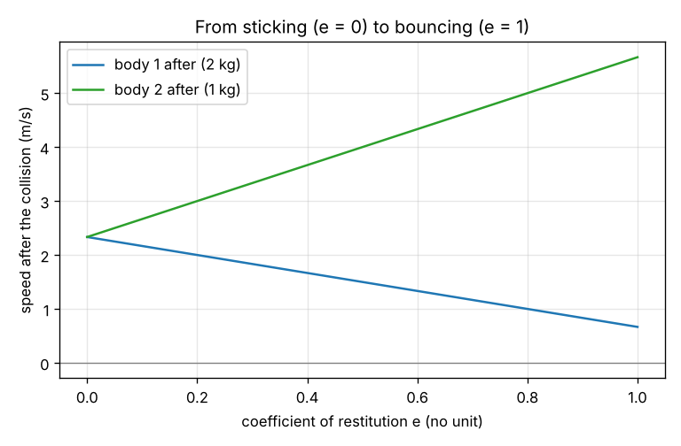
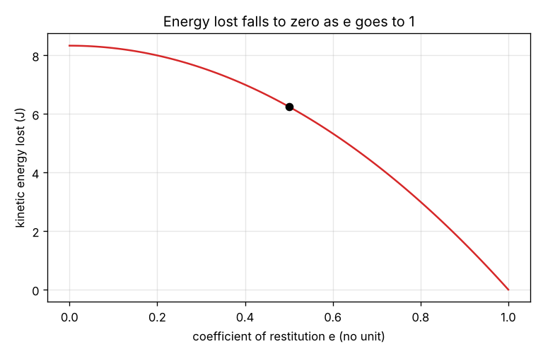

# Session 2: Every collision in between: restitution, energy lost and the ballistic pendulum

*Level 2 (mathematical engineering model) · about 75 minutes · opencollisions*

> This is a simplified educational model. It is not a validated design tool and must not be used for real structures, electrical installations, vehicles, industrial processes or medical decisions.

**Prerequisites**

- Session 1: momentum conservation, sticking and bouncing.
- Reduced mass and the work-energy idea are explained in Section B.

**Learning objectives.** After this session you can:

- Use the coefficient of restitution e to find both speeds after any collision on a line.
- Compute the kinetic energy lost with the reduced mass formula.
- Measure e from a bouncing ball and find a bullet speed with a ballistic pendulum.
- Explain why e must lie between 0 and 1.

## A. Real-world problem
A basketball dropped from 1 m comes back to 0.64 m. A bullet buried in a hanging block makes it swing up a few centimetres. What happens in collisions that are neither perfectly sticky nor perfectly bouncy, how much energy disappears, and how can a swing tell us the speed of a bullet that is far too fast to time?

## B. Concept and theory
The speed of separation after a collision is a fixed fraction of the speed of approach before it: e = (v2' - v1') / (v1 - v2), with e between 0 and 1. For e = 1 the collision is perfectly bouncing, for e = 0 it is sticking. Together with momentum conservation, this gives v1' = (m1 v1 + m2 v2 + m2 e (v2 - v1)) / (m1 + m2) and v2' = (m1 v1 + m2 v2 + m1 e (v1 - v2)) / (m1 + m2). The kinetic energy that is lost depends on the reduced mass mu = m1 m2 / (m1 + m2): dKE = 1/2 mu (1 - e^2) (v1 - v2)^2. A ball dropped from a height h reaches the floor with speed sqrt(2 g h) and leaves with sqrt(2 g h'), so e = sqrt(h' / h). In a ballistic pendulum the bullet sticks in the block (momentum is kept, e = 0), and the swing then converts kinetic energy into height: v_bullet = (m + M) / m x sqrt(2 g h). e cannot be above 1 (that would create energy) or below 0 (the bodies would pass through each other).

| Symbol | Meaning | Unit |
|---|---|---|
| e | coefficient of restitution | no unit |
| mu | reduced mass, m1 m2 / (m1 + m2) | kg |
| dKE | kinetic energy lost in the collision | J |
| h, h' | drop height and rebound height | m |
| m, M | bullet mass and block mass | kg |
| g | gravitational acceleration | m/s^2 (9.81) |

**Assumptions**

- Straight-line collision, no friction, instant contact.
- e is a single constant for the pair of bodies (in reality it also depends on the speed).
- In the pendulum the block swings without loss after the collision, and the bullet stays inside.

$$ e = \frac{v_2' - v_1'}{v_1 - v_2},\qquad 0 \le e \le 1 $$

$$ v_1' = \frac{m_1 v_1 + m_2 v_2 + m_2 e (v_2 - v_1)}{m_1 + m_2},\qquad v_2' = \frac{m_1 v_1 + m_2 v_2 + m_1 e (v_1 - v_2)}{m_1 + m_2} $$

$$ \Delta KE = \tfrac{1}{2}\mu (1 - e^{2})(v_1 - v_2)^{2},\qquad e = \sqrt{h'/h},\qquad v_{\mathrm{bullet}} = \frac{m + M}{m}\sqrt{2 g h} $$

## C. Visual explanation
The first figure plots the two speeds after the collision against e for a 2 kg body at 4 m/s hitting a 1 kg body at -1 m/s. At e = 0 the lines meet at the common speed of the sticking collision, and as e grows they spread apart: the speed of separation is e times the speed of approach. The second figure plots the kinetic energy lost: it is largest at e = 0 and falls to zero at e = 1, following the curve 1 - e^2.

*Speeds after the collision against the coefficient of restitution.*

*Kinetic energy lost against e; the dot is the worked example (e = 0.5).*

## D. Interactive simulation
Run the lesson (`python start.py 2`), then open the live app: [Session 2: restitution and the energy lost](https://krunalpanchal1995.github.io/pan-iit-oss/opencollisions/session-02/) (or `app.html` in this folder). Slide e from 0 to 1 and watch the two speeds spread apart while the energy lost shrinks. Check on the momentum bars that the total never changes.

**Challenge.** Send body 2 away at 6 m/s or more while losing at most 4 J of kinetic energy.

## E. Worked example and experiment
**Problem.** A 2 kg body moving at 4 m/s hits a 1 kg body moving at -1 m/s (towards it). The coefficient of restitution is e = 0.5. Find both final speeds and the kinetic energy lost.

1. Momentum before: 2 x 4 + 1 x (-1) = 7 kg m/s. The speed of approach is 4 - (-1) = 5 m/s.
2. v1' = (7 + 1 x 0.5 x (-1 - 4)) / 3 = (7 - 2.5) / 3 = 1.50 m/s.
3. v2' = (7 + 2 x 0.5 x (4 + 1)) / 3 = (7 + 5) / 3 = 4.00 m/s. Check: the speed of separation is 4.00 - 1.50 = 2.50 = 0.5 x 5 = 2.5.
4. Momentum after: 2 x 1.50 + 1 x 4.00 = 7.00 kg m/s.
5. Kinetic energy: before 1/2 x 2 x 16 + 1/2 x 1 x 1 = 16.50 J, after 1/2 x 2 x 2.25 + 1/2 x 1 x 16 = 10.25 J.
6. Lost: 16.50 - 10.25 = 6.25 J. Check with the formula: mu = 2/3, so 1/2 x 2/3 x (1 - 0.25) x 25 = 6.25 J.

**Answer.** v1' = 1.50 m/s, v2' = 4.00 m/s, and 6.25 J of kinetic energy are lost.

**Experiment.** Measure e for a ball you have at home: drop it from a known height (for example 1 m) next to a ruler, film the rebound with a phone and read the highest point. Compute e = sqrt(h' / h) and repeat from two different heights. If e changes with the height, the model of a constant e is only an approximation. Compare a tennis ball, a rubber ball and a steel ball bearing: the model says nothing about why they differ, it only measures the difference.

## F. Assessment and design challenge
**Question type A: Conceptual.** Why can the coefficient of restitution not be larger than 1?

Hint

Compute the kinetic energy lost with the formula and look at the sign when e is above 1.

Step-by-step solution

The energy lost is 1/2 mu (1 - e^2) (v1 - v2)^2. For e above 1 this would be negative: the bodies would gain kinetic energy from nothing, which no ordinary collision can do. (Explosive or spring-loaded collisions, where stored energy is released, are a different situation.) For e below 0 the bodies would move through each other, so e is between 0 and 1.

**Question type B: Numerical.** A 0.50 kg ball moving at 6 m/s hits a 1.5 kg ball at rest. The coefficient of restitution is 0.8. Find both speeds and the kinetic energy lost.

Hint

Use the two formulas with v2 = 0. The first ball bounces back, so v1' comes out negative.

Step-by-step solution

Momentum: 0.5 x 6 = 3 kg m/s. v1' = (3 + 1.5 x 0.8 x (0 - 6)) / 2 = -2.1 m/s and v2' = (3 + 0.5 x 0.8 x 6) / 2 = 2.7 m/s. Check: 0.5 x (-2.1) + 1.5 x 2.7 = 3.0 kg m/s. Energy lost: mu = 0.375 kg, so 1/2 x 0.375 x (1 - 0.64) x 36 = 2.43 J. The light ball bounces back and the heavy ball moves forward, as expected.

**Question type C: Graph and simulation interpretation.** On the speeds-against-e graph, read the two speeds at e = 0 and at e = 1 and say what each means.

Hint

At e = 0 the two lines meet. Compare with the sticking speed 7 / 3.

Step-by-step solution

At e = 0 both speeds are 2.33 m/s: the bodies stick and move together (7 kg m/s of momentum over 3 kg). At e = 1 the speeds are 0.67 and 5.67 m/s: a perfectly bouncing collision, the speed of separation (5 m/s) equals the speed of approach, and no energy is lost.

**Question type D: Design and optimisation challenge.** Design: a ballistic pendulum has a 2.0 kg block and must measure bullets of 10 g with speeds from 150 to 400 m/s. Find the swing heights at the two ends and say whether a 12 cm scale is long enough. What would you change?

Hint

Invert the formula: h = (m v / (m + M))^2 / (2 g).

Step-by-step solution

At 150 m/s the block starts at 150 x 0.010 / 2.010 = 0.746 m/s and rises 2.8 cm. At 400 m/s it starts at 1.99 m/s and rises 20.2 cm. A 12 cm scale is too short for the fast end. Heavier block: the swing gets smaller for the same bullet, so the scale fits, but small heights are harder to read precisely. Trade-off: range against precision. Assumption: the bullet stays in the block and the swing has no loss.

Score yourself with [RUBRIC.md](../../RUBRIC.md). Print the [activity sheet](activity_sheet.md) to work on paper.

## Common misconceptions
| Common misconception | What is actually true |
|---|---|
| A higher e means more energy is lost. | A higher e means less energy is lost: at e = 1 nothing is lost, at e = 0 the loss is largest. |
| The energy lost depends on the masses only. | It depends on the reduced mass, on e and on the square of the relative speed. |
| In the ballistic pendulum, energy is conserved from the bullet to the swing. | Energy is not conserved during the bullet's sticking collision (most is lost); only afterwards, during the swing, is it conserved. |
| e is a property of one body. | It describes a pair of materials and it also depends on the impact speed; the model uses one fixed number. |

## Glossary
- **coefficient of restitution**: the ratio of the speed of separation to the speed of approach
- **reduced mass**: m1 m2 / (m1 + m2): the effective mass of a two-body collision
- **ballistic pendulum**: a hanging block that catches a bullet and swings up, used to find the bullet's speed
- **speed of approach**: v1 - v2 before the collision

## Finish
1. Do the three coding tasks in [exercises.md](exercises.md).
2. Run `python start.py 2` again after your changes. It ends with the checkpoint; when it prints `PASS`, you are done. (Checkpoint only: `python start.py check 2`.)

Next: [Session 3](../session-03/README.md)
