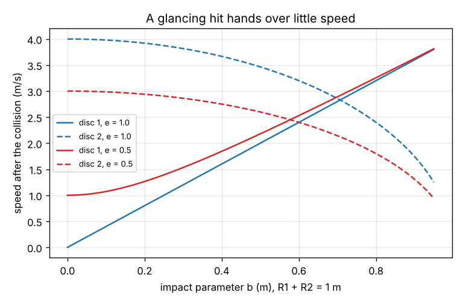
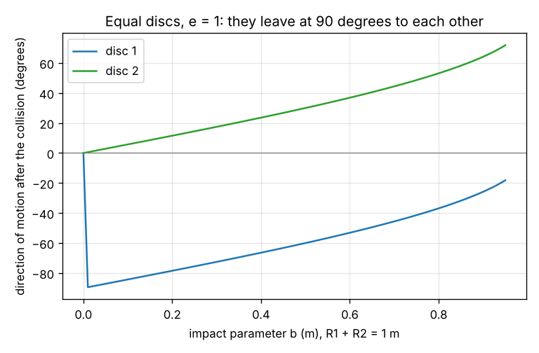

# Session 3: Off-centre hits: discs in two dimensions, a contact simulation and a crash estimate

*Level 3 (simulation and validation) · about 90 minutes · opencollisions*

> This is a simplified educational model. It is not a validated design tool and must not be used for real structures, electrical installations, vehicles, industrial processes or medical decisions.

**Prerequisites**

- Session 2: restitution and the energy lost.
- Vector components and the dot product are explained in Section B.

**Learning objectives.** After this session you can:

- Find the velocities of two smooth discs after an off-centre collision, from the impact parameter.
- Show that the discs leave at 90 degrees to each other for equal masses, e = 1 and one disc at rest.
- Validate the formulas against an independent time-stepping simulation of the contact.
- Use the work-energy idea to estimate the average force and deceleration of a car stopping against a wall.

## A. Real-world problem
Two billiard balls hit off-centre: the first is deflected and the second leaves at an angle. How do the speeds and angles depend on how far off-centre the hit is, and can we trust the formulas? Then the same ideas on a larger scale: a car hits a wall, and the front crumples over a short distance. How large are the average force and the deceleration, and what must a designer change to keep them below a limit?

## B. Concept and theory
Disc 1 moves along +x. Disc 2 sits a distance b (the impact parameter) above that line. At contact the line from the centre of disc 1 to the centre of disc 2 makes an angle phi with sin(phi) = b / (R1 + R2); call its unit vector n. Smooth discs push on each other only along n, so only the component of the relative velocity along n changes: with v_n = (v1 - v2) . n, v1' = v1 - m2 / (m1 + m2) (1 + e) v_n n and v2' = v2 + m1 / (m1 + m2) (1 + e) v_n n. The component across n does not change. The kinetic energy lost is 1/2 mu (1 - e^2) v_n^2. For equal masses, e = 1 and v2 = 0, momentum and energy conservation make the two outgoing velocities perpendicular. As an independent check, we let the discs overlap slightly and push each other with a stiff spring (force k x overlap along n) and a damper whose damping ratio gives the chosen e, and step the motion forward in small time steps; the final velocities must agree with the formula. For the car, the work done by the average crumple force over the crumple distance d equals the initial kinetic energy: F d = 1/2 m v^2, so the average deceleration is a = v^2 / (2 d).

| Symbol | Meaning | Unit |
|---|---|---|
| b | impact parameter: offset of disc 2 from the line of motion of disc 1 | m |
| R1, R2 | radii of the discs | m |
| phi | angle of the line of centres at contact, sin(phi) = b / (R1 + R2) | degrees |
| n | unit vector from the centre of disc 1 to the centre of disc 2 | no unit |
| v_n | component of the relative velocity along n | m/s |
| k | contact spring stiffness (simulation) | N/m |
| F, a | average crumple force and average deceleration | N, m/s^2 |
| d | crumple distance | m |

**Assumptions**

- Smooth (frictionless) discs without spin: the contact force acts along the line of centres.
- The collision is instant in the formulas; in the simulation the contact lasts a few milliseconds.
- The collision happens at the moment of contact with the geometry of that moment.
- For the car: a rigid wall, a constant average force and no rotation. The numbers are not a safety assessment.

$$ \sin\varphi = \frac{b}{R_1 + R_2},\qquad \mathbf n = (\cos\varphi,\ \sin\varphi),\qquad v_n = (\mathbf v_1 - \mathbf v_2)\cdot\mathbf n $$

$$ \mathbf v_1' = \mathbf v_1 - \frac{m_2}{m_1+m_2}(1+e)\,v_n\,\mathbf n,\qquad \mathbf v_2' = \mathbf v_2 + \frac{m_1}{m_1+m_2}(1+e)\,v_n\,\mathbf n $$

$$ \Delta KE = \tfrac12 \mu (1-e^{2}) v_n^{2},\qquad F = \frac{m v^{2}}{2d},\qquad a = \frac{v^{2}}{2d} $$

## C. Visual explanation
The first figure plots the speeds of the two discs after the collision against the impact parameter. A head-on hit (b = 0) hands all the motion to disc 2 for e = 1, and a grazing hit leaves disc 1 almost unchanged. The solid lines are e = 1 and the dashed lines e = 0.5, where less speed is handed over. The second figure shows the direction of each disc after the collision: the two curves stay 90 degrees apart for equal masses with e = 1.

*Speeds of the two discs after the collision against the impact parameter, for e = 1 and e = 0.5.*

*Direction of each disc after the collision, for equal masses and e = 1.*

## D. Interactive simulation
Run the lesson (`python start.py 3`), then open the live app: [Session 3: off-centre hits of two discs](https://krunalpanchal1995.github.io/pan-iit-oss/opencollisions/session-03/) (or `app.html` in this folder). Raise the impact parameter from 0 and watch the two directions open up; keep the masses equal and e = 1 and see that the gap between the angles stays at 90 degrees.

**Challenge.** Send disc 2 away at 30 degrees or more from the x axis while disc 1 keeps a speed of at least 1.5 m/s.

## E. Worked example and experiment
**Problem.** Disc 1 (1 kg, radius 0.5 m) moves at 4 m/s along +x and hits disc 2 (1 kg, radius 0.5 m) at rest. The impact parameter is b = 0.5 m and e = 1. Find both velocities after the collision.

1. sin(phi) = 0.5 / 1.0, so phi = 30 degrees and n = (0.866, 0.5).
2. v_n = (4, 0) . n = 3.464 m/s.
3. v1' = (4, 0) - (1/2) x 2 x 3.464 x n = (1.00, -1.73) m/s: speed 2.00 m/s at -60 degrees.
4. v2' = 0 + (1/2) x 2 x 3.464 x n = (3.00, 1.73) m/s: speed 3.46 m/s at 30 degrees.
5. Check momentum: (1.00 + 3.00, -1.73 + 1.73) = (4, 0), the same as before.
6. Check energy: 1/2 x 1 x 4 + 1/2 x 1 x 12 = 8 J = 8 J before.
7. Check the angle: (1.00, -1.73) . (3.00, 1.73) = 0, so the discs leave at 90 degrees to each other.

**Answer.** Disc 1: (1.00, -1.73) m/s. Disc 2: (3.00, 1.73) m/s. The angle between them is 90 degrees.

**Experiment.** Film two pool balls (or two coins on a smooth table) with a phone held above the table: hit one into a stationary one off-centre and measure the angle between the two paths after the hit from single frames. For equal balls the model predicts 90 degrees. The real angle is a little different because of friction between the balls and the spin that it creates; this is the gap that roadmap Session 4 explores. Mini-project: estimate the average force and deceleration of a car stopping against a wall: run `crash` for several speeds (30, 50 and 70 km/h) and crumple distances (0.4, 0.6 and 0.8 m) and tabulate the deceleration in units of g.

## F. Assessment and design challenge
**Question type A: Conceptual.** Why do two equal discs leave at 90 degrees to each other when one is at rest and e = 1?

Hint

Write momentum conservation as a vector sum and energy conservation as a sum of squares of speeds.

Step-by-step solution

With equal masses, momentum conservation gives v1 = v1' + v2' (a vector sum). Energy conservation gives |v1|^2 = |v1'|^2 + |v2'|^2. The second equation is Pythagoras' theorem for the triangle formed by the three vectors, so the angle between v1' and v2' must be 90 degrees. The formula agrees: v1' and v2' are the parts of v1 across and along n.

**Question type B: Numerical.** Disc 1 (2 kg, radius 0.6 m) moves at 5 m/s along +x and hits disc 2 (1 kg, radius 0.4 m) at rest with b = 0.3 m and e = 0.6. Find both velocities and the energy lost.

Hint

sin(phi) = b / (R1 + R2) = 0.3. Compute v_n = 5 cos(phi), then use the formulas.

Step-by-step solution

cos(phi) = sqrt(1 - 0.09) = 0.954, so n = (0.954, 0.3) and v_n = 4.77 m/s. v1' = (5, 0) - (1/3) x 1.6 x 4.77 x n = (2.57, -0.76) m/s and v2' = (2/3) x 1.6 x 4.77 x n = (4.85, 1.53) m/s. Check momentum: 2 x 2.57 + 1 x 4.85 = 10.00 (= 10) and 2 x -0.76 + 1.53 = 0.00 (= 0). Energy lost: mu = 2/3, so 1/2 x 2/3 x (1 - 0.36) x 4.77^2 = 4.85 J.

**Question type C: Graph and simulation interpretation.** On the speed graph, why is disc 2's speed highest at b = 0 and falls towards 0 as b approaches 1 m, while disc 1 keeps more and more of its speed?

Hint

Think of how much of the velocity lies along the line of centres, v_n = v cos(phi).

Step-by-step solution

Only the component along the line of centres is exchanged: v_n = v cos(phi). At b = 0, phi = 0 and all the velocity is along n, so a head-on hit hands over everything (for equal masses and e = 1). As b approaches R1 + R2, phi approaches 90 degrees, v_n approaches 0 and the discs just graze each other: disc 2 hardly moves and disc 1 keeps almost all of its velocity.

**Question type D: Design and optimisation challenge.** Design: a 1200 kg car drives at 50 km/h into a rigid wall. The average deceleration must not exceed 20 g (a made-up limit for this exercise, not a safety standard). Find the least crumple distance, and compare with the 0.6 m of the worked example.

Hint

Use d = v^2 / (2 a) with v in m/s and a = 20 x 9.81 m/s^2.

Step-by-step solution

v = 50 / 3.6 = 13.89 m/s, so d = 192.9 / (2 x 20 x 9.81) = 0.492 m: round up to 0.50 m (0.49 m gives 20.1 g, just above the limit). A crumple distance of 0.6 m gives 16.4 g on average, which is inside the limit. Trade-off: a longer crumple zone lowers the deceleration but makes the car longer, and the average is not the peak: a real crash has a peak force above the average (roadmap Session 7). Assumption: rigid wall, constant force.

Score yourself with [RUBRIC.md](../../RUBRIC.md). Print the [activity sheet](activity_sheet.md) to work on paper.

## Common misconceptions
| Common misconception | What is actually true |
|---|---|
| A moving disc always transfers all its speed in a collision between equal masses. | Only a head-on hit does. An off-centre hit splits the motion between the discs: only the part along the line of centres is handed over. |
| The velocity across the line of centres is also exchanged. | Smooth discs push only along the line of centres, so the component across it does not change at all. |
| A simulation that agrees with the formula proves the real discs behave the same way. | It only proves the formula and the simulation of the same simplified model agree. Real balls have friction, spin and a contact that is not a linear spring. |
| A crash lasting 0.05 s means the car is 'hit' with 193 kN at every instant. | 193 kN is the average over the crumple distance. The force changes during the crash and the peak is higher than the average. |

## Glossary
- **impact parameter**: the perpendicular distance between the two lines of motion (here the offset b of the discs)
- **line of centres**: the line through the centres of the two discs at contact
- **smooth disc**: a disc with no friction at the contact, so the contact force is along the line of centres
- **damping ratio**: a number that says how strongly a spring-damper contact loses energy
- **crumple zone**: the front structure of a car that deforms to absorb the energy of a crash

## Finish
1. Do the three coding tasks in [exercises.md](exercises.md).
2. Run `python start.py 3` again after your changes. It ends with the checkpoint; when it prints `PASS`, you are done. (Checkpoint only: `python start.py check 3`.)

Next: the [roadmap](../../promo/roadmap.md): Sessions 4 and up are yours to build.
