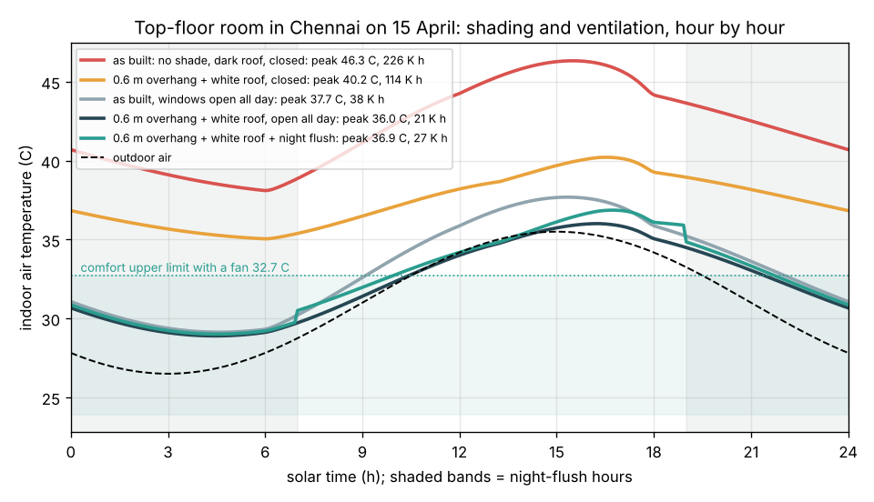
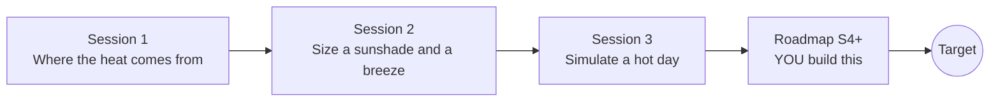

# opencomfort

[](https://github.com/KrunalPanchal1995/pan-iit-oss/actions/workflows/tests.yml)   [](https://colab.research.google.com/github/KrunalPanchal1995/pan-iit-oss/blob/main/opencomfort/sessions/session-01/lesson.ipynb) [](https://krunalpanchal1995.github.io/pan-iit-oss/opencomfort/)

**Cool a building passively with shading and ventilation, in three sessions.**

opencomfort teaches how a room heats up and how shade, air flow, a white roof and thermal mass keep it cool without much energy, from the heat balance to sun angles, sunshade sizing, cross ventilation and an hour-by-hour room simulation, using only Python and a browser.

- **Start from zero.** Session 1 needs only school arithmetic: watts in, watts out, and one fraction.
- **See the sun and the breeze.** Every session ships a slider app that runs in the browser, with a room picture, a wall section with the overhang's shadow, and labelled graphs.
- **Know you got it right.** Each session ends with a checkpoint that prints PASS or FAIL against hand calculations, known sun angles and the energy balance.
- **Build the missing half.** The repo stops at Session 3 on purpose; the roadmap shows the path to the Target.

[Target](#the-target) · [Who is this for](#who-is-this-for) · [Quick start](#quick-start) · [Sessions](#sessions) · [Roadmap](#roadmap) · [Contribute](#contribute) · [Explainer PDF](docs/explainer.pdf)

> **This repo is incomplete on purpose.** Sessions 1 to 3 are here and fully working. The finished Target below is a preview of what the community can build next. We show you the path, not the code. Sessions 4 and up are yours.

## The Target

A top-floor room in Chennai on a hot April day, simulated hour by hour. As built (no sunshade, dark concrete roof, windows shut) it peaks at 46.3 C and stays above 38 C all night. A 0.6 m overhang and a white roof bring the peak to 40.2 C; adding open windows brings it to 36.0 C, close to the outdoor maximum of 35.5 C, and night flushing to 36.9 C. Your goal over the coming sessions: extend this room into a full passive-design tool, with an insulated roof that stores heat, sunlit walls, vertical fins and jaali screens, a ceiling fan in the comfort model and a whole month of real weather, and find the design that keeps the room comfortable with no air conditioner at all.



*Target: indoor temperature of a top-floor room in Chennai on 15 April for five passive designs, with the adaptive comfort limit*

Try it live:

- [Session 3 app: a day in the room](https://krunalpanchal1995.github.io/pan-iit-oss/opencomfort/session-03/)
- [Math Visual Studio](https://krunalpanchal1995.github.io/studio/)

How the Target was made is shown only as a path in [promo/roadmap.md](promo/roadmap.md).

## Who is this for
**higher secondary to diploma / undergraduate (levels 4-5).** Topic area: Architecture, Design and Smart Buildings.

Prerequisites:

- School arithmetic, sine, cosine and tangent; the idea that heat flows from hot to cold.
- Python 3.10 or newer; if `python --version` works, you are ready. PRIMER.md explains the rest.
- No prior GitHub, heat transfer or architecture experience is needed; Session 3 explains the numerical steps it uses.

New to Python? Read [PRIMER.md](PRIMER.md) first (10 minutes).

## Quick start

No installation knowledge needed. You need [Git](https://git-scm.com/downloads) and [Python 3.10+](https://www.python.org/downloads/) (Windows: tick "Add Python to PATH"). On Mac and Linux type `python3` wherever this page says `python`.

```bash
git clone https://github.com/KrunalPanchal1995/pan-iit-oss.git
cd pan-iit-oss/opencomfort
python start.py 1
```

`start.py` creates a private environment, installs what is needed and runs Session 1 with its checkpoint. Next: `python start.py 2`, `python start.py 3`, or `python start.py test` to check everything. Only a checkpoint: `python start.py check 1`.

<!-- friendly-help -->
<details>
<summary><b>Not working? Common fixes (no Git, "python not found", no internet)</b></summary>

- **No Git?** You do not need it. On the main page of this collection click the green **Code** button, then **Download ZIP**, unzip it, open a terminal inside the folder `pan-iit-oss-main/opencomfort` and run `python start.py 1`. The ZIP holds every project, so it is large; the live apps need no download at all.
- **"python is not recognized" or "command not found".** On Windows try `py start.py 1`. On Mac and Linux try `python3 start.py 1`. If neither works, install Python from [python.org](https://www.python.org/downloads/) and tick "Add Python to PATH".
- **Needs internet once.** The first run downloads NumPy and Matplotlib into a private folder (`.venv`); after that it works offline.
- **Rather not install anything?** Open the [live apps](https://krunalpanchal1995.github.io/pan-iit-oss/opencomfort/) in your browser, or use the Colab badge at the top of this page.
- **Still stuck?** [Open an issue](https://github.com/KrunalPanchal1995/pan-iit-oss/issues/new?title=%5Bopencomfort%5D%20) with your operating system and the message you see. Questions from beginners are welcome.

</details>

Four lines turn the idea of Session 1 into a result (they work as they are): Save it as `try.py` and run it with `python start.py run try.py` (this uses the private environment, where NumPy is installed):

```python
import numpy as np
ua, hv, sun, people = 70.0, 160.0, 160.0, 250.0  # W/K walls+roof, W/K air flow, W shaded sun, W people+lamps
print(np.round(34 + (sun + people) / (ua + hv), 1))          # -> 35.8  C indoors at 34 C outside
print(np.round(1.8 / np.tan(np.radians(45.8)), 2))           # -> 1.75  m overhang to shade a 1.5 m west window at 3 pm
```

Every session also opens in your browser with sliders (no install): [live apps](https://krunalpanchal1995.github.io/pan-iit-oss/opencomfort/). Or use the Colab badge above for the notebook.

## Sessions

| # | Session | Model level | Time | Live app |
|---|---|---|---|---|
| 1 | [Where the heat in a hot room comes from](sessions/session-01/README.md) | Level 1: conceptual interactive model | 60 min | [open](https://krunalpanchal1995.github.io/pan-iit-oss/opencomfort/session-01/) |
| 2 | [Size a sunshade and a breeze](sessions/session-02/README.md) | Level 2: mathematical engineering model | 75 min | [open](https://krunalpanchal1995.github.io/pan-iit-oss/opencomfort/session-02/) |
| 3 | [Simulate a hot day and choose a passive design](sessions/session-03/README.md) | Level 3: simulation and validation | 90 min | [open](https://krunalpanchal1995.github.io/pan-iit-oss/opencomfort/session-03/) |

Each session follows the same six steps: A real-world problem, B concept and theory, C visual explanation, D interactive simulation, E worked example and experiment, F assessment and design challenge. Each ends with `checkpoint.py`, which prints `PASS` or `FAIL` against reference numbers. Session 3 also contains the real-world mini-project: **Choose the passive cooling package for a top-floor room**.

## Architecture



| Folder or file | What is inside |
|---|---|
| `sessions/` | three sessions: README (A-F), `lesson.py`, notebook, live app, exercises, activity sheet, checkpoint |
| `promo/` | the Target: media, live links, and the roadmap (path only) |
| `docs/` | `explainer.tex` and the built `explainer.pdf` |
| `tests/` | runs every lesson and checkpoint headless |
| `start.py` | one command to set up and run anything |
| `QUALITY.md`, `RUBRIC.md` | the quality checklist and the scoring rubric |
| `.github/` | CI, PDF build, Pages deploy, issue and PR templates |

## Roadmap

| Milestone | What you will build | Difficulty |
|---|---|---|
| Session 4: A roof that stores heat | Split the roof into layers and step heat through them, with and without insulation. | intermediate |
| Session 5: Fins, jaalis and sunlit walls | Fins for side sun, jaali screens for low east and west sun, and sol-air temperatures on every wall. | intermediate |
| Session 6: Fans, humidity and comfort | Add air speed and humidity to the comfort model and judge designs by hours of comfort. | intermediate |
| Session 7: A month of real weather | Drive the room with an hourly weather file and compare strategies over the hot season. | advanced |
| Session 8: Smart windows | A controller that opens windows when outdoor air is cooler, with a temperature sensor. | advanced |

Full detail with a checkpoint per milestone: [promo/roadmap.md](promo/roadmap.md).

## Contribute
New to GitHub? Read [CONTRIBUTING.md](CONTRIBUTING.md); it starts from zero. Pick an issue labelled `good first issue`. Translations into Hindi, Telugu, Tamil and Malayalam are welcome.

<details>
<summary>Development</summary>

```bash
python start.py test        # runs every lesson and checkpoint
```
Lessons use `# %%` cell markers so they open as notebooks in VS Code. See [QUALITY.md](QUALITY.md) for the standard every session meets.
</details>

## License
MIT. See [LICENSE](LICENSE). Media in `promo/media` is (c) Krunal Panchal, CC BY 4.0.

## Acknowledgments
Part of the [PAN IIT OSS](https://hellofoss.tech-iitb.org/projects) open-source teaching collection, modelled on the structure of [openspline](https://github.com/openspline/openspline). Built on ideas from the Math Visual Studio at https://krunalpanchal1995.github.io/studio/.
