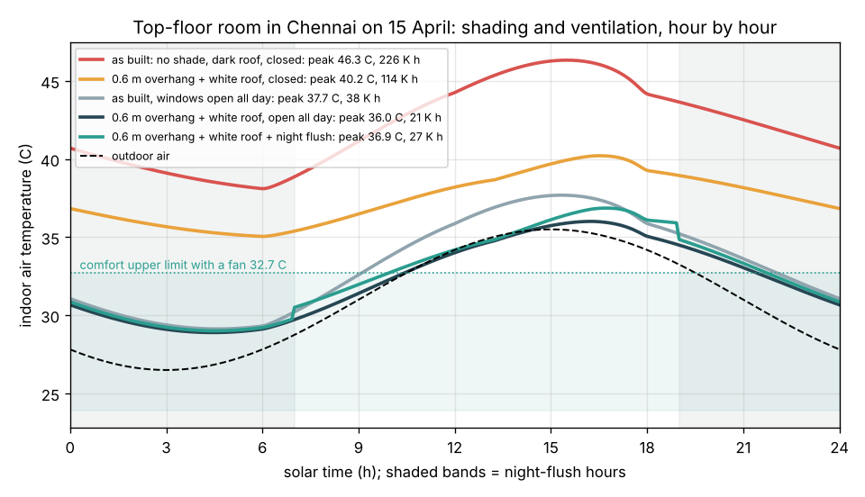

# What you are building toward

A top-floor room in Chennai on a hot April day, simulated hour by hour. As built (no sunshade, dark concrete roof, windows shut) it peaks at 46.3 C and stays above 38 C all night. A 0.6 m overhang and a white roof bring the peak to 40.2 C; adding open windows brings it to 36.0 C, close to the outdoor maximum of 35.5 C, and night flushing to 36.9 C. Your goal over the coming sessions: extend this room into a full passive-design tool, with an insulated roof that stores heat, sunlit walls, vertical fins and jaali screens, a ceiling fan in the comfort model and a whole month of real weather, and find the design that keeps the room comfortable with no air conditioner at all.

*Target: indoor temperature of a top-floor room in Chennai on 15 April for five passive designs, with the adaptive comfort limit*

This figure comes from Session 3 of this repo. The full passive-design tool described above is not published; the roadmap shows the path so you can build your own.

Live links:

- [Session 3 app: a day in the room](https://krunalpanchal1995.github.io/pan-iit-oss/opencomfort/session-03/)
- [Math Visual Studio](https://krunalpanchal1995.github.io/studio/)
