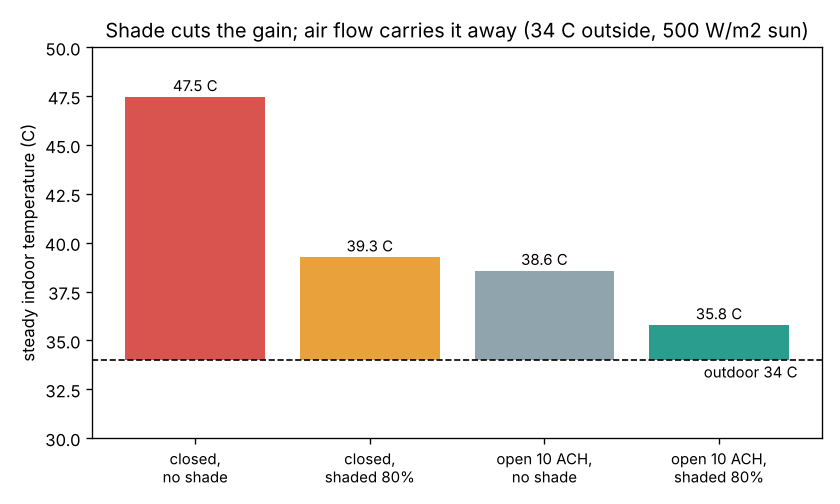
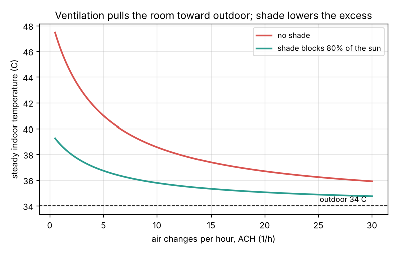

# Session 1: Where the heat in a hot room comes from

*Level 1 (conceptual interactive model) · about 60 minutes · opencomfort*

> This is a simplified educational model. It is not a validated design tool and must not be used for real structures, electrical installations, vehicles, industrial processes or medical decisions.

**Prerequisites**

- School arithmetic and the idea that heat flows from hot to cold.
- You have read PRIMER.md and run `python start.py 1` once.

**Learning objectives.** After this session you can:

- List the four ways heat enters or leaves a room: through walls and roof, sunshine through glass, people and lamps, and air flow.
- Compute each one in watts: Q = U A dT, Q = (1 - s) SHGC A I, and Q = rho cp V_dot dT.
- Find the steady indoor temperature where heat in equals heat out.
- Explain why shading and ventilation are the two cheapest levers for keeping a room cool.

## A. Real-world problem
On an April afternoon in Chennai a closed top-floor room with a sunny west window can feel hotter than the street outside. Where does that heat come from? And why do two old, cheap ideas, a sunshade (chajja) over the window and open windows, make such a big difference without using any electricity? (General education only: this is a simplified model, not a building design method.)

## B. Concept and theory
Heat always flows from hot to cold. A room gains heat in four ways. **Conduction** through a wall, roof or glass of area A gives Q = U A dT, where the U-value says how many watts pass through 1 m2 for each kelvin of difference (230 mm brick about 2, bare concrete roof about 2.5, single glass about 5 W/(m2 K)). **Sunshine** through a window brings Q = SHGC A I, where I is the sunshine on the glass in W/m2 and the solar heat gain coefficient SHGC (about 0.8 for clear glass) is the share that becomes heat; a shade outside that blocks a fraction s of the sun multiplies this by (1 - s). **People and equipment** add their heat directly (about 75 W per resting adult). **Air flow** replaces indoor air with outdoor air: with ACH air changes per hour in a room of volume Vol, the flow is V_dot = ACH Vol / 3600 and the heat it brings is rho cp V_dot (T_out - T_in), with rho cp = 1200 J/(m3 K). If nothing changes for a long time the room settles where all the flows add to zero. Then the indoor temperature is the outdoor temperature plus the gains divided by everything that lets heat out. Shading shrinks the top of that fraction; ventilation grows the bottom.

| Symbol | Meaning | Unit |
|---|---|---|
| U | U-value (thermal transmittance) of a wall, roof or window | W/(m2 K) |
| A | area of a surface or window | m2 |
| UA | sum of U x A over all outside surfaces | W/K |
| I | sunshine falling on the window (irradiance) | W/m2 |
| SHGC | solar heat gain coefficient of the glass | no unit |
| s | fraction of the sun blocked by a shade | no unit |
| ACH | air changes per hour | 1/h |
| H_v | ventilation conductance rho cp V_dot | W/K |
| T_out, T_in | outdoor and indoor air temperature | C |

**Assumptions**

- Steady state: sun, outdoor temperature and air flow do not change.
- The indoor air is well mixed (one temperature for the whole room).
- The heat stored in walls and floor is ignored here (Session 3 adds it).
- The sun on the window (500 W/m2) and the shade fraction are given numbers (Session 2 computes them).

$$ Q_{\mathrm{cond}} = U A\,(T_{\mathrm{out}} - T_{\mathrm{in}}) $$

$$ Q_{\mathrm{sun}} = (1 - s)\,\mathrm{SHGC}\,A_{\mathrm{win}}\,I $$

$$ H_v = \rho c_p \dot V = 1200 \times \frac{\mathrm{ACH} \times \mathrm{Vol}}{3600} $$

$$ T_{\mathrm{in}} = T_{\mathrm{out}} + \frac{Q_{\mathrm{sun}} + Q_{\mathrm{int}}}{UA + H_v} $$

## C. Visual explanation
The example room is 4 m x 4 m x 3 m (48 m3) on the top floor, with one outside west wall of 12 m2 that holds a 2 m2 window. UA = 2 x 10 + 5 x 2 + 2.5 x 16 = 70 W/K; two people and lamps give 250 W. The first figure shows the steady indoor temperature at 34 C outside and 500 W/m2 on the window for four designs: closed with no shade 47.5 C, closed with a shade blocking 80 percent 39.3 C, windows open at 10 air changes per hour but no shade 38.6 C, and both together 35.8 C, only 1.8 K above outdoor. The second figure plots the indoor temperature against the air change rate: every curve falls toward the outdoor line, and the shaded curve always sits lower.

*Steady indoor temperature for four designs: shading and ventilation together bring the room to 35.8 C.*

*Indoor temperature against air changes per hour, with and without a shade.*

## D. Interactive simulation
Run the lesson (`python start.py 1`), then open the live app: [Session 1: where the heat comes from](https://krunalpanchal1995.github.io/pan-iit-oss/opencomfort/session-01/) (or `app.html` in this folder). Move the shade slider and watch the sun arrow thin out; move the air change slider and watch the indoor colour cool. Switch to the second graph to see the indoor temperature against air flow, with the unshaded curve in red for comparison.

**Challenge.** At 34 C outdoors and 500 W/m2 of sun, keep the room within 2 K of outdoor using at most 15 air changes per hour.

## E. Worked example and experiment
**Problem.** The example room (UA = 70 W/K, 48 m3, 250 W of internal gains) has 500 W/m2 of sun on its 2 m2 window (SHGC 0.8) at 34 C outside. A shade blocks 80 percent of the sun and the windows give 10 air changes per hour. Find the steady indoor temperature and check the energy balance.

1. Sun gain: Q_sun = (1 - 0.8) x 0.8 x 2 x 500 = 160 W.
2. Air flow: V_dot = 10 x 48 / 3600 = 0.1333 m3/s, so H_v = 1200 x 0.1333 = 160 W/K.
3. Steady temperature: T_in = 34 + (160 + 250) / (70 + 160) = 34 + 410 / 230 = 35.78 C.
4. Check: walls and roof carry 70 x 1.78 = 125 W out, air carries 160 x 1.78 = 285 W out; 125 + 285 = 410 W = gains.
5. Without shade or air flow (0.5 ACH from leaks, H_v = 8 W/K): T_in = 34 + 1050 / 78 = 47.5 C.

**Answer.** About 35.8 C, 1.8 K above outdoor; the closed, unshaded room would sit at 47.5 C.

**Experiment.** On a sunny afternoon, put a thermometer in a closed room with a sunlit window for 30 minutes and note the reading. Then hang a sheet of cardboard or a cloth outside the window (not inside: inside, the heat is already in the room) and open a window on the opposite side. Read the thermometer again after 30 minutes. The model predicts a large drop; a real room drops more slowly because the walls and floor have stored heat, which Session 3 adds.

## F. Assessment and design challenge
**Question type A: Conceptual.** Why does a shade work much better outside the window than a curtain inside it?

Hint

Where does the sunlight turn into heat in each case, and is that place inside the room or outside?

Step-by-step solution

An outside shade stops the sunlight before it reaches the glass, so its heat stays outdoors and is carried away by the outdoor air. A curtain inside stops the light only after it has passed the glass; the curtain warms up inside the room and gives most of that heat to the room air. So in the model, s applies to an outside shade; an inside curtain removes only a small part of Q_sun.

**Question type B: Numerical.** A 1.5 m2 clear window (SHGC 0.8) receives 600 W/m2. How much heat enters with no shade and with a shade blocking 70 percent? Check the units.

Hint

Q_sun = (1 - s) x SHGC x A x I.

Step-by-step solution

No shade: 0.8 x 1.5 m2 x 600 W/m2 = 720 W. With s = 0.7: 0.3 x 720 = 216 W. Units: m2 x W/m2 = W. Sanity check: 720 W is like seven 100 W bulbs on the window, a believable number for a sunny window.

**Question type C: Graph and simulation interpretation.** In the second figure, why do both curves flatten as the air change rate grows, and what temperature do they approach?

Hint

Look at the formula T_in = T_out + gains / (UA + H_v) as H_v grows without limit.

Step-by-step solution

H_v grows in proportion to ACH, so the excess (gains) / (UA + H_v) shrinks like 1 / ACH: each extra air change buys less. Both curves approach the outdoor temperature, 34 C. Ventilation can bring the room down to outdoor temperature but never below it; to go below you need cooler air (for example at night, Session 3).

**Question type D: Design and optimisation challenge.** Design: the example room must stay within 2 K of outdoor at 34 C with 500 W/m2 on the window. Find the minimum air changes per hour with no shade and with an 80 percent shade. Which is more realistic to achieve?

Hint

Set gains / (70 + 16 ACH) = 2 (because H_v = 1200 x 48 / 3600 x ACH = 16 ACH) and solve for ACH.

Step-by-step solution

No shade: gains = 800 + 250 = 1050 W, so 70 + 16 ACH = 525, ACH = 28.4. With shade: gains = 160 + 250 = 410 W, so 70 + 16 ACH = 205, ACH = 8.4. Cross ventilation can give 10 to 20 ACH on a breezy day (Session 2), so the shaded design is realistic and the unshaded one is not. Trade-off: shading costs money once; air flow depends on the wind every day.

Score yourself with [RUBRIC.md](../../RUBRIC.md). Print the [activity sheet](activity_sheet.md) to work on paper.

## Common misconceptions
| Common misconception | What is actually true |
|---|---|
| Opening windows always cools a room. | Air flow pulls the room toward the outdoor temperature. If outside is hotter than inside (a shaded, cool room at 3 pm), open windows heat it. |
| A curtain inside works as well as a shade outside. | Inside, the sunlight has already passed the glass and becomes heat in the room. Outside shading is far better. |
| A fan cools the air. | A fan moves air over your skin and makes you feel cooler, but it adds its motor power as heat to the room. It does not lower the air temperature. |
| Thick walls alone keep a room cool. | Walls slow heat down (low U, high storage), but a room with large unshaded glass and no air flow still overheats. |

## Glossary
- **U-value**: watts that pass through 1 m2 of a wall, roof or window per kelvin of temperature difference
- **SHGC**: solar heat gain coefficient: the share of sunshine on a window that ends up as heat inside
- **air changes per hour (ACH)**: how many times the room's whole air volume is replaced in one hour
- **steady state**: the condition reached when nothing changes for a long time and heat in = heat out
- **passive cooling**: keeping a building cool by design (shade, air flow, mass, colour) without machines

## Finish
1. Do the three coding tasks in [exercises.md](exercises.md).
2. Run `python start.py 1` again after your changes. It ends with the checkpoint; when it prints `PASS`, you are done. (Checkpoint only: `python start.py check 1`.)

Next: [Session 2](../session-02/README.md)
