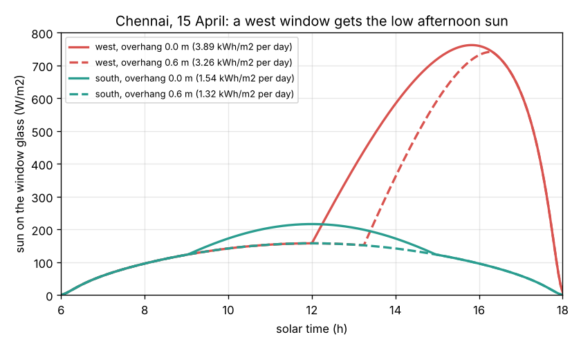
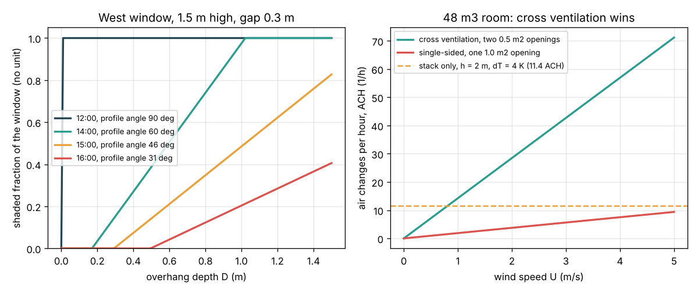

# Session 2: Size a sunshade and a breeze

*Level 2 (mathematical engineering model) · about 75 minutes · opencomfort*

> This is a simplified educational model. It is not a validated design tool and must not be used for real structures, electrical installations, vehicles, industrial processes or medical decisions.

**Prerequisites**

- Session 1: the heat gains and the steady indoor temperature.
- Sine, cosine and tangent of an angle; square roots. Everything else is explained in Section B.

**Learning objectives.** After this session you can:

- Compute the sun's altitude and azimuth for any place, day and hour.
- Find the profile angle on a wall and the depth of an overhang that shades a window.
- Compute wind-driven cross ventilation and buoyancy-driven stack ventilation and convert them to air changes per hour.
- Explain why west windows are hard to shade and why cross ventilation beats a single open window.

## A. Real-world problem
In Session 1 we simply assumed that a shade blocks 80 percent of the sun and that open windows give 10 air changes per hour. A builder needs real numbers: how deep must the concrete sunshade (chajja) over a west window in Chennai be, and how much air will two open windows move on a breezy evening? (Simplified clear-sky and textbook ventilation formulas; not a design method.)

## B. Concept and theory
The sun's position comes from three angles. The **declination** delta is the latitude where the sun is overhead today; it swings between +23.45 degrees in June and -23.45 degrees in December. The **hour angle** omega is 15 degrees per hour away from solar noon. The **altitude** alpha above the horizon follows from sin(alpha) = sin(phi) sin(delta) + cos(phi) cos(delta) cos(omega), with phi the latitude; the **azimuth** (compass direction) follows from the same angles. In Chennai (13.08 N) the sun is north of overhead at noon from late April to mid-August, so south windows get almost no direct sun in summer. For a vertical wall facing azimuth psi, the **wall-solar azimuth** gamma is the sun's azimuth minus psi, and the beam strikes the glass with cos(theta) = cos(alpha) cos(gamma). Seen in a section through the wall, the sun's rays slope at the **profile angle** Omega with tan(Omega) = tan(alpha) / cos(gamma). An overhang of depth D, a gap G above a window of height H, shades the fraction f = (D tan(Omega) - G) / H of the window (clipped to 0..1). A high sun has a steep profile angle and is easy to block; the low afternoon sun on a west wall is very hard to block. For air flow, wind presses on the windward wall and sucks on the leeward one; the difference of pressure coefficients dCp is about 0.8. Two openings in series act like one effective opening A_eff, and the flow is Q = Cd A_eff U sqrt(dCp) with discharge coefficient Cd about 0.6. With only one window the flow is roughly Q = 0.025 A U. Warm indoor air is lighter, so a low and a high opening a height h apart drive a **stack** flow Q = Cd A_eff sqrt(2 g h dT / T_mean).

| Symbol | Meaning | Unit |
|---|---|---|
| phi | latitude (Chennai 13.08 N) | degrees |
| delta, omega | declination, hour angle | degrees |
| alpha, az | sun altitude, sun azimuth from north | degrees |
| gamma | wall-solar azimuth (sun azimuth minus wall azimuth) | degrees |
| Omega | profile (vertical shadow) angle | degrees |
| D, G, H | overhang depth, gap above window, window height | m |
| U, dCp, Cd | wind speed, pressure coefficient difference, discharge coefficient | m/s, no unit, no unit |
| Q, A_eff | air flow, effective opening area | m3/s, m2 |

**Assumptions**

- Clear sky; beam sunshine I_DN = 1100 exp(-0.18 / sin(alpha)) W/m2 (illustrative constants).
- Solar time (noon when the sun is highest); no correction for time zone or the equation of time.
- The overhang is much wider than the window, so only its depth matters.
- Steady wind, no obstruction by neighbouring buildings; illustrative Cp values.

$$ \delta = 23.45^\circ \sin\!\left(360^\circ\,\frac{284 + n}{365}\right),\qquad \omega = 15^\circ\,(t - 12) $$

$$ \sin\alpha = \sin\phi\,\sin\delta + \cos\phi\,\cos\delta\,\cos\omega $$

$$ \tan\Omega = \frac{\tan\alpha}{\cos\gamma},\qquad f = \mathrm{clip}\!\left(\frac{D\tan\Omega - G}{H},\,0,\,1\right) $$

$$ Q_{\mathrm{wind}} = C_d\,A_{\mathrm{eff}}\,U\,\sqrt{\Delta C_p},\qquad \frac{1}{A_{\mathrm{eff}}^2} = \frac{1}{A_1^2} + \frac{1}{A_2^2} $$

$$ Q_{\mathrm{stack}} = C_d\,A_{\mathrm{eff}}\,\sqrt{\frac{2 g h\,\Delta T}{T_{\mathrm{mean}}}},\qquad \mathrm{ACH} = \frac{3600\,Q}{\mathrm{Vol}} $$

## C. Visual explanation
The first figure shows the sunshine on a west and a south window in Chennai on 15 April. The west window gets only diffuse light in the morning and then a steep rise to about 760 W/m2 near 4 pm: 3.89 kWh/m2 in the day, against 1.54 for the south window. A 0.6 m overhang trims the west curve only a little (to 3.26 kWh/m2) because the afternoon sun is low. The second figure, left, shows the shaded fraction of a 1.5 m high west window against overhang depth at different hours: at noon (profile angle 90 degrees) any overhang is enough, at 2 pm 1.02 m is enough, at 3 pm 1.75 m, and at 4 pm almost 3 m. On the right, two 0.5 m2 openings on opposite walls give 21 air changes per hour at 1.5 m/s, a single 1 m2 window under 3, and stack flow alone with a 4 K difference over 2 m about 11.

*Sun on a west and a south window over the day, with and without a 0.6 m overhang.*

*Left: shaded fraction against overhang depth. Right: air changes per hour against wind speed.*

## D. Interactive simulation
Run the lesson (`python start.py 2`), then open the live app: [Session 2: sunshade and breeze](https://krunalpanchal1995.github.io/pan-iit-oss/opencomfort/session-02/) (or `app.html` in this folder). Move the day and the hour and watch the sun ray and the shadow in the wall section. Turn the window to face south and see the overhang shade it fully at noon. Then switch to the air-flow graph and change the wind speed and the opening size.

**Challenge.** On 15 April (day 105) at 3 pm, fully shade the west window with the shallowest overhang, and get at least 20 air changes per hour with wind 1.5 m/s and openings of at most 0.6 m2.

## E. Worked example and experiment
**Problem.** Chennai (13.08 N), 15 April (day 105), 3 pm solar time. Find the sun's altitude, the overhang depth that fully shades a 1.5 m high west window with a 0.3 m gap, and the shaded fraction for a 0.6 m overhang. Then find the air changes in a 48 m3 room with two 0.5 m2 openings and a 1.5 m/s wind.

1. Declination: delta = 23.45 sin(360 x 389 / 365) = 9.41 degrees. Hour angle omega = 15 x 3 = 45 degrees.
2. sin(alpha) = 0.2263 x 0.1636 + 0.9741 x 0.9865 x 0.7071 = 0.7165, so alpha = 45.8 degrees; the azimuth is 270.1 (due west), so gamma is about 0 and the profile angle is also 45.8 degrees.
3. Full shade: D = (G + H) / tan(Omega) = 1.8 / 1.028 = 1.75 m.
4. A 0.6 m overhang: f = (0.6 x 1.028 - 0.3) / 1.5 = 0.21, only 21 percent of the window.
5. A_eff = 0.5 / sqrt(2) = 0.354 m2; Q = 0.6 x 0.354 x 1.5 x sqrt(0.8) = 0.285 m3/s; ACH = 3600 x 0.285 / 48 = 21.3.

**Answer.** Altitude 45.8 degrees; a 1.75 m overhang shades the whole window but a 0.6 m one only 21 percent; cross ventilation gives about 21 air changes per hour.

**Experiment.** At 3 pm on a sunny day, stand a pencil upright on a flat surface and measure its shadow. The sun's altitude is arctan(pencil height / shadow length); compare with the formula for your city and date. For air flow, open two windows on opposite walls, hold a strip of tissue at each, and compare with one window open. The model ignores neighbouring buildings and gusts, so a real room usually gets less flow than the formula.

## F. Assessment and design challenge
**Question type A: Conceptual.** Why is a horizontal overhang good for a south window in Chennai in winter, but nearly useless for a west window at 4 pm?

Hint

Compare the profile angle in the two cases: is the sun high or low as seen from the wall?

Step-by-step solution

At noon in December the sun is due south at an altitude of 53.5 degrees, so its profile angle on a south wall is 53.5 degrees and a 1.33 m overhang shades a 1.5 m window with a 0.3 m gap. At 4 pm in April the sun is almost due west at only 31 degrees: the profile angle is 31 degrees and the overhang would have to be about 3 m deep. Low sun almost straight in front of the glass needs a screen over the window (a jaali, a chik blind), a tree or a deep veranda; vertical fins help only when the sun comes from the side.

**Question type B: Numerical.** On the equinox (declination 0) at solar noon, what is the sun's altitude in Chennai (13.08 N)? Which way does it face?

Hint

At noon omega = 0 and the formula becomes sin(alpha) = cos(phi - delta).

Step-by-step solution

sin(alpha) = cos(13.08 - 0) so alpha = 90 - 13.08 = 76.92 degrees, in the south (azimuth 180). In June (delta = +23.45) the same formula gives 90 - (23.45 - 13.08) = 79.6 degrees with the sun in the north. Units: degrees.

**Question type C: Graph and simulation interpretation.** In the first figure, why does the west window's sunshine stay low until noon and then rise sharply, while the 0.6 m overhang only delays the rise?

Hint

Before noon the sun is in the east: on which side of the west wall is it? After noon, how does the profile angle change with time?

Step-by-step solution

Before noon the sun is behind the west wall (cos(theta) below 0), so the glass gets only diffuse sky light, about 100 to 160 W/m2. After noon the sun swings to the west and drops; cos(theta) grows and the beam rises to about 760 W/m2 near 4 pm. The 0.6 m overhang shades the whole window only while the profile angle is steep (until about 1:15 pm). As the sun sinks, the shadow edge climbs up the glass (79 percent shaded at 1:30 pm, 21 percent at 3 pm, 4 percent at 4 pm), so the dashed curve rises later and joins the unshaded one at about 4:30 pm.

**Question type D: Design and optimisation challenge.** Design: a 48 m3 bedroom needs at least 15 air changes per hour from cross ventilation with a 1.0 m/s evening breeze. Two equal openings on opposite walls are allowed. What is the smallest area for each opening? What if only one wall can have an opening?

Hint

Required Q = 15 x 48 / 3600 = 0.2 m3/s. Then A_eff = Q / (Cd U sqrt(dCp)) and each opening A = sqrt(2) A_eff.

Step-by-step solution

Q = 0.2 m3/s; A_eff = 0.2 / (0.6 x 1.0 x 0.894) = 0.373 m2; each opening = 1.414 x 0.373 = 0.53 m2 (for example 0.6 m x 0.9 m). With a single opening Q = 0.025 A U gives A = 0.2 / 0.025 = 8 m2: an entire wall. Trade-off: cross ventilation needs a door or window on the opposite side to stay open, which affects privacy and planning, but it is about fifteen times more effective.

Score yourself with [RUBRIC.md](../../RUBRIC.md). Print the [activity sheet](activity_sheet.md) to work on paper.

## Common misconceptions
| Common misconception | What is actually true |
|---|---|
| In India the sun is always in the south. | Below 23.45 N the sun is north of overhead at noon for part of the summer; in Chennai from late April to mid-August. |
| A deeper overhang always solves overheating. | It works for high sun. Low east and west sun needs a screen in front of the glass (jaali, chik blind), trees or a veranda. |
| Two windows double the air flow of one. | Openings on opposite walls (cross ventilation) give many times more flow than the same area on one wall. |
| Stack ventilation works best on hot afternoons. | It needs indoor air warmer than outdoor, so it is strongest at night when the outside cools down. |

## Glossary
- **declination**: latitude at which the sun is overhead at noon on a given day
- **altitude and azimuth**: the sun's angle above the horizon and its compass direction
- **profile angle**: the slope of the sun's rays seen in a section cut through the wall
- **cross ventilation**: air flow through openings on opposite walls, driven by wind
- **stack effect**: air flow driven by warm, light indoor air rising and leaving through high openings

## Finish
1. Do the three coding tasks in [exercises.md](exercises.md).
2. Run `python start.py 2` again after your changes. It ends with the checkpoint; when it prints `PASS`, you are done. (Checkpoint only: `python start.py check 2`.)

Next: [Session 3](../session-03/README.md)
