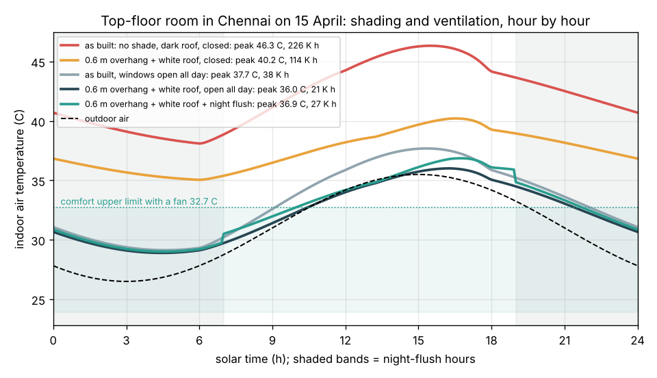
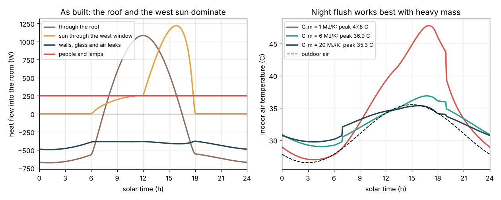

# Session 3: Simulate a hot day and choose a passive design

*Level 3 (simulation and validation) · about 90 minutes · opencomfort*

> This is a simplified educational model. It is not a validated design tool and must not be used for real structures, electrical installations, vehicles, industrial processes or medical decisions.

**Prerequisites**

- Session 1: heat gains and the steady indoor temperature.
- Session 2: sun position, overhang shading and air changes per hour.
- Idea of stepping a quantity forward in time in small steps; explained in Section B.

**Learning objectives.** After this session you can:

- Model a room with air and thermal mass and step it through a day with Runge-Kutta 4.
- Validate the simulation against Session 1 and the energy balance (heat in = heat stored).
- Compare shading, a white roof, all-day ventilation and night flushing, and measure what each one buys.
- Use an adaptive comfort limit and discomfort degree-hours to choose the cheapest design that works.

## A. Real-world problem
Session 1 gave one steady temperature for fixed conditions, and Session 2 the sun and the air flow at one moment. But the sun moves, the outdoor air swings from 26.5 C at dawn to 35.5 C in the afternoon, the roof bakes in the sun, and the floor slab soaks up heat by day and gives it back at night. Can we step through a whole day, check the simulation against Session 1 and the energy balance, and then choose the cheapest set of passive measures (sunshade, white roof, night ventilation) that keeps a top-floor room in Chennai comfortable on 15 April? (A simplified teaching model, not a design tool.)

## B. Concept and theory
A sunlit roof is far hotter than the air. Its effect on the room is as if the air above it were at the **sol-air temperature** T_sa = T_out + a I_roof / h_o - 3.9 K, where a is the roof's solar absorptance (about 0.8 for dark concrete, 0.3 for a white lime or reflective coating), I_roof the sunshine on the roof and h_o = 20 W/(m2 K); the 3.9 K is heat the roof radiates to the cold sky. The room has two parts. The **air** stores very little heat, so at every moment its heat flows balance: walls and glass (UA_w), roof (UA_r, driven by T_sa), ventilation (H_v), the **thermal mass** (hA, the floor slab and inner walls at T_m) and the gains add to zero, which makes the air temperature a weighted average. The **mass** has a large heat capacity C_m and changes slowly: C_m dT_m/dt = hA (T_a - T_m) + f Q_sun, where f = 0.7 is the share of the window sun that lands on the floor. We step this equation every 5 minutes with Runge-Kutta 4. We want the day that repeats itself (a periodic steady state); because the model is linear, two trial days give it exactly. **Night flushing** opens the windows from 7 pm to 7 am, when outdoor air is cooler, to cool the mass; then the windows are shut by day so the cool mass absorbs the afternoon heat. People in naturally ventilated buildings adapt to their climate: the **adaptive comfort** model (ASHRAE Standard 55) puts the 80 percent acceptability upper limit at 0.31 T_pma + 17.8 + 3.5 C, which is 30.9 C for a prevailing mean outdoor temperature of 31 C, and a ceiling fan moving air at about 0.9 m/s raises it by 1.8 K to 32.7 C. **Discomfort degree-hours** add up the kelvin above that limit over the hours of the day.

| Symbol | Meaning | Unit |
|---|---|---|
| T_a, T_m | indoor air temperature, thermal-mass temperature | C |
| T_sa | sol-air temperature of the roof | C |
| a | solar absorptance of the roof surface | no unit |
| UA_w, UA_r | conductance of walls plus glass, of the roof | W/K |
| C_m, hA | heat capacity of the mass, air-to-mass conductance | J/K, W/K |
| H_v | ventilation conductance 1200 x ACH x Vol / 3600 | W/K |
| T_lim | adaptive comfort upper limit | C |
| DH | discomfort degree-hours above T_lim | K h |

**Assumptions**

- The design day repeats: clear sky, outdoor 31 C +/- 4.5 K peaking at 15:00, 15 April in Chennai.
- One lumped mass of 6 MJ/K (about a 150 mm slab and inner walls); the roof itself stores no heat.
- Walls are treated as shaded; only the roof sees the sun. Air changes 0.5 (closed) or 20 per hour (open).
- Comfort is judged on air temperature (a stand-in for operative temperature). Costs are illustrative rupees.

$$ T_{\mathrm{sa}} = T_{\mathrm{out}} + \frac{a\,I_{\mathrm{roof}}}{h_o} - 3.9 $$

$$ T_a = \frac{(UA_w + H_v)\,T_{\mathrm{out}} + UA_r\,T_{\mathrm{sa}} + hA\,T_m + Q_{\mathrm{int}} + (1-f)\,Q_{\mathrm{sun}}}{UA_w + UA_r + H_v + hA} $$

$$ C_m\,\frac{dT_m}{dt} = hA\,(T_a - T_m) + f\,Q_{\mathrm{sun}} $$

$$ T_{\mathrm{lim}} = 0.31\,T_{\mathrm{pma}} + 17.8 + 3.5\ (+1.8\ \text{with a fan}) $$

$$ \mathrm{DH} = \int \max(0,\ T_a - T_{\mathrm{lim}})\,dt $$

## C. Visual explanation
Figure 1 follows the room through the day. As built (no shade, dark roof, windows shut) it peaks at 46.3 C and never drops below 38 C: 226 K h of discomfort. A 0.6 m overhang plus a white roof, still closed, cuts the peak to 40.2 C (114 K h). Opening the windows all day brings the as-built room to 37.7 C (38 K h). Shade, white roof and open windows together give 36.0 C (21 K h), and with night flushing instead 36.9 C (27 K h). Figure 2 (left) shows why: in the as-built room the roof brings up to 1080 W at noon and the west sun up to 1220 W at about 4 pm. On the right, the night-flush design with three thermal masses: a light room (1 MJ/K) swings by 21 K and peaks at 47.8 C, the standard one (6 MJ/K) swings 7.9 K, and a heavy one (20 MJ/K) peaks at 35.3 C, just below the outdoor maximum.

*Indoor air temperature over 15 April for five designs, with the comfort limit.*

*Left: heat flows into the as-built room. Right: night flushing with light, standard and heavy thermal mass.*

## D. Interactive simulation
Run the lesson (`python start.py 3`), then open the live app: [Session 3: a day in the room](https://krunalpanchal1995.github.io/pan-iit-oss/opencomfort/session-03/) (or `app.html` in this folder). Change the overhang, the roof colour, the window schedule and the thermal mass and watch the blue day curve move against the red as-built curve and the green comfort band. Move the time slider and open the room picture to see the roof, air and floor temperatures at that hour.

**Challenge.** Keep the peak indoor temperature at or below 36.5 C with no more than 20 air changes per hour and the standard thermal mass (6 MJ/K).

## E. Worked example and experiment
**Problem.** For the as-built room at 15:00 on 15 April, find the outdoor temperature and the sol-air temperature of the dark roof. Then validate the simulation: with constant inputs (34 C outside and on the roof, 160 W of sun, 10 air changes per hour) it must give the Session 1 answer.

1. Outdoor: T_out = 31 + 4.5 cos(0) = 35.5 C.
2. Sun on the roof at 15:00: altitude 45.8 degrees, beam 1100 exp(-0.18 / 0.7165) = 856 W/m2, so I_roof = 856 x (0.7165 + 0.12) = 716 W/m2.
3. Sol-air: T_sa = 35.5 + 0.8 x 716 / 20 - 3.9 = 60.2 C for the dark roof, and 35.5 + 0.3 x 716 / 20 - 3.9 = 42.3 C for a white roof.
4. Validation: with constant inputs the mass stops changing, so T_a = 34 + (160 + 250) / (70 + 160) = 35.78 C at every step, which the simulation reproduces to 10^-6 K. Its mass sits 0.7 x 160 / 400 = 0.28 K warmer, because it absorbs the floor sun.
5. Energy check on the real day: heat flowing in over 24 h minus heat stored in the mass is at most 0.02 percent of the heat flows, and the mass ends the day at its starting temperature.

**Answer.** T_out = 35.5 C, roof sol-air 60.2 C (dark) or 42.3 C (white); the simulation reproduces Session 1 exactly and conserves energy.

**Experiment.** On a sunny day, measure the surface temperature of a dark roof and a white-painted patch with an infrared thermometer (or by touch, carefully) at 1 pm. The model predicts a difference of about 0.5 x 1000 / 20 = 25 K. Log a room's temperature every hour for a day (a cheap digital thermometer with memory is enough) and compare its swing and its delay behind the outdoor peak with the model. Real rooms differ because walls in the sun also heat up, the wind is not steady, and people open and close windows.

## Real-world application and mini-project: Choose the passive cooling package for a top-floor room
A family wants their top-floor bedroom in Chennai (the Session 3 room) to stay comfortable with a ceiling fan on hot April days, without buying an air conditioner. The options, with illustrative costs: a concrete overhang over the west window of 0.6 m (Rs 6000) or 1.2 m (Rs 12000), a white reflective roof coating that lowers the absorptance from 0.8 to 0.3 (Rs 8000), and keeping windows open all day (free) or opening them only at night with insect mesh and a security grille (Rs 1500). Comfort limit: 32.7 C (adaptive limit for a prevailing mean of 31 C, plus 1.8 K for the fan).

**Deliverable:** A script that uses `simulate_day`, `comfort_upper_limit`, `degree_hours` and `choose_design` to try all 18 combinations, prints the peak temperature, the discomfort degree-hours and the cost of each, and reports the cheapest design under 25 K h and under 20 K h, with a figure of discomfort against cost.

**Success looks like:** The cheapest design under 25 K h is the white roof with windows open all day (Rs 8000, 23.1 K h, peak 36.2 C); under 20 K h it is the 1.2 m overhang plus white roof with windows open (Rs 20000, 19.5 K h); the report notes that the roof matters more than the overhang for a top-floor room, and that no option reaches zero discomfort because the outdoor air itself goes above 32.7 C.

## F. Assessment and design challenge
**Question type A: Conceptual.** In the design-day results, opening the windows all day beats night flushing (36.0 C against 36.9 C). When would night flushing win, and why?

Hint

Night flushing stores "coolth" in the mass at night. What sets how much coolth there is to store?

Step-by-step solution

Night flushing wins when the nights are much cooler than the days and the mass is heavy. Chennai in April is humid with a small daily swing (26.5 to 35.5 C), so the night air is not much cooler and keeping windows open all day pulls the room toward an outdoor temperature that is still below the indoor one. In a drier climate with a larger swing, for example 28 C +/- 9 K (19 to 37 C), the model gives 33.8 C with night flushing against 35.8 C with all-day opening: shutting the windows on the hot afternoon air and letting the cool mass absorb the heat pays off.

**Question type B: Numerical.** Find the sol-air temperature of a flat roof at noon when the outdoor air is 34.2 C and the sun on the roof is 1027 W/m2, for a dark roof (a = 0.8) and a white roof (a = 0.3). How much hotter than the air is each?

Hint

T_sa = T_out + a I / 20 - 3.9.

Step-by-step solution

Dark: 34.2 + 0.8 x 1027 / 20 - 3.9 = 34.2 + 41.1 - 3.9 = 71.4 C, 37.2 K above the air. White: 34.2 + 0.3 x 1027 / 20 - 3.9 = 34.2 + 15.4 - 3.9 = 45.7 C, 11.5 K above the air. Units: W/m2 divided by W/(m2 K) gives K. Sanity check: dark roofs in Indian summers are known to reach 60 to 70 C.

**Question type C: Graph and simulation interpretation.** In Figure 1, why does the as-built room reach its peak around 15:30 and stay above 38 C all night, while the outdoor air falls to 26.5 C?

Hint

Look at the heat flows in Figure 2 (left) and the conductances. How much can a closed room lose at night?

Step-by-step solution

The peak comes when the roof (largest at noon) and the west window sun (largest near 4 pm) overlap with the hottest air at 3 pm. At night the closed room can lose heat only through UA = 70 W/K and 8 W/K of leaks, while the mass releases the heat it stored by day, so the air stays far above outdoor. Opening the windows at night (H_v = 320 W/K at 20 air changes) is what lets the heat out.

**Question type D: Design and optimisation challenge.** Design: using `choose_design`, find the cheapest package that keeps discomfort under 25 K h, and the cheapest under 20 K h. Explain why the roof coating comes before the overhang for this room.

Hint

Compare the peak with only a white roof and with only a 1.2 m overhang, windows open in both cases.

Step-by-step solution

Under 25 K h: white roof plus windows open all day, Rs 8000, 23.1 K h, peak 36.2 C. Under 20 K h: 1.2 m overhang plus white roof plus windows open, Rs 20000, 19.5 K h, peak 35.7 C. With windows open, a white roof alone gives 36.2 C while a 1.2 m overhang alone gives 37.1 C: on a top floor the 16 m2 roof takes far more sun than the 2 m2 window, and on a west window a horizontal overhang misses the low late sun (Session 2). Trade-off: no package reaches zero, because the outdoor air itself exceeds the comfort limit for several hours; the next steps are an insulated roof and vertical fins or a jaali (see the roadmap).

Score yourself with [RUBRIC.md](../../RUBRIC.md). Print the [activity sheet](activity_sheet.md) to work on paper.

## Common misconceptions
| Common misconception | What is actually true |
|---|---|
| A simulation is right because it looks right. | It must be validated: here against the Session 1 formula with constant inputs and by the energy balance over the day. |
| Heavy walls make a room cooler on their own. | Mass smooths the swing. It helps only if it can be cooled, for example by night ventilation; a heavy closed room stays hot all night. |
| Night flushing always beats daytime ventilation. | It depends on the climate: it wins when nights are much cooler than days, as in dry inland cities; in humid coastal Chennai open windows by day can do as well or better. |
| The comfort limit is the same everywhere. | People in naturally ventilated buildings adapt; the adaptive limit rises with the outdoor climate and with air movement from a fan. |

## Glossary
- **sol-air temperature**: the outdoor air temperature that would heat a roof as much as the real air plus sunshine
- **thermal mass**: heavy material (slab, brick) that stores heat and slows temperature changes
- **night flushing**: ventilating at night to cool the thermal mass, then closing up by day
- **adaptive comfort**: a comfort model in which the acceptable temperature depends on the recent outdoor climate
- **degree-hours**: kelvin above a limit added up over the hours: a measure of how much and how long it is too hot

## Finish
1. Do the three coding tasks in [exercises.md](exercises.md).
2. Run `python start.py 3` again after your changes. It ends with the checkpoint; when it prints `PASS`, you are done. (Checkpoint only: `python start.py check 3`.)

Next: the [roadmap](../../promo/roadmap.md). Session 4 is yours to build.
