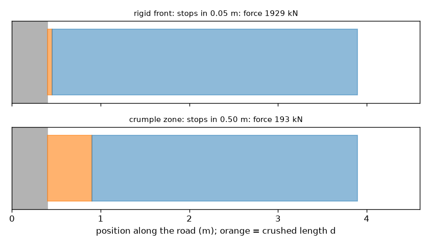
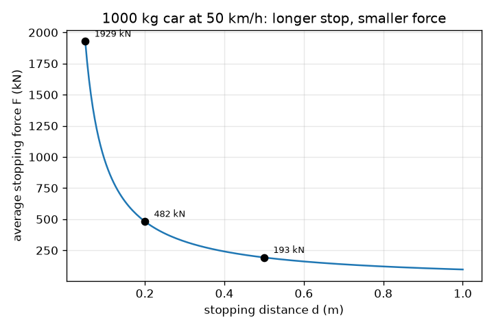

# सत्र 1: कार क्यों पिचकती है: लंबा रुकना यानी छोटा बल

*स्तर 1 (संकल्पनात्मक इंटरैक्टिव मॉडल) · लगभग 60 मिनट · opencrashsim*

> यह एक सरलीकृत शैक्षिक मॉडल है। यह कोई प्रमाणित डिज़ाइन टूल नहीं है और इसका उपयोग वास्तविक संरचनाओं, विद्युत स्थापनाओं, वाहनों, औद्योगिक प्रक्रियाओं या चिकित्सा निर्णयों के लिए नहीं किया जाना चाहिए।

**पूर्व-आवश्यकताएँ (Prerequisites)**

- स्कूल स्तर का बीजगणित: किसी सूत्र को पुनर्व्यवस्थित करना।
- आपने PRIMER.md पढ़ लिया है और `python start.py 1` एक बार चला लिया है।

**सीखने के उद्देश्य (Learning objectives)।** इस सत्र के बाद आप:

- समझा सकेंगे कि लंबी रुकने की दूरी (stopping distance) से औसत बल (average force) छोटा क्यों होता है।
- गतिज ऊर्जा (kinetic energy) और औसत रोकने वाला बल F = m v^2 / (2 d), इकाइयों सहित, निकाल सकेंगे।
- किसी बल को g में मंदन (deceleration) में बदल सकेंगे और देख सकेंगे कि g द्रव्यमान पर निर्भर नहीं करता।
- रुकने की दूरी के विरुद्ध रोकने वाले बल का ग्राफ़ पढ़ सकेंगे।

## A. वास्तविक दुनिया की समस्या
एक कार दीवार से टकराती है। दीवार नहीं हिलती, इसलिए कार को उतनी ही दूरी में रुकना पड़ता है जितनी कार स्वयं देती है। एक कठोर, सख़्त अगला हिस्सा कार को कुछ सेंटीमीटर में रोक देता है और बल बहुत अधिक होता है। एक अगला हिस्सा जो पिचक जाता है, उसे लगभग आधे मीटर में रोकता है और बल बहुत कम होता है। रुकने की दूरी बल को कैसे नियंत्रित करती है? (यह सामान्य भौतिकी शिक्षा है, वाहन सुरक्षा मार्गदर्शिका नहीं।)

## B. संकल्पना और सिद्धांत
चाल v से चलती द्रव्यमान m की एक कार गतिज ऊर्जा KE = (1/2) m v^2 रखती है। रुकने के लिए, वह सारी ऊर्जा हटानी होगी। दूरी d पर पीछे की ओर धकेलने वाला बल F, कार्य (work) F d करता है। यदि बल स्थिर है, तो कार्य को ऊर्जा के बराबर रखने पर F d = (1/2) m v^2 मिलता है, इसलिए F = m v^2 / (2 d)। बल दूरी के व्युत्क्रमानुपाती (inversely proportional) है: पिचकने की दूरी दोगुनी करें तो बल आधा हो जाता है। न्यूटन का दूसरा नियम F = m a बल को मंदन a = v^2 / (2 d) में बदल देता है, जो द्रव्यमान पर निर्भर नहीं करता। हम a को g = 9.81 m/s^2 के गुणज के रूप में लिखते हैं, इसलिए 'a = 20 g' का अर्थ है गुरुत्व के खिंचाव का 20 गुना। चाल मीटर प्रति सेकंड में होनी चाहिए: km/h को 3.6 से भाग दीजिए।

| प्रतीक | अर्थ | इकाई |
|---|---|---|
| m | कार का द्रव्यमान | kg |
| v | टक्कर से ठीक पहले की चाल | m/s |
| d | रुकने की दूरी (पिचकने की दूरी) | m |
| KE | गतिज ऊर्जा | J |
| F | औसत रोकने वाला बल | N |
| a | औसत मंदन | m/s^2 |
| g | गुरुत्वीय त्वरण, 9.81 | m/s^2 |

**मान्यताएँ (Assumptions)**

- बल पूरी रुकने की दूरी पर स्थिर है (औसत बल)।
- कार एक कठोर पिंड है जो सीधी रेखा में एक अचल दीवार की ओर चलती है।
- कोई पलटाव (rebound) नहीं है: कार अंत में विराम में होती है।
- सरलीकृत शैक्षिक मॉडल: यह टक्कर-सुरक्षा (crashworthiness) डिज़ाइन टूल नहीं है, कोई चोट पूर्वानुमान नहीं।

$$ KE=\tfrac12 m v^2 $$

$$ F\,d=\tfrac12 m v^2\quad\Longrightarrow\quad F=\dfrac{m v^2}{2d} $$

$$ a=\dfrac{F}{m}=\dfrac{v^2}{2d}\qquad\text{in g units: } \dfrac{a}{g} $$

## C. दृश्य व्याख्या
पहला चित्र 50 km/h पर चल रही 1000 kg की कार पर औसत बल को रुकने की दूरी के विरुद्ध आलेखित करता है: एक गिरता हुआ वक्र, जिसमें 0.05 m पर 1929 kN, 0.20 m पर 482 kN, 0.50 m पर 193 kN और 1.00 m पर 96 kN है। दूसरा चित्र कार और दीवार को दो बार दिखाता है: एक कठोर अगले हिस्से के साथ (0.05 m पिचकाव) और एक क्रम्पल ज़ोन (crumple zone) के साथ (0.50 m)। लंबा नारंगी खंड पिचकी हुई लंबाई है, और हर चित्र के ऊपर लिखा बल क्रम्पल ज़ोन के लिए 10 गुना छोटा है।

*कठोर अगला हिस्सा (0.05 m पिचकाव) बनाम क्रम्पल ज़ोन (0.50 m): लगभग 1929 kN बनाम 193 kN।*

*50 km/h पर 1000 kg की कार के लिए रुकने की दूरी के विरुद्ध औसत रोकने वाला बल।*

## D. इंटरैक्टिव सिमुलेशन
पाठ चलाइए (`python start.py 1`), फिर लाइव ऐप खोलिए: [सत्र 1: कार क्यों पिचकती है](https://krunalpanchal1995.github.io/pan-iit-oss/opencrashsim/session-01/) (या इसी फ़ोल्डर में `app.html`)। पिचकने की दूरी को 0.05 m से 1 m तक खिसकाइए और बल का तीर, पिचकने वाले खंड का रंग और g का मान बदलते देखिए। फिर चाल दोगुनी कीजिए और देखिए क्या होता है। द्रव्यमान बल को बदलता है पर g को नहीं।

**चुनौती।** पिचकने की दूरी चुनकर 50 km/h पर औसत मंदन को 20 g या उससे कम रखिए।

## E. हल किया गया उदाहरण और प्रयोग
**समस्या।** 50 km/h पर चल रही 1000 kg की एक कार को एक क्रम्पल ज़ोन 0.5 m में रोकता है। औसत बल और g में मंदन ज्ञात कीजिए।

1. चाल बदलिए: 50 km/h / 3.6 = 13.89 m/s।
2. गतिज ऊर्जा: KE = 0.5 * 1000 * 13.89^2 = 96450 J (96.5 kJ)।
3. बल: F = KE / d = 96450 / 0.5 = 192900 N = 192.9 kN।
4. मंदन: a = F / m = 192900 / 1000 = 192.9 m/s^2।
5. g में: 192.9 / 9.81 = 19.7 g।
6. समझदारी जाँच (sanity check): a = v^2 / (2 d) = 192.9 / 1.0 = 192.9 m/s^2, वही।

**उत्तर।** औसत बल 192.9 kN है, यानी 19.7 g का मंदन।

**प्रयोग।** एक खिलौना कार को ढलान से नीचे एक ऐसी दीवार की ओर लुढ़काइए जिसके सामने मुड़े हुए कागज़ का ढेर या फ़ोम का एक छोटा टुकड़ा लगा हो, और फ़ोन से स्लो मोशन में बगल से वीडियो बनाइए। मापिए कि अगला हिस्सा कितना पिचकता है और फ़ोम की दो मोटाइयों की तुलना कीजिए: मोटा फ़ोम अधिक पिचकना चाहिए और कार कम पीछे फेंकी जानी चाहिए। वास्तविक पिचकाव एक स्थिर बल नहीं होता और कुछ ऊर्जा ध्वनि, ऊष्मा और पलटाव में चली जाती है, इसलिए वास्तविक रुकने की दूरी मॉडल से अलग होती है, और खिलौना g में बल नहीं दिखा सकता।

## F. मूल्यांकन और डिज़ाइन चुनौती
**प्रश्न प्रकार A: संकल्पनात्मक।** एक भारी ट्रक और एक छोटी कार समान चाल से दीवार से टकराते हैं और दोनों 0.5 m में रुकते हैं। किसका औसत बल बड़ा है? किसका मंदन बड़ा है? समझाइए।

संकेत

F = m v^2 / (2 d) और a = v^2 / (2 d) की तुलना कीजिए।

चरण-दर-चरण हल

ट्रक का बल बड़ा है क्योंकि F, m के समानुपाती है। मंदन a = v^2 / (2 d) में द्रव्यमान नहीं है, इसलिए दोनों का मंदन समान है। ट्रक में बैठे लोग वही g महसूस करते हैं, पर ट्रक की संरचना को बड़ा बल सहना पड़ता है, इसीलिए भारी वाहनों को अधिक मज़बूत, लंबी संरचनाओं की आवश्यकता होती है।

**प्रश्न प्रकार B: संख्यात्मक।** 36 km/h पर चल रही 1500 kg की एक कार 0.4 m में रुकती है। औसत बल (kN में) और मंदन (g में) ज्ञात कीजिए। अपने उत्तर को दूसरे तरीके से जाँचिए।

संकेत

36 km/h, 10 m/s है। F = m v^2 / (2 d) और a = F / m का उपयोग कीजिए।

चरण-दर-चरण हल

v = 36 / 3.6 = 10 m/s। F = 1500 * 10^2 / (2 * 0.4) = 150000 / 0.8 = 187500 N = 187.5 kN। a = 187500 / 1500 = 125 m/s^2 = 125 / 9.81 = 12.7 g। जाँच: a = v^2 / (2 d) = 100 / 0.8 = 125 m/s^2, वही।

**प्रश्न प्रकार C: ग्राफ़ और सिमुलेशन की व्याख्या।** 50 km/h पर 1000 kg की कार के बल-बनाम-दूरी ग्राफ़ पर d = 0.2 m पर बल लगभग 482 kN है। कैलकुलेटर के बिना, d = 0.4 m और d = 0.1 m पर बल क्या है? इस वक्र को क्या कहते हैं और यह कभी शून्य क्यों नहीं होता?

संकेत

F, 1 / d के समानुपाती है।

चरण-दर-चरण हल

दूरी दोगुनी करने से बल आधा हो जाता है: 0.4 m पर 241 kN। दूरी आधी करने से यह दोगुना हो जाता है: 0.1 m पर 965 kN। वक्र एक अतिपरवलय (hyperbola) F = KE / d है। यह कभी शून्य तक नहीं पहुँचता क्योंकि किसी सीमित ऊर्जा को किसी भी सीमित दूरी पर कुछ बल चाहिए; यह केवल बहुत लंबे रुकाव के लिए छोटा होता है।

**प्रश्न प्रकार D: डिज़ाइन और इष्टतमीकरण (optimisation) चुनौती।** डिज़ाइन: 50 km/h पर 1000 kg की एक कार को अधिकतम 150 kN के औसत बल से रोकना है। सबसे छोटी पिचकने की दूरी क्या है? निकटतम 0.05 m तक एक व्यावहारिक मान चुनिए और समझौता (trade-off) बताइए।

संकेत

F = KE / d को d = KE / F में पुनर्व्यवस्थित कीजिए और ऊपर की ओर पूर्णांकित कीजिए।

चरण-दर-चरण हल

KE = 96450 J, इसलिए d = 96450 / 150000 = 0.643 m। ऊपर की ओर 0.65 m तक पूर्णांकित कीजिए (नीचे की ओर पूर्णांकन 150 kN से अधिक हो जाएगा): F = 96450 / 0.65 = 148.4 kN, a = 14.8 g। समझौता: लंबा क्रम्पल ज़ोन बल घटाता है पर कार को लंबा या भारी बनाता है, और मॉडल एक स्थिर बल मानता है, जिसका वास्तविक संरचना केवल सन्निकटन करती है।

[RUBRIC.md](../../RUBRIC.md) से स्वयं को अंक दीजिए। कागज़ पर काम करने के लिए [गतिविधि पत्रक](activity_sheet.md) प्रिंट कीजिए।

## सामान्य भ्रांतियाँ (Common misconceptions)
| सामान्य भ्रांति | वास्तव में क्या सच है |
|---|---|
| एक अधिक मज़बूत, कठोर अगला हिस्सा हमेशा अधिक सुरक्षित होता है। | एक कठोर अगला हिस्सा कार को बहुत छोटी दूरी में रोक देता है, इसलिए बल और मंदन बहुत बड़े होते हैं। पिचकना उसी ऊर्जा को लंबी दूरी पर फैला देता है। |
| एक भारी कार बड़ा मंदन महसूस करती है क्योंकि बल बड़ा होता है। | बल बड़ा होता है, पर a = F / m, इसलिए द्रव्यमान कट जाता है: a = v^2 / (2 d) किसी भी द्रव्यमान के लिए समान है। |
| चाल दोगुनी करने से बल दोगुना हो जाता है। | ऊर्जा v^2 के साथ बढ़ती है, इसलिए समान रुकने की दूरी पर बल चार गुना हो जाता है। |
| टक्कर में ऊर्जा नष्ट हो जाती है। | गतिज ऊर्जा रूपांतरित होती है, ज़्यादातर धातु को मोड़ने और पिचकाने के कार्य में, साथ में थोड़ी ऊष्मा और ध्वनि में। ऊर्जा संरक्षित रहती है। |

## शब्दावली (Glossary)
- **गतिज ऊर्जा (kinetic energy)**: गति की ऊर्जा, (1/2) m v^2, जूल में मापी जाती है
- **कार्य (work)**: बल गुणा बल की दिशा में दूरी, जूल में
- **क्रम्पल ज़ोन (crumple zone)**: कार का वह भाग जो पिचकने और ऊर्जा सोखने के लिए डिज़ाइन किया गया है
- **g (एक इकाई के रूप में)**: 9.81 m/s^2 के गुणज के रूप में व्यक्त मंदन
- **औसत बल (average force)**: वह स्थिर बल जो समान दूरी पर समान कार्य करता है

## समापन
1. [exercises.md](exercises.md) में दिए गए तीन कोडिंग कार्य कीजिए।
2. अपने बदलावों के बाद `python start.py 1` फिर से चलाइए। यह checkpoint के साथ समाप्त होता है; जब यह `PASS` छापे, तो आपका काम पूरा है। (केवल checkpoint: `python start.py check 1`।)

अगला: [सत्र 2](../session-02/README.md)
