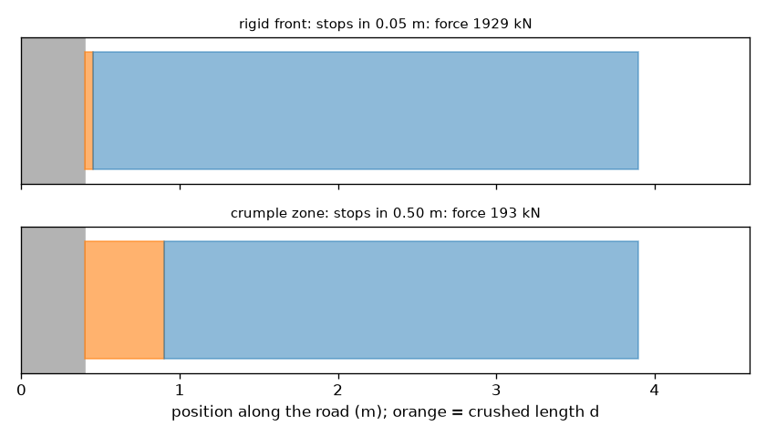
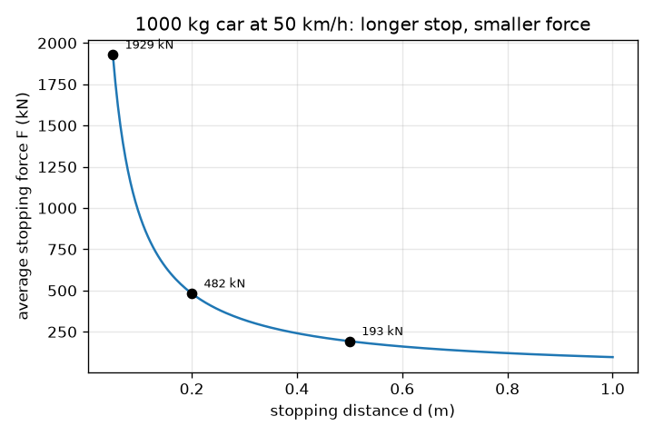

# സെഷൻ 1: ഒരു കാർ ചുളുങ്ങുന്നത് എന്തുകൊണ്ട്: നീണ്ട നിർത്തൽ എന്നാൽ ചെറിയ ബലം

[Session 1 — हिन्दी](README.hi.md)

*ലെവൽ 1 (ആശയപരമായ ഇന്ററാക്ടീവ് മോഡൽ) · ഏകദേശം 60 മിനിറ്റ് · opencrashsim*

> ഇത് ലളിതമാക്കിയ ഒരു വിദ്യാഭ്യാസ മോഡലാണ്. ഇത് സാധൂകരിക്കപ്പെട്ട ഒരു ഡിസൈൻ ഉപകരണമല്ല; യഥാർത്ഥ നിർമ്മിതികൾ, വൈദ്യുത ഇൻസ്റ്റലേഷനുകൾ, വാഹനങ്ങൾ, വ്യാവസായിക പ്രക്രിയകൾ അല്ലെങ്കിൽ വൈദ്യശാസ്ത്രപരമായ തീരുമാനങ്ങൾ എന്നിവയ്ക്ക് ഇത് ഉപയോഗിക്കരുത്.

**മുൻ‌അറിവ് (Prerequisites)**

- സ്കൂൾ ബീജഗണിതം: ഒരു സൂത്രവാക്യം പുനഃക്രമീകരിക്കൽ.
- നിങ്ങൾ PRIMER.md വായിക്കുകയും `python start.py 1` ഒരു തവണ റൺ ചെയ്യുകയും ചെയ്തിട്ടുണ്ട്.

**പഠന ലക്ഷ്യങ്ങൾ (Learning objectives).** ഈ സെഷനു ശേഷം നിങ്ങൾക്ക് കഴിയും:

- നീണ്ട നിർത്തൽ ദൂരം ചെറിയ ശരാശരി ബലം നൽകുന്നത് എന്തുകൊണ്ടെന്ന് വിശദീകരിക്കാൻ.
- ഗതികോർജ്ജവും (kinetic energy) ശരാശരി നിർത്തൽ ബലം F = m v^2 / (2 d) യൂണിറ്റുകളോടെ കണക്കാക്കാൻ.
- ഒരു ബലത്തെ g-യിലുള്ള മന്ദീകരണമായി (deceleration) മാറ്റാനും മന്ദീകരണം പിണ്ഡത്തെ ആശ്രയിക്കുന്നില്ലെന്ന് കാണാനും.
- നിർത്തൽ ദൂരത്തിനെതിരെ നിർത്തൽ ബലത്തിന്റെ ഗ്രാഫ് വായിക്കാൻ.

## A. യഥാർത്ഥ ലോക പ്രശ്നം
ഒരു കാർ ഒരു ഭിത്തിയിൽ ഇടിക്കുന്നു. ഭിത്തി അനങ്ങുന്നില്ല, അതിനാൽ കാർ തന്നെ നൽകുന്ന ദൂരത്തിനുള്ളിൽ കാർ നിൽക്കണം. ദൃഢമായ, കട്ടിയുള്ള മുൻഭാഗം കാറിനെ ഏതാനും സെന്റിമീറ്ററിൽ നിർത്തുന്നു, ബലം വളരെ വലുതാണ്. ചുളുങ്ങുന്ന മുൻഭാഗം ഏകദേശം അര മീറ്ററിൽ നിർത്തുന്നു, ബലം വളരെ ചെറുതാണ്. നിർത്തൽ ദൂരം ബലത്തെ എങ്ങനെ നിയന്ത്രിക്കുന്നു? (ഇത് പൊതു ഭൗതികശാസ്ത്ര വിദ്യാഭ്യാസമാണ്, വാഹന സുരക്ഷാ ഗൈഡ് അല്ല.)

## B. ആശയവും സിദ്ധാന്തവും
v വേഗതയിൽ നീങ്ങുന്ന m പിണ്ഡമുള്ള ഒരു കാർ KE = (1/2) m v^2 ഗതികോർജ്ജം വഹിക്കുന്നു. നിൽക്കാൻ, ആ ഊർജ്ജം മുഴുവൻ എടുത്തുമാറ്റണം, ഇവിടെ കാറിന്റെ മുൻഭാഗം ചതയ്ക്കുന്ന പ്രവൃത്തിയിലൂടെ. d ദൂരത്തിൽ പിന്നോട്ട് തള്ളുന്ന ഒരു സ്ഥിര ബലം F F d പ്രവൃത്തി (work) ചെയ്യുന്നു. ബലം സ്ഥിരമാണെങ്കിൽ, പ്രവൃത്തിയെ ഊർജ്ജത്തിന് തുല്യമാക്കുമ്പോൾ F d = (1/2) m v^2, അതിനാൽ F = m v^2 / (2 d). ബലം ദൂരത്തിന് വിപരീതാനുപാതത്തിലാണ്: ചുളുങ്ങൽ ദൂരം ഇരട്ടിയാക്കിയാൽ ബലം പകുതിയാകുന്നു. ന്യൂട്ടന്റെ രണ്ടാം നിയമം F = m a ബലത്തെ a = v^2 / (2 d) എന്ന മന്ദീകരണമാക്കുന്നു, ഇത് പിണ്ഡത്തെ ആശ്രയിക്കുന്നില്ല. നാം a-യെ g = 9.81 m/s^2-ന്റെ ഗുണിതമായി എഴുതുന്നു, അതിനാൽ 'a = 20 g' എന്നാൽ സ്വതന്ത്രമായി വീഴുന്ന ഒരു വസ്തുവിന്റെ ത്വരണത്തിന്റെ 20 മടങ്ങ്. വേഗത മീറ്റർ പ്രതി സെക്കൻഡിൽ ആയിരിക്കണം: km/h-നെ 3.6 കൊണ്ട് ഹരിക്കുക.

| ചിഹ്നം | അർത്ഥം | യൂണിറ്റ് |
|---|---|---|
| m | കാറിന്റെ പിണ്ഡം | kg |
| v | ഇടിക്കുന്നതിന് തൊട്ടുമുമ്പുള്ള വേഗത | m/s |
| d | നിർത്തൽ ദൂരം (ചുളുങ്ങൽ ദൂരം) | m |
| KE | ഗതികോർജ്ജം | J |
| F | ശരാശരി നിർത്തൽ ബലം | N |
| a | ശരാശരി മന്ദീകരണം | m/s^2 |
| g | ഗുരുത്വാകർഷണ ത്വരണം, 9.81 | m/s^2 |

**അനുമാനങ്ങൾ (Assumptions)**

- നിർത്തൽ ദൂരം മുഴുവൻ ബലം സ്ഥിരമാണ് (ശരാശരി ബലം).
- കാർ നേർരേഖയിൽ അനങ്ങാത്ത ഭിത്തിയിലേക്ക് നീങ്ങുന്ന ഒരു ദൃഢ കട്ടയാണ്.
- തിരിച്ചുചാട്ടം (rebound) ഇല്ല: കാർ നിശ്ചലമായി അവസാനിക്കുന്നു.
- ലളിതമാക്കിയ വിദ്യാഭ്യാസ മോഡൽ: ക്രാഷ്‌വർത്തിനസ് ഡിസൈൻ ഉപകരണമല്ല, പരിക്ക് പ്രവചനങ്ങളില്ല.

$$ KE=\tfrac12 m v^2 $$

$$ F\,d=\tfrac12 m v^2\quad\Longrightarrow\quad F=\dfrac{m v^2}{2d} $$

$$ a=\dfrac{F}{m}=\dfrac{v^2}{2d}\qquad\text{in g units: } \dfrac{a}{g} $$

## C. ദൃശ്യ വിശദീകരണം
ആദ്യ ചിത്രം 50 km/h-ലുള്ള 1000 kg കാറിലെ ശരാശരി ബലം നിർത്തൽ ദൂരത്തിനെതിരെ വരയ്ക്കുന്നു: 0.05 m-ൽ 1929 kN, 0.20 m-ൽ 482 kN, 0.50 m-ൽ 193 kN, 1.00 m-ൽ 96 kN എന്നിങ്ങനെ താഴുന്ന ഒരു വക്രം. രണ്ടാമത്തെ ചിത്രം കാറിനെയും ഭിത്തിയെയും രണ്ടുതവണ വരയ്ക്കുന്നു: ദൃഢമായ മുൻഭാഗത്തോടെ (0.05 m ചതയൽ), ചുളുങ്ങൽ മേഖലയോടെ (crumple zone) (0.50 m). ഓറഞ്ച് ബ്ലോക്ക് ചതഞ്ഞ നീളം d ആണ്. ചുളുങ്ങൽ മേഖലയ്ക്ക് അത് 10 മടങ്ങ് നീളമുള്ളതാണ്, അതിനാൽ ആ ചിത്രത്തിന് മുകളിൽ നൽകിയ ബലം 10 മടങ്ങ് ചെറുതാണ് (1929 kN-ന് പകരം 193 kN).

*ദൃഢമായ മുൻഭാഗം (0.05 m ചതയൽ) ചുളുങ്ങൽ മേഖലയ്ക്കെതിരെ (0.50 m): ഏകദേശം 1929 kN-ഉം 193 kN-ഉം.*

*50 km/h-ലുള്ള 1000 kg കാറിന് നിർത്തൽ ദൂരത്തിനെതിരെ ശരാശരി നിർത്തൽ ബലം.*

## D. ഇന്ററാക്ടീവ് സിമുലേഷൻ
പാഠം റൺ ചെയ്യുക (`python start.py 1`), തുടർന്ന് ലൈവ് ആപ്പ് തുറക്കുക: [സെഷൻ 1: ഒരു കാർ ചുളുങ്ങുന്നത് എന്തുകൊണ്ട്](https://krunalpanchal1995.github.io/pan-iit-oss/opencrashsim/session-01/) (അല്ലെങ്കിൽ ഈ ഫോൾഡറിലെ `app.html`). ചുളുങ്ങൽ ദൂരം 0.05 m-ൽ നിന്ന് 1 m വരെ നീക്കി ബല അമ്പടയാളം, ചുളുങ്ങൽ ബ്ലോക്കിന്റെ നിറം, g മൂല്യം എന്നിവ മാറുന്നത് ശ്രദ്ധിക്കുക. തുടർന്ന് വേഗത ഇരട്ടിയാക്കുക: ബലം രണ്ടല്ല, നാല് മടങ്ങ് വലുതാകുന്നു. അവസാനം പിണ്ഡം മാറ്റുക: ബലം മാറുന്നു, പക്ഷേ g മൂല്യം മാറുന്നില്ല.

**വെല്ലുവിളി.** ഒരു ചുളുങ്ങൽ ദൂരം തിരഞ്ഞെടുത്ത് 50 km/h-ൽ ശരാശരി മന്ദീകരണം 20 g-യിലോ അതിൽ താഴെയോ നിലനിർത്തുക.

## E. പ്രവർത്തിച്ച ഉദാഹരണവും പരീക്ഷണവും
**പ്രശ്നം.** 50 km/h-ലുള്ള 1000 kg കാർ 0.5 m-ൽ ഒരു ചുളുങ്ങൽ മേഖലയാൽ നിർത്തപ്പെടുന്നു. ശരാശരി ബലവും g-യിലുള്ള മന്ദീകരണവും കണ്ടെത്തുക.

1. വേഗത മാറ്റുക: 50 km/h / 3.6 = 13.89 m/s.
2. ഗതികോർജ്ജം: KE = 0.5 * 1000 * 13.89^2 = 96450 J (96.5 kJ).
3. ബലം: F = KE / d = 96450 / 0.5 = 192900 N = 192.9 kN.
4. മന്ദീകരണം: a = F / m = 192900 / 1000 = 192.9 m/s^2.
5. g-യിൽ: 192.9 / 9.81 = 19.7 g.
6. യുക്തിപരിശോധന: a = v^2 / (2 d) = 192.9 / 1.0 = 192.9 m/s^2, അതുതന്നെ.

**ഉത്തരം.** ശരാശരി ബലം 192.9 kN, മന്ദീകരണം 19.7 g.

**പരീക്ഷണം.** മടക്കിയ പേപ്പർ കൂമ്പാരമോ ചെറിയ ഫോം ബ്ലോക്കോ മുന്നിൽ വച്ച ഒരു ഭിത്തിയിലേക്ക് ഒരു കളിപ്പാട്ട കാർ ചരിവിലൂടെ ഉരുട്ടി വിടുക, ഫോൺ ഉപയോഗിച്ച് സ്ലോ മോഷനിൽ വശത്തുനിന്ന് ചിത്രീകരിക്കുക. മുൻഭാഗം എത്ര ദൂരം ചതയുന്നു എന്ന് അളന്ന് രണ്ട് ഫോം കനങ്ങൾ താരതമ്യം ചെയ്യുക: കനം കൂടിയ ഫോം കൂടുതൽ ചതയണം, കാർ കുറച്ചേ തിരിച്ചുചാടാവൂ. യഥാർത്ഥ ചതയൽ സ്ഥിര ബലമല്ല, ചില ഊർജ്ജം ശബ്ദം, താപം, തിരിച്ചുചാട്ടം എന്നിവയിലേക്ക് പോകുന്നു, അതിനാൽ യഥാർത്ഥ നിർത്തൽ ദൂരം മോഡലിൽ നിന്ന് വ്യത്യസ്തമാണ്, കളിപ്പാട്ടത്തിന് g-യിൽ ബലങ്ങൾ കാണിക്കാൻ കഴിയില്ല.

## F. മൂല്യനിർണ്ണയവും ഡിസൈൻ വെല്ലുവിളിയും
**ചോദ്യ തരം A: ആശയപരം.** ഭാരമേറിയ ഒരു ട്രക്കും ഒരു ചെറിയ കാറും ഒരേ വേഗതയിൽ ഭിത്തിയിൽ ഇടിച്ച് രണ്ടും 0.5 m-ൽ നിൽക്കുന്നു. ഏതിനാണ് വലിയ ശരാശരി ബലം? ഏതിനാണ് വലിയ മന്ദീകരണം? വിശദീകരിക്കുക.

സൂചന

F = m v^2 / (2 d), a = v^2 / (2 d) എന്നിവ താരതമ്യം ചെയ്യുക.

ഘട്ടം ഘട്ടമായുള്ള പരിഹാരം

F, m-ന് ആനുപാതികമായതിനാൽ ട്രക്കിനാണ് വലിയ ബലം. മന്ദീകരണം a = v^2 / (2 d)-ൽ പിണ്ഡമില്ല, അതിനാൽ രണ്ടിനും ഒരേ മന്ദീകരണമാണ്. ട്രക്കിലെ യാത്രക്കാർക്ക് ഒരേ g അനുഭവപ്പെടുന്നു, പക്ഷേ ട്രക്കിന്റെ ഘടന വലിയ ബലം വഹിക്കണം, അതുകൊണ്ടാണ് ഭാരമേറിയ വാഹനങ്ങൾക്ക് ശക്തവും നീളമുള്ളതുമായ ഘടനകൾ വേണ്ടത്.

**ചോദ്യ തരം B: സംഖ്യാപരം.** 36 km/h-ലുള്ള 1500 kg കാർ 0.4 m-ൽ നിർത്തപ്പെടുന്നു. ശരാശരി ബലവും (kN-ൽ) മന്ദീകരണവും (g-യിൽ) കണ്ടെത്തുക. മറ്റൊരു രീതിയിൽ ഉത്തരം പരിശോധിക്കുക.

സൂചന

36 km/h എന്നത് 10 m/s ആണ്. F = m v^2 / (2 d), a = F / m എന്നിവ ഉപയോഗിക്കുക.

ഘട്ടം ഘട്ടമായുള്ള പരിഹാരം

v = 36 / 3.6 = 10 m/s. F = 1500 * 10^2 / (2 * 0.4) = 150000 / 0.8 = 187500 N = 187.5 kN. a = 187500 / 1500 = 125 m/s^2 = 125 / 9.81 = 12.7 g. പരിശോധന: a = v^2 / (2 d) = 100 / 0.8 = 125 m/s^2, അതുതന്നെ.

**ചോദ്യ തരം C: ഗ്രാഫും സിമുലേഷനും വ്യാഖ്യാനിക്കൽ.** 50 km/h-ലുള്ള 1000 kg കാറിന്റെ ബലം-ദൂരം ഗ്രാഫിൽ d = 0.2 m-ലെ ബലം ഏകദേശം 482 kN ആണ്. കാൽക്കുലേറ്റർ ഇല്ലാതെ, d = 0.4 m-ലും d = 0.1 m-ലും ബലം എന്താണ്? ഈ വക്രത്തെ എന്ത് വിളിക്കുന്നു, അത് ഒരിക്കലും പൂജ്യമാകാത്തത് എന്തുകൊണ്ട്?

സൂചന

F, 1 / d-ന് ആനുപാതികമാണ്.

ഘട്ടം ഘട്ടമായുള്ള പരിഹാരം

ദൂരം ഇരട്ടിയാക്കിയാൽ ബലം പകുതിയാകുന്നു: 0.4 m-ൽ 241 kN. ദൂരം പകുതിയാക്കിയാൽ ബലം ഇരട്ടിയാകുന്നു: 0.1 m-ൽ 965 kN. വക്രം ഒരു ഹൈപ്പർബോള (hyperbola) F = KE / d ആണ്. പരിമിതമായ ഊർജ്ജത്തിന് ഏത് പരിമിത ദൂരത്തിലും കുറച്ച് ബലം വേണ്ടതിനാൽ അത് ഒരിക്കലും പൂജ്യത്തിൽ എത്തുന്നില്ല; വളരെ നീണ്ട നിർത്തലുകൾക്ക് മാത്രമേ അത് ചെറുതാകൂ.

**ചോദ്യ തരം D: ഡിസൈനും ഒപ്റ്റിമൈസേഷൻ വെല്ലുവിളിയും.** ഡിസൈൻ: 50 km/h-ലുള്ള 1000 kg കാർ പരമാവധി 150 kN ശരാശരി ബലത്തോടെ നിർത്തണം. ഏറ്റവും ചെറിയ ചുളുങ്ങൽ ദൂരം എന്താണ്? ഏറ്റവും അടുത്ത 0.05 m-ലേക്ക് ഒരു പ്രായോഗിക മൂല്യം തിരഞ്ഞെടുത്ത് വിട്ടുവീഴ്ച (trade-off) പറയുക.

സൂചന

F = KE / d-നെ d = KE / F ആയി പുനഃക്രമീകരിച്ച് മുകളിലേക്ക് റൗണ്ട് ചെയ്യുക.

ഘട്ടം ഘട്ടമായുള്ള പരിഹാരം

KE = 96450 J, അതിനാൽ d = 96450 / 150000 = 0.643 m. 0.65 m-ലേക്ക് മുകളിലേക്ക് റൗണ്ട് ചെയ്യുക (താഴേക്ക് റൗണ്ട് ചെയ്താൽ 150 kN കവിയും): F = 96450 / 0.65 = 148.4 kN, a = 14.8 g. വിട്ടുവീഴ്ച: നീളമുള്ള ചുളുങ്ങൽ മേഖല ബലം കുറയ്ക്കുന്നു, പക്ഷേ കാറിനെ നീളമുള്ളതോ ഭാരമുള്ളതോ ആക്കുന്നു; മോഡൽ സ്ഥിര ബലം അനുമാനിക്കുന്നു, യഥാർത്ഥ ഘടന അതിനെ ഏകദേശമായി മാത്രമേ പിന്തുടരൂ.

[RUBRIC.md](../../RUBRIC.md) ഉപയോഗിച്ച് സ്വയം സ്കോർ ചെയ്യുക. പേപ്പറിൽ ചെയ്യാൻ [പ്രവർത്തന ഷീറ്റ്](activity_sheet.md) പ്രിന്റ് ചെയ്യുക.

## സാധാരണ തെറ്റിദ്ധാരണകൾ
| സാധാരണ തെറ്റിദ്ധാരണ | യഥാർത്ഥത്തിൽ ശരിയായത് |
|---|---|
| ശക്തവും ദൃഢവുമായ മുൻഭാഗം എപ്പോഴും സുരക്ഷിതമാണ്. | ദൃഢമായ മുൻഭാഗം കാറിനെ വളരെ ചെറിയ ദൂരത്തിൽ നിർത്തുന്നു, അതിനാൽ ബലവും മന്ദീകരണവും വളരെ വലുതാണ്. ചുളുങ്ങൽ അതേ ഊർജ്ജത്തെ നീണ്ട ദൂരത്തിൽ വ്യാപിപ്പിക്കുന്നു. |
| ബലം വലുതായതിനാൽ ഭാരമേറിയ കാറിന് വലിയ മന്ദീകരണം അനുഭവപ്പെടുന്നു. | ബലം വലുതാണ്, പക്ഷേ a = F / m, അതിനാൽ പിണ്ഡം റദ്ദാകുന്നു: a = v^2 / (2 d) ഏത് പിണ്ഡത്തിനും ഒന്നാണ്. |
| വേഗത ഇരട്ടിയാക്കിയാൽ ബലം ഇരട്ടിയാകും. | ഊർജ്ജം v^2-നോടൊപ്പം വളരുന്നു, അതിനാൽ ഒരേ നിർത്തൽ ദൂരത്തിൽ ബലം നാലിരട്ടിയാകുന്നു. |
| ഇടിയിൽ ഊർജ്ജം നശിപ്പിക്കപ്പെടുന്നു. | ഗതികോർജ്ജം രൂപാന്തരപ്പെടുന്നു, മിക്കവാറും ലോഹം വളയ്ക്കുന്നതിനും ചതയ്ക്കുന്നതിനുമുള്ള പ്രവൃത്തിയായി, കൂടാതെ അല്പം താപവും ശബ്ദവും. ഊർജ്ജം സംരക്ഷിക്കപ്പെടുന്നു. |

## പദാവലി (Glossary)
- **ഗതികോർജ്ജം (kinetic energy)**: ചലനത്തിന്റെ ഊർജ്ജം, (1/2) m v^2, ജൂളിൽ അളക്കുന്നു
- **പ്രവൃത്തി (work)**: ബലം ഗുണം ബലത്തിന്റെ ദിശയിലുള്ള ദൂരം, ജൂളിൽ
- **ചുളുങ്ങൽ മേഖല (crumple zone)**: തകർന്ന് ഊർജ്ജം ആഗിരണം ചെയ്യാൻ രൂപകൽപ്പന ചെയ്ത കാറിന്റെ ഭാഗം
- **g (ഒരു യൂണിറ്റായി)**: 9.81 m/s^2-ന്റെ ഗുണിതമായി പ്രകടിപ്പിച്ച മന്ദീകരണം
- **ശരാശരി ബലം (average force)**: ഒരേ ദൂരത്തിൽ ഒരേ പ്രവൃത്തി ചെയ്യുന്ന സ്ഥിര ബലം

## പൂർത്തിയാക്കുക
1. [exercises.md](exercises.md)-ലെ മൂന്ന് കോഡിംഗ് ടാസ്കുകൾ ചെയ്യുക.
2. നിങ്ങളുടെ മാറ്റങ്ങൾക്ക് ശേഷം `python start.py 1` വീണ്ടും റൺ ചെയ്യുക. അത് ചെക്ക്‌പോയിന്റോടെ അവസാനിക്കുന്നു; അത് `PASS` പ്രിന്റ് ചെയ്യുമ്പോൾ, നിങ്ങൾ പൂർത്തിയാക്കി. (ചെക്ക്‌പോയിന്റ് മാത്രം: `python start.py check 1`.)

അടുത്തത്: [സെഷൻ 2](../session-02/README.md)
