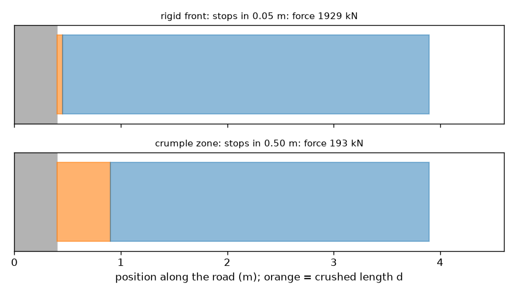
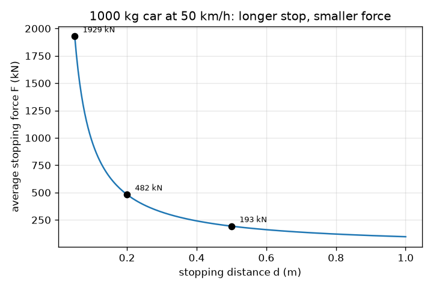

# அமர்வு 1: கார் ஏன் நசுங்குகிறது: நீண்ட நிறுத்தம் என்றால் சிறிய விசை

[Session 1 — हिन्दी](README.hi.md)

*நிலை 1 (கருத்தியல் ஊடாடும் மாதிரி) · சுமார் 60 நிமிடங்கள் · opencrashsim*

> இது எளிமைப்படுத்தப்பட்ட ஒரு கல்வி மாதிரி. இது சரிபார்க்கப்பட்ட வடிவமைப்புக் கருவி அல்ல; உண்மையான கட்டமைப்புகள், மின் நிறுவல்கள், வாகனங்கள், தொழில்துறை செயல்முறைகள் அல்லது மருத்துவ முடிவுகளுக்கு இதைப் பயன்படுத்தக் கூடாது.

**முன்தேவைகள் (Prerequisites)**

- பள்ளி இயற்கணிதம்: ஒரு சூத்திரத்தை மாற்றியமைத்தல்.
- நீங்கள் PRIMER.md படித்து, `python start.py 1` ஐ ஒரு முறை இயக்கியிருக்க வேண்டும்.

**கற்றல் நோக்கங்கள் (Learning objectives).** இந்த அமர்வுக்குப் பிறகு நீங்கள்:

- நீண்ட நிறுத்தத் தூரம் சிறிய சராசரி விசையைத் தருவது ஏன் என்று விளக்க முடியும்.
- இயக்க ஆற்றலையும் (kinetic energy) சராசரி நிறுத்த விசை F = m v^2 / (2 d) ஐயும் அலகுகளுடன் கணக்கிட முடியும்.
- ஒரு விசையை g-ல் உள்ள வேகக்குறைப்பாக (deceleration) மாற்றி, வேகக்குறைப்பு நிறையைச் சார்ந்ததல்ல என்பதைக் காண முடியும்.
- நிறுத்தத் தூரத்திற்கு எதிரான நிறுத்த விசையின் வரைபடத்தைப் படிக்க முடியும்.

## A. நிஜ உலகப் பிரச்சனை
ஒரு கார் சுவரில் மோதுகிறது. சுவர் நகராது, எனவே கார் தானே வழங்கும் தூரத்திற்குள் நிற்க வேண்டும். விறைப்பான, கடினமான முன்பகுதி காரைச் சில சென்டிமீட்டர்களில் நிறுத்துகிறது, விசை மிகப் பெரியது. நசுங்கும் முன்பகுதி சுமார் அரை மீட்டரில் நிறுத்துகிறது, விசை மிகச் சிறியது. நிறுத்தத் தூரம் விசையை எப்படிக் கட்டுப்படுத்துகிறது? (இது பொது இயற்பியல் கல்வி, வாகனப் பாதுகாப்பு வழிகாட்டி அல்ல.)

## B. கருத்தும் கோட்பாடும்
v வேகத்தில் நகரும் m நிறையுள்ள கார் KE = (1/2) m v^2 இயக்க ஆற்றலைக் கொண்டுள்ளது. நிற்க, அந்த ஆற்றல் முழுவதும் அகற்றப்பட வேண்டும், இங்கே காரின் முன்பகுதியை நசுக்கும் வேலையால். d தூரத்தில் பின்னோக்கித் தள்ளும் ஒரு மாறா விசை F, F d வேலை (work) செய்கிறது. விசை மாறிலி எனில், வேலையை ஆற்றலுக்குச் சமமாக்கினால் F d = (1/2) m v^2, எனவே F = m v^2 / (2 d). விசை தூரத்திற்கு எதிர்விகிதத்தில் உள்ளது: நசுங்கல் தூரத்தை இரு மடங்காக்கினால் விசை பாதியாகிறது. நியூட்டனின் இரண்டாம் விதி F = m a விசையை a = v^2 / (2 d) என்ற வேகக்குறைப்பாக மாற்றுகிறது, இது நிறையைச் சார்ந்ததல்ல. நாம் a-ஐ g = 9.81 m/s^2 இன் மடங்காக எழுதுகிறோம், எனவே 'a = 20 g' என்றால் தடையின்றி விழும் பொருளின் முடுக்கத்தின் 20 மடங்கு. வேகம் மீட்டர் per வினாடியில் இருக்க வேண்டும்: km/h-ஐ 3.6 ஆல் வகுக்கவும்.

| குறியீடு | பொருள் | அலகு |
|---|---|---|
| m | காரின் நிறை | kg |
| v | மோதலுக்குச் சற்று முன் வேகம் | m/s |
| d | நிறுத்தத் தூரம் (நசுங்கல் தூரம்) | m |
| KE | இயக்க ஆற்றல் | J |
| F | சராசரி நிறுத்த விசை | N |
| a | சராசரி வேகக்குறைப்பு | m/s^2 |
| g | ஈர்ப்பு முடுக்கம், 9.81 | m/s^2 |

**அனுமானங்கள் (Assumptions)**

- முழு நிறுத்தத் தூரத்திலும் விசை மாறிலி (சராசரி விசை).
- கார் நகராத சுவரை நோக்கி நேர்கோட்டில் நகரும் ஒரு திடக் கட்டி.
- மீள்துள்ளல் (rebound) இல்லை: கார் ஓய்வில் முடிகிறது.
- எளிமைப்படுத்தப்பட்ட கல்வி மாதிரி: மோதல்-தாங்குதிறன் வடிவமைப்புக் கருவி அல்ல, காயக் கணிப்புகள் இல்லை.

$$ KE=\tfrac12 m v^2 $$

$$ F\,d=\tfrac12 m v^2\quad\Longrightarrow\quad F=\dfrac{m v^2}{2d} $$

$$ a=\dfrac{F}{m}=\dfrac{v^2}{2d}\qquad\text{in g units: } \dfrac{a}{g} $$

## C. காட்சி விளக்கம்
முதல் படம் 50 km/h-ல் செல்லும் 1000 kg காரின் சராசரி விசையை நிறுத்தத் தூரத்திற்கு எதிராக வரைகிறது: 0.05 m-ல் 1929 kN, 0.20 m-ல் 482 kN, 0.50 m-ல் 193 kN, 1.00 m-ல் 96 kN என இறங்கும் வளைவு. இரண்டாவது படம் காரையும் சுவரையும் இரு முறை வரைகிறது: கடினமான முன்பகுதியுடன் (0.05 m நசுங்கல்) மற்றும் நசுங்கு மண்டலத்துடன் (crumple zone) (0.50 m). ஆரஞ்சுத் தொகுதி நசுங்கிய நீளம் d. நசுங்கு மண்டலத்திற்கு அது 10 மடங்கு நீளமானது, எனவே அந்தப் படத்தின் மேலே குறிப்பிடப்பட்ட விசை 10 மடங்கு சிறியது (1929 kN-க்குப் பதிலாக 193 kN).

*கடினமான முன்பகுதி (0.05 m நசுங்கல்) மற்றும் நசுங்கு மண்டலம் (0.50 m): சுமார் 1929 kN மற்றும் 193 kN.*

*50 km/h-ல் செல்லும் 1000 kg காருக்கு நிறுத்தத் தூரத்திற்கு எதிரான சராசரி நிறுத்த விசை.*

## D. ஊடாடும் உருவகப்படுத்தல்
பாடத்தை இயக்கவும் (`python start.py 1`), பிறகு நேரடிச் செயலியைத் திறக்கவும்: [அமர்வு 1: கார் ஏன் நசுங்குகிறது](https://krunalpanchal1995.github.io/pan-iit-oss/opencrashsim/session-01/) (அல்லது இந்தக் கோப்புறையில் உள்ள `app.html`). நசுங்கல் தூரத்தை 0.05 m-லிருந்து 1 m வரை நகர்த்தி, விசை அம்பு, நசுங்கல் தொகுதியின் நிறம் மற்றும் g மதிப்பு மாறுவதைக் கவனியுங்கள். பிறகு வேகத்தை இரு மடங்காக்குங்கள்: விசை இரண்டு அல்ல, நான்கு மடங்கு பெரிதாகிறது. இறுதியாக நிறையை மாற்றுங்கள்: விசை மாறுகிறது, ஆனால் g மதிப்பு மாறுவதில்லை.

**சவால்.** ஒரு நசுங்கல் தூரத்தைத் தேர்ந்தெடுத்து 50 km/h-ல் சராசரி வேகக்குறைப்பை 20 g அல்லது அதற்குக் கீழே வைத்திருங்கள்.

## E. தீர்க்கப்பட்ட உதாரணமும் சோதனையும்
**பிரச்சனை.** 50 km/h-ல் செல்லும் 1000 kg கார் 0.5 m-ல் ஒரு நசுங்கு மண்டலத்தால் நிறுத்தப்படுகிறது. சராசரி விசையையும் g-ல் வேகக்குறைப்பையும் கண்டறியுங்கள்.

1. வேகத்தை மாற்றுங்கள்: 50 km/h / 3.6 = 13.89 m/s.
2. இயக்க ஆற்றல்: KE = 0.5 * 1000 * 13.89^2 = 96450 J (96.5 kJ).
3. விசை: F = KE / d = 96450 / 0.5 = 192900 N = 192.9 kN.
4. வேகக்குறைப்பு: a = F / m = 192900 / 1000 = 192.9 m/s^2.
5. g-ல்: 192.9 / 9.81 = 19.7 g.
6. சரிபார்ப்பு: a = v^2 / (2 d) = 192.9 / 1.0 = 192.9 m/s^2, அதே மதிப்பு.

**விடை.** சராசரி விசை 192.9 kN, வேகக்குறைப்பு 19.7 g.

**சோதனை.** மடித்த காகித அடுக்கு அல்லது சிறிய நுரைத் தொகுதி முன்னால் வைக்கப்பட்ட ஒரு சுவரை நோக்கி ஒரு பொம்மைக் காரைச் சரிவில் உருட்டி விடுங்கள், தொலைபேசியால் மெதுவான இயக்கத்தில் (slow motion) பக்கவாட்டில் படம்பிடியுங்கள். முன்பகுதி எவ்வளவு நசுங்குகிறது என்று அளந்து இரண்டு நுரைத் தடிமன்களை ஒப்பிடுங்கள்: தடிமனான நுரை அதிகமாக நசுங்க வேண்டும், கார் குறைவாகத் திரும்பித் துள்ள வேண்டும். உண்மையான நசுங்கல் மாறா விசை அல்ல, சில ஆற்றல் ஒலி, வெப்பம், மீள்துள்ளல் ஆகியவற்றுக்குச் செல்கிறது, எனவே உண்மையான நிறுத்தத் தூரம் மாதிரியிலிருந்து வேறுபடுகிறது; பொம்மையால் g-ல் விசைகளைக் காட்ட முடியாது.

## F. மதிப்பீடும் வடிவமைப்புச் சவாலும்
**கேள்வி வகை A: கருத்தியல்.** ஒரு கனமான லாரியும் ஒரு சிறிய காரும் ஒரே வேகத்தில் சுவரில் மோதி இரண்டும் 0.5 m-ல் நிற்கின்றன. எதற்குப் பெரிய சராசரி விசை? எதற்குப் பெரிய வேகக்குறைப்பு? விளக்குங்கள்.

குறிப்பு

F = m v^2 / (2 d) மற்றும் a = v^2 / (2 d) ஐ ஒப்பிடுங்கள்.

படிப்படியான தீர்வு

F, m-க்கு விகிதசமம் என்பதால் லாரிக்குப் பெரிய விசை. வேகக்குறைப்பு a = v^2 / (2 d) இல் நிறை இல்லை, எனவே இரண்டிற்கும் ஒரே வேகக்குறைப்பு. லாரியில் உள்ளவர்கள் அதே g-ஐ உணர்கின்றனர், ஆனால் லாரியின் கட்டமைப்பு பெரிய விசையைத் தாங்க வேண்டும்; அதனால்தான் கனரக வாகனங்களுக்கு வலுவான, நீளமான கட்டமைப்புகள் தேவை.

**கேள்வி வகை B: எண்ணியல்.** 36 km/h-ல் செல்லும் 1500 kg கார் 0.4 m-ல் நிறுத்தப்படுகிறது. சராசரி விசையையும் (kN-ல்) வேகக்குறைப்பையும் (g-ல்) கண்டறியுங்கள். உங்கள் விடையை வேறு வழியில் சரிபாருங்கள்.

குறிப்பு

36 km/h என்பது 10 m/s. F = m v^2 / (2 d) மற்றும் a = F / m பயன்படுத்துங்கள்.

படிப்படியான தீர்வு

v = 36 / 3.6 = 10 m/s. F = 1500 * 10^2 / (2 * 0.4) = 150000 / 0.8 = 187500 N = 187.5 kN. a = 187500 / 1500 = 125 m/s^2 = 125 / 9.81 = 12.7 g. சரிபார்ப்பு: a = v^2 / (2 d) = 100 / 0.8 = 125 m/s^2, அதே மதிப்பு.

**கேள்வி வகை C: வரைபடம் மற்றும் உருவகப்படுத்தல் விளக்கம்.** 50 km/h-ல் செல்லும் 1000 kg காருக்கான விசை-தூர வரைபடத்தில் d = 0.2 m-ல் விசை சுமார் 482 kN. கணிப்பான் இல்லாமல், d = 0.4 m-லும் d = 0.1 m-லும் விசை என்ன? இந்த வளைவு என்ன அழைக்கப்படுகிறது, அது ஏன் ஒருபோதும் பூஜ்ஜியமாவதில்லை?

குறிப்பு

F, 1 / d-க்கு விகிதசமம்.

படிப்படியான தீர்வு

தூரத்தை இரு மடங்காக்கினால் விசை பாதியாகிறது: 0.4 m-ல் 241 kN. தூரத்தைப் பாதியாக்கினால் விசை இரு மடங்காகிறது: 0.1 m-ல் 965 kN. வளைவு ஒரு அதிபரவளையம் (hyperbola) F = KE / d. வரம்புள்ள ஆற்றலுக்கு எந்த வரம்புள்ள தூரத்திலும் சிறிது விசை தேவை என்பதால் அது ஒருபோதும் பூஜ்ஜியத்தை அடையாது; மிக நீண்ட நிறுத்தங்களுக்கு மட்டுமே அது சிறியதாகிறது.

**கேள்வி வகை D: வடிவமைப்பு மற்றும் உகப்பாக்கச் சவால்.** வடிவமைப்பு: 50 km/h-ல் செல்லும் 1000 kg கார் அதிகபட்சம் 150 kN சராசரி விசையுடன் நிறுத்தப்பட வேண்டும். மிகச் சிறிய நசுங்கல் தூரம் என்ன? அருகிலுள்ள 0.05 m-க்கு ஒரு நடைமுறை மதிப்பைத் தேர்ந்தெடுத்து, சமரசத்தைக் (trade-off) கூறுங்கள்.

குறிப்பு

F = KE / d ஐ d = KE / F ஆக மாற்றியமைத்து மேல்நோக்கி முழுமையாக்குங்கள்.

படிப்படியான தீர்வு

KE = 96450 J, எனவே d = 96450 / 150000 = 0.643 m. 0.65 m-க்கு மேல்நோக்கி முழுமையாக்குங்கள் (கீழ்நோக்கி முழுமையாக்கினால் 150 kN-ஐத் தாண்டும்): F = 96450 / 0.65 = 148.4 kN, a = 14.8 g. சமரசம்: நீண்ட நசுங்கு மண்டலம் விசையைக் குறைக்கிறது, ஆனால் காரை நீளமாகவோ கனமாகவோ ஆக்குகிறது; மாதிரி மாறா விசையை அனுமானிக்கிறது, உண்மையான கட்டமைப்பு அதைத் தோராயமாக மட்டுமே பின்பற்றுகிறது.

[RUBRIC.md](../../RUBRIC.md) மூலம் உங்களை மதிப்பிட்டுக் கொள்ளுங்கள். காகிதத்தில் செய்ய [செயல்பாட்டுத் தாள்](activity_sheet.md) அச்சிடுங்கள்.

## பொதுவான தவறான கருத்துகள்
| பொதுவான தவறான கருத்து | உண்மையில் சரியானது |
|---|---|
| வலுவான, விறைப்பான முன்பகுதி எப்போதும் பாதுகாப்பானது. | கடினமான முன்பகுதி காரை மிகக் குறுகிய தூரத்தில் நிறுத்துகிறது, எனவே விசையும் வேகக்குறைப்பும் மிகப் பெரியவை. நசுங்குதல் அதே ஆற்றலை நீண்ட தூரத்தில் பரப்புகிறது. |
| விசை பெரியது என்பதால் கனமான கார் பெரிய வேகக்குறைப்பை உணர்கிறது. | விசை பெரியது, ஆனால் a = F / m, எனவே நிறை நீங்குகிறது: a = v^2 / (2 d) எந்த நிறைக்கும் ஒன்றே. |
| வேகத்தை இரு மடங்காக்கினால் விசை இரு மடங்காகும். | ஆற்றல் v^2 உடன் வளர்கிறது, எனவே அதே நிறுத்தத் தூரத்தில் விசை நான்கு மடங்காகிறது. |
| மோதலில் ஆற்றல் அழிக்கப்படுகிறது. | இயக்க ஆற்றல் மாற்றப்படுகிறது, பெரும்பாலும் உலோகத்தை வளைத்து நசுக்கும் வேலையாக, மேலும் சிறிது வெப்பமும் ஒலியும். ஆற்றல் அழிவின்றிக் காக்கப்படுகிறது. |

## சொற்களஞ்சியம் (Glossary)
- **இயக்க ஆற்றல் (kinetic energy)**: இயக்கத்தின் ஆற்றல், (1/2) m v^2, ஜூலில் அளக்கப்படுகிறது
- **வேலை (work)**: விசை பெருக்கல் விசையின் திசையிலான தூரம், ஜூலில்
- **நசுங்கு மண்டலம் (crumple zone)**: சரிந்து ஆற்றலை உறிஞ்சும்படி வடிவமைக்கப்பட்ட காரின் பகுதி
- **g (ஒரு அலகாக)**: 9.81 m/s^2 இன் மடங்காக வெளிப்படுத்தப்பட்ட வேகக்குறைப்பு
- **சராசரி விசை (average force)**: அதே தூரத்தில் அதே வேலையைச் செய்யும் மாறா விசை

## நிறைவு
1. [exercises.md](exercises.md) இல் உள்ள மூன்று நிரலாக்கப் பணிகளைச் செய்யுங்கள்.
2. உங்கள் மாற்றங்களுக்குப் பிறகு `python start.py 1` ஐ மீண்டும் இயக்குங்கள். அது சோதனைச் சாவடியுடன் (checkpoint) முடிகிறது; அது `PASS` என அச்சிடும்போது, நீங்கள் முடித்துவிட்டீர்கள். (சோதனைச் சாவடி மட்டும்: `python start.py check 1`.)

அடுத்து: [அமர்வு 2](../session-02/README.md)
