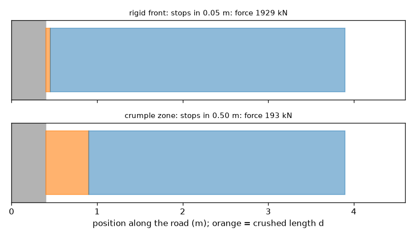
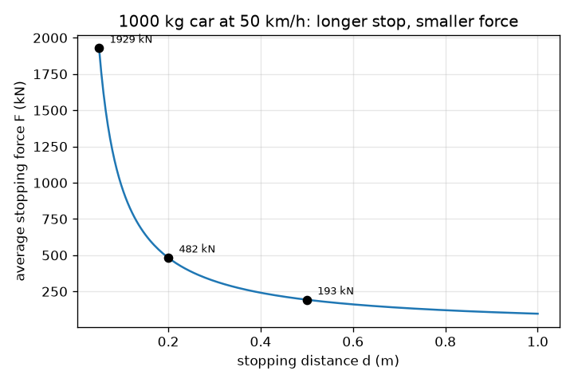

# సెషన్ 1: కారు ఎందుకు నలిగిపోతుంది: ఎక్కువ దూరంలో ఆగడం అంటే తక్కువ బలం

[Session 1 — हिन्दी](README.hi.md)

*స్థాయి 1 (భావనాత్మక ఇంటరాక్టివ్ మోడల్) · సుమారు 60 నిమిషాలు · opencrashsim*

> ఇది సరళీకరించిన విద్యా మోడల్. ఇది ధృవీకరించబడిన డిజైన్ సాధనం కాదు; నిజమైన నిర్మాణాలు, విద్యుత్ ఇన్‌స్టాలేషన్‌లు, వాహనాలు, పారిశ్రామిక ప్రక్రియలు లేదా వైద్య నిర్ణయాల కోసం దీనిని ఉపయోగించకూడదు.

**ముందస్తు అవసరాలు (Prerequisites)**

- పాఠశాల బీజగణితం: సూత్రాన్ని పునర్వ్యవస్థీకరించడం.
- మీరు PRIMER.md చదివి, `python start.py 1` ను ఒకసారి రన్ చేసి ఉండాలి.

**అభ్యాస లక్ష్యాలు (Learning objectives).** ఈ సెషన్ తర్వాత మీరు:

- ఎక్కువ ఆగే దూరం తక్కువ సగటు బలాన్ని ఎందుకు ఇస్తుందో వివరించగలరు.
- గతిశక్తిని (kinetic energy) మరియు సగటు ఆపే బలం F = m v^2 / (2 d) ను యూనిట్లతో లెక్కించగలరు.
- బలాన్ని g లో ప్రతిత్వరణంగా (deceleration) మార్చి, ప్రతిత్వరణం ద్రవ్యరాశిపై ఆధారపడదని చూడగలరు.
- ఆగే దూరానికి వ్యతిరేకంగా ఆపే బలం గ్రాఫ్‌ను చదవగలరు.

## A. నిజ జీవిత సమస్య
ఒక కారు గోడను ఢీకొంటుంది. గోడ కదలదు, కాబట్టి కారు తానే ఇచ్చే దూరంలో ఆగాలి. దృఢమైన, గట్టి ముందు భాగం కారును కొన్ని సెంటీమీటర్లలో ఆపుతుంది మరియు బలం అపారంగా ఉంటుంది. నలిగే ముందు భాగం దాదాపు అర మీటరులో ఆపుతుంది మరియు బలం చాలా తక్కువ. ఆగే దూరం బలాన్ని ఎలా నియంత్రిస్తుంది? (ఇది సాధారణ భౌతిక శాస్త్ర విద్య, వాహన భద్రతా మార్గదర్శి కాదు.)

## B. భావన మరియు సిద్ధాంతం
v వేగంతో కదులుతున్న m ద్రవ్యరాశి గల కారు KE = (1/2) m v^2 గతిశక్తిని కలిగి ఉంటుంది. ఆగడానికి, ఆ శక్తి మొత్తం తొలగించబడాలి, ఇక్కడ కారు ముందు భాగాన్ని నలిపే పని ద్వారా. d దూరంలో వెనక్కు నెట్టే స్థిర బలం F, F d పని (work) చేస్తుంది. బలం స్థిరమైతే, పనిని శక్తికి సమానం చేస్తే F d = (1/2) m v^2, కాబట్టి F = m v^2 / (2 d). బలం దూరానికి విలోమానుపాతంలో ఉంటుంది: నలిగే దూరాన్ని రెట్టింపు చేస్తే బలం సగమవుతుంది. న్యూటన్ రెండవ నియమం F = m a బలాన్ని a = v^2 / (2 d) అనే ప్రతిత్వరణంగా మారుస్తుంది, ఇది ద్రవ్యరాశిపై ఆధారపడదు. మనం a ను g = 9.81 m/s^2 యొక్క గుణిజంగా రాస్తాము, కాబట్టి 'a = 20 g' అంటే స్వేచ్ఛగా పడే వస్తువు త్వరణానికి 20 రెట్లు. వేగం మీటర్ per సెకనులో ఉండాలి: km/h ను 3.6 తో భాగించండి.

| చిహ్నం | అర్థం | యూనిట్ |
|---|---|---|
| m | కారు ద్రవ్యరాశి | kg |
| v | ఢీకొనడానికి ముందు వేగం | m/s |
| d | ఆగే దూరం (నలిగే దూరం) | m |
| KE | గతిశక్తి | J |
| F | సగటు ఆపే బలం | N |
| a | సగటు ప్రతిత్వరణం | m/s^2 |
| g | గురుత్వ త్వరణం, 9.81 | m/s^2 |

**ఊహలు (Assumptions)**

- మొత్తం ఆగే దూరంలో బలం స్థిరంగా ఉంటుంది (సగటు బలం).
- కారు కదలని గోడలోకి సరళ రేఖలో కదిలే ఒక దృఢ ముద్ద.
- పునరుత్క్షేపం (rebound) లేదు: కారు విశ్రాంతిలో ముగుస్తుంది.
- సరళీకరించిన విద్యా మోడల్: క్రాష్‌వర్దీనెస్ డిజైన్ సాధనం కాదు, గాయాల అంచనాలు లేవు.

$$ KE=\tfrac12 m v^2 $$

$$ F\,d=\tfrac12 m v^2\quad\Longrightarrow\quad F=\dfrac{m v^2}{2d} $$

$$ a=\dfrac{F}{m}=\dfrac{v^2}{2d}\qquad\text{in g units: } \dfrac{a}{g} $$

## C. దృశ్య వివరణ
మొదటి చిత్రం 50 km/h వద్ద ఉన్న 1000 kg కారుపై సగటు బలాన్ని ఆగే దూరానికి వ్యతిరేకంగా గీస్తుంది: 0.05 m వద్ద 1929 kN, 0.20 m వద్ద 482 kN, 0.50 m వద్ద 193 kN మరియు 1.00 m వద్ద 96 kN తో పడిపోయే వక్రం. రెండవ చిత్రం కారు మరియు గోడను రెండుసార్లు గీస్తుంది: దృఢమైన ముందు భాగంతో (0.05 m నలుగుదల) మరియు నలిగే మండలంతో (crumple zone) (0.50 m). నారింజ దిమ్మె నలిగిన పొడవు d. నలిగే మండలానికి అది 10 రెట్లు పొడవు, కాబట్టి ఆ చిత్రం పైన పేర్కొన్న బలం 10 రెట్లు చిన్నది (1929 kN బదులు 193 kN).

*దృఢమైన ముందు భాగం (0.05 m నలుగుదల) మరియు నలిగే మండలం (0.50 m): సుమారు 1929 kN మరియు 193 kN.*

*50 km/h వద్ద ఉన్న 1000 kg కారుకు ఆగే దూరానికి వ్యతిరేకంగా సగటు ఆపే బలం.*

## D. ఇంటరాక్టివ్ సిమ్యులేషన్
పాఠాన్ని రన్ చేయండి (`python start.py 1`), తర్వాత లైవ్ యాప్‌ను తెరవండి: [సెషన్ 1: కారు ఎందుకు నలిగిపోతుంది](https://krunalpanchal1995.github.io/pan-iit-oss/opencrashsim/session-01/) (లేదా ఈ ఫోల్డర్‌లోని `app.html`). నలిగే దూరాన్ని 0.05 m నుండి 1 m వరకు జరిపి బల బాణం, నలిగే దిమ్మె రంగు మరియు g విలువ మారడం గమనించండి. తర్వాత వేగాన్ని రెట్టింపు చేయండి: బలం రెండు కాదు, నాలుగు రెట్లు పెద్దదవుతుంది. చివరగా ద్రవ్యరాశిని మార్చండి: బలం మారుతుంది కానీ g విలువ మారదు.

**సవాలు.** ఒక నలిగే దూరాన్ని ఎంచుకుని 50 km/h వద్ద సగటు ప్రతిత్వరణాన్ని 20 g లేదా అంతకంటే తక్కువగా ఉంచండి.

## E. సాధించిన ఉదాహరణ మరియు ప్రయోగం
**సమస్య.** 50 km/h వద్ద ఉన్న 1000 kg కారు 0.5 m లో ఒక నలిగే మండలం ద్వారా ఆపబడుతుంది. సగటు బలాన్ని మరియు g లో ప్రతిత్వరణాన్ని కనుగొనండి.

1. వేగాన్ని మార్చండి: 50 km/h / 3.6 = 13.89 m/s.
2. గతిశక్తి: KE = 0.5 * 1000 * 13.89^2 = 96450 J (96.5 kJ).
3. బలం: F = KE / d = 96450 / 0.5 = 192900 N = 192.9 kN.
4. ప్రతిత్వరణం: a = F / m = 192900 / 1000 = 192.9 m/s^2.
5. g లో: 192.9 / 9.81 = 19.7 g.
6. సరిచూపు: a = v^2 / (2 d) = 192.9 / 1.0 = 192.9 m/s^2, అదే.

**సమాధానం.** సగటు బలం 192.9 kN, ప్రతిత్వరణం 19.7 g.

**ప్రయోగం.** మడిచిన కాగితాల కుప్ప లేదా చిన్న ఫోమ్ దిమ్మె ఉన్న గోడలోకి ఒక బొమ్మ కారును వాలు మీద నుండి దొర్లించి, ఫోన్‌లో స్లో మోషన్‌లో పక్క నుండి చిత్రీకరించండి. ముందు భాగం ఎంత నలుగుతుందో కొలిచి రెండు ఫోమ్ మందాలను పోల్చండి: మందమైన ఫోమ్ ఎక్కువ నలగాలి మరియు కారు తక్కువ వెనక్కు ఎగరాలి. నిజమైన నలుగుదల స్థిర బలం కాదు మరియు కొంత శక్తి ధ్వని, వేడి, పునరుత్క్షేపంలోకి పోతుంది, కాబట్టి నిజమైన ఆగే దూరం మోడల్ నుండి భిన్నంగా ఉంటుంది, మరియు బొమ్మ g లో బలాలను చూపలేదు.

## F. మూల్యాంకనం మరియు డిజైన్ సవాలు
**ప్రశ్న రకం A: భావనాత్మక.** ఒక బరువైన ట్రక్కు మరియు ఒక చిన్న కారు ఒకే వేగంతో గోడను ఢీకొని రెండూ 0.5 m లో ఆగుతాయి. దేనికి ఎక్కువ సగటు బలం ఉంటుంది? దేనికి ఎక్కువ ప్రతిత్వరణం ఉంటుంది? వివరించండి.

సూచన

F = m v^2 / (2 d) మరియు a = v^2 / (2 d) ను పోల్చండి.

దశలవారీ పరిష్కారం

F, m కు అనులోమానుపాతం కాబట్టి ట్రక్కుకు ఎక్కువ బలం ఉంటుంది. ప్రతిత్వరణం a = v^2 / (2 d) లో ద్రవ్యరాశి లేదు, కాబట్టి రెండింటికీ ఒకే ప్రతిత్వరణం. ట్రక్కులోని వారు అదే g అనుభవిస్తారు, కానీ ట్రక్కు నిర్మాణం పెద్ద బలాన్ని మోయాలి, అందుకే భారీ వాహనాలకు బలమైన, పొడవైన నిర్మాణాలు అవసరం.

**ప్రశ్న రకం B: సంఖ్యాత్మక.** 36 km/h వద్ద ఉన్న 1500 kg కారు 0.4 m లో ఆపబడుతుంది. సగటు బలాన్ని (kN లో) మరియు ప్రతిత్వరణాన్ని (g లో) కనుగొనండి. మీ సమాధానాన్ని మరో విధంగా సరిచూడండి.

సూచన

36 km/h అంటే 10 m/s. F = m v^2 / (2 d) మరియు a = F / m ఉపయోగించండి.

దశలవారీ పరిష్కారం

v = 36 / 3.6 = 10 m/s. F = 1500 * 10^2 / (2 * 0.4) = 150000 / 0.8 = 187500 N = 187.5 kN. a = 187500 / 1500 = 125 m/s^2 = 125 / 9.81 = 12.7 g. సరిచూపు: a = v^2 / (2 d) = 100 / 0.8 = 125 m/s^2, అదే.

**ప్రశ్న రకం C: గ్రాఫ్ మరియు సిమ్యులేషన్ వ్యాఖ్యానం.** 50 km/h వద్ద ఉన్న 1000 kg కారుకు బలం-దూరం గ్రాఫ్‌లో d = 0.2 m వద్ద బలం సుమారు 482 kN. కాలిక్యులేటర్ లేకుండా, d = 0.4 m వద్ద మరియు d = 0.1 m వద్ద బలం ఎంత? ఈ వక్రాన్ని ఏమంటారు మరియు అది ఎప్పుడూ సున్నా ఎందుకు కాదు?

సూచన

F, 1 / d కు అనులోమానుపాతం.

దశలవారీ పరిష్కారం

దూరాన్ని రెట్టింపు చేస్తే బలం సగమవుతుంది: 0.4 m వద్ద 241 kN. దూరాన్ని సగం చేస్తే బలం రెట్టింపవుతుంది: 0.1 m వద్ద 965 kN. వక్రం ఒక అతిపరావలయం (hyperbola) F = KE / d. పరిమిత శక్తికి ఏ పరిమిత దూరంలోనైనా కొంత బలం అవసరం కాబట్టి అది ఎప్పుడూ సున్నాకు చేరదు; చాలా పొడవైన ఆగుదలలకు మాత్రమే అది చిన్నదవుతుంది.

**ప్రశ్న రకం D: డిజైన్ మరియు ఆప్టిమైజేషన్ సవాలు.** డిజైన్: 50 km/h వద్ద ఉన్న 1000 kg కారును గరిష్టంగా 150 kN సగటు బలంతో ఆపాలి. అతి చిన్న నలిగే దూరం ఎంత? సమీప 0.05 m కు ఒక ఆచరణాత్మక విలువను ఎంచుకుని, రాజీని (trade-off) తెలపండి.

సూచన

F = KE / d ను d = KE / F గా పునర్వ్యవస్థీకరించి పైకి రౌండ్ చేయండి.

దశలవారీ పరిష్కారం

KE = 96450 J, కాబట్టి d = 96450 / 150000 = 0.643 m. 0.65 m కు పైకి రౌండ్ చేయండి (కిందకు రౌండ్ చేస్తే 150 kN మించిపోతుంది): F = 96450 / 0.65 = 148.4 kN, a = 14.8 g. రాజీ: పొడవైన నలిగే మండలం బలాన్ని తగ్గిస్తుంది కానీ కారును పొడవుగా లేదా బరువుగా చేస్తుంది, మరియు మోడల్ స్థిర బలాన్ని ఊహిస్తుంది, నిజమైన నిర్మాణం దానిని సుమారుగా మాత్రమే అనుసరిస్తుంది.

[RUBRIC.md](../../RUBRIC.md) తో మిమ్మల్ని మీరు స్కోర్ చేసుకోండి. కాగితంపై పని చేయడానికి [కార్యాచరణ షీట్](activity_sheet.md) ప్రింట్ చేయండి.

## సాధారణ అపోహలు
| సాధారణ అపోహ | వాస్తవంగా నిజమైనది |
|---|---|
| బలమైన, దృఢమైన ముందు భాగం ఎల్లప్పుడూ సురక్షితం. | దృఢమైన ముందు భాగం కారును చాలా తక్కువ దూరంలో ఆపుతుంది, కాబట్టి బలం మరియు ప్రతిత్వరణం చాలా పెద్దవి. నలుగుదల అదే శక్తిని ఎక్కువ దూరంలో విస్తరిస్తుంది. |
| బలం పెద్దది కాబట్టి బరువైన కారు పెద్ద ప్రతిత్వరణం అనుభవిస్తుంది. | బలం పెద్దదే, కానీ a = F / m, కాబట్టి ద్రవ్యరాశి రద్దవుతుంది: a = v^2 / (2 d) ఏ ద్రవ్యరాశికైనా ఒకటే. |
| వేగాన్ని రెట్టింపు చేస్తే బలం రెట్టింపవుతుంది. | శక్తి v^2 తో పెరుగుతుంది, కాబట్టి అదే ఆగే దూరంలో బలం నాలుగు రెట్లు అవుతుంది. |
| ఢీకొనడంలో శక్తి నాశనమవుతుంది. | గతిశక్తి రూపాంతరం చెందుతుంది, ఎక్కువగా లోహాన్ని వంచి నలిపే పనిగా, కొంచెం వేడి మరియు ధ్వనిగా. శక్తి నిత్యత్వం పాటిస్తుంది. |

## పదకోశం (Glossary)
- **గతిశక్తి (kinetic energy)**: చలన శక్తి, (1/2) m v^2, జూల్స్‌లో కొలుస్తారు
- **పని (work)**: బలం గుణకారం బలం దిశలో దూరం, జూల్స్‌లో
- **నలిగే మండలం (crumple zone)**: కూలిపోయి శక్తిని గ్రహించేలా రూపొందించిన కారు భాగం
- **g (యూనిట్‌గా)**: 9.81 m/s^2 యొక్క గుణిజంగా వ్యక్తీకరించిన ప్రతిత్వరణం
- **సగటు బలం (average force)**: అదే దూరంలో అదే పని చేసే స్థిర బలం

## ముగింపు
1. [exercises.md](exercises.md) లోని మూడు కోడింగ్ పనులు చేయండి.
2. మీ మార్పుల తర్వాత `python start.py 1` ను మళ్ళీ రన్ చేయండి. అది చెక్‌పాయింట్‌తో ముగుస్తుంది; అది `PASS` అని ప్రింట్ చేసినప్పుడు, మీరు పూర్తి చేసినట్లు. (చెక్‌పాయింట్ మాత్రమే: `python start.py check 1`.)

తదుపరి: [సెషన్ 2](../session-02/README.md)
