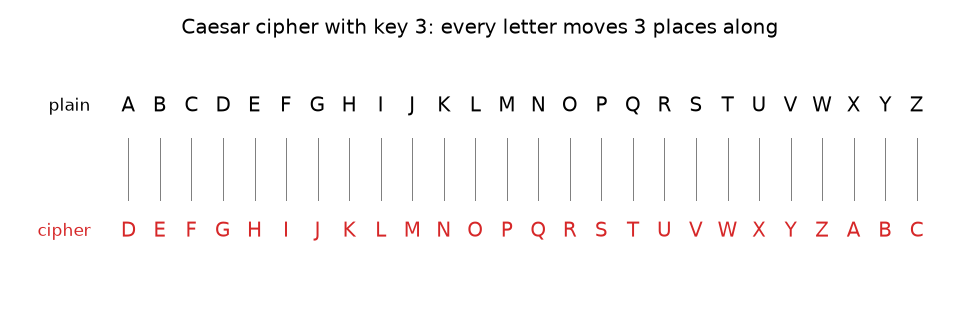
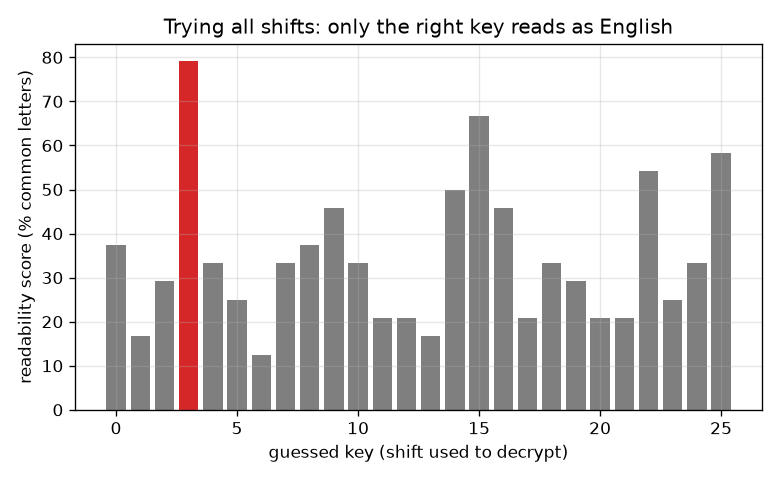

# सत्र 1: एक गुप्त संदेश: सीज़र शिफ़्ट सिफ़र

*स्तर 1 (वैचारिक इंटरैक्टिव मॉडल) · लगभग 60 मिनट · opencrypto*

> यह एक सरलीकृत शैक्षिक मॉडल (simplified educational model) है। यह कोई सत्यापित डिज़ाइन टूल नहीं है और इसका उपयोग वास्तविक संरचनाओं, बिजली की स्थापनाओं, वाहनों, औद्योगिक प्रक्रियाओं या चिकित्सा निर्णयों के लिए नहीं किया जाना चाहिए।

**पूर्व-आवश्यकताएँ (Prerequisites)**

- शेषफल (remainders): 'mod' का घड़ी वाला अंकगणित (खंड B में समझाया गया है)।
- आपने PRIMER.md पढ़ लिया है और `python start.py 1` एक बार चला लिया है।

**सीखने के उद्देश्य (Learning objectives).** इस सत्र के बाद आप:

- सीज़र शिफ़्ट (Caesar shift) से किसी संदेश को हाथ से कूटबद्ध (encrypt) और विकूटित (decrypt) कर सकेंगे।
- समझा सकेंगे कि सीज़र सिफ़र (cipher) में केवल 25 उपयोगी कुंजियाँ (keys) क्यों हैं और कोई भी उन सबको क्यों आज़मा सकता है।
- सही शिफ़्ट अपने आप चुनने के लिए पठनीयता अंक (readability score) का उपयोग कर सकेंगे।
- बता सकेंगे कि आसानी से टूटने वाला सिफ़र सीखने के लिए तो उपयोगी है पर वास्तविक रहस्यों के लिए कभी नहीं।

## A. वास्तविक दुनिया की समस्या
आप कक्षा में एक पर्ची ऐसे भेजना चाहते हैं कि केवल आपका मित्र उसे पढ़ सके। जूलियस सीज़र द्वारा उपयोग की गई एक तरकीब है हर अक्षर को वर्णमाला में एक निश्चित संख्या आगे वाले अक्षर से बदल देना। जो व्यक्ति वह संख्या नहीं जानता, उसे पर्ची बेतुकी लगती है। आप यह कैसे करते हैं, आपका मित्र इसे कैसे उलटता है, और एक जिज्ञासु सहपाठी को फिर भी इसे पढ़ने में कितना समय लगेगा? यह एक खिलौना है: यह क्रिप्टोग्राफ़ी (cryptography) की शब्दावली (सादा पाठ / plaintext, सिफ़र पाठ / ciphertext, कुंजी / key) को सबसे सरल रूप में दिखाता है। वास्तविक रहस्यों को कभी भी इससे सुरक्षित नहीं करना चाहिए।

## B. अवधारणा और सिद्धांत
अक्षरों को संख्याएँ दीजिए A = 0, B = 1, ..., Z = 25। सादा पाठ पढ़ने योग्य संदेश है और सिफ़र पाठ बिगाड़ा हुआ संदेश। कुंजी k वह संख्या है जितने स्थान खिसकाना है। कूटबद्ध करने के लिए, हर अक्षर की संख्या में k जोड़िए और Z के बाद 26 से भाग देने पर बचे शेषफल को लेकर वापस घुमाइए (mod 26 लिखा जाता है)। विकूटित करने के लिए, उसी तरह k घटाइए। शिफ़्ट 0 और 26 कुछ नहीं बदलते, इसलिए 25 उपयोगी कुंजियाँ हैं। जो हमलावर (attacker) विधि जानता है, वह बस सभी 25 आज़माता है और वह पढ़ लेता है जिसका अर्थ निकलता है। कंप्यूटर हर उम्मीदवार को अंक देकर यह कर सकता है: नौ अक्षर E T A O I N S H R सामान्य अंग्रेज़ी पाठ का अधिकांश भाग बनाते हैं, पर एक यादृच्छिक गड़बड़ (random jumble) में केवल 26 में से 9 अक्षर (लगभग 35 प्रतिशत)। पठनीयता अंक किसी उम्मीदवार के उन अक्षरों का हिस्सा है जो इन नौ में से हैं।

| प्रतीक | अर्थ | इकाई |
|---|---|---|
| p | सादे पाठ के अक्षर की संख्या (A = 0 ... Z = 25) | कोई इकाई नहीं |
| c | सिफ़र पाठ के अक्षर की संख्या | कोई इकाई नहीं |
| k | कुंजी: कितने स्थान खिसकाना है | अक्षर |
| score | पठनीयता: E T A O I N S H R में से अक्षरों का हिस्सा | अंश (या %) |

**मान्यताएँ (Assumptions)**

- केवल 26 अक्षर A से Z खिसकाए जाते हैं; रिक्त स्थान और विराम चिह्न वैसे ही छोड़े जाते हैं।
- हमलावर विधि (सीज़र) और भाषा (अंग्रेज़ी) जानता है; केवल कुंजी गुप्त है।
- सीखने के लिए खिलौना मॉडल; वास्तविक जानकारी को सुरक्षित करने का तरीका नहीं।

$$ c=(p+k)\bmod 26 $$

$$ p=(c-k)\bmod 26 $$

$$ \text{number of useful keys}=26-1=25 $$

$$ \text{score}=\frac{\text{letters in }\{E,T,A,O,I,N,S,H,R\}}{\text{all letters}} $$

## C. दृश्य व्याख्या
पहला चित्र कुंजी 3 के लिए वर्णमाला की दो पंक्तियाँ दिखाता है: हर सादा अक्षर उस अक्षर के ऊपर बैठा है जो वह बन जाता है। दूसरा चित्र कुंजी 3 से कूटबद्ध संदेश के लिए सभी 26 अनुमानों का पठनीयता अंक दिखाता है। सही अनुमान (3) लगभग 79 प्रतिशत तक पहुँचता है जबकि सबसे अच्छा गलत अनुमान लगभग 67 प्रतिशत तक: छोटे संदेश केवल मामूली अंतर देते हैं, पर सही शिफ़्ट फिर भी अलग दिखता है और मानव आँख को उसे देखने में एक पल लगता है।

*कुंजी 3 वाला सीज़र सिफ़र: हर सादा अक्षर (ऊपर) 3 स्थान आगे वाला अक्षर (नीचे) बन जाता है।*

*सभी 26 अनुमानों के लिए पठनीयता अंक: सही कुंजी 3 अलग दिखती है।*

## D. इंटरैक्टिव सिमुलेशन
पाठ चलाइए (`python start.py 1`), फिर लाइव ऐप खोलिए: [सत्र 1: खिसकाओ, फिर तोड़ो](https://krunalpanchal1995.github.io/pan-iit-oss/opencrypto/session-01/) (या इस फ़ोल्डर में `app.html`)। कुंजी स्लाइडर को खिसकाइए और सिफ़र पंक्ति को सादी पंक्ति के साथ सरकते देखिए। फिर अनुमान स्लाइडर को खिसकाइए और देखिए कि विकूटित पाठ केवल तभी अंग्रेज़ी बनता है जब अनुमान कुंजी के बराबर हो। सभी 26 अनुमान एक साथ देखने के लिए ग्राफ़ पर जाइए।

**चुनौती (Challenge).** 10 या उससे अधिक की कुंजी चुनिए और अनुमान को कुंजी के बराबर रखकर संदेश विकूटित कीजिए।

## E. हल किया गया उदाहरण और प्रयोग
**समस्या.** SEE YOU AT NOON को कुंजी 5 से कूटबद्ध कीजिए, फिर उसे वापस विकूटित कीजिए।

1. S = 18, 18 + 5 = 23 = X। E = 4, 4 + 5 = 9 = J। इसलिए SEE बन जाता है XJJ।
2. Y = 24, 24 + 5 = 29, जो घूमकर 29 - 26 = 3 = D बनता है। O = 14, 14 + 5 = 19 = T। U = 20, 20 + 5 = 25 = Z। इसलिए YOU बन जाता है DTZ।
3. A = 0 बन जाता है F = 5, और T = 19 बन जाता है Y = 24, इसलिए AT बन जाता है FY।
4. N = 13 बन जाता है S = 18 और O = 14 बन जाता है T = 19, इसलिए NOON बन जाता है STTS।
5. सिफ़र पाठ: XJJ DTZ FY STTS। विकूटित करने के लिए 5 घटाइए: X = 23, 23 - 5 = 18 = S, और इसी तरह वापस SEE YOU AT NOON तक।

**उत्तर.** सिफ़र पाठ XJJ DTZ FY STTS है, और कुंजी 5 से विकूटित करने पर SEE YOU AT NOON वापस मिलता है।

**प्रयोग (Experiment).** कागज़ की दो पट्टियाँ काटिए जिन पर वर्णमाला लिखी हो, एक को 5 स्थान खिसकाइए और पट्टियों के साथ देखकर अपना एक छोटा शब्द कूटबद्ध कीजिए; फिर किसी मित्र से बिना कुंजी के उसे तोड़ने को कहिए और गिनिए कि शब्द के सार्थक पढ़े जाने से पहले वे कितने शिफ़्ट आज़माते हैं (अधिकतम 25)। मॉडल बनाम वास्तविकता: गणित सटीक है, पर मनुष्य कोई अक्षर गलत पढ़ सकता है; कंप्यूटर का पठनीयता अंक एक सांख्यिकीय अनुमान है जिसे बहुत छोटे संदेश धोखा दे सकते हैं।

## F. मूल्यांकन और डिज़ाइन चुनौती
**प्रश्न प्रकार A: वैचारिक (Conceptual).** कोई भी व्यक्ति, कुंजी जाने बिना भी, सीज़र सिफ़र को क्यों तोड़ सकता है? क्या विधि को गुप्त रखने से मदद मिलती है?

संकेत

कुंजियाँ गिनिए, और पूछिए कि हमलावर हर एक के साथ क्या करता है।

चरण-दर-चरण हल

केवल 25 उपयोगी कुंजियाँ हैं, इसलिए हमलावर बस हर एक से विकूटित करता है और वह पढ़ लेता है जिसका अर्थ निकलता है; इसमें हाथ से एक मिनट और कंप्यूटर पर एक सेकंड का बहुत छोटा अंश लगता है। विधि को गुप्त रखने से ज़्यादा मदद नहीं मिलती: विधि का अनुमान लगाना आसान है, और एक अच्छा सिफ़र विधि सार्वजनिक होने पर भी सुरक्षित रहना चाहिए (सत्र 2)। सारी मज़बूती ऐसी कुंजी में होनी चाहिए जिसके विकल्प आज़माने के लिए बहुत अधिक हों।

**प्रश्न प्रकार B: संख्यात्मक (Numerical).** शब्द GO को कुंजी 20 से कूटबद्ध कीजिए। घूमना (wrap-around) दिखाइए, फिर विकूटित करके जाँचिए।

संकेत

G = 6 और O = 14। 20 जोड़िए और 25 पार करने पर 26 घटाइए।

चरण-दर-चरण हल

G: 6 + 20 = 26, जो घूमकर 0 = A बनता है। O: 14 + 20 = 34, और 34 - 26 = 8 = I। इसलिए GO बन जाता है AI। जाँच: A = 0, 0 - 20 = -20, और -20 + 26 = 6 = G; I = 8, 8 - 20 = -12, और -12 + 26 = 14 = O। इकाइयाँ: अक्षर स्थान, कोई भौतिक इकाई नहीं।

**प्रश्न प्रकार C: ग्राफ़ और सिमुलेशन की व्याख्या.** अनुमान के सापेक्ष पठनीयता के ग्राफ़ में, एक स्तंभ ऊँचा और बाकी नीचे क्यों हैं? बहुत छोटे संदेश के लिए अंतर छोटा क्यों हो सकता है?

संकेत

सोचिए कि गलत शिफ़्ट अक्षरों के हिस्सों के साथ क्या करता है।

चरण-दर-चरण हल

गलत शिफ़्ट संदेश को इस तरह बिगाड़ देता है कि उसके अक्षर एक यादृच्छिक मिश्रण जैसे दिखते हैं, जिसका अंक औसतन लगभग 35 प्रतिशत के यादृच्छिक स्तर के आसपास होता है; सही शिफ़्ट वास्तविक अंग्रेज़ी हिस्से लौटा देता है, इसलिए उसका स्तंभ ऊँचा होता है (यहाँ लगभग 79 प्रतिशत, जबकि किसी भी गलत अनुमान के लिए अधिकतम लगभग 67 प्रतिशत)। छोटे संदेश में कम अक्षर होते हैं, इसलिए हिस्से संयोग से ऊपर-नीचे होते हैं और कोई गलत अनुमान कभी-कभी अच्छा अंक पा सकता है; लंबे संदेश स्पष्ट अंतर देते हैं।

**प्रश्न प्रकार D: डिज़ाइन और अनुकूलन (optimisation) चुनौती.** डिज़ाइन: आपको केवल इस सत्र के विचारों का उपयोग करके ऐसी पर्ची भेजनी है जिसे कोई सहपाठी अपने पास उपलब्ध समय में न पढ़ सके। दो बदलाव बताइए जो आप कर सकते हैं और हर एक की क्या कीमत है।

संकेत

संभावित कुंजियाँ गिनिए, और सोचिए कि आपको और आपके मित्र को पहले से क्या साझा करना होगा।

चरण-दर-चरण हल

बदलाव 1: अलग-अलग अक्षरों के लिए अलग शिफ़्ट उपयोग कीजिए (उदाहरण के लिए शिफ़्टों की एक छोटी दोहराई जाने वाली सूची)। इससे कुंजियों की संख्या बढ़ती है पर अब आपको और आपके मित्र को पूरी सूची साझा करनी होगी, और सत्र 2 दिखाता है कि छोटी दोहराई जाने वाली सूचियाँ फिर भी तोड़ी जा सकती हैं। बदलाव 2: वर्णमाला को किसी भी क्रम में उलट-पुलट कर दीजिए, जिससे बहुत अधिक कुंजियाँ मिलती हैं, पर अक्षर गिनती का स्वरूप बचा रहता है और सत्र 2 दिखाता है कि गिनती से यह कैसे टूटता है। समझौता (trade-off): अधिक कुंजियों को साझा करना और याद रखना अधिक महँगा है; केवल संदेश जितनी लंबी वास्तव में यादृच्छिक कुंजी (सत्र 3) पूर्ण गोपनीयता देती है। वास्तविक जीवन में, जाँची-परखी लाइब्रेरी का उपयोग कीजिए, कभी घर में बना सिफ़र नहीं।

[RUBRIC.md](../../RUBRIC.md) से स्वयं को अंक दीजिए। कागज़ पर काम करने के लिए [गतिविधि पत्रक](activity_sheet.md) प्रिंट कीजिए।

## सामान्य भ्रांतियाँ
| सामान्य भ्रांति (misconception) | वास्तव में क्या सच है |
|---|---|
| गुप्त विधि सिफ़र को सुरक्षित बनाती है। | एक अच्छा सिफ़र विधि सार्वजनिक होने पर भी सुरक्षित रहता है; केवल कुंजी गुप्त होती है। सीज़र इसलिए विफल होता है क्योंकि कुंजी-क्षेत्र (key space) बहुत छोटा है। |
| 26 से खिसकाना एक मज़बूत कुंजी है। | 26 (या 0) से खिसकाने पर कुछ नहीं बदलता; इसीलिए 26 नहीं, 25 उपयोगी कुंजियाँ हैं। |
| बड़ा शिफ़्ट मज़बूत कुंजी है। | कुंजी 20 को ढूँढना कुंजी 2 से कठिन नहीं है: हमलावर हर हाल में सभी 25 आज़माता है। |
| जिस सिफ़र को मैं खुद नहीं पढ़ सकता वह सुरक्षित सिफ़र है। | आपके लिए अपठनीय होना कंप्यूटर के लिए अपठनीय होना नहीं है। सुरक्षा को उस हमलावर के विरुद्ध आँका जाता है जो सब कुछ आज़माता है। |

## शब्दावली
- **सादा पाठ (plaintext)**: कूटबद्ध करने से पहले का पढ़ने योग्य संदेश
- **सिफ़र पाठ (ciphertext)**: कूटबद्ध करने के बाद का बिगाड़ा हुआ संदेश
- **कुंजी (key)**: वह गुप्त संख्या (या शब्द) जो नियंत्रित करती है कि संदेश कैसे बिगाड़ा जाए
- **mod**: भाग देने के बाद का शेषफल; 'mod 26' वर्णमाला के चारों ओर घुमा देता है
- **ब्रूट फ़ोर्स (brute force)**: हर संभावित कुंजी आज़माना
- **सिफ़र (cipher)**: कुंजी से किसी संदेश को बिगाड़ने की विधि

## समापन
1. [exercises.md](exercises.md) में दिए तीन कोडिंग कार्य कीजिए।
2. अपने बदलावों के बाद `python start.py 1` फिर से चलाइए। यह चेकपॉइंट (checkpoint) के साथ समाप्त होता है; जब यह `PASS` छापे, तो आपका काम पूरा है। (केवल चेकपॉइंट: `python start.py check 1`।)

आगे: [सत्र 2](../session-02/README.md)
