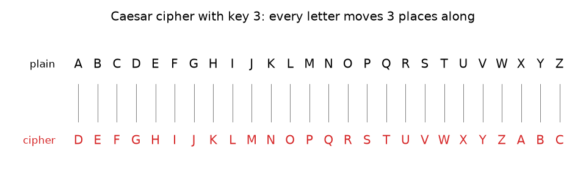
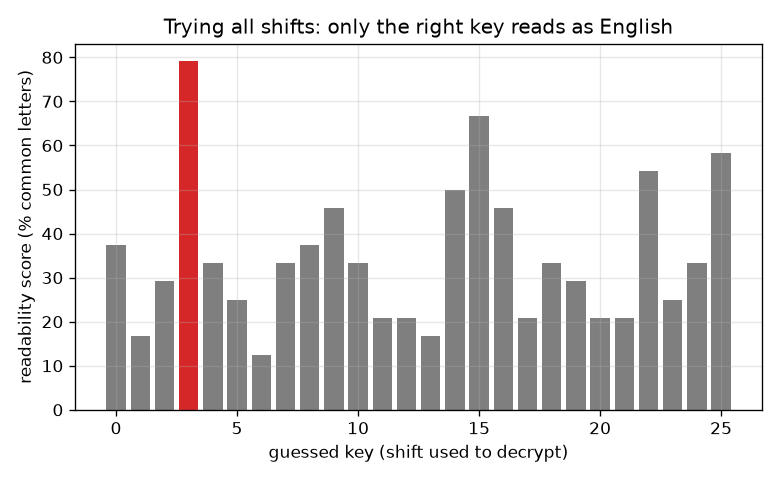

# സെഷൻ 1: ഒരു രഹസ്യ സന്ദേശം: സീസർ ഷിഫ്റ്റ് സൈഫർ

[Session 1 — हिन्दी](README.hi.md) · [Session 1 — മലയാളം](README.ml.md)

*ലെവൽ 1 (ആശയപരമായ ഇന്ററാക്ടീവ് മോഡൽ) · ഏകദേശം 60 മിനിറ്റ് · opencrypto*

> ഇത് ലളിതമാക്കിയ ഒരു വിദ്യാഭ്യാസ മോഡലാണ്. ഇത് സാധൂകരിക്കപ്പെട്ട (validated) ഒരു ഡിസൈൻ ഉപകരണമല്ല; യഥാർത്ഥ നിർമ്മിതികൾ, ഇലക്ട്രിക്കൽ ഇൻസ്റ്റലേഷനുകൾ, വാഹനങ്ങൾ, വ്യാവസായിക പ്രക്രിയകൾ അല്ലെങ്കിൽ മെഡിക്കൽ തീരുമാനങ്ങൾ എന്നിവയ്ക്ക് ഇത് ഉപയോഗിക്കരുത്.

**മുൻ‌വ്യവസ്ഥകൾ (Prerequisites)**

- ശിഷ്ടങ്ങൾ (remainders): 'mod'-ന്റെ ഘടികാര ഗണിതം (സെക്ഷൻ B-ൽ വിശദീകരിക്കുന്നു).
- നിങ്ങൾ PRIMER.md വായിക്കുകയും `python start.py 1` ഒരിക്കൽ റൺ ചെയ്യുകയും ചെയ്തിട്ടുണ്ട്.

**പഠന ലക്ഷ്യങ്ങൾ (Learning objectives).** ഈ സെഷനു ശേഷം നിങ്ങൾക്ക് കഴിയും:

- ഒരു സീസർ ഷിഫ്റ്റ് ഉപയോഗിച്ച് കൈകൊണ്ട് ഒരു സന്ദേശം എൻക്രിപ്റ്റ് (encrypt) ചെയ്യാനും ഡീക്രിപ്റ്റ് (decrypt) ചെയ്യാനും.
- ഒരു സീസർ സൈഫറിന് 25 ഉപയോഗപ്രദമായ കീകൾ (keys) മാത്രമുള്ളത് എന്തുകൊണ്ടെന്നും ആർക്കും അവയെല്ലാം പരീക്ഷിക്കാൻ കഴിയുന്നത് എന്തുകൊണ്ടെന്നും വിശദീകരിക്കാൻ.
- ശരിയായ ഷിഫ്റ്റ് സ്വയമേവ തിരഞ്ഞെടുക്കാൻ ഒരു വായനാക്ഷമതാ സ്കോർ (readability score) ഉപയോഗിക്കാൻ.
- എളുപ്പത്തിൽ തകർക്കാവുന്ന ഒരു സൈഫർ പഠനത്തിന് ഇപ്പോഴും ഉപയോഗപ്രദമാണെങ്കിലും യഥാർത്ഥ രഹസ്യങ്ങൾക്ക് ഒരിക്കലും അല്ലാത്തത് എന്തുകൊണ്ടെന്ന് പറയാൻ.

## A. യഥാർത്ഥ ലോക പ്രശ്നം
നിങ്ങളുടെ സുഹൃത്തിന് മാത്രം വായിക്കാൻ കഴിയുന്ന വിധം ക്ലാസിൽ ഒരു കുറിപ്പ് കൈമാറാൻ നിങ്ങൾ ആഗ്രഹിക്കുന്നു. ജൂലിയസ് സീസർ ഉപയോഗിച്ച ഒരു തന്ത്രം, ഓരോ അക്ഷരത്തെയും അക്ഷരമാലയിൽ ഒരു നിശ്ചിത എണ്ണം സ്ഥാനങ്ങൾ മുന്നിലുള്ള അക്ഷരം കൊണ്ട് മാറ്റിസ്ഥാപിക്കുക എന്നതാണ്. ആ സംഖ്യ അറിയാത്ത ഏതൊരാൾക്കും കുറിപ്പ് അസംബന്ധമായി തോന്നും. നിങ്ങൾ അത് എങ്ങനെ ചെയ്യും, നിങ്ങളുടെ സുഹൃത്ത് അത് എങ്ങനെ തിരിച്ചാക്കും, ജിജ്ഞാസുവായ ഒരു സഹപാഠിക്ക് എന്തായാലും അത് വായിക്കാൻ എത്ര സമയമെടുക്കും? ഇതൊരു കളിപ്പാട്ടമാണ്: ക്രിപ്റ്റോഗ്രഫിയുടെ പദാവലി (പ്ലെയിൻടെക്സ്റ്റ്, സൈഫർടെക്സ്റ്റ്, കീ) ഏറ്റവും ലളിതമായ സാഹചര്യത്തിൽ ഇത് കാണിക്കുന്നു. യഥാർത്ഥ രഹസ്യങ്ങൾ ഒരിക്കലും ഇതുപയോഗിച്ച് സംരക്ഷിക്കരുത്.

## B. ആശയവും സിദ്ധാന്തവും
അക്ഷരങ്ങൾക്ക് A = 0, B = 1, ..., Z = 25 എന്ന് നമ്പർ നൽകുക. പ്ലെയിൻടെക്സ്റ്റ് (plaintext) വായിക്കാവുന്ന സന്ദേശമാണ്, സൈഫർടെക്സ്റ്റ് (ciphertext) കലർത്തിയതും. കീ k എന്നത് എത്ര സ്ഥാനങ്ങൾ നീക്കണം എന്ന സംഖ്യയാണ്. എൻക്രിപ്റ്റ് ചെയ്യാൻ, ഓരോ അക്ഷര നമ്പറിലും k കൂട്ടുക, 26 കൊണ്ട് ഹരിച്ചതിന്റെ ശിഷ്ടം എടുത്ത് Z-നു ശേഷം ചുറ്റിത്തിരിയുക (mod 26 എന്ന് എഴുതുന്നു). ഡീക്രിപ്റ്റ് ചെയ്യാൻ, അതേ രീതിയിൽ k കുറയ്ക്കുക. 0, 26 എന്നീ ഷിഫ്റ്റുകൾ ഒന്നും മാറ്റുന്നില്ല, അതിനാൽ 25 ഉപയോഗപ്രദമായ കീകളുണ്ട്. രീതി അറിയാവുന്ന ഒരു ആക്രമണകാരി ലളിതമായി 25-ഉം പരീക്ഷിച്ച് അർത്ഥമുള്ളത് വായിക്കുന്നു. ഓരോ സാധ്യതയ്ക്കും സ്കോർ നൽകി ഒരു കമ്പ്യൂട്ടറിന് ഇത് ചെയ്യാം: E T A O I N S H R എന്ന ഒൻപത് അക്ഷരങ്ങളാണ് സാധാരണ ഇംഗ്ലീഷ് വാചകത്തിന്റെ ഭൂരിഭാഗവും, എന്നാൽ ക്രമരഹിതമായ ഒരു കൂട്ടത്തിൽ 26-ൽ 9 അക്ഷരങ്ങൾ മാത്രം (ഏകദേശം 35 ശതമാനം). ഒരു സാധ്യതയിലെ അക്ഷരങ്ങളിൽ ആ ഒൻപതിൽ പെട്ടവയുടെ പങ്കാണ് വായനാക്ഷമതാ സ്കോർ.

| ചിഹ്നം | അർത്ഥം | യൂണിറ്റ് |
|---|---|---|
| p | പ്ലെയിൻടെക്സ്റ്റ് അക്ഷര നമ്പർ (A = 0 ... Z = 25) | യൂണിറ്റ് ഇല്ല |
| c | സൈഫർടെക്സ്റ്റ് അക്ഷര നമ്പർ | യൂണിറ്റ് ഇല്ല |
| k | കീ: എത്ര സ്ഥാനങ്ങൾ നീക്കണം | അക്ഷരങ്ങൾ |
| score | വായനാക്ഷമത: E T A O I N S H R-ൽ പെട്ട അക്ഷരങ്ങളുടെ പങ്ക് | അംശം (അല്ലെങ്കിൽ %) |

**അനുമാനങ്ങൾ (Assumptions)**

- A മുതൽ Z വരെയുള്ള 26 അക്ഷരങ്ങൾ മാത്രമേ നീക്കുന്നുള്ളൂ; സ്പേസുകളും ചിഹ്നങ്ങളും അതേപടി വിടുന്നു.
- ആക്രമണകാരിക്ക് രീതിയും (സീസർ) ഭാഷയും (ഇംഗ്ലീഷ്) അറിയാം; കീ മാത്രമാണ് രഹസ്യം.
- പഠനത്തിനുള്ള കളിപ്പാട്ട മോഡൽ; യഥാർത്ഥ വിവരങ്ങൾ സംരക്ഷിക്കാനുള്ള മാർഗ്ഗമല്ല.

$$ c=(p+k)\bmod 26 $$

$$ p=(c-k)\bmod 26 $$

$$ \text{number of useful keys}=26-1=25 $$

$$ \text{score}=\frac{\text{letters in }\{E,T,A,O,I,N,S,H,R\}}{\text{all letters}} $$

## C. ദൃശ്യ വിശദീകരണം
ആദ്യ ചിത്രം കീ 3-നുള്ള രണ്ട് അക്ഷരമാല വരികൾ കാണിക്കുന്നു: ഓരോ പ്ലെയിൻ അക്ഷരവും അത് മാറുന്ന അക്ഷരത്തിന് മുകളിൽ ഇരിക്കുന്നു. കീ 3 ഉപയോഗിച്ച് എൻക്രിപ്റ്റ് ചെയ്ത ഒരു സന്ദേശത്തിനായി എല്ലാ 26 ഊഹങ്ങളുടെയും വായനാക്ഷമതാ സ്കോർ രണ്ടാമത്തെ ചിത്രം പ്ലോട്ട് ചെയ്യുന്നു. ശരിയായ ഊഹം (3) ഏകദേശം 79 ശതമാനത്തിൽ എത്തുന്നു, ഏറ്റവും മികച്ച തെറ്റായ ഊഹം ഏകദേശം 67 ശതമാനത്തിലും: ചെറിയ സന്ദേശങ്ങൾ ചെറിയ വിടവ് മാത്രമേ നൽകുന്നുള്ളൂ, എങ്കിലും ശരിയായ ഷിഫ്റ്റ് വേറിട്ടുനിൽക്കുന്നു, മനുഷ്യ കണ്ണിന് അത് കാണാൻ ഒരു നിമിഷം മതി.

*കീ 3 ഉള്ള സീസർ സൈഫർ: ഓരോ പ്ലെയിൻ അക്ഷരവും (മുകളിൽ) 3 സ്ഥാനം മുന്നിലുള്ള അക്ഷരമായി (താഴെ) മാറുന്നു.*

*എല്ലാ 26 ഊഹങ്ങൾക്കുമുള്ള വായനാക്ഷമതാ സ്കോർ: യഥാർത്ഥ കീ 3 വേറിട്ടുനിൽക്കുന്നു.*

## D. ഇന്ററാക്ടീവ് സിമുലേഷൻ
പാഠം റൺ ചെയ്യുക (`python start.py 1`), തുടർന്ന് ലൈവ് ആപ്പ് തുറക്കുക: [സെഷൻ 1: നീക്കുക, പിന്നെ തകർക്കുക](https://krunalpanchal1995.github.io/pan-iit-oss/opencrypto/session-01/) (അല്ലെങ്കിൽ ഈ ഫോൾഡറിലെ `app.html`). കീ സ്ലൈഡർ നീക്കി സൈഫർ വരി പ്ലെയിൻ വരിയിലൂടെ നീങ്ങുന്നത് നിരീക്ഷിക്കുക. പിന്നെ ഊഹ സ്ലൈഡർ നീക്കി, ഊഹം കീയ്ക്ക് തുല്യമാകുമ്പോൾ മാത്രം ഡീക്രിപ്റ്റ് ചെയ്ത വാചകം ഇംഗ്ലീഷായി മാറുന്നത് നിരീക്ഷിക്കുക. എല്ലാ 26 ഊഹങ്ങളും ഒരുമിച്ച് കാണാൻ ഗ്രാഫിലേക്ക് മാറുക.

**വെല്ലുവിളി (Challenge).** 10 അല്ലെങ്കിൽ അതിൽ കൂടുതലുള്ള ഒരു കീ തിരഞ്ഞെടുത്ത്, ഊഹം കീയ്ക്ക് തുല്യമാക്കി സന്ദേശം ഡീക്രിപ്റ്റ് ചെയ്യുക.

## E. പരിഹരിച്ച ഉദാഹരണവും പരീക്ഷണവും
**പ്രശ്നം.** SEE YOU AT NOON കീ 5 ഉപയോഗിച്ച് എൻക്രിപ്റ്റ് ചെയ്യുക, പിന്നെ വീണ്ടും ഡീക്രിപ്റ്റ് ചെയ്യുക.

1. S = 18, 18 + 5 = 23 = X. E = 4, 4 + 5 = 9 = J. അതിനാൽ SEE എന്നത് XJJ ആകുന്നു.
2. Y = 24, 24 + 5 = 29, ഇത് 29 - 26 = 3 = D ആയി ചുറ്റിത്തിരിയുന്നു. O = 14, 14 + 5 = 19 = T. U = 20, 20 + 5 = 25 = Z. അതിനാൽ YOU എന്നത് DTZ ആകുന്നു.
3. A = 0 എന്നത് F = 5 ആകുന്നു, T = 19 എന്നത് Y = 24 ആകുന്നു, അതിനാൽ AT എന്നത് FY ആകുന്നു.
4. N = 13 എന്നത് S = 18 ആകുന്നു, O = 14 എന്നത് T = 19 ആകുന്നു, അതിനാൽ NOON എന്നത് STTS ആകുന്നു.
5. സൈഫർടെക്സ്റ്റ്: XJJ DTZ FY STTS. ഡീക്രിപ്റ്റ് ചെയ്യാൻ 5 കുറയ്ക്കുക: X = 23, 23 - 5 = 18 = S, ഇങ്ങനെ SEE YOU AT NOON-ലേക്ക് തിരികെ.

**ഉത്തരം.** സൈഫർടെക്സ്റ്റ് XJJ DTZ FY STTS ആണ്, കീ 5 ഉപയോഗിച്ച് ഡീക്രിപ്റ്റ് ചെയ്യുമ്പോൾ SEE YOU AT NOON തിരികെ ലഭിക്കുന്നു.

**പരീക്ഷണം.** അക്ഷരമാല എഴുതിയ രണ്ട് കടലാസ് സ്ട്രിപ്പുകൾ മുറിക്കുക, ഒന്നിനെ 5 സ്ഥാനം നീക്കി, സ്ട്രിപ്പുകളിലൂടെ നോക്കി നിങ്ങളുടെ ഒരു ചെറിയ വാക്ക് എൻക്രിപ്റ്റ് ചെയ്യുക; പിന്നെ കീ ഇല്ലാതെ അത് തകർക്കാൻ ഒരു സുഹൃത്തിനോട് ആവശ്യപ്പെട്ട്, വാക്ക് അർത്ഥവത്തായി വായിക്കുന്നതിനു മുമ്പ് അവർ എത്ര ഷിഫ്റ്റുകൾ പരീക്ഷിക്കുന്നുവെന്ന് എണ്ണുക (പരമാവധി 25). മോഡലും യാഥാർത്ഥ്യവും: ഗണിതം കൃത്യമാണ്, പക്ഷേ ഒരു മനുഷ്യൻ ഒരു അക്ഷരം തെറ്റായി വായിച്ചേക്കാം; കമ്പ്യൂട്ടറിന്റെ വായനാക്ഷമതാ സ്കോർ വളരെ ചെറിയ സന്ദേശങ്ങളാൽ കബളിപ്പിക്കപ്പെടാവുന്ന ഒരു സ്ഥിതിവിവര ഊഹമാണ്.

## F. വിലയിരുത്തലും ഡിസൈൻ വെല്ലുവിളിയും
**ചോദ്യ തരം A: ആശയപരം.** കീ അറിയാതെ പോലും ആർക്കും ഒരു സീസർ സൈഫർ തകർക്കാൻ കഴിയുന്നത് എന്തുകൊണ്ട്? രീതി രഹസ്യമായി സൂക്ഷിക്കുന്നത് സഹായിക്കുമോ?

സൂചന

കീകൾ എണ്ണുക, ഓരോന്നും ഉപയോഗിച്ച് ആക്രമണകാരി എന്ത് ചെയ്യുന്നുവെന്ന് ചോദിക്കുക.

ഘട്ടം ഘട്ടമായുള്ള പരിഹാരം

25 ഉപയോഗപ്രദമായ കീകൾ മാത്രമേയുള്ളൂ, അതിനാൽ ഒരു ആക്രമണകാരി ഓരോന്നും ഉപയോഗിച്ച് ഡീക്രിപ്റ്റ് ചെയ്ത് അർത്ഥമുള്ളത് വായിക്കുന്നു; ഇതിന് കൈകൊണ്ട് ഒരു മിനിറ്റും കമ്പ്യൂട്ടറിൽ ഒരു സെക്കൻഡിന്റെ ചെറിയ അംശവും മതി. രീതി രഹസ്യമായി സൂക്ഷിക്കുന്നത് അധികം സഹായിക്കില്ല: രീതി ഊഹിക്കാൻ എളുപ്പമാണ്, രീതി പരസ്യമായാലും ഒരു നല്ല സൈഫർ സുരക്ഷിതമായിരിക്കണം (സെഷൻ 2). മുഴുവൻ ശക്തിയും പരീക്ഷിക്കാൻ കഴിയാത്തത്ര എണ്ണമുള്ള ഒരു കീയിലായിരിക്കണം.

**ചോദ്യ തരം B: സംഖ്യാപരം.** GO എന്ന വാക്ക് കീ 20 ഉപയോഗിച്ച് എൻക്രിപ്റ്റ് ചെയ്യുക. ചുറ്റിത്തിരിയൽ കാണിക്കുക, പിന്നെ ഡീക്രിപ്റ്റ് ചെയ്ത് പരിശോധിക്കുക.

സൂചന

G = 6, O = 14. 20 കൂട്ടുക, 25 കടക്കുമ്പോൾ 26 കുറയ്ക്കുക.

ഘട്ടം ഘട്ടമായുള്ള പരിഹാരം

G: 6 + 20 = 26, ഇത് 0 = A ആയി ചുറ്റിത്തിരിയുന്നു. O: 14 + 20 = 34, 34 - 26 = 8 = I. അതിനാൽ GO എന്നത് AI ആകുന്നു. പരിശോധന: A = 0, 0 - 20 = -20, -20 + 26 = 6 = G; I = 8, 8 - 20 = -12, -12 + 26 = 14 = O. യൂണിറ്റുകൾ: അക്ഷര സ്ഥാനങ്ങൾ, ഭൗതിക യൂണിറ്റ് ഇല്ല.

**ചോദ്യ തരം C: ഗ്രാഫ്, സിമുലേഷൻ വ്യാഖ്യാനം.** ഊഹത്തിനെതിരെ വായനാക്ഷമതയുടെ ഗ്രാഫിൽ, ഒരു ബാർ ഉയരമുള്ളതും മറ്റുള്ളവ താഴ്ന്നതും ആയിരിക്കുന്നത് എന്തുകൊണ്ട്? വളരെ ചെറിയ സന്ദേശത്തിന് വിടവ് ചെറുതാകാവുന്നത് എന്തുകൊണ്ട്?

സൂചന

തെറ്റായ ഒരു ഷിഫ്റ്റ് അക്ഷരങ്ങളുടെ പങ്കിനോട് എന്ത് ചെയ്യുന്നുവെന്ന് ചിന്തിക്കുക.

ഘട്ടം ഘട്ടമായുള്ള പരിഹാരം

തെറ്റായ ഷിഫ്റ്റ് സന്ദേശത്തെ കലർത്തുന്നു, അതിനാൽ അതിന്റെ അക്ഷരങ്ങൾ ക്രമരഹിതമായ ഒരു മിശ്രിതം പോലെ കാണപ്പെടുന്നു, ശരാശരി ഏകദേശം 35 ശതമാനം എന്ന ക്രമരഹിത നിലയിൽ സ്കോർ ചെയ്യുന്നു; ശരിയായ ഷിഫ്റ്റ് യഥാർത്ഥ ഇംഗ്ലീഷ് പങ്കുകൾ പുനഃസ്ഥാപിക്കുന്നു, അതിനാൽ അതിന്റെ ബാർ ഉയർന്നതാണ് (ഇവിടെ ഏകദേശം 79 ശതമാനം, ഏത് തെറ്റായ ഊഹത്തിനും പരമാവധി ഏകദേശം 67 ശതമാനം). ചെറിയ സന്ദേശത്തിന് കുറച്ച് അക്ഷരങ്ങളേ ഉള്ളൂ, അതിനാൽ പങ്കുകൾ യാദൃച്ഛികമായി ഏറിയും കുറഞ്ഞും വരുന്നു, ഒരു തെറ്റായ ഊഹം ഇടയ്ക്ക് നല്ല സ്കോർ നേടാം; നീളമുള്ള സന്ദേശങ്ങൾ വ്യക്തമായ വിടവ് നൽകുന്നു.

**ചോദ്യ തരം D: ഡിസൈൻ, ഒപ്റ്റിമൈസേഷൻ വെല്ലുവിളി.** ഡിസൈൻ: ഈ സെഷനിലെ ആശയങ്ങൾ മാത്രം ഉപയോഗിച്ച്, ഒരു സഹപാഠിക്ക് അവർക്കുള്ള സമയത്തിനുള്ളിൽ വായിക്കാൻ കഴിയാത്ത ഒരു കുറിപ്പ് നിങ്ങൾ അയയ്ക്കണം. നിങ്ങൾക്ക് വരുത്താവുന്ന രണ്ട് മാറ്റങ്ങളും ഓരോന്നിന്റെയും വിലയും പട്ടികപ്പെടുത്തുക.

സൂചന

സാധ്യമായ കീകൾ എണ്ണുക, നിങ്ങളും സുഹൃത്തും മുൻകൂട്ടി എന്ത് പങ്കിടണമെന്ന് ചിന്തിക്കുക.

ഘട്ടം ഘട്ടമായുള്ള പരിഹാരം

മാറ്റം 1: വ്യത്യസ്ത അക്ഷരങ്ങൾക്ക് വ്യത്യസ്ത ഷിഫ്റ്റ് ഉപയോഗിക്കുക (ഉദാഹരണത്തിന് ആവർത്തിക്കുന്ന ഷിഫ്റ്റുകളുടെ ഒരു ചെറിയ പട്ടിക). ഇത് കീകളുടെ എണ്ണം കൂട്ടുന്നു, പക്ഷേ നിങ്ങളും സുഹൃത്തും ഇപ്പോൾ മുഴുവൻ പട്ടികയും പങ്കിടണം, ആവർത്തിക്കുന്ന ചെറിയ പട്ടികകൾ ഇപ്പോഴും തകർക്കാമെന്ന് സെഷൻ 2 കാണിക്കുന്നു. മാറ്റം 2: അക്ഷരമാലയെ ഏത് ക്രമത്തിലും കലർത്തുക, ഇത് വളരെയധികം കീകൾ നൽകുന്നു, പക്ഷേ അക്ഷര എണ്ണങ്ങളുടെ രൂപം നിലനിൽക്കുന്നു, എണ്ണൽ അതിനെ എങ്ങനെ തകർക്കുന്നുവെന്ന് സെഷൻ 2 കാണിക്കുന്നു. വിട്ടുവീഴ്ച (trade-off): കൂടുതൽ കീകൾ പങ്കിടാനും ഓർമ്മിക്കാനും കൂടുതൽ ചെലവാണ്; സന്ദേശത്തോളം നീളമുള്ള യഥാർത്ഥത്തിൽ ക്രമരഹിതമായ ഒരു കീ മാത്രമേ (സെഷൻ 3) തികഞ്ഞ രഹസ്യാത്മകത നൽകുന്നുള്ളൂ. യഥാർത്ഥ ജീവിതത്തിൽ, പരിശോധിച്ചുറപ്പിച്ച ഒരു ലൈബ്രറി ഉപയോഗിക്കുക, ഒരിക്കലും വീട്ടിലുണ്ടാക്കിയ സൈഫർ ഉപയോഗിക്കരുത്.

[RUBRIC.md](../../RUBRIC.md) ഉപയോഗിച്ച് സ്വയം സ്കോർ ചെയ്യുക. കടലാസിൽ പ്രവർത്തിക്കാൻ [ആക്ടിവിറ്റി ഷീറ്റ്](activity_sheet.md) പ്രിന്റ് ചെയ്യുക.

## സാധാരണ തെറ്റിദ്ധാരണകൾ
| സാധാരണ തെറ്റിദ്ധാരണ | യഥാർത്ഥത്തിൽ സത്യം എന്താണ് |
|---|---|
| രഹസ്യമായ രീതി ഒരു സൈഫറിനെ സുരക്ഷിതമാക്കുന്നു. | രീതി പരസ്യമാകുമ്പോഴും ഒരു നല്ല സൈഫർ സുരക്ഷിതമായിരിക്കും; കീ മാത്രമാണ് രഹസ്യം. കീ സ്പേസ് വളരെ ചെറുതായതുകൊണ്ടാണ് സീസർ പരാജയപ്പെടുന്നത്. |
| 26 കൊണ്ട് നീക്കുന്നത് ശക്തമായ ഒരു കീ ആണ്. | 26 (അല്ലെങ്കിൽ 0) കൊണ്ട് നീക്കുന്നത് ഒന്നും മാറ്റുന്നില്ല; അതുകൊണ്ടാണ് 26 അല്ല, 25 ഉപയോഗപ്രദമായ കീകളുള്ളത്. |
| വലിയ ഷിഫ്റ്റ് ശക്തമായ കീ ആണ്. | കീ 20 കണ്ടെത്താൻ കീ 2-നേക്കാൾ ബുദ്ധിമുട്ടില്ല: ആക്രമണകാരി എന്തായാലും 25-ഉം പരീക്ഷിക്കുന്നു. |
| എനിക്ക് തന്നെ വായിക്കാൻ കഴിയാത്ത ഒരു സൈഫർ സുരക്ഷിതമായ സൈഫറാണ്. | നിങ്ങൾക്ക് വായിക്കാൻ കഴിയാത്തത് ഒരു കമ്പ്യൂട്ടറിന് വായിക്കാൻ കഴിയാത്തതല്ല. എല്ലാം പരീക്ഷിക്കുന്ന ഒരു ആക്രമണകാരിക്കെതിരെയാണ് സുരക്ഷ വിലയിരുത്തുന്നത്. |

## പദാവലി (Glossary)
- **പ്ലെയിൻടെക്സ്റ്റ് (plaintext)**: എൻക്രിപ്ഷന് മുമ്പുള്ള വായിക്കാവുന്ന സന്ദേശം
- **സൈഫർടെക്സ്റ്റ് (ciphertext)**: എൻക്രിപ്ഷന് ശേഷമുള്ള കലർത്തിയ സന്ദേശം
- **കീ (key)**: സന്ദേശം എങ്ങനെ കലർത്തപ്പെടുന്നുവെന്ന് നിയന്ത്രിക്കുന്ന രഹസ്യ സംഖ്യ (അല്ലെങ്കിൽ വാക്ക്)
- **mod**: ഹരണത്തിനു ശേഷമുള്ള ശിഷ്ടം; 'mod 26' അക്ഷരമാലയെ ചുറ്റിത്തിരിക്കുന്നു
- **ബ്രൂട്ട് ഫോഴ്സ് (brute force)**: സാധ്യമായ എല്ലാ കീകളും പരീക്ഷിക്കൽ
- **സൈഫർ (cipher)**: ഒരു കീ ഉപയോഗിച്ച് സന്ദേശം കലർത്താനുള്ള ഒരു രീതി

## പൂർത്തിയാക്കുക
1. [exercises.md](exercises.md)-ലെ മൂന്ന് കോഡിംഗ് ടാസ്കുകൾ ചെയ്യുക.
2. നിങ്ങളുടെ മാറ്റങ്ങൾക്കു ശേഷം `python start.py 1` വീണ്ടും റൺ ചെയ്യുക. അത് ചെക്ക്‌പോയിന്റോടെ അവസാനിക്കുന്നു; അത് `PASS` പ്രിന്റ് ചെയ്യുമ്പോൾ, നിങ്ങൾ പൂർത്തിയാക്കി. (ചെക്ക്‌പോയിന്റ് മാത്രം: `python start.py check 1`.)

അടുത്തത്: [സെഷൻ 2](../session-02/README.md)
