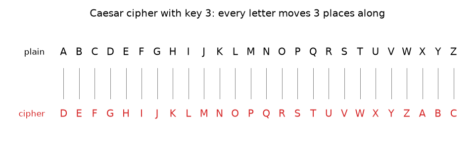
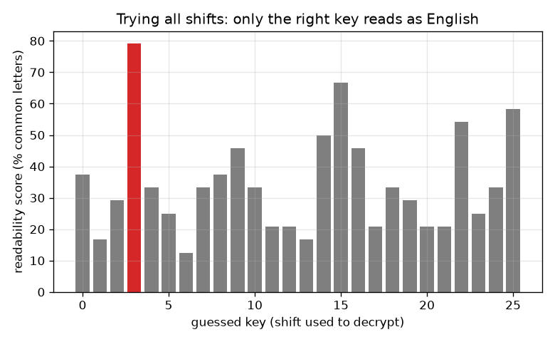

# அமர்வு 1: ஒரு ரகசியச் செய்தி: சீசர் நகர்வு மறைக்குறியீடு

[Session 1 — हिन्दी](README.hi.md) · [Session 1 — മലയാളം](README.ml.md) · [Session 1 — தமிழ்](README.ta.md)

*நிலை 1 (கருத்தியல் ஊடாடும் மாதிரி) · சுமார் 60 நிமிடங்கள் · opencrypto*

> இது ஒரு எளிமைப்படுத்தப்பட்ட கல்வி மாதிரி. இது சரிபார்க்கப்பட்ட (validated) வடிவமைப்புக் கருவி அல்ல; உண்மையான கட்டமைப்புகள், மின் நிறுவல்கள், வாகனங்கள், தொழில்துறை செயல்முறைகள் அல்லது மருத்துவ முடிவுகளுக்கு இதைப் பயன்படுத்தக் கூடாது.

**முன்தேவைகள் (Prerequisites)**

- மீதிகள் (remainders): 'mod' இன் கடிகாரக் கணிதம் (பிரிவு B இல் விளக்கப்பட்டுள்ளது).
- நீங்கள் PRIMER.md படித்து, `python start.py 1` ஐ ஒருமுறை இயக்கியிருக்கிறீர்கள்.

**கற்றல் நோக்கங்கள் (Learning objectives).** இந்த அமர்வுக்குப் பிறகு உங்களால் முடியும்:

- ஒரு சீசர் நகர்வைக் கொண்டு ஒரு செய்தியைக் கையால் மறையாக்கம் (encrypt) மற்றும் மறைவிலக்கம் (decrypt) செய்ய.
- ஒரு சீசர் மறைக்குறியீட்டுக்கு ஏன் 25 பயனுள்ள சாவிகள் (keys) மட்டுமே உள்ளன, ஏன் யார் வேண்டுமானாலும் அவை அனைத்தையும் முயன்று பார்க்கலாம் என்பதை விளக்க.
- சரியான நகர்வைத் தானாகத் தேர்ந்தெடுக்க ஒரு படிக்கக்கூடிய மதிப்பெண்ணை (readability score) பயன்படுத்த.
- எளிதில் உடைக்கக்கூடிய மறைக்குறியீடு கற்றலுக்கு இன்னும் பயனுள்ளது, ஆனால் உண்மையான ரகசியங்களுக்கு ஒருபோதும் அல்ல என்பதை ஏன் என்று சொல்ல.

## A. நிஜ உலகப் பிரச்சினை
வகுப்பில் உங்கள் நண்பர் மட்டும் படிக்கக்கூடிய ஒரு குறிப்பைக் கொடுக்க விரும்புகிறீர்கள். ஜூலியஸ் சீசர் பயன்படுத்திய ஒரு தந்திரம், ஒவ்வொரு எழுத்தையும் எழுத்துவரிசையில் ஒரு நிலையான எண்ணிக்கை இடங்கள் முன்னால் உள்ள எழுத்தால் மாற்றுவது. அந்த எண்ணைத் தெரியாத எவருக்கும் குறிப்பு அர்த்தமற்றதாகத் தெரியும். நீங்கள் அதை எப்படிச் செய்வீர்கள், உங்கள் நண்பர் அதை எப்படித் திருப்புவார், ஆர்வமுள்ள ஒரு வகுப்புத் தோழர் எப்படியும் அதைப் படிக்க எவ்வளவு நேரம் எடுக்கும்? இது ஒரு விளையாட்டுப் பொருள்: குறியாக்கவியலின் சொற்களை (மூல உரை, மறைக்குறி உரை, சாவி) மிக எளிய சூழலில் இது காட்டுகிறது. உண்மையான ரகசியங்களை இதைக் கொண்டு ஒருபோதும் பாதுகாக்கக் கூடாது.

## B. கருத்தும் கோட்பாடும்
எழுத்துகளுக்கு A = 0, B = 1, ..., Z = 25 என எண்ணிடுங்கள். மூல உரை (plaintext) படிக்கக்கூடிய செய்தி, மறைக்குறி உரை (ciphertext) கலைக்கப்பட்டது. சாவி k என்பது எத்தனை இடங்கள் நகர்த்த வேண்டும் என்ற எண். மறையாக்கம் செய்ய, ஒவ்வொரு எழுத்து எண்ணுடனும் k ஐக் கூட்டி, 26 ஆல் வகுத்த மீதியை எடுத்து Z க்குப் பிறகு சுற்றி வாருங்கள் (mod 26 என எழுதப்படுகிறது). மறைவிலக்கம் செய்ய, அதே வழியில் k ஐக் கழியுங்கள். 0 மற்றும் 26 நகர்வுகள் எதையும் மாற்றுவதில்லை, எனவே 25 பயனுள்ள சாவிகள் உள்ளன. முறையைத் தெரிந்த ஒரு தாக்குபவர் வெறுமனே 25 ஐயும் முயன்று அர்த்தமுள்ளதைப் படிக்கிறார். ஒவ்வொரு வேட்பாளருக்கும் மதிப்பெண் இட்டு ஒரு கணினி இதைச் செய்யலாம்: E T A O I N S H R என்ற ஒன்பது எழுத்துகள் சாதாரண ஆங்கில உரையின் பெரும்பகுதியை உருவாக்குகின்றன, ஆனால் ஒரு சீரற்ற கலவையில் 26 இல் 9 எழுத்துகள் மட்டுமே (சுமார் 35 சதவீதம்). ஒரு வேட்பாளரில் அந்த ஒன்பதில் அடங்கும் எழுத்துகளின் பங்குதான் படிக்கக்கூடிய மதிப்பெண்.

| குறியீடு | பொருள் | அலகு |
|---|---|---|
| p | மூல உரை எழுத்து எண் (A = 0 ... Z = 25) | அலகு இல்லை |
| c | மறைக்குறி உரை எழுத்து எண் | அலகு இல்லை |
| k | சாவி: எத்தனை இடங்கள் நகர்த்த வேண்டும் | எழுத்துகள் |
| score | படிக்கக்கூடிய தன்மை: E T A O I N S H R இல் அடங்கும் எழுத்துகளின் பங்கு | பின்னம் (அல்லது %) |

**அனுமானங்கள் (Assumptions)**

- A முதல் Z வரையிலான 26 எழுத்துகள் மட்டுமே நகர்த்தப்படுகின்றன; இடைவெளிகளும் நிறுத்தக்குறிகளும் அப்படியே விடப்படுகின்றன.
- தாக்குபவருக்கு முறையும் (சீசர்) மொழியும் (ஆங்கிலம்) தெரியும்; சாவி மட்டுமே ரகசியம்.
- கற்றலுக்கான விளையாட்டு மாதிரி; உண்மையான தகவலைப் பாதுகாக்கும் வழி அல்ல.

$$ c=(p+k)\bmod 26 $$

$$ p=(c-k)\bmod 26 $$

$$ \text{number of useful keys}=26-1=25 $$

$$ \text{score}=\frac{\text{letters in }\{E,T,A,O,I,N,S,H,R\}}{\text{all letters}} $$

## C. காட்சி விளக்கம்
முதல் படம் சாவி 3 க்கான இரண்டு எழுத்துவரிசை வரிகளைக் காட்டுகிறது: ஒவ்வொரு மூல எழுத்தும் அது மாறும் எழுத்துக்கு மேலே அமர்ந்துள்ளது. சாவி 3 கொண்டு மறையாக்கம் செய்யப்பட்ட ஒரு செய்திக்கு, அனைத்து 26 ஊகங்களின் படிக்கக்கூடிய மதிப்பெண்ணை இரண்டாவது படம் வரைகிறது. சரியான ஊகம் (3) சுமார் 79 சதவீதத்தை அடைகிறது, சிறந்த தவறான ஊகம் சுமார் 67 சதவீதத்தை அடைகிறது: குறுகிய செய்திகள் சிறிய இடைவெளியையே தருகின்றன, ஆனாலும் சரியான நகர்வு தனித்து நிற்கிறது, மனிதக் கண் அதைப் பார்க்க ஒரு நொடி போதும்.

*சாவி 3 கொண்ட சீசர் மறைக்குறியீடு: ஒவ்வொரு மூல எழுத்தும் (மேலே) 3 இடங்கள் முன்னால் உள்ள எழுத்தாக (கீழே) மாறுகிறது.*

*அனைத்து 26 ஊகங்களுக்கான படிக்கக்கூடிய மதிப்பெண்: உண்மையான சாவி 3 தனித்து நிற்கிறது.*

## D. ஊடாடும் உருவகப்படுத்தல் (Interactive simulation)
பாடத்தை இயக்குங்கள் (`python start.py 1`), பின்னர் நேரடிச் செயலியைத் திறங்கள்: [அமர்வு 1: நகர்த்து, பின்னர் உடை](https://krunalpanchal1995.github.io/pan-iit-oss/opencrypto/session-01/) (அல்லது இந்தக் கோப்புறையில் உள்ள `app.html`). சாவி ஸ்லைடரை நகர்த்தி, மறைக்குறி வரி மூல வரியின் வழியே நழுவுவதைக் கவனியுங்கள். பின்னர் ஊக ஸ்லைடரை நகர்த்தி, ஊகம் சாவிக்குச் சமமாகும்போது மட்டுமே மறைவிலக்கப்பட்ட உரை ஆங்கிலமாக மாறுவதைக் கவனியுங்கள். அனைத்து 26 ஊகங்களையும் ஒரே நேரத்தில் பார்க்க வரைபடத்துக்கு மாறுங்கள்.

**சவால் (Challenge).** 10 அல்லது அதற்கு மேற்பட்ட ஒரு சாவியைத் தேர்ந்தெடுத்து, ஊகத்தைச் சாவிக்குச் சமமாக அமைத்துச் செய்தியை மறைவிலக்கம் செய்யுங்கள்.

## E. தீர்க்கப்பட்ட எடுத்துக்காட்டும் சோதனையும்
**பிரச்சினை.** SEE YOU AT NOON ஐச் சாவி 5 கொண்டு மறையாக்கம் செய்து, பின்னர் மீண்டும் மறைவிலக்கம் செய்யுங்கள்.

1. S = 18, 18 + 5 = 23 = X. E = 4, 4 + 5 = 9 = J. எனவே SEE என்பது XJJ ஆகிறது.
2. Y = 24, 24 + 5 = 29, இது 29 - 26 = 3 = D ஆகச் சுற்றி வருகிறது. O = 14, 14 + 5 = 19 = T. U = 20, 20 + 5 = 25 = Z. எனவே YOU என்பது DTZ ஆகிறது.
3. A = 0 என்பது F = 5 ஆகிறது, T = 19 என்பது Y = 24 ஆகிறது, எனவே AT என்பது FY ஆகிறது.
4. N = 13 என்பது S = 18 ஆகிறது, O = 14 என்பது T = 19 ஆகிறது, எனவே NOON என்பது STTS ஆகிறது.
5. மறைக்குறி உரை: XJJ DTZ FY STTS. மறைவிலக்கம் செய்ய 5 ஐக் கழியுங்கள்: X = 23, 23 - 5 = 18 = S, இப்படியே SEE YOU AT NOON க்குத் திரும்ப.

**விடை.** மறைக்குறி உரை XJJ DTZ FY STTS, சாவி 5 கொண்டு மறைவிலக்கம் செய்தால் SEE YOU AT NOON திரும்பக் கிடைக்கிறது.

**சோதனை.** எழுத்துவரிசை எழுதப்பட்ட இரண்டு காகிதப் பட்டைகளை வெட்டி, ஒன்றை 5 இடங்கள் நகர்த்தி, பட்டைகளின் வழியே பார்த்து உங்கள் சொந்தச் சிறிய சொல்லை மறையாக்கம் செய்யுங்கள்; பின்னர் சாவி இல்லாமல் அதை உடைக்க ஒரு நண்பரிடம் கேட்டு, சொல் அர்த்தமுள்ளதாகப் படிக்கும் முன் அவர்கள் எத்தனை நகர்வுகளை முயல்கிறார்கள் என்று எண்ணுங்கள் (அதிகபட்சம் 25). மாதிரியும் யதார்த்தமும்: கணிதம் துல்லியமானது, ஆனால் ஒரு மனிதர் ஒரு எழுத்தைத் தவறாகப் படிக்கலாம்; கணினியின் படிக்கக்கூடிய மதிப்பெண் மிகக் குறுகிய செய்திகளால் ஏமாற்றப்படக்கூடிய ஒரு புள்ளியியல் ஊகம்.

## F. மதிப்பீடும் வடிவமைப்புச் சவாலும்
**கேள்வி வகை A: கருத்தியல்.** சாவி தெரியாமலேயே யார் வேண்டுமானாலும் ஒரு சீசர் மறைக்குறியீட்டை ஏன் உடைக்க முடியும்? முறையை ரகசியமாக வைத்திருப்பது உதவுமா?

குறிப்பு

சாவிகளை எண்ணுங்கள், ஒவ்வொன்றையும் கொண்டு தாக்குபவர் என்ன செய்கிறார் என்று கேளுங்கள்.

படிப்படியான தீர்வு

25 பயனுள்ள சாவிகள் மட்டுமே உள்ளன, எனவே ஒரு தாக்குபவர் ஒவ்வொன்றைக் கொண்டும் மறைவிலக்கம் செய்து அர்த்தமுள்ளதைப் படிக்கிறார்; இதற்குக் கையால் ஒரு நிமிடமும் கணினியில் ஒரு நொடியின் சிறு பகுதியும் போதும். முறையை ரகசியமாக வைப்பது பெரிதாக உதவாது: முறையை ஊகிப்பது எளிது, முறை பொதுவில் இருந்தாலும் ஒரு நல்ல மறைக்குறியீடு பாதுகாப்பாக இருக்க வேண்டும் (அமர்வு 2). முழு வலிமையும் முயன்று பார்க்க முடியாத அளவுக்கு எண்ணிக்கை அதிகமான ஒரு சாவியில் இருக்க வேண்டும்.

**கேள்வி வகை B: எண்ணியல்.** GO என்ற சொல்லைச் சாவி 20 கொண்டு மறையாக்கம் செய்யுங்கள். சுற்றி வருதலைக் காட்டி, பின்னர் மறைவிலக்கம் செய்து சரிபாருங்கள்.

குறிப்பு

G = 6, O = 14. 20 ஐக் கூட்டி, 25 ஐத் தாண்டும்போது 26 ஐக் கழியுங்கள்.

படிப்படியான தீர்வு

G: 6 + 20 = 26, இது 0 = A ஆகச் சுற்றி வருகிறது. O: 14 + 20 = 34, 34 - 26 = 8 = I. எனவே GO என்பது AI ஆகிறது. சரிபார்ப்பு: A = 0, 0 - 20 = -20, -20 + 26 = 6 = G; I = 8, 8 - 20 = -12, -12 + 26 = 14 = O. அலகுகள்: எழுத்து நிலைகள், இயற்பியல் அலகு இல்லை.

**கேள்வி வகை C: வரைபடம் மற்றும் உருவகப்படுத்தல் விளக்கம்.** ஊகத்துக்கு எதிரான படிக்கக்கூடிய தன்மை வரைபடத்தில், ஒரு பட்டை ஏன் உயரமாகவும் மற்றவை தாழ்வாகவும் உள்ளன? மிகக் குறுகிய செய்திக்கு இடைவெளி ஏன் சிறியதாக இருக்கலாம்?

குறிப்பு

ஒரு தவறான நகர்வு எழுத்துப் பங்குகளுக்கு என்ன செய்கிறது என்று சிந்தியுங்கள்.

படிப்படியான தீர்வு

ஒரு தவறான நகர்வு செய்தியைக் கலைக்கிறது, எனவே அதன் எழுத்துகள் ஒரு சீரற்ற கலவை போலத் தெரிகின்றன, சராசரியாகச் சுமார் 35 சதவீதம் என்ற சீரற்ற நிலையில் மதிப்பெண் பெறுகின்றன; சரியான நகர்வு உண்மையான ஆங்கிலப் பங்குகளை மீட்டெடுக்கிறது, எனவே அதன் பட்டை உயரமானது (இங்கே சுமார் 79 சதவீதம், எந்தத் தவறான ஊகத்துக்கும் அதிகபட்சம் சுமார் 67 சதவீதம்). ஒரு குறுகிய செய்தியில் சில எழுத்துகளே உள்ளன, எனவே பங்குகள் தற்செயலாக ஏற்ற இறக்கம் அடைகின்றன, ஒரு தவறான ஊகம் எப்போதாவது நல்ல மதிப்பெண் பெறலாம்; நீண்ட செய்திகள் தெளிவான இடைவெளியைத் தருகின்றன.

**கேள்வி வகை D: வடிவமைப்பு மற்றும் உகப்பாக்கச் சவால்.** வடிவமைப்பு: இந்த அமர்வின் கருத்துகளை மட்டும் பயன்படுத்தி, ஒரு வகுப்புத் தோழர் தம்மிடம் உள்ள நேரத்துக்குள் படிக்க முடியாத ஒரு குறிப்பை நீங்கள் அனுப்ப வேண்டும். நீங்கள் செய்யக்கூடிய இரண்டு மாற்றங்களையும் ஒவ்வொன்றின் விலையையும் பட்டியலிடுங்கள்.

குறிப்பு

சாத்தியமான சாவிகளை எண்ணுங்கள், நீங்களும் உங்கள் நண்பரும் முன்கூட்டியே என்ன பகிர வேண்டும் என்று சிந்தியுங்கள்.

படிப்படியான தீர்வு

மாற்றம் 1: வெவ்வேறு எழுத்துகளுக்கு வெவ்வேறு நகர்வைப் பயன்படுத்துங்கள் (எடுத்துக்காட்டாக மீண்டும் வரும் நகர்வுகளின் ஒரு சிறு பட்டியல்). இது சாவிகளின் எண்ணிக்கையை உயர்த்துகிறது, ஆனால் நீங்களும் நண்பரும் இப்போது முழுப் பட்டியலையும் பகிர வேண்டும், மீண்டும் வரும் சிறு பட்டியல்களை இன்னும் உடைக்க முடியும் என்று அமர்வு 2 காட்டுகிறது. மாற்றம் 2: எழுத்துவரிசையை எந்த வரிசையிலும் கலையுங்கள், இது மிக அதிகச் சாவிகளைத் தருகிறது, ஆனால் எழுத்து எண்ணிக்கைகளின் வடிவம் தப்பிப் பிழைக்கிறது, எண்ணுதல் அதை எப்படி உடைக்கிறது என்று அமர்வு 2 காட்டுகிறது. சமரசம் (trade-off): அதிகச் சாவிகளைப் பகிரவும் நினைவில் கொள்ளவும் அதிகச் செலவாகும்; செய்தியின் நீளத்துக்கு உண்மையிலேயே சீரற்ற ஒரு சாவி மட்டுமே (அமர்வு 3) முழுமையான ரகசியத்தைத் தருகிறது. நிஜ வாழ்க்கையில், சரிபார்க்கப்பட்ட ஒரு நூலகத்தைப் பயன்படுத்துங்கள், வீட்டில் செய்த மறைக்குறியீட்டை ஒருபோதும் பயன்படுத்தாதீர்கள்.

[RUBRIC.md](../../RUBRIC.md) கொண்டு உங்களுக்கு நீங்களே மதிப்பெண் இடுங்கள். தாளில் வேலை செய்ய [செயல்பாட்டுத் தாளை](activity_sheet.md) அச்சிடுங்கள்.

## பொதுவான தவறான கருத்துகள்
| பொதுவான தவறான கருத்து | உண்மையில் சரியானது என்ன |
|---|---|
| ரகசியமான முறை ஒரு மறைக்குறியீட்டைப் பாதுகாப்பானதாக்குகிறது. | முறை பொதுவில் இருந்தாலும் ஒரு நல்ல மறைக்குறியீடு பாதுகாப்பாக இருக்கும்; சாவி மட்டுமே ரகசியம். சாவி வெளி மிகச் சிறியதாக இருப்பதால் சீசர் தோற்கிறது. |
| 26 ஆல் நகர்த்துவது ஒரு வலுவான சாவி. | 26 (அல்லது 0) ஆல் நகர்த்துவது எதையும் மாற்றாது; அதனால்தான் 26 அல்ல, 25 பயனுள்ள சாவிகள் உள்ளன. |
| பெரிய நகர்வு வலுவான சாவி. | சாவி 20 ஐக் கண்டுபிடிப்பது சாவி 2 ஐ விடக் கடினமானதல்ல: தாக்குபவர் எப்படியும் 25 ஐயும் முயல்கிறார். |
| எனக்கே படிக்க முடியாத மறைக்குறியீடு பாதுகாப்பான மறைக்குறியீடு. | உங்களுக்குப் படிக்க முடியாதது ஒரு கணினிக்குப் படிக்க முடியாதது அல்ல. எல்லாவற்றையும் முயலும் ஒரு தாக்குபவருக்கு எதிராகவே பாதுகாப்பு மதிப்பிடப்படுகிறது. |

## சொற்களஞ்சியம் (Glossary)
- **மூல உரை (plaintext)**: மறையாக்கத்துக்கு முன் படிக்கக்கூடிய செய்தி
- **மறைக்குறி உரை (ciphertext)**: மறையாக்கத்துக்குப் பின் கலைக்கப்பட்ட செய்தி
- **சாவி (key)**: செய்தி எப்படிக் கலைக்கப்படுகிறது என்பதைக் கட்டுப்படுத்தும் ரகசிய எண் (அல்லது சொல்)
- **mod**: வகுத்தலுக்குப் பின் உள்ள மீதி; 'mod 26' எழுத்துவரிசையைச் சுற்றி வரச் செய்கிறது
- **முரட்டு விசை (brute force)**: சாத்தியமான ஒவ்வொரு சாவியையும் முயல்வது
- **மறைக்குறியீடு (cipher)**: ஒரு சாவியைக் கொண்டு செய்தியைக் கலைக்கும் ஒரு முறை

## முடிக்க
1. [exercises.md](exercises.md) இல் உள்ள மூன்று நிரலாக்கப் பணிகளைச் செய்யுங்கள்.
2. உங்கள் மாற்றங்களுக்குப் பிறகு `python start.py 1` ஐ மீண்டும் இயக்குங்கள். அது சோதனைச் சாவடியுடன் (checkpoint) முடிகிறது; அது `PASS` என அச்சிடும்போது, நீங்கள் முடித்துவிட்டீர்கள். (சோதனைச் சாவடி மட்டும்: `python start.py check 1`.)

அடுத்து: [அமர்வு 2](../session-02/README.md)
