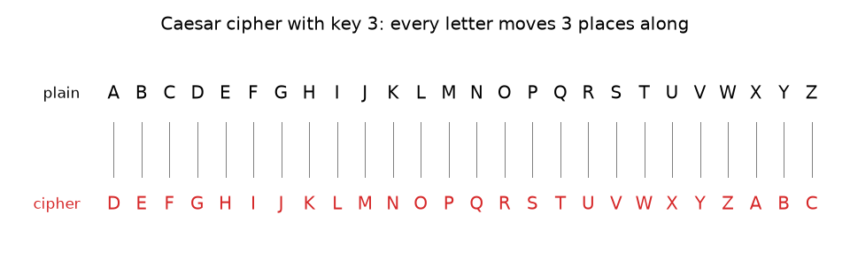
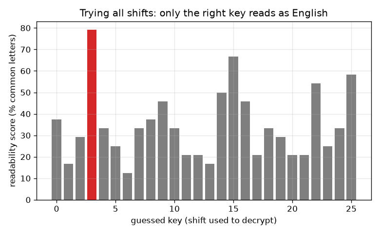

# సెషన్ 1: ఒక రహస్య సందేశం: సీజర్ షిఫ్ట్ సైఫర్

[Session 1 — हिन्दी](README.hi.md) · [Session 1 — മലയാളം](README.ml.md) · [Session 1 — தமிழ்](README.ta.md) · [Session 1 — తెలుగు](README.te.md)

*స్థాయి 1 (భావనాత్మక ఇంటరాక్టివ్ మోడల్) · సుమారు 60 నిమిషాలు · opencrypto*

> ఇది సరళీకరించిన ఒక విద్యా మోడల్. ఇది ధృవీకరించబడిన (validated) డిజైన్ సాధనం కాదు; నిజమైన నిర్మాణాలు, విద్యుత్ ఇన్‌స్టలేషన్‌లు, వాహనాలు, పారిశ్రామిక ప్రక్రియలు లేదా వైద్య నిర్ణయాల కోసం దీనిని ఉపయోగించకూడదు.

**ముందస్తు అవసరాలు (Prerequisites)**

- శేషాలు (remainders): 'mod' యొక్క గడియార గణితం (విభాగం B లో వివరించబడింది).
- మీరు PRIMER.md చదివి, `python start.py 1` ను ఒకసారి రన్ చేశారు.

**అభ్యాస లక్ష్యాలు (Learning objectives).** ఈ సెషన్ తర్వాత మీరు చేయగలరు:

- సీజర్ షిఫ్ట్‌తో చేతితో ఒక సందేశాన్ని ఎన్‌క్రిప్ట్ (encrypt) మరియు డీక్రిప్ట్ (decrypt) చేయడం.
- సీజర్ సైఫర్‌కు 25 ఉపయోగకరమైన కీలు (keys) మాత్రమే ఎందుకు ఉన్నాయో, ఎవరైనా వాటన్నింటినీ ఎందుకు ప్రయత్నించగలరో వివరించడం.
- సరైన షిఫ్ట్‌ను స్వయంచాలకంగా ఎంచుకోవడానికి చదవదగిన స్కోర్ (readability score) ఉపయోగించడం.
- సులభంగా ఛేదించగల సైఫర్ నేర్చుకోవడానికి ఇప్పటికీ ఉపయోగకరమైనప్పటికీ నిజమైన రహస్యాలకు ఎప్పటికీ ఎందుకు కాదో చెప్పడం.

## A. నిజ జీవిత సమస్య
మీ స్నేహితుడు మాత్రమే చదవగలిగేలా తరగతిలో ఒక చీటీ అందించాలని మీరు కోరుకుంటారు. జూలియస్ సీజర్ ఉపయోగించిన ఒక ఉపాయం, ప్రతి అక్షరాన్ని వర్ణమాలలో నిర్ణీత సంఖ్యలో స్థానాలు ముందున్న అక్షరంతో మార్చడం. ఆ సంఖ్య తెలియని ఎవరికైనా చీటీ అర్థం లేనిదిగా కనిపిస్తుంది. మీరు దానిని ఎలా చేస్తారు, మీ స్నేహితుడు దానిని ఎలా వెనక్కి మారుస్తాడు, ఆసక్తిగల ఒక సహవిద్యార్థి ఎలాగైనా దానిని చదవడానికి ఎంత సమయం పడుతుంది? ఇది ఒక ఆటబొమ్మ: క్రిప్టోగ్రఫీ పదజాలాన్ని (ప్లెయిన్‌టెక్స్ట్, సైఫర్‌టెక్స్ట్, కీ) అత్యంత సరళమైన సందర్భంలో ఇది చూపిస్తుంది. నిజమైన రహస్యాలను ఎప్పుడూ దీనితో రక్షించకూడదు.

## B. భావన మరియు సిద్ధాంతం
అక్షరాలకు A = 0, B = 1, ..., Z = 25 అని సంఖ్యలు ఇవ్వండి. ప్లెయిన్‌టెక్స్ట్ (plaintext) చదవగలిగే సందేశం, సైఫర్‌టెక్స్ట్ (ciphertext) గందరగోళం చేసినది. కీ k అంటే ఎన్ని స్థానాలు జరపాలో ఆ సంఖ్య. ఎన్‌క్రిప్ట్ చేయడానికి, ప్రతి అక్షర సంఖ్యకు k కలిపి, 26 తో భాగించిన శేషం తీసుకుని Z తర్వాత చుట్టూ తిరిగి రండి (mod 26 అని రాస్తారు). డీక్రిప్ట్ చేయడానికి, అదే విధంగా k తీసివేయండి. షిఫ్ట్‌లు 0 మరియు 26 దేనినీ మార్చవు, కాబట్టి 25 ఉపయోగకరమైన కీలు ఉన్నాయి. పద్ధతి తెలిసిన దాడిచేసేవాడు కేవలం 25 నీ ప్రయత్నించి అర్థవంతమైనదాన్ని చదువుతాడు. ప్రతి అభ్యర్థికి స్కోర్ ఇవ్వడం ద్వారా కంప్యూటర్ దీనిని చేయగలదు: E T A O I N S H R అనే తొమ్మిది అక్షరాలు సాధారణ ఆంగ్ల పాఠంలో అధిక భాగం, కానీ యాదృచ్ఛిక గందరగోళంలో 26 లో 9 అక్షరాలు మాత్రమే (సుమారు 35 శాతం). ఒక అభ్యర్థిలో ఆ తొమ్మిదిలో ఉన్న అక్షరాల వాటాయే చదవదగిన స్కోర్.

| గుర్తు | అర్థం | యూనిట్ |
|---|---|---|
| p | ప్లెయిన్‌టెక్స్ట్ అక్షర సంఖ్య (A = 0 ... Z = 25) | యూనిట్ లేదు |
| c | సైఫర్‌టెక్స్ట్ అక్షర సంఖ్య | యూనిట్ లేదు |
| k | కీ: ఎన్ని స్థానాలు జరపాలి | అక్షరాలు |
| score | చదవదగినతనం: E T A O I N S H R లో ఉన్న అక్షరాల వాటా | భిన్నం (లేదా %) |

**ఊహలు (Assumptions)**

- A నుండి Z వరకు 26 అక్షరాలు మాత్రమే జరుపబడతాయి; ఖాళీలు మరియు విరామ చిహ్నాలు అలాగే వదిలివేయబడతాయి.
- దాడిచేసేవాడికి పద్ధతి (సీజర్) మరియు భాష (ఆంగ్లం) తెలుసు; కీ మాత్రమే రహస్యం.
- నేర్చుకోవడానికి ఆటబొమ్మ మోడల్; నిజమైన సమాచారాన్ని రక్షించే మార్గం కాదు.

$$ c=(p+k)\bmod 26 $$

$$ p=(c-k)\bmod 26 $$

$$ \text{number of useful keys}=26-1=25 $$

$$ \text{score}=\frac{\text{letters in }\{E,T,A,O,I,N,S,H,R\}}{\text{all letters}} $$

## C. దృశ్య వివరణ
మొదటి చిత్రం కీ 3 కోసం రెండు వర్ణమాల వరుసలను చూపిస్తుంది: ప్రతి ప్లెయిన్ అక్షరం అది మారే అక్షరం పైన కూర్చుంటుంది. కీ 3 తో ఎన్‌క్రిప్ట్ చేసిన సందేశం కోసం మొత్తం 26 ఊహల చదవదగిన స్కోర్‌ను రెండవ చిత్రం ప్లాట్ చేస్తుంది. సరైన ఊహ (3) సుమారు 79 శాతానికి చేరుతుంది, అత్యుత్తమ తప్పు ఊహ సుమారు 67 శాతానికి చేరుతుంది: చిన్న సందేశాలు చిన్న అంతరాన్నే ఇస్తాయి, అయినా సరైన షిఫ్ట్ ప్రత్యేకంగా నిలుస్తుంది, మానవ కంటికి దానిని చూడటానికి ఒక క్షణం చాలు.

*కీ 3 తో సీజర్ సైఫర్: ప్రతి ప్లెయిన్ అక్షరం (పైన) 3 స్థానాలు ముందున్న అక్షరంగా (కింద) మారుతుంది.*

*మొత్తం 26 ఊహలకు చదవదగిన స్కోర్: నిజమైన కీ 3 ప్రత్యేకంగా నిలుస్తుంది.*

## D. ఇంటరాక్టివ్ సిమ్యులేషన్
పాఠాన్ని రన్ చేయండి (`python start.py 1`), ఆపై లైవ్ యాప్ తెరవండి: [సెషన్ 1: జరుపు, ఆపై ఛేదించు](https://krunalpanchal1995.github.io/pan-iit-oss/opencrypto/session-01/) (లేదా ఈ ఫోల్డర్‌లోని `app.html`). కీ స్లైడర్‌ను కదిపి సైఫర్ వరుస ప్లెయిన్ వరుస వెంట జారడం గమనించండి. ఆపై ఊహ స్లైడర్‌ను కదిపి, ఊహ కీకి సమానమైనప్పుడు మాత్రమే డీక్రిప్ట్ చేసిన పాఠం ఆంగ్లంగా మారడం గమనించండి. మొత్తం 26 ఊహలను ఒకేసారి చూడటానికి గ్రాఫ్‌కు మారండి.

**సవాలు (Challenge).** 10 లేదా అంతకంటే ఎక్కువ కీని ఎంచుకుని, ఊహను కీకి సమానంగా ఉంచి సందేశాన్ని డీక్రిప్ట్ చేయండి.

## E. సాధించిన ఉదాహరణ మరియు ప్రయోగం
**సమస్య.** SEE YOU AT NOON ను కీ 5 తో ఎన్‌క్రిప్ట్ చేసి, ఆపై మళ్ళీ డీక్రిప్ట్ చేయండి.

1. S = 18, 18 + 5 = 23 = X. E = 4, 4 + 5 = 9 = J. కాబట్టి SEE అనేది XJJ అవుతుంది.
2. Y = 24, 24 + 5 = 29, ఇది 29 - 26 = 3 = D గా చుట్టూ తిరుగుతుంది. O = 14, 14 + 5 = 19 = T. U = 20, 20 + 5 = 25 = Z. కాబట్టి YOU అనేది DTZ అవుతుంది.
3. A = 0 అనేది F = 5 అవుతుంది, T = 19 అనేది Y = 24 అవుతుంది, కాబట్టి AT అనేది FY అవుతుంది.
4. N = 13 అనేది S = 18 అవుతుంది, O = 14 అనేది T = 19 అవుతుంది, కాబట్టి NOON అనేది STTS అవుతుంది.
5. సైఫర్‌టెక్స్ట్: XJJ DTZ FY STTS. డీక్రిప్ట్ చేయడానికి 5 తీసివేయండి: X = 23, 23 - 5 = 18 = S, ఇలా SEE YOU AT NOON కు తిరిగి.

**సమాధానం.** సైఫర్‌టెక్స్ట్ XJJ DTZ FY STTS, కీ 5 తో డీక్రిప్ట్ చేస్తే SEE YOU AT NOON తిరిగి వస్తుంది.

**ప్రయోగం.** వర్ణమాల రాసిన రెండు కాగితపు పట్టీలను కత్తిరించి, ఒకదాన్ని 5 స్థానాలు జరిపి, పట్టీల వెంట చూస్తూ మీ సొంత చిన్న పదాన్ని ఎన్‌క్రిప్ట్ చేయండి; ఆపై కీ లేకుండా దానిని ఛేదించమని స్నేహితుడిని అడిగి, పదం అర్థవంతంగా చదవబడే ముందు వారు ఎన్ని షిఫ్ట్‌లు ప్రయత్నిస్తారో లెక్కించండి (గరిష్టంగా 25). మోడల్ వర్సెస్ వాస్తవం: గణితం ఖచ్చితమైనది, కానీ మనిషి ఒక అక్షరాన్ని తప్పుగా చదవవచ్చు; కంప్యూటర్ చదవదగిన స్కోర్ చాలా చిన్న సందేశాలతో మోసపోగల గణాంక ఊహ.

## F. మూల్యాంకనం మరియు డిజైన్ సవాలు
**ప్రశ్న రకం A: భావనాత్మకం.** కీ తెలియకుండానే ఎవరైనా సీజర్ సైఫర్‌ను ఎందుకు ఛేదించగలరు? పద్ధతిని రహస్యంగా ఉంచడం సహాయపడుతుందా?

సూచన

కీలను లెక్కించండి, ప్రతి దానితో దాడిచేసేవాడు ఏమి చేస్తాడో అడగండి.

దశలవారీ పరిష్కారం

25 ఉపయోగకరమైన కీలు మాత్రమే ఉన్నాయి, కాబట్టి దాడిచేసేవాడు ప్రతి దానితో డీక్రిప్ట్ చేసి అర్థవంతమైనదాన్ని చదువుతాడు; దీనికి చేతితో ఒక నిమిషం, కంప్యూటర్‌లో సెకనులో చిన్న భాగం పడుతుంది. పద్ధతిని రహస్యంగా ఉంచడం పెద్దగా సహాయపడదు: పద్ధతిని ఊహించడం సులభం, పద్ధతి బహిరంగమైనా మంచి సైఫర్ సురక్షితంగా ఉండాలి (సెషన్ 2). మొత్తం బలం ప్రయత్నించలేనంత ఎక్కువ సంఖ్యలో ఉన్న కీలో ఉండాలి.

**ప్రశ్న రకం B: సంఖ్యాత్మకం.** GO అనే పదాన్ని కీ 20 తో ఎన్‌క్రిప్ట్ చేయండి. చుట్టూ తిరగడాన్ని చూపించి, ఆపై డీక్రిప్ట్ చేసి తనిఖీ చేయండి.

సూచన

G = 6 మరియు O = 14. 20 కలిపి, 25 దాటినప్పుడు 26 తీసివేయండి.

దశలవారీ పరిష్కారం

G: 6 + 20 = 26, ఇది 0 = A గా చుట్టూ తిరుగుతుంది. O: 14 + 20 = 34, మరియు 34 - 26 = 8 = I. కాబట్టి GO అనేది AI అవుతుంది. తనిఖీ: A = 0, 0 - 20 = -20, -20 + 26 = 6 = G; I = 8, 8 - 20 = -12, -12 + 26 = 14 = O. యూనిట్లు: అక్షర స్థానాలు, భౌతిక యూనిట్ లేదు.

**ప్రశ్న రకం C: గ్రాఫ్ మరియు సిమ్యులేషన్ వ్యాఖ్యానం.** ఊహకు వ్యతిరేకంగా చదవదగినతనం గ్రాఫ్‌లో, ఒక బార్ ఎత్తుగా, మిగిలినవి తక్కువగా ఎందుకు ఉన్నాయి? చాలా చిన్న సందేశానికి అంతరం ఎందుకు చిన్నదిగా ఉండవచ్చు?

సూచన

తప్పు షిఫ్ట్ అక్షరాల వాటాలకు ఏమి చేస్తుందో ఆలోచించండి.

దశలవారీ పరిష్కారం

తప్పు షిఫ్ట్ సందేశాన్ని గందరగోళం చేస్తుంది, కాబట్టి దాని అక్షరాలు యాదృచ్ఛిక మిశ్రమంలా కనిపిస్తాయి, సగటున సుమారు 35 శాతం అనే యాదృచ్ఛిక స్థాయిలో స్కోర్ చేస్తాయి; సరైన షిఫ్ట్ నిజమైన ఆంగ్ల వాటాలను పునరుద్ధరిస్తుంది, కాబట్టి దాని బార్ ఎత్తుగా ఉంటుంది (ఇక్కడ సుమారు 79 శాతం, ఏ తప్పు ఊహకైనా గరిష్టంగా సుమారు 67 శాతం). చిన్న సందేశంలో కొన్ని అక్షరాలే ఉంటాయి, కాబట్టి వాటాలు యాదృచ్ఛికంగా హెచ్చుతగ్గులకు లోనవుతాయి, తప్పు ఊహ అప్పుడప్పుడు మంచి స్కోర్ పొందవచ్చు; పొడవైన సందేశాలు స్పష్టమైన అంతరాన్ని ఇస్తాయి.

**ప్రశ్న రకం D: డిజైన్ మరియు ఆప్టిమైజేషన్ సవాలు.** డిజైన్: ఈ సెషన్ ఆలోచనలను మాత్రమే ఉపయోగించి, సహవిద్యార్థి తమకున్న సమయంలో చదవలేని చీటీని మీరు పంపాలి. మీరు చేయగల రెండు మార్పులను, ప్రతి దాని ఖర్చును జాబితా చేయండి.

సూచన

సాధ్యమైన కీలను లెక్కించండి, మీరు మరియు మీ స్నేహితుడు ముందుగానే ఏమి పంచుకోవాలో ఆలోచించండి.

దశలవారీ పరిష్కారం

మార్పు 1: వేర్వేరు అక్షరాలకు వేర్వేరు షిఫ్ట్ ఉపయోగించండి (ఉదాహరణకు పునరావృతమయ్యే షిఫ్ట్‌ల చిన్న జాబితా). ఇది కీల సంఖ్యను పెంచుతుంది, కానీ మీరు మరియు మీ స్నేహితుడు ఇప్పుడు మొత్తం జాబితాను పంచుకోవాలి, పునరావృతమయ్యే చిన్న జాబితాలను ఇప్పటికీ ఛేదించవచ్చని సెషన్ 2 చూపిస్తుంది. మార్పు 2: వర్ణమాలను ఏ క్రమంలోనైనా గందరగోళం చేయండి, ఇది చాలా ఎక్కువ కీలను ఇస్తుంది, కానీ అక్షర గణనల ఆకారం మిగిలి ఉంటుంది, లెక్కించడం దానిని ఎలా ఛేదిస్తుందో సెషన్ 2 చూపిస్తుంది. రాజీ (trade-off): ఎక్కువ కీలను పంచుకోవడానికి మరియు గుర్తుంచుకోవడానికి ఎక్కువ ఖర్చు; సందేశమంత పొడవైన నిజంగా యాదృచ్ఛిక కీ మాత్రమే (సెషన్ 3) పరిపూర్ణ గోప్యతను ఇస్తుంది. నిజ జీవితంలో, పరిశీలించిన లైబ్రరీని ఉపయోగించండి, ఇంట్లో తయారుచేసిన సైఫర్‌ను ఎప్పుడూ ఉపయోగించకండి.

[RUBRIC.md](../../RUBRIC.md) తో మీకు మీరే స్కోర్ ఇచ్చుకోండి. కాగితంపై పని చేయడానికి [కార్యాచరణ పత్రాన్ని](activity_sheet.md) ప్రింట్ చేయండి.

## సాధారణ అపోహలు
| సాధారణ అపోహ | వాస్తవంగా నిజం ఏమిటి |
|---|---|
| రహస్య పద్ధతి సైఫర్‌ను సురక్షితంగా చేస్తుంది. | పద్ధతి బహిరంగమైనా మంచి సైఫర్ సురక్షితంగా ఉంటుంది; కీ మాత్రమే రహస్యం. కీ స్పేస్ చాలా చిన్నది కాబట్టి సీజర్ విఫలమవుతుంది. |
| 26 తో జరపడం బలమైన కీ. | 26 (లేదా 0) తో జరపడం దేనినీ మార్చదు; అందుకే 26 కాదు, 25 ఉపయోగకరమైన కీలు ఉన్నాయి. |
| పెద్ద షిఫ్ట్ బలమైన కీ. | కీ 20 ని కనుగొనడం కీ 2 కంటే కష్టం కాదు: దాడిచేసేవాడు ఎలాగైనా 25 నీ ప్రయత్నిస్తాడు. |
| నేనే చదవలేని సైఫర్ సురక్షితమైన సైఫర్. | మీకు చదవలేనిది కంప్యూటర్‌కు చదవలేనిది కాదు. అన్నింటినీ ప్రయత్నించే దాడిచేసేవాడికి వ్యతిరేకంగా భద్రత అంచనా వేయబడుతుంది. |

## పదకోశం (Glossary)
- **ప్లెయిన్‌టెక్స్ట్ (plaintext)**: ఎన్‌క్రిప్షన్‌కు ముందు చదవగలిగే సందేశం
- **సైఫర్‌టెక్స్ట్ (ciphertext)**: ఎన్‌క్రిప్షన్ తర్వాత గందరగోళం చేసిన సందేశం
- **కీ (key)**: సందేశం ఎలా గందరగోళం చేయబడుతుందో నియంత్రించే రహస్య సంఖ్య (లేదా పదం)
- **mod**: భాగహారం తర్వాత శేషం; 'mod 26' వర్ణమాలను చుట్టూ తిప్పుతుంది
- **బ్రూట్ ఫోర్స్ (brute force)**: సాధ్యమైన ప్రతి కీని ప్రయత్నించడం
- **సైఫర్ (cipher)**: కీతో సందేశాన్ని గందరగోళం చేసే పద్ధతి

## ముగించండి
1. [exercises.md](exercises.md) లోని మూడు కోడింగ్ పనులు చేయండి.
2. మీ మార్పుల తర్వాత `python start.py 1` ను మళ్ళీ రన్ చేయండి. అది చెక్‌పాయింట్‌తో ముగుస్తుంది; అది `PASS` అని ప్రింట్ చేసినప్పుడు, మీరు పూర్తి చేశారు. (చెక్‌పాయింట్ మాత్రమే: `python start.py check 1`.)

తదుపరి: [సెషన్ 2](../session-02/README.md)
