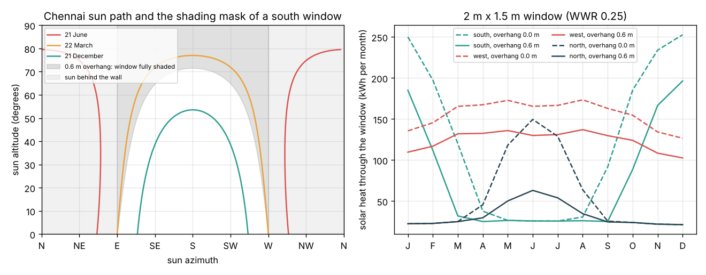
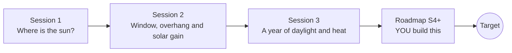

# opendaylight

[](https://github.com/KrunalPanchal1995/pan-iit-oss/actions/workflows/tests.yml)   [](https://colab.research.google.com/github/KrunalPanchal1995/pan-iit-oss/blob/main/opendaylight/sessions/session-01/lesson.ipynb) [](https://krunalpanchal1995.github.io/pan-iit-oss/opendaylight/)

**Plan windows for natural daylight using the sun path, in three sessions.**

opendaylight teaches how the sun moves across the sky and how window size, orientation and shading decide how much daylight a room gets and how much energy it needs, from the sun-path diagram to overhangs, solar heat gain and a year-long room simulation, using only Python and a browser.

- **Start from zero.** Session 1 needs only school trigonometry: the tilt of the Earth, the noon sun and the shadow of a pole.
- **See the sun.** Every session ships a slider app that runs in the browser: sun paths, window sections with the sun ray, and yearly energy curves.
- **Know you got it right.** Each session ends with a checkpoint that prints PASS or FAIL against hand calculations, symmetries, limits and an independent ray test.
- **Build the missing half.** The repo stops at Session 3 on purpose; the roadmap shows the path to the Target.

[Target](#the-target) · [Who is this for](#who-is-this-for) · [Quick start](#quick-start) · [Sessions](#sessions) · [Roadmap](#roadmap) · [Contribute](#contribute) · [Explainer PDF](docs/explainer.pdf)

> **This repo is incomplete on purpose.** Sessions 1 to 3 are here and fully working. The finished Target below is a preview of what the community can build next. We show you the path, not the code. Sessions 4 and up are yours.

## The Target

A window planner for any Indian city. You enter the latitude, the room and the wall the window can go in. The planner draws the sun path with the shading mask of your overhang and side fins, runs the room hour by hour through a real weather year (with monsoon clouds), maps the daylight point by point across the desk, flags glare, and recommends the orientation, the window-to-wall ratio and the shading that give at least 2 percent daylight factor for the least electricity. Session 3 already gives the first view of it below: the Chennai sun path seen from a south window with the shading mask of a 0.6 m overhang, and the solar heat month by month for south, west and north windows. Your goal over the coming sessions: add weather data, fins, a daylight map and glare, and turn the planner into a tool a student architect could use.



*Target preview: Chennai sun path with the shading mask of a 0.6 m overhang, and monthly solar heat through south, west and north windows*

Try it live:

- [Session 1: the sun path](https://krunalpanchal1995.github.io/pan-iit-oss/opendaylight/session-01/)
- [Session 3: plan the window for a year](https://krunalpanchal1995.github.io/pan-iit-oss/opendaylight/session-03/)

How the full Target is built is shown only as a path in [promo/roadmap.md](promo/roadmap.md).

## Who is this for
**higher secondary to diploma / undergraduate (levels 4-5).** Topic area: Architecture, Design and Smart Buildings.

Prerequisites:

- School trigonometry: sin, cos and tan of an angle in degrees; the idea of latitude.
- Python 3.10 or newer; if `python --version` works, you are ready. PRIMER.md explains the rest.
- No prior GitHub, architecture or building-physics experience is needed; Session 3 explains the time-stepping it uses.

New to Python? Read [PRIMER.md](PRIMER.md) first (10 minutes).

## Quick start

No installation knowledge needed. You need [Git](https://git-scm.com/downloads) and [Python 3.10+](https://www.python.org/downloads/) (Windows: tick "Add Python to PATH"). On Mac and Linux type `python3` wherever this page says `python`.

```bash
git clone https://github.com/KrunalPanchal1995/pan-iit-oss.git
cd pan-iit-oss/opendaylight
python start.py 1
```

`start.py` creates a private environment, installs what is needed and runs Session 1 with its checkpoint. Next: `python start.py 2`, `python start.py 3`, or `python start.py test` to check everything. Only a checkpoint: `python start.py check 1`.

<!-- friendly-help -->
<details>
<summary><b>Not working? Common fixes (no Git, "python not found", no internet)</b></summary>

- **No Git?** You do not need it. On the main page of this collection click the green **Code** button, then **Download ZIP**, unzip it, open a terminal inside the folder `pan-iit-oss-main/opendaylight` and run `python start.py 1`. The ZIP holds every project, so it is large; the live apps need no download at all.
- **"python is not recognized" or "command not found".** On Windows try `py start.py 1`. On Mac and Linux try `python3 start.py 1`. If neither works, install Python from [python.org](https://www.python.org/downloads/) and tick "Add Python to PATH".
- **Needs internet once.** The first run downloads NumPy and Matplotlib into a private folder (`.venv`); after that it works offline.
- **Rather not install anything?** Open the [live apps](https://krunalpanchal1995.github.io/pan-iit-oss/opendaylight/) in your browser, or use the Colab badge at the top of this page.
- **Still stuck?** [Open an issue](https://github.com/KrunalPanchal1995/pan-iit-oss/issues/new?title=%5Bopendaylight%5D%20) with your operating system and the message you see. Questions from beginners are welcome.

</details>

Four lines turn the idea of Session 1 into a result (they work as they are): Save it as `try.py` and run it with `python start.py run try.py` (this uses the private environment, where NumPy is installed):

```python
import numpy as np
lat, decl = 28.6, -23.45                        # Delhi, 21 December
alt = 90 - abs(lat - decl)                      # noon sun altitude (degrees)
print(round(alt, 2), round(2 / np.tan(np.radians(alt)), 2))   # -> 37.95 2.56  (shadow of a 2 m pole, m)
```

Every session also opens in your browser with sliders (no install): [live apps](https://krunalpanchal1995.github.io/pan-iit-oss/opendaylight/). Or use the Colab badge above for the notebook.

## Sessions

| # | Session | Model level | Time | Live app |
|---|---|---|---|---|
| 1 | [Where is the sun? Sun path, shadows and day length](sessions/session-01/README.md) | Level 1: conceptual interactive model | 60 min | [open](https://krunalpanchal1995.github.io/pan-iit-oss/opendaylight/session-01/) |
| 2 | [Sunlight on a window, the overhang and solar heat gain](sessions/session-02/README.md) | Level 2: mathematical engineering model | 75 min | [open](https://krunalpanchal1995.github.io/pan-iit-oss/opendaylight/session-02/) |
| 3 | [Simulate a year of daylight and heat, then plan the window](sessions/session-03/README.md) | Level 3: simulation and validation | 90 min | [open](https://krunalpanchal1995.github.io/pan-iit-oss/opendaylight/session-03/) |

Each session follows the same six steps: A real-world problem, B concept and theory, C visual explanation, D interactive simulation, E worked example and experiment, F assessment and design challenge. Each ends with `checkpoint.py`, which prints `PASS` or `FAIL` against reference numbers. Session 3 also contains the real-world mini-project: **Plan the window of a study room in Chennai**.

## Architecture



| Folder or file | What is inside |
|---|---|
| `sessions/` | three sessions: README (A-F), `lesson.py`, notebook, live app, exercises, activity sheet, checkpoint |
| `promo/` | the Target: media, live links, and the roadmap (path only) |
| `docs/` | `explainer.tex` and the built `explainer.pdf` |
| `tests/` | runs every lesson and checkpoint headless |
| `start.py` | one command to set up and run anything |
| `QUALITY.md`, `RUBRIC.md` | the quality checklist and the scoring rubric |
| `.github/` | CI, PDF build, Pages deploy, issue and PR templates |

## Roadmap

| Milestone | What you will build | Difficulty |
|---|---|---|
| Session 4: Clock time, the equation of time and real sunrise | Convert Indian Standard Time to solar time and add refraction to sunrise and sunset. | intermediate |
| Session 5: Side fins and egg-crate shading | A fin shading function from the horizontal shadow angle, combined with the overhang. | intermediate |
| Session 6: Real weather and the monsoon | Read an hourly weather file and replace the clear-sky Meinel model with measured sunlight. | intermediate |
| Session 7: A daylight map across the room | Split-flux or view-factor daylight at a grid of desk points and the daylight autonomy. | advanced |
| Session 8: Glare and thermal mass | A direct-sun-on-desk glare check and a simple room heat-storage (RC) model for cooling. | advanced |

Full detail with a checkpoint per milestone: [promo/roadmap.md](promo/roadmap.md).

## Contribute
New to GitHub? Read [CONTRIBUTING.md](CONTRIBUTING.md); it starts from zero. Pick an issue labelled `good first issue`. Translations into Hindi, Telugu, Tamil and Malayalam are welcome.

<details>
<summary>Development</summary>

```bash
python start.py test        # runs every lesson and checkpoint
```
Lessons use `# %%` cell markers so they open as notebooks in VS Code. See [QUALITY.md](QUALITY.md) for the standard every session meets.
</details>

## License
MIT. See [LICENSE](LICENSE). Media in `promo/media` is (c) Krunal Panchal, CC BY 4.0.

## Acknowledgments
Part of the [PAN IIT OSS](https://hellofoss.tech-iitb.org/projects) open-source teaching collection, modelled on the structure of [openspline](https://github.com/openspline/openspline). Built on ideas from the Math Visual Studio at https://krunalpanchal1995.github.io/studio/.
