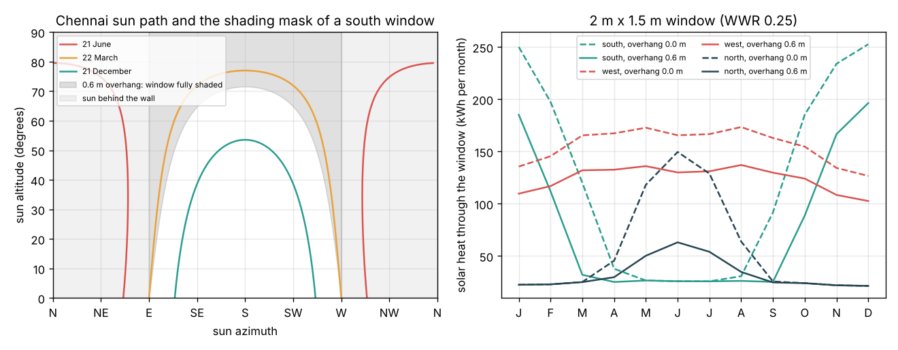

# What you are building toward

A window planner for any Indian city. You enter the latitude, the room and the wall the window can go in. The planner draws the sun path with the shading mask of your overhang and side fins, runs the room hour by hour through a real weather year (with monsoon clouds), maps the daylight point by point across the desk, flags glare, and recommends the orientation, the window-to-wall ratio and the shading that give at least 2 percent daylight factor for the least electricity. Your goal over the coming sessions: add weather data, fins, a daylight map and glare to the Session 3 model, and turn it into a tool a student architect could use.

*Target preview: Chennai sun path with the shading mask of a 0.6 m overhang, and monthly solar heat through south, west and north windows*

The figure above comes from Session 3 (`python start.py 3`); it is the first view of the planner. The full planner is not published; the roadmap shows the path so you can build your own.

Live links:

- [Session 1: the sun path](https://krunalpanchal1995.github.io/pan-iit-oss/opendaylight/session-01/)
- [Session 2: window, overhang and solar gain](https://krunalpanchal1995.github.io/pan-iit-oss/opendaylight/session-02/)
- [Session 3: plan the window for a year](https://krunalpanchal1995.github.io/pan-iit-oss/opendaylight/session-03/)
