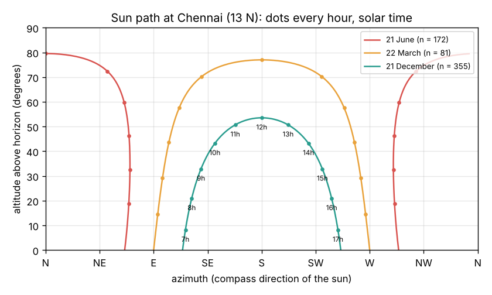
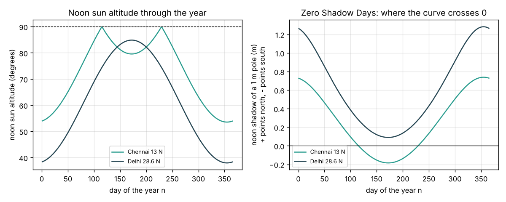

# Session 1: Where is the sun? Sun path, shadows and day length

*Level 1 (conceptual interactive model) · about 60 minutes · opendaylight*

> This is a simplified educational model. It is not a validated design tool and must not be used for real structures, electrical installations, vehicles, industrial processes or medical decisions.

**Prerequisites**

- School trigonometry: sin, cos and tan of an angle in degrees.
- You have read PRIMER.md and run `python start.py 1` once.

**Learning objectives.** After this session you can:

- Explain why the sun is higher in summer than in winter, using the declination.
- Compute the noon sun altitude, 90 - |latitude - declination|, and say whether the noon sun is to the south or the north.
- Find the sun's altitude and azimuth at any hour and draw a sun path.
- Compute the shadow of a pole and the length of the day, and find a Zero Shadow Day.

## A. Real-world problem
An architect in Delhi wants winter sun in a living room and a cool bedroom in May. A builder in Chennai wonders why the sun shines into a north window in June. Before anyone can size or shade a window they must know where the sun is: how high, in which direction, and for how long each day. How do we compute that from nothing more than the latitude, the date and the hour? (General education only: this is a simplified model, not a building design method.)

## B. Concept and theory
The Earth spins about an axis tilted 23.45 degrees from the plane of its orbit. Through the year the latitude where the noon sun is straight overhead moves between 23.45 N (about 21 June) and 23.45 S (about 21 December); that latitude is the **declination** delta. At **solar noon** the sun is in the north-south plane and the angle between the vertical and the sun is the difference phi - delta, so the noon altitude is 90 - |phi - delta|. The sun appears to turn 15 degrees per hour around the Earth's axis; the **hour angle** H = 15 (hour - 12) measures this. Projecting the sun direction onto east, north and up gives the **altitude** (angle above the horizon) and the **azimuth** (compass bearing, measured clockwise from north). A vertical pole of height h casts a shadow h / tan(altitude). Setting the altitude to zero gives the sunrise hour angle and so the day length. Times in this repo are **solar time**: 12:00 is when the sun crosses the meridian, which differs from clock time by up to about half an hour in India.

| Symbol | Meaning | Unit |
|---|---|---|
| n | day of the year (1 = 1 January) | no unit |
| delta | solar declination | degrees |
| phi | latitude (north positive) | degrees |
| H | hour angle, 15 x (solar hour - 12) | degrees |
| alpha | sun altitude above the horizon | degrees |
| A | sun azimuth, clockwise from north (S = 180) | degrees |
| h, L | pole height, shadow length | m |

**Assumptions**

- Cooper's formula for the declination (accurate to about 1 degree).
- Solar time; the equation of time and the time-zone offset are ignored.
- The sun is a point; atmospheric refraction is ignored; the horizon is flat.

$$ \delta = 23.45^\circ \sin\!\left(\frac{360^\circ\,(284+n)}{365}\right) $$

$$ \alpha_{\mathrm{noon}} = 90^\circ - |\varphi - \delta| $$

$$ \sin\alpha = \sin\delta\sin\varphi + \cos\delta\cos\varphi\cos H,\qquad H = 15^\circ\,(t - 12) $$

$$ A = \operatorname{atan2}\big(-\cos\delta\sin H,\ \sin\delta\cos\varphi - \cos\delta\sin\varphi\cos H\big) $$

$$ L = \frac{h}{\tan\alpha},\qquad \cos H_0 = -\tan\varphi\tan\delta,\qquad \text{day length} = \frac{2H_0}{15^\circ}\ \text{h} $$

## C. Visual explanation
The first figure is a **sun-path diagram** for Chennai (13 N): altitude against compass direction on three days, with a dot every hour. On 21 December (green) the sun rises south of east, peaks at 53.6 degrees due south and sets south of west. At the March equinox (orange) it rises due east, peaks at 77 degrees and sets due west. On 21 June (red) it rises north of east and the noon sun, 79.6 degrees high, is to the **north**, because Chennai lies south of the Tropic of Cancer. The second figure follows the noon sun through the year for Chennai and Delhi. Chennai's noon shadow changes direction twice a year: those are its Zero Shadow Days (about 25 April and 17 August in this model; the published dates are 24 April and 18 August). Delhi, north of the tropic, always has its noon shadow pointing north.

*Sun path at Chennai on 21 June, 22 March and 21 December, with hourly dots.*

*Noon sun altitude and noon shadow of a 1 m pole through the year, Chennai and Delhi.*

## D. Interactive simulation
Run the lesson (`python start.py 1`), then open the live app: [Session 1: the sun path](https://krunalpanchal1995.github.io/pan-iit-oss/opendaylight/session-01/) (or `app.html` in this folder). Move the day of the year and watch the path climb and fall. Move the hour and see the sun dot and the shadow of a pole move. Change the latitude from Chennai to Delhi to Srinagar and compare.

**Challenge.** Find a Zero Shadow Day for Chennai: set the latitude to 13 degrees and the hour to 12, then find a day on which the noon shadow of the 1 m pole is shorter than 5 cm.

## E. Worked example and experiment
**Problem.** In Delhi (latitude 28.6 N) on 21 December (n = 355), find the declination, the noon sun altitude, the noon shadow of a 2 m pole and the day length. Then find where the sun is at 9:00 solar time in Chennai (13 N) at the equinox.

1. Declination: 360 x (284 + 355) / 365 = 630.25 degrees, sin(630.25) = -1.000, so delta = -23.45 degrees.
2. Noon altitude = 90 - |28.6 - (-23.45)| = 90 - 52.05 = 37.95 degrees. Since phi > delta the sun is due south.
3. Shadow = 2 / tan(37.95) = 2 / 0.780 = 2.56 m, pointing due north.
4. Day length: cos H0 = -tan(28.6) tan(-23.45) = 0.545 x 0.434 = 0.237, so H0 = 76.3 degrees and the day lasts 2 x 76.3 / 15 = 10.18 h.
5. Chennai, equinox, 9:00: H = -45, delta = 0, so sin(alpha) = cos(13) cos(45) = 0.689, alpha = 43.55 degrees. East part = sin(45) = 0.707, north part = -sin(13) cos(45) = -0.159, so the azimuth is atan2(0.707, -0.159) = 102.7 degrees (just south of east).

**Answer.** delta = -23.45 degrees, noon altitude 37.95 degrees, shadow 2.56 m, day 10.18 h; at 9:00 in Chennai the sun is 43.55 degrees up at azimuth 102.7 degrees.

**Experiment.** Stand a straight stick (a pencil on a book works) on flat ground in the sun and mark the tip of its shadow every 30 minutes from 10:00 to 14:00. The shortest shadow points due north (in winter) and marks solar noon; measure its length and compute the altitude from tan(alpha) = h / L. Compare with the model. Expect a difference of one or two degrees from the sun's size, a stick that is not quite vertical, ground that is not quite flat and Cooper's approximate declination; the clock time of the shortest shadow also differs from 12:00 by the equation of time and your longitude.

## F. Assessment and design challenge
**Question type A: Conceptual.** Why is the noon sun lower in winter than in summer in Delhi, and why can the noon sun be to the north in Chennai but never in Delhi?

Hint

Compare the latitude with the range of the declination, -23.45 to +23.45 degrees.

Step-by-step solution

The noon altitude is 90 - |phi - delta|. In Delhi phi = 28.6, so phi - delta goes from 5.15 (June) to 52.05 (December): the noon sun is high in June and low in December. The noon sun is north of the zenith only when delta > phi. The declination never exceeds 23.45, so this happens only for latitudes below 23.45 N. Chennai (13 N) qualifies from late April to mid August; Delhi (28.6 N) never does.

**Question type B: Numerical.** In Chennai on 21 June (delta = +23.45), find the noon sun altitude, the length and direction of the noon shadow of a 1 m pole, and the day length.

Hint

Noon altitude = 90 - |13 - 23.45|; is phi bigger or smaller than delta?

Step-by-step solution

Altitude = 90 - 10.45 = 79.55 degrees. Shadow = 1 / tan(79.55) = 0.184 m. Because delta > phi the sun is to the north, so the shadow points south. Day length: cos H0 = -tan(13) tan(23.45) = -0.231 x 0.434 = -0.100, H0 = 95.7 degrees, day = 12.77 h. Sanity check: just over 12 h, as expected near the equator in summer.

**Question type C: Graph and simulation interpretation.** On the noon-shadow graph, how many times does the Chennai curve cross zero, and roughly on which days? Why does the Delhi curve never cross zero, and on which day is Delhi's noon shadow longest?

Hint

A zero crossing means the noon sun is exactly overhead: delta = phi.

Step-by-step solution

Chennai crosses twice: about day 115 (25 April) and day 229 (17 August), when the declination passes through 13 degrees on its way up and down. Delhi needs delta = 28.6, which never happens, so its curve stays positive (shadow always to the north). It is longest at the winter solstice, 21 December, when the sun is lowest (37.95 degrees, shadow 1.28 m for a 1 m pole).

**Question type D: Design and optimisation challenge.** Design: a courtyard house in Delhi has a 2.4 m high south wall of the next building 3 m away from your south window. Will the window get noon sun on 21 December? What is the shortest distance that keeps the whole window (sill at ground level) in noon sun on that day? Is the courtyard in shade at noon on 21 June?

Hint

The wall's noon shadow length is 2.4 / tan(alpha); compare it with the 3 m gap.

Step-by-step solution

On 21 December alpha = 37.95 degrees, so the wall's shadow is 2.4 / 0.780 = 3.08 m: it just reaches past the 3 m gap and shades the foot of the window. A gap of at least 3.08 m (say 3.1 m) keeps the whole window in noon sun. On 21 June alpha = 84.85 degrees and the shadow is only 0.22 m, so the courtyard is almost fully sunlit. Trade-off: a wider courtyard gives winter sun but more summer sun on the ground; trees or a pergola can shade it in summer.

Score yourself with [RUBRIC.md](../../RUBRIC.md). Print the [activity sheet](activity_sheet.md) to work on paper.

## Common misconceptions
| Common misconception | What is actually true |
|---|---|
| In India the noon sun is always to the south. | Only north of 23.45 N. In Chennai, Bengaluru or Kochi the noon sun is to the north for part of the summer. |
| The sun always rises due east and sets due west. | Only at the equinoxes. In June it rises north of east, in December south of east. |
| Summer is hotter because the Earth is closer to the sun. | It is the tilt: a higher sun and a longer day. The Earth is actually closest to the sun in early January. |
| 12:00 on the clock is when the sun is highest. | Solar noon differs from clock noon by the longitude offset and the equation of time, up to about 30 minutes in India. |

## Glossary
- **declination**: the latitude where the noon sun is overhead on a given day, between -23.45 and +23.45 degrees
- **altitude**: the angle of the sun above the horizon
- **azimuth**: the compass direction of the sun, measured clockwise from north
- **hour angle**: how far the sun has turned from noon, 15 degrees per hour
- **solar time**: time in which 12:00 is the moment the sun crosses the north-south line
- **Zero Shadow Day**: a day on which the noon sun is straight overhead and vertical objects cast no shadow

## Finish
1. Do the three coding tasks in [exercises.md](exercises.md).
2. Run `python start.py 1` again after your changes. It ends with the checkpoint; when it prints `PASS`, you are done. (Checkpoint only: `python start.py check 1`.)

Next: [Session 2](../session-02/README.md)
