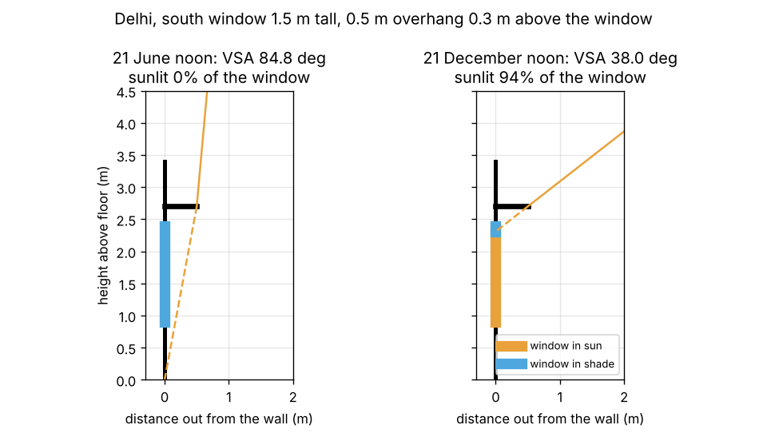
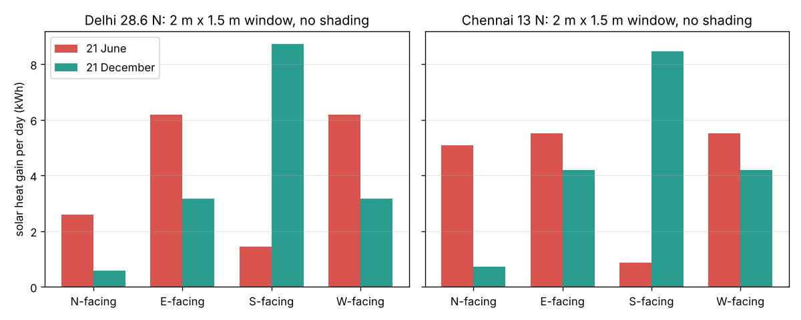

# Session 2: Sunlight on a window, the overhang and solar heat gain

*Level 2 (mathematical engineering model) · about 75 minutes · opendaylight*

> This is a simplified educational model. It is not a validated design tool and must not be used for real structures, electrical installations, vehicles, industrial processes or medical decisions.

**Prerequisites**

- Session 1: sun altitude, azimuth and declination.
- tan and cos of an angle; a power such as 0.7 to the 1.2 (explained in Section B).

**Learning objectives.** After this session you can:

- Compute the angle of incidence of sunlight on a wall of any orientation.
- Use the vertical shadow angle to find the shaded part of a window under an overhang, and size an overhang.
- Estimate clear-sky sunlight with the Meinel model and the solar heat gain through glass.
- Explain why south windows in north India are easy to shade and west windows are not.

## A. Real-world problem
A west-facing bedroom in Chennai is hot every afternoon even with the curtains drawn, while a south-facing living room in Delhi gets pleasant winter sun under its chajja (concrete overhang) and stays shaded in summer. How much sunlight falls on a window that faces a given direction, how deep should the overhang be, and how many watts of heat does the sun push through the glass? (Simplified clear-sky model; not a building design method.)

## B. Concept and theory
A vertical wall faces the compass direction psi of its outward normal (south = 180). The **wall-solar azimuth** gamma = A - psi is how far round the sun is from straight in front. The **angle of incidence** theta between the sun's rays and the wall normal satisfies cos(theta) = cos(alpha) cos(gamma); if this is negative the sun is behind the wall. For shading we cut the wall in section: in that plane the sun ray makes the **vertical shadow angle** (VSA, or profile angle) with tan(VSA) = tan(alpha) / cos(gamma). An overhang of depth P a gap G above a window of height H throws its shadow P tan(VSA) down the wall, so the shaded height is clamp(P tan(VSA) - G, 0, H), and the whole window is shaded once P >= (G + H) / tan(VSA). A high VSA (summer noon on a south wall) is easy to cut off with a short overhang; a low VSA (morning sun on an east wall, afternoon sun on a west wall) needs an impossibly deep one. The strength of sunlight falls when it crosses more air: with air mass AM = 1 / sin(alpha), the Meinel clear-sky model gives the **direct normal irradiance** DNI = 1353 x 0.7^(AM^0.678) W/m2. A vertical wall also sees half of the sky's diffuse light, taken here as 0.05 DNI. The **solar heat gain coefficient** SHGC (0.6 for clear double glazing, roughly 0.8 for single clear glass) is the share of the sunlight hitting the glass that ends up as heat inside.

| Symbol | Meaning | Unit |
|---|---|---|
| psi | direction the wall faces (N 0, E 90, S 180, W 270) | degrees |
| gamma | wall-solar azimuth A - psi | degrees |
| theta | angle of incidence on the wall | degrees |
| VSA | vertical shadow angle in the wall section | degrees |
| P, G, H, b | overhang depth, gap above window, window height, width | m |
| DNI | direct normal irradiance (clear sky) | W/m2 |
| SHGC | solar heat gain coefficient of the glass | no unit |
| Q | solar heat gain through the window | W |

**Assumptions**

- Clear sky every hour; no clouds, dust haze or ground reflection.
- The overhang is at least as wide as the window, so no sun leaks in at the sides.
- One SHGC for all angles (real glass lets in less at very oblique angles).
- Sun position from Session 1 in solar time.

$$ \cos\theta = \cos\alpha\,\cos\gamma,\qquad \gamma = A - \psi $$

$$ \tan(\mathrm{VSA}) = \frac{\tan\alpha}{\cos\gamma} $$

$$ \text{shaded height} = \min\!\big(\max(P\tan(\mathrm{VSA}) - G,\,0),\,H\big),\qquad P_{\mathrm{full}} = \frac{G + H}{\tan(\mathrm{VSA})} $$

$$ \mathrm{DNI} = 1353\times 0.7^{\,(1/\sin\alpha)^{0.678}}\ \mathrm{W/m^2} $$

$$ Q = \mathrm{SHGC}\; b\,H \left[\mathrm{DNI}\cos\theta\;f_{\mathrm{lit}} + 0.05\,\mathrm{DNI}\right] $$

## C. Visual explanation
The first figure cuts through a 1.5 m tall south window in Delhi with a 0.5 m overhang 0.3 m above it. At noon on 21 June the sun is 84.85 degrees up, the shadow of the overhang covers the whole window and only diffuse light enters. At noon on 21 December the sun is 37.95 degrees up, the shadow edge reaches only 0.09 m below the window head and 94 percent of the glass is in sun. The second figure shows a whole clear day's solar heat through a 2 m x 1.5 m unshaded window facing each direction. In Delhi the south window gets 8.7 kWh on a December day but only 1.4 kWh on a June day, while east and west windows get 6.2 kWh in June. In Chennai the north window gets 5.1 kWh in June, more than the south window.

*A 0.5 m overhang in section: full shade at June noon, 94 percent sun at December noon (Delhi).*

*Daily solar heat gain through a 2 m x 1.5 m window facing N, E, S and W in June and December, Delhi and Chennai.*

## D. Interactive simulation
Run the lesson (`python start.py 2`), then open the live app: [Session 2: window, overhang and solar gain](https://krunalpanchal1995.github.io/pan-iit-oss/opendaylight/session-02/) (or `app.html` in this folder). Pick the window direction, the day and the hour, then change the overhang depth. The section view shows the sun ray and the shaded part of the window; the day view shows the heat coming in hour by hour.

**Challenge.** For a south window in Delhi (1.5 m tall, gap 0.3 m), choose an overhang that keeps the window fully shaded at noon on 22 March (day 81) and at least 60 percent sunlit at noon on 21 December (day 355).

## E. Worked example and experiment
**Problem.** A south window in Delhi (28.6 N) is 2 m wide and 1.5 m tall, with a 0.5 m overhang 0.3 m above it; SHGC = 0.6. Find the sunlit share and the solar heat gain at noon on 21 December, and check that the same overhang shades the window at noon on 21 June.

1. From Session 1, the noon altitude on 21 December is 37.95 degrees and the sun is due south, so gamma = 0 and VSA = 37.95 degrees.
2. The overhang's shadow reaches 0.5 x tan(37.95) = 0.5 x 0.780 = 0.390 m down; minus the 0.3 m gap that is 0.090 m of window in shade. Sunlit share = 1 - 0.090 / 1.5 = 0.940.
3. Air mass = 1 / sin(37.95) = 1.626; 1.626^0.678 = 1.391; DNI = 1353 x 0.7^1.391 = 1353 x 0.609 = 824 W/m2.
4. cos(theta) = cos(37.95) = 0.789. Beam on the glass = 824 x 0.789 x 0.940 = 611 W/m2; diffuse = 0.05 x 824 = 41 W/m2.
5. Q = 0.6 x 3.0 m2 x (611 + 41) = 1174 W.
6. 21 June: altitude 84.85 degrees, VSA 84.85, shadow 0.5 x 11.1 = 5.5 m, far more than 0.3 + 1.5 m: fully shaded. Only diffuse enters: Q = 0.6 x 3 x 0.05 x 946 = 85 W.

**Answer.** On the December noon the window is 94 percent sunlit and gains about 1174 W; on the June noon it is fully shaded and gains about 85 W.

**Experiment.** On a sunny day, measure the depth of a chajja over a window at home or at college, and the gap and window height. Mark the edge of its shadow on the wall at a known time and measure how far down the window it reaches. Compute the sun position for that time (Session 1, remember to convert clock time to solar time) and predict the shadow edge with the VSA formula. The difference is usually a few centimetres, from the side edges of the overhang, an approximate wall direction and the conversion from clock time to solar time.

## F. Assessment and design challenge
**Question type A: Conceptual.** Why does an overhang work well on a south window in Delhi but hardly at all on a west window?

Hint

Compare the vertical shadow angle of the high midday sun on a south wall with that of the low afternoon sun on a west wall.

Step-by-step solution

On a south wall the summer sun at midday is high and nearly in front, so the VSA is large (85 degrees at June noon): even a short overhang throws a long shadow down the wall. A west window receives the sun in the late afternoon, when it is low and nearly in front of the wall, so the VSA is small (for example 20 to 35 degrees): the overhang would need to be deeper than the window is tall. West windows need vertical fins, screens (jaalis), trees or simply a smaller size.

**Question type B: Numerical.** A west window in Chennai (13 N) at 16:00 solar time on 21 June: the sun is at altitude 32.44 degrees and azimuth 289.71 degrees. Find gamma, cos(theta), the VSA and the share of a 1.5 m tall window (gap 0.3 m) that a 0.5 m overhang leaves in sun.

Hint

gamma = 289.71 - 270; tan(VSA) = tan(32.44) / cos(gamma).

Step-by-step solution

gamma = 19.71 degrees. cos(theta) = cos(32.44) x cos(19.71) = 0.844 x 0.941 = 0.794. tan(VSA) = 0.636 / 0.941 = 0.675, VSA = 34.0 degrees. Shadow reach = 0.5 x 0.675 = 0.338 m; minus the 0.3 m gap leaves 0.038 m shaded, so 97.5 percent of the window is in sun. Sanity check: the overhang almost does nothing against the low western sun.

**Question type C: Graph and simulation interpretation.** In the daily-gain figure for Delhi, which window direction gains the most in December, and which in June? Why is the north window not zero in June?

Hint

Where does the sun rise and set in June at 28.6 N (Session 1)?

Step-by-step solution

December: the south window (8.7 kWh per day), because the low winter sun is in front of it all day. June: east and west (6.2 kWh each), because the summer sun rises and sets well north of east and west and shines on them at a low angle for hours, while the high noon sun hits the south wall at a glancing angle (1.4 kWh). The north window gets 2.6 kWh in June: early morning and late afternoon sun from the north-east and north-west, plus diffuse light.

**Question type D: Design and optimisation challenge.** Design: choose the overhang depth for the Delhi south window (1.5 m tall, gap 0.3 m) so that it is fully shaded at noon on the equinoxes (22 March and 23 September), when the noon sun altitude is 90 - 28.6 = 61.4 degrees, so that it is shaded at noon all through the hot half of the year. What share of the window is sunlit at noon on 21 December with that overhang? What would a 1 m overhang cost you in winter?

Hint

P = (G + H) / tan(VSA), and for a south wall at noon VSA = altitude.

Step-by-step solution

P = (0.3 + 1.5) / tan(61.4) = 1.8 / 1.834 = 0.98 m. On 21 December: reach = 0.98 x 0.780 = 0.765 m, minus 0.3 gives 0.465 m shaded, so 1 - 0.465 / 1.5 = 0.69 (69 percent) sunlit. A 1 m overhang would leave 68 percent sunlit. Trade-off: a deeper overhang extends the shaded season into early autumn but cuts winter sun; because the sun path is symmetric about the solstice, the overhang treats March (often pleasant) the same as September (often still hot), a seasonal mismatch that adjustable shades or deciduous plants solve.

Score yourself with [RUBRIC.md](../../RUBRIC.md). Print the [activity sheet](activity_sheet.md) to work on paper.

## Common misconceptions
| Common misconception | What is actually true |
|---|---|
| A deeper overhang is always better. | It also blocks winter sun and some daylight; size it for the sun angles you want to block. |
| The sun's altitude decides the overhang. | The vertical shadow angle does; for oblique sun it is larger than the altitude, because tan(VSA) = tan(alpha) / cos(gamma). |
| A north window in India never gets direct sun. | In summer the sun rises and sets north of east and west, and south of 23.45 N the noon sun is to the north. |
| The midday sun is the main heat problem for a south window in summer. | It hits a south wall at a glancing angle; the long, low morning and afternoon sun on east and west windows brings more heat. |

## Glossary
- **angle of incidence**: the angle between the sun's rays and the line straight out from the wall
- **vertical shadow angle (VSA)**: the angle of the sun ray with the ground, seen in a vertical cut through the wall
- **overhang (chajja)**: a horizontal projection above a window that shades it
- **direct normal irradiance (DNI)**: sunlight power per square metre on a surface facing the sun
- **air mass**: how many times thicker the air is along the sun's ray than straight up
- **SHGC**: solar heat gain coefficient, the share of the sunlight on the glass that ends up inside as heat

## Finish
1. Do the three coding tasks in [exercises.md](exercises.md).
2. Run `python start.py 2` again after your changes. It ends with the checkpoint; when it prints `PASS`, you are done. (Checkpoint only: `python start.py check 2`.)

Next: [Session 3](../session-03/README.md)
