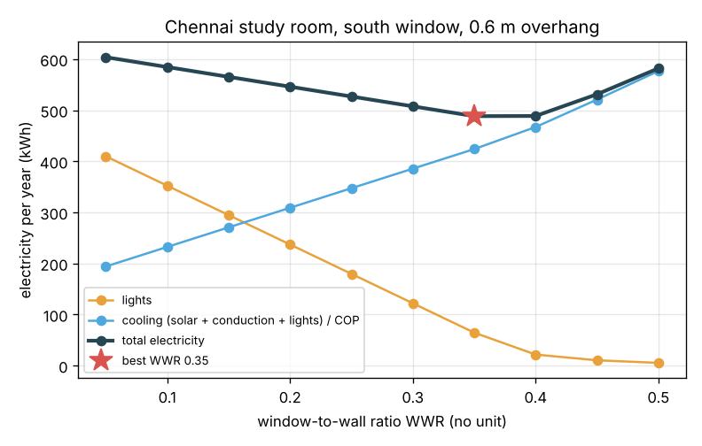
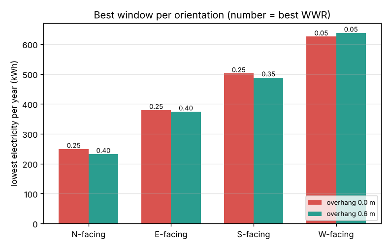
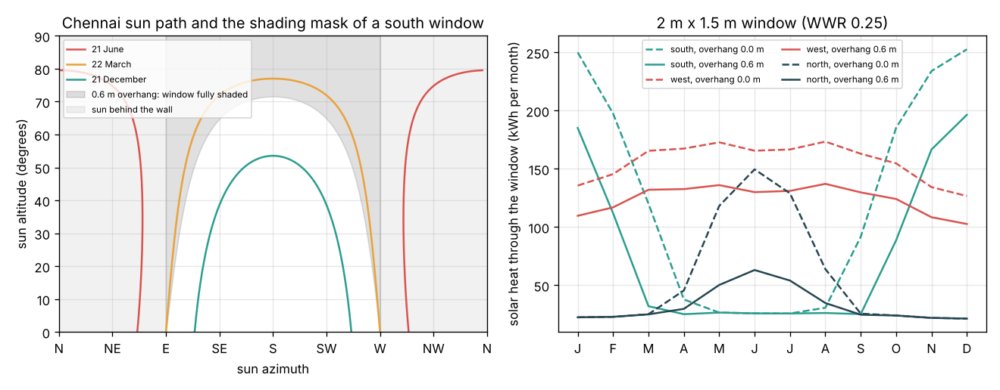

# Session 3: Simulate a year of daylight and heat, then plan the window

*Level 3 (simulation and validation) · about 90 minutes · opendaylight*

> This is a simplified educational model. It is not a validated design tool and must not be used for real structures, electrical installations, vehicles, industrial processes or medical decisions.

**Prerequisites**

- Session 1: sun altitude and azimuth.
- Session 2: angle of incidence, vertical shadow angle, DNI and solar heat gain.
- Idea of adding up many small time steps (explained in Section B).

**Learning objectives.** After this session you can:

- Compute the average daylight factor of a room and the effect of an overhang on it.
- Simulate one year of a room hour by hour: daylight, dimmed lights, solar heat and cooling electricity.
- Validate the simulation with an independent ray test, hand checks, limits and a convergence test.
- Choose the window orientation, size (window-to-wall ratio) and overhang that use the least electricity while giving enough daylight.

## A. Real-world problem
A bigger window gives more daylight, so the lights can stay off longer; but it also lets in more solar heat that an air conditioner must pump out. A tiny window wastes electricity on lights, a glass wall wastes it on cooling. For a 4 m x 5 m study room in Chennai with one outside wall, which direction should the window face, how big should it be and how deep should the overhang be? Can we simulate a whole year, prove the simulation is right, and make the choice with numbers? (A simplified teaching model, not a design tool.)

## B. Concept and theory
The **daylight factor** DF is the indoor illuminance as a percentage of the outdoor illuminance on an unobstructed horizontal surface at the same moment, defined under an overcast sky; 2 percent on average is a common target for a well daylit room. The **average daylight factor** formula (Littlefair, used in British daylighting guidance and many textbooks) is DF = T Aw theta / (A (1 - R^2)): it grows with glass transmittance T, glass area Aw and the visible sky angle theta, and falls with the total room surface area A; the factor 1 / (1 - R^2) accounts for light bouncing round a room with mean reflectance R. An overhang hides part of the sky, so theta drops below 90 degrees to about atan((G + H/2) / P). For the year simulation we step through every day and every quarter hour: the sun position (Session 1), the DNI and the solar heat (Session 2), the indoor daylight E_in = DF / 100 x 120 lm/W x 0.1 DNI, and the **dimmed lights** that top the daylight up to 300 lux on the desk from 9:00 to 17:00. The air conditioner runs during those hours and must remove the solar heat, the extra conduction through glass compared with wall, and the heat of the lights; its electricity is that heat divided by the **COP**. Adding up gives yearly kWh (W x hours / 1000). The **window-to-wall ratio** WWR is the glass area over the facade area (12 m2 here). Validation: the overhang rule is tested against a 3D ray test that never uses the VSA, the energy totals are checked by hand, and limits (tiny window, no overhang, finer time step) must behave as expected.

| Symbol | Meaning | Unit |
|---|---|---|
| DF | average daylight factor | percent |
| T | visible transmittance of the glass (0.7) | no unit |
| Aw | glass area | m2 |
| theta | visible sky angle from the window | degrees |
| A, R | total room surface area (94 m2), mean reflectance (0.5) | m2, no unit |
| WWR | window-to-wall ratio Aw / 12 m2 | no unit |
| E_in | daylight illuminance on the desk | lux |
| LPD | lighting power density (8) | W/m2 of floor |
| COP | coefficient of performance of the air conditioner (3) | no unit |

**Assumptions**

- Clear sky all year (no monsoon clouds); solar time; one window wall, 1.5 m tall windows with a 0.3 m gap to the overhang.
- One average daylight factor for the room; daylight is taken as the diffuse part only (direct sun patches are treated as glare, not useful light).
- Cooling only during use (9:00 to 17:00); the room does not store heat; heat that arrives at other hours is ventilated away.
- Illustrative values: SHGC 0.6, U-values 5.8 (glass) and 2.0 (wall) W/(m2 K), mean outdoor-indoor difference 4 K, COP 3.

$$ \mathrm{DF} = \frac{T\,A_w\,\theta}{A\,(1-R^2)}\ \%,\qquad \theta = \arctan\frac{G + H/2}{P} $$

$$ E_{\mathrm{in}} = \frac{\mathrm{DF}}{100}\times 120\ \tfrac{\mathrm{lm}}{\mathrm{W}}\times 0.1\,\mathrm{DNI} $$

$$ P_{\mathrm{light}} = \mathrm{LPD}\;A_{\mathrm{floor}}\;\max\!\left(0,\ 1 - \frac{E_{\mathrm{in}}}{300\ \mathrm{lux}}\right) $$

$$ E_{\mathrm{total}} = E_{\mathrm{light}} + \frac{Q_{\mathrm{solar}} + (U_g - U_w)A_w\Delta T\,t + E_{\mathrm{light}}}{\mathrm{COP}} $$

$$ \text{energy (kWh)} = \sum \text{power (W)}\times \Delta t\ (\mathrm{h}) / 1000 $$

## C. Visual explanation
Figure 1 shows the trade-off for a south window with a 0.6 m overhang: as the WWR grows from 0.05 to 0.5, lighting falls from 410 to 5 kWh per year and cooling rises from 194 to 577 kWh per year. The total has its lowest point of about 488 kWh at a WWR of 0.35 to 0.40, where the daylight factor is 2.5 to 2.9 percent. Figure 2 repeats the search for each orientation: in Chennai the north window is best (232 kWh with a 0.6 m overhang), then east (374), then south (488), and west is worst (626 to 638 kWh, best with the smallest window, because an overhang does little against the low afternoon sun). Figure 3 is the **window planner**: the Chennai sun path seen from a south window with the shading mask of a 0.6 m overhang (the grey area is where the overhang shades the whole window), and the solar heat per month through a 2 m x 1.5 m window. The south window gets its heat in the cool months (up to 250 kWh in December without shading), the west window all year round, and the north window mainly from May to July.

*Yearly electricity for lights, cooling and total against the window-to-wall ratio (Chennai, south, 0.6 m overhang).*

*Lowest yearly electricity and the best WWR for each orientation, with and without a 0.6 m overhang.*

*Window planner: sun path with the shading mask of the overhang, and monthly solar heat for south, west and north windows.*

## D. Interactive simulation
Run the lesson (`python start.py 3`), then open the live app: [Session 3: plan the window for a year](https://krunalpanchal1995.github.io/pan-iit-oss/opendaylight/session-03/) (or `app.html` in this folder). Choose the latitude, the window direction, the WWR and the overhang. The app simulates the whole year in your browser and shows the room plan with the window, the energy against WWR curve, and the monthly solar heat.

**Challenge.** In Chennai (13 N), find a window with an average daylight factor of at least 2 percent that uses less than 250 kWh of electricity per year.

## E. Worked example and experiment
**Problem.** The Chennai study room (4 m facade, 5 m deep, 3 m high) has a south window with WWR 0.25 (2 m x 1.5 m = 3 m2) and a 0.6 m overhang 0.3 m above it. Find the visible sky angle, the average daylight factor and the yearly electricity, and check the totals by hand.

1. Visible sky angle: theta = atan((0.3 + 0.75) / 0.6) = atan(1.75) = 60.26 degrees.
2. Room surface area: 2 x (4 x 5 + 4 x 3 + 5 x 3) = 94 m2. DF = 0.7 x 3 x 60.26 / (94 x (1 - 0.25)) = 126.5 / 70.5 = 1.79 percent (below the 2 percent target).
3. The year simulation (365 days x 96 quarter hours) gives: solar heat during use 729.1 kWh, lights 179.5 kWh (out of a maximum of 8 W/m2 x 20 m2 x 8 h x 365 = 467 kWh).
4. Conduction by hand: (5.8 - 2.0) x 3 m2 x 4 K x 8 h x 365 days / 1000 = 133.2 kWh.
5. Cooling electricity = (729.1 + 133.2 + 179.5) / 3 = 347.2 kWh. Total = 179.5 + 347.2 = 526.8 kWh per year.
6. Checks: the 3D ray test and the VSA formula agree within 0.0002; halving the time step changes the total by less than 0.01 kWh.

**Answer.** theta = 60.26 degrees, DF = 1.79 percent, total about 527 kWh per year (lights 180, cooling 347).

**Experiment.** With a phone light-meter app (lux), measure the illuminance on a desk in the middle of a room and, at the same moment, outdoors in open shade facing the sky (not in direct sun). Their ratio times 100 is the daylight factor at that point. Measure the window and room sizes and compare with the average daylight factor formula. Expect the measured value near the window to be several times the average and far from the window to be lower: the formula gives a room average and ignores trees, buildings opposite, curtains and dirty glass, and phone sensors are only roughly calibrated.

## Real-world application and mini-project: Plan the window of a study room in Chennai
A student's study room in Chennai (13 N) is 4 m wide, 5 m deep and 3 m high, used from 9:00 to 17:00 with a 300 lux task light that dims when daylight is available, and an air conditioner with COP 3. The single outside wall can face north, east, south or west (the plot allows any). Window heights are 1.5 m with a 0.3 m gap to the overhang; the overhang can be 0, 0.3, 0.6 or 0.9 m deep; the WWR can be 0.05 to 0.5 in steps of 0.05. The room must have an average daylight factor of at least 2 percent. Use `simulate_year` and `plan_window` from Session 3.

**Deliverable:** A script that prints, for each orientation, the best overhang and WWR that meet the 2 percent daylight target and their yearly electricity, names the best overall choice, and saves a figure of total electricity against WWR for that orientation with the 2 percent limit marked.

**Success looks like:** North with a 0.3 m overhang and WWR 0.35 (DF 3.1 percent) at about 223 kWh per year is best; east needs a 0.9 m overhang and WWR 0.45 (about 363 kWh); south 0.9 m and 0.45 (about 436 kWh); west is worst, an unshaded WWR of 0.2 (about 633 kWh). The report notes that the south and east answers sit at the edge of the allowed overhang range, so a deeper overhang or side fins are worth testing.

## F. Assessment and design challenge
**Question type A: Conceptual.** Why is there a best window size, rather than "the bigger the better" or "the smaller the better"?

Hint

Look at how the lighting and cooling curves change with WWR in Figure 1, and where each one stops changing.

Step-by-step solution

Lighting energy falls as the window grows, but only until the daylight reaches 300 lux for most working hours; after that (WWR about 0.4 here) extra glass saves almost nothing. Cooling energy keeps rising roughly in proportion to the glass area, because every extra square metre lets in more solar heat and conduction. The sum of a falling curve that flattens out and a rising line has a minimum in between. The position of the minimum depends on the climate, the orientation, the shading, the glass and the lights.

**Question type B: Numerical.** For the north window of the mini-project (WWR 0.35, 0.3 m overhang 0.3 m above a 1.5 m window), find the glass area, the visible sky angle and the average daylight factor. Does it meet 2 percent?

Hint

Aw = 0.35 x 12 m2; theta = atan((0.3 + 0.75) / 0.3).

Step-by-step solution

Aw = 4.2 m2 (2.8 m x 1.5 m). theta = atan(1.05 / 0.3) = atan(3.5) = 74.05 degrees. DF = 0.7 x 4.2 x 74.05 / (94 x 0.75) = 217.7 / 70.5 = 3.09 percent. Yes, it meets the 2 percent target comfortably. Sanity check: removing the overhang (theta = 90) would give 3.75 percent.

**Question type C: Graph and simulation interpretation.** In Figure 1, by how much do lighting and cooling change from WWR 0.30 to 0.35, and from 0.40 to 0.45? Use this to explain where the minimum lies.

Hint

Read the values: lights 122.0, 64.5, 21.6, 10.4; cooling 385.5, 423.9, 467.0, 520.8 kWh.

Step-by-step solution

From 0.30 to 0.35 lights fall by 57.5 kWh and cooling rises by 38.4 kWh: the total falls by 19.1 kWh, so a bigger window still pays. From 0.40 to 0.45 lights fall by only 11.2 kWh but cooling rises by 53.8 kWh: the total rises by 42.6 kWh. The minimum lies where the two changes balance, between 0.35 and 0.40 (488.3 and 488.6 kWh, practically equal).

**Question type D: Design and optimisation challenge.** Design: your client insists on a west-facing window (the view is to the west) and needs DF of at least 2 percent. Using the model, what is the best you can do with the overhang options 0 to 0.9 m? Suggest two design changes outside the model that would help, and say how you would test them.

Hint

Run `plan_window(13.0, facings=(270,))` and look at what an overhang does to the late-afternoon sun (Session 2, question B).

Step-by-step solution

The best is an unshaded west window with WWR 0.2 (DF 2.14 percent) at about 633 kWh per year, nearly three times the north window. Overhangs reduce the daylight factor more than they cut the low western sun, so they do not help. Better options: vertical fins or a jaali screen that block sun from low westerly angles while keeping part of the view; low-SHGC (solar control) glass, for example 0.3 instead of 0.6; or a tree or a verandah to the west. Test them by adding a fin shading function or changing `shgc` in `simulate_year` and comparing the yearly total, keeping DF at 2 percent or more.

Score yourself with [RUBRIC.md](../../RUBRIC.md). Print the [activity sheet](activity_sheet.md) to work on paper.

## Common misconceptions
| Common misconception | What is actually true |
|---|---|
| A simulation that gives sensible numbers is right. | It must be validated: here with an independent ray test, hand calculations, limits (tiny window) and a convergence test. |
| More daylight always saves energy. | Only until the lights are off most of the time; after that, more glass only adds heat. |
| The best orientation is the same everywhere. | In Chennai north wins; in Delhi a shaded south window is a strong choice because it welcomes winter sun. Climate and latitude decide. |
| An overhang always helps. | It cuts daylight too; against low east and west sun it shades little and can make the total worse. |

## Glossary
- **daylight factor**: indoor illuminance as a percentage of the outdoor illuminance from the sky
- **window-to-wall ratio (WWR)**: glass area divided by the area of the wall it sits in
- **lux**: unit of illuminance, lumens per square metre
- **dimming control**: lights that turn down when daylight supplies part of the needed illuminance
- **COP**: coefficient of performance, heat removed by an air conditioner per unit of electricity
- **shading mask**: the part of the sky, drawn on a sun-path diagram, from which a shade blocks the sun

## Finish
1. Do the three coding tasks in [exercises.md](exercises.md).
2. Run `python start.py 3` again after your changes. It ends with the checkpoint; when it prints `PASS`, you are done. (Checkpoint only: `python start.py check 3`.)

Next: the [roadmap](../../promo/roadmap.md). Session 4 is yours to build.
