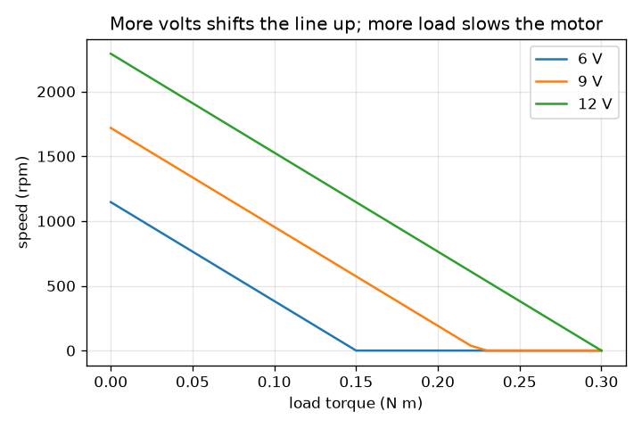
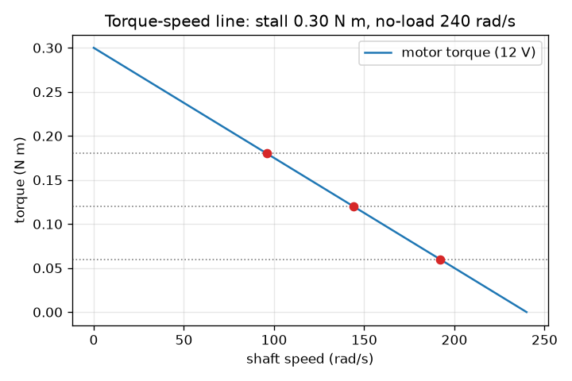

# सत्र 1: अधिक भार, धीमी मोटर: बलाघूर्ण-गति रेखा

*स्तर 1 (वैचारिक इंटरैक्टिव मॉडल) · लगभग 60 मिनट · opendcmotor*

> यह एक सरलीकृत शैक्षिक मॉडल है। यह कोई प्रमाणित डिज़ाइन उपकरण नहीं है और इसका उपयोग वास्तविक संरचनाओं, विद्युत संस्थापनों, वाहनों, औद्योगिक प्रक्रियाओं या चिकित्सा निर्णयों के लिए नहीं किया जाना चाहिए।

**पूर्व-आवश्यकताएँ (Prerequisites)**

- सीधी-रेखा वाला ग्राफ़ पढ़ना।
- आपने PRIMER.md पढ़ लिया है और एक बार `python start.py 1` चला लिया है।

**सीखने के उद्देश्य (Learning objectives)।** इस सत्र के बाद आप:

- समझा सकेंगे कि बलाघूर्ण (torque) और गति (speed) क्या हैं, और rad/s तथा rpm का उपयोग कर सकेंगे।
- मोटर की बलाघूर्ण-गति रेखा से स्टॉल बलाघूर्ण (stall torque) और बिना-भार गति (no-load speed) पढ़ सकेंगे।
- दिए गए भार बलाघूर्ण (load torque) के तहत मोटर की स्थिर गति ज्ञात कर सकेंगे।
- समझा सकेंगे कि आपूर्ति वोल्टेज बदलने पर रेखा का क्या होता है।

## A. वास्तविक जीवन की समस्या
एक छोटी 12 V मोटर खिलौने के पहिये को तेज़ी से घुमाती है। उस पर भारी भार लटकाइए तो वह धीमी हो जाती है। शाफ़्ट को हाथ से पकड़ लीजिए तो वह रुक जाती है, भनभनाती है, और जल्द ही गर्म हो जाती है। गति भार पर कैसे निर्भर करती है, और क्या हम इसे एक सरल चित्र में पकड़ सकते हैं? यहाँ सब कुछ एक सरलीकृत, कम-वोल्टेज शैक्षिक मॉडल है, कोई डिज़ाइन उपकरण नहीं।

## B. अवधारणा और सिद्धांत
बलाघूर्ण शाफ़्ट का मरोड़ने वाला प्रयास है, जिसे न्यूटन मीटर (N m) में मापा जाता है। गति बताती है कि यह कितनी तेज़ घूमता है: रेडियन प्रति सेकंड (rad/s) में या प्रति मिनट चक्करों (rpm) में; एक चक्कर 2 pi रेडियन है, इसलिए rpm = rad/s x 60 / (2 pi)। एक ब्रश वाली DC मोटर (brushed DC motor) की बलाघूर्ण-गति रेखा सीधी होती है। शून्य गति पर (शाफ़्ट पकड़ा हुआ है) मोटर अपना सबसे बड़ा बलाघूर्ण देती है, यानी स्टॉल बलाघूर्ण। जैसे-जैसे यह तेज़ होती है, जो बलाघूर्ण यह दे सकती है वह घटता जाता है, जब तक कि बिना-भार गति पर यह कुछ भी नहीं देती। जब मोटर एक स्थिर भार चलाती है, तो वह वहाँ टिकती है जहाँ भार बलाघूर्ण रेखा से मिलता है। स्टॉल बलाघूर्ण से अधिक भार को घुमाया नहीं जा सकता। आपूर्ति वोल्टेज बढ़ाने से रेखा ऊपर उठती है: स्टॉल बलाघूर्ण और बिना-भार गति दोनों वोल्टेज के अनुपात में बढ़ते हैं (सत्र 2 इसे व्युत्पन्न करता है)। 12 V पर उदाहरण मोटर का स्टॉल बलाघूर्ण 0.30 N m और बिना-भार गति 240 rad/s है।

| प्रतीक | अर्थ | इकाई |
|---|---|---|
| T | मोटर द्वारा दिया गया बलाघूर्ण | N m |
| w | शाफ़्ट की गति | rad/s |
| T_stall | शून्य गति पर बलाघूर्ण | N m |
| w_noload | शून्य बलाघूर्ण पर गति | rad/s |
| T_load | भार द्वारा माँगा गया बलाघूर्ण | N m |
| P | यांत्रिक शक्ति, बलाघूर्ण गुणा गति | W |

**मान्यताएँ (Assumptions)**

- बलाघूर्ण-गति संबंध एक बिल्कुल सीधी रेखा है (आदर्श ब्रश वाली DC मोटर के लिए सत्य, वास्तविक मोटरों के लिए लगभग सत्य)।
- भार बलाघूर्ण स्थिर है और गति का विरोध करता है।
- आपूर्ति वोल्टेज स्थिर और कम है (12 V या उससे कम); तापमान के प्रभावों की उपेक्षा की गई है।

$$ T(\omega)=T_{\mathrm{stall}}\left(1-\frac{\omega}{\omega_{\mathrm{noload}}}\right) $$

$$ \omega=\omega_{\mathrm{noload}}\left(1-\frac{T_{\mathrm{load}}}{T_{\mathrm{stall}}}\right)\quad(T_{\mathrm{load}}<T_{\mathrm{stall}}) $$

$$ \mathrm{rpm}=\omega\,\frac{60}{2\pi} $$

$$ P=T_{\mathrm{load}}\,\omega $$

## C. दृश्य व्याख्या
पहला चित्र 12 V की बलाघूर्ण-गति रेखा दिखाता है, जो विराम पर 0.30 N m से 240 rad/s पर शून्य तक उतरती है, साथ में तीन भार बिंदुदार क्षैतिज रेखाओं के रूप में और वे संचालन बिंदु (operating points) जहाँ वे रेखा से मिलते हैं। दूसरा चित्र 6, 9 और 12 V के लिए भार के विरुद्ध गति आलेखित करता है: तीन लगभग समांतर दिखने वाली रेखाएँ जो भार बढ़ने पर गिरती हैं और वोल्टेज के साथ ऊपर खिसकती हैं। किसी भी चित्र को पढ़ने पर: भारी भार का अर्थ है धीमी मोटर, और मोटर कभी अपनी बिना-भार गति से तेज़ नहीं चलती।

*6, 9 और 12 V के लिए भार के विरुद्ध गति: भारी भार, धीमी मोटर; अधिक वोल्ट, तेज़ मोटर।*

*तीन भारों के संचालन बिंदुओं के साथ 12 V की बलाघूर्ण-गति रेखा।*

## D. इंटरैक्टिव सिमुलेशन
पाठ चलाएँ (`python start.py 1`), फिर लाइव ऐप खोलें: [सत्र 1: भार और गति](https://krunalpanchal1995.github.io/pan-iit-oss/opendcmotor/session-01/) (या इसी फ़ोल्डर में `app.html`)। भार को खिसकाएँ और सुई तथा रेखा पर लाल बिंदु को देखें, फिर वोल्टेज बदलें और रेखा को हिलते देखें। स्टॉल बलाघूर्ण से बड़ा भार आज़माएँ।

**चुनौती।** कम से कम 0.15 N m का भार उठाते हुए शाफ़्ट को 1000 rpm या उससे अधिक पर घुमाएँ।

## E. हल किया गया उदाहरण और प्रयोग
**समस्या।** 12 V मोटर (स्टॉल बलाघूर्ण 0.30 N m, बिना-भार गति 240 rad/s) 0.12 N m का भार चलाती है। rad/s और rpm में इसकी गति, और यांत्रिक शक्ति ज्ञात करें।

1. स्टॉल के भिन्न के रूप में भार: 0.12 / 0.30 = 0.4।
2. गति = 240 x (1 - 0.4) = 144 rad/s।
3. rpm = 144 x 60 / (2 pi) = 1375 rpm (4 अंकों तक, 1375.1)।
4. शक्ति = बलाघूर्ण x गति = 0.12 x 144 = 17.28 W।
5. जाँच (sanity check): गति 0 और 240 rad/s के बीच है, और भार स्टॉल बलाघूर्ण से कम है, इसलिए मोटर घूमती है।

**उत्तर।** 144 rad/s, लगभग 1375 rpm, 17.28 W देते हुए।

**प्रयोग।** एक छोटी हॉबी गियर मोटर और 12 V आपूर्ति लें (किसी वयस्क की मदद से), और फ़ोन के स्ट्रोब ऐप से या चिह्नित चक्कर गिनकर मुक्त घूमने की गति मापें। फिर कपड़े में लिपटी उँगली से शाफ़्ट को हल्का दबाएँ: गति वैसे ही गिरती है जैसा मॉडल कहता है। वास्तविक मोटरें थोड़ी मुड़ी हुई रेखा देती हैं, घर्षण दिखाती हैं और गर्म होती हैं, और भार के तहत वोल्टेज गिरता है। मॉडल केवल मुख्य सीधी-रेखा प्रवृत्ति को रखता है; यह एक कक्षा मॉडल है, किसी विशिष्ट मोटर का माप नहीं।

## F. मूल्यांकन और डिज़ाइन चुनौती
**प्रश्न प्रकार A: वैचारिक।** भार बढ़ने पर मोटर धीमी क्यों हो जाती है? यह कभी बिना-भार गति से तेज़ क्यों नहीं घूमती?

संकेत

सीधी रेखा गति अक्ष को कहाँ काटती है, और वहाँ कितना बलाघूर्ण बचता है?

चरण-दर-चरण हल

मोटर केवल उतना ही बलाघूर्ण दे सकती है जितना रेखा उसकी वर्तमान गति पर अनुमति देती है। भारी भार अधिक बलाघूर्ण माँगता है, जो रेखा केवल कम गति पर देती है, इसलिए मोटर धीमी होकर टिकती है। बिना-भार गति पर रेखा कहती है कि मोटर शून्य बलाघूर्ण देती है, इसलिए उसे और तेज़ धकेलने के लिए कुछ नहीं बचता। इसलिए शून्य भार सबसे अधिक गति देता है, यानी बिना-भार गति।

**प्रश्न प्रकार B: संख्यात्मक।** 12 V मोटर 0.21 N m का भार चलाती है। rad/s और rpm में गति ज्ञात करें। फिर वह भार बलाघूर्ण ज्ञात करें जो ठीक आधी बिना-भार गति देता है।

संकेत

गति = 240 x (1 - भार / 0.30) का उपयोग करें। आधी गति का अर्थ है (1 - भार / 0.30) = 0.5।

चरण-दर-चरण हल

स्टॉल का भिन्न: 0.21 / 0.30 = 0.7, इसलिए गति = 240 x 0.3 = 72 rad/s, जो 72 x 60 / (2 pi) = 687.5 rpm है। आधी बिना-भार गति (120 rad/s) के लिए 1 - भार / 0.30 = 0.5 चाहिए, इसलिए भार = 0.15 N m। जाँच: 0.15 स्टॉल बलाघूर्ण का आधा है, जैसा सीधी रेखा माँगती है।

**प्रश्न प्रकार C: ग्राफ़ और सिमुलेशन की व्याख्या।** गति-बनाम-भार ग्राफ़ में, 12 V रेखा की तुलना में 6 V रेखा क्या करती है? हर एक किस भार पर शून्य गति पर पहुँचती है?

संकेत

याद रखें कि स्टॉल बलाघूर्ण और बिना-भार गति दोनों वोल्टेज के साथ बढ़ते-घटते हैं।

चरण-दर-चरण हल

6 V रेखा आधी गति से शुरू होती है (बिना भार पर 2292 rpm के मुक़ाबले 1146 rpm) और आधे भार पर, 0.30 N m के बजाय 0.15 N m पर, शून्य गति पर पहुँचती है। 9 V रेखा बीच में है, 0.225 N m पर स्टॉल होती है। तो कम वोल्टेज शीर्ष गति और मोटर द्वारा उठाए जा सकने वाले भार, दोनों को घटा देता है।

**प्रश्न प्रकार D: डिज़ाइन और अनुकूलन (optimisation) चुनौती।** एक भार को कम से कम 1000 rpm (104.7 rad/s) पर 0.15 N m चाहिए। क्या 12 V मोटर यह कर सकती है? 0.5 V के कदमों में सबसे कम वोल्टेज कौन-सा है जो यह करता है?

संकेत

वोल्टेज V पर रेखा का स्टॉल बलाघूर्ण 0.025 V और बिना-भार गति 20 V है। गति = 20 V (1 - 0.15 / (0.025 V)) >= 104.7 हल करें।

चरण-दर-चरण हल

12 V पर गति 240 x (1 - 0.15 / 0.30) = 120 rad/s = 1146 rpm है, जो 1000 rpm से ऊपर है, इसलिए हाँ। वोल्टेज V पर गति 20 V - 120 है, इसलिए 20 V - 120 >= 104.7 से V >= 11.24 मिलता है; 0.5 V के कदमों में सबसे कम वोल्टेज 11.5 V है। समझौता (trade-off): तब मोटर अपनी सीमाओं के पास चलती है; बड़े स्टॉल बलाघूर्ण वाली मोटर ठंडी चलेगी।

[RUBRIC.md](../../RUBRIC.md) से स्वयं को अंक दें। काग़ज़ पर काम करने के लिए [गतिविधि पत्रक (activity sheet)](activity_sheet.md) प्रिंट करें।

## सामान्य भ्रांतियाँ (Common misconceptions)
| सामान्य भ्रांति | वास्तव में क्या सच है |
|---|---|
| एक मोटर की एक ही निश्चित गति होती है। | मोटर की हर भार के लिए एक गति होती है; भार बढ़ने पर गति एक रेखा के साथ गिरती है। |
| अधिक भार हमेशा अधिक शक्ति देता है। | शक्ति बलाघूर्ण गुणा गति है। यह बिना भार पर शून्य और स्टॉल पर शून्य है, और बीच में सबसे बड़ी है (यहाँ 0.15 N m पर 18 W)। |
| बलाघूर्ण और गति एक ही चीज़ हैं। | बलाघूर्ण मरोड़ने का प्रयास है (N m); गति घूमने की दर है (rad/s या rpm)। रेखा एक के बदले दूसरा देती है। |
| स्टॉल हुई मोटर सुरक्षित है क्योंकि वह चल नहीं रही। | स्टॉल हुई मोटर फिर भी अपनी सबसे बड़ी धारा (current) खींचती है और उसे पूरी तरह ऊष्मा में बदल देती है। सत्र 3 दिखाता है कितनी। |

## शब्दावली (Glossary)
- **बलाघूर्ण (torque)**: शाफ़्ट का मरोड़ने वाला प्रयास, न्यूटन मीटर (N m) में
- **rad/s**: रेडियन प्रति सेकंड; एक पूरा चक्कर 2 pi रेडियन है
- **rpm**: प्रति मिनट चक्कर (revolutions per minute)
- **स्टॉल बलाघूर्ण (stall torque)**: शून्य गति पर बलाघूर्ण, मोटर जितना अधिकतम दे सकती है
- **बिना-भार गति (no-load speed)**: घुमाने को कुछ न होने पर गति, मोटर जितनी अधिकतम पहुँच सकती है
- **संचालन बिंदु (operating point)**: वह गति और बलाघूर्ण जहाँ मोटर रेखा और भार मिलते हैं

## समापन
1. [exercises.md](exercises.md) में दिए गए तीन कोडिंग कार्य करें।
2. अपने बदलावों के बाद `python start.py 1` फिर से चलाएँ। यह चेकपॉइंट के साथ समाप्त होता है; जब यह `PASS` छापे, तो आपका काम पूरा हो गया। (केवल चेकपॉइंट: `python start.py check 1`।)

आगे: [सत्र 2](../session-02/README.md)
