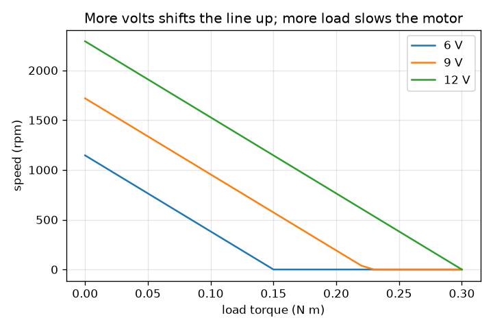
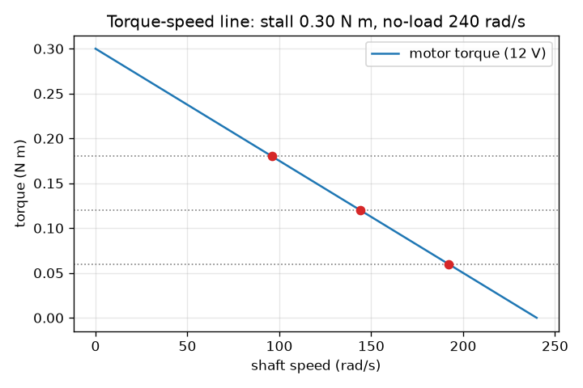

# സെഷൻ 1: കൂടുതൽ ഭാരം, മന്ദഗതിയിലുള്ള മോട്ടോർ: ടോർക്ക്-വേഗ രേഖ

[Session 1 — हिन्दी](README.hi.md) · [Session 1 — മലയാളം](README.ml.md)

*ലെവൽ 1 (ആശയപരമായ ഇന്ററാക്ടീവ് മോഡൽ) · ഏകദേശം 60 മിനിറ്റ് · opendcmotor*

> ഇത് ലളിതമാക്കിയ ഒരു വിദ്യാഭ്യാസ മോഡലാണ്. ഇത് സാധൂകരിക്കപ്പെട്ട (validated) ഡിസൈൻ ഉപകരണമല്ല; യഥാർത്ഥ ഘടനകൾ, വൈദ്യുത സംവിധാനങ്ങൾ, വാഹനങ്ങൾ, വ്യാവസായിക പ്രക്രിയകൾ അല്ലെങ്കിൽ വൈദ്യശാസ്ത്ര തീരുമാനങ്ങൾ എന്നിവയ്ക്ക് ഇത് ഉപയോഗിക്കരുത്.

**മുൻ‌അറിവ് (Prerequisites)**

- ഒരു നേർരേഖാ ഗ്രാഫ് വായിക്കൽ.
- നിങ്ങൾ PRIMER.md വായിക്കുകയും `python start.py 1` ഒരിക്കൽ പ്രവർത്തിപ്പിക്കുകയും ചെയ്തിട്ടുണ്ട്.

**പഠന ലക്ഷ്യങ്ങൾ (Learning objectives).** ഈ സെഷനു ശേഷം നിങ്ങൾക്ക് കഴിയും:

- ടോർക്ക് (torque), വേഗം (speed) എന്നിവ എന്താണെന്ന് വിശദീകരിക്കാനും rad/s, rpm എന്നിവ ഉപയോഗിക്കാനും.
- ഒരു മോട്ടോറിന്റെ ടോർക്ക്-വേഗ രേഖയിൽ നിന്ന് സ്റ്റാൾ ടോർക്കും (stall torque) നോ-ലോഡ് വേഗവും (no-load speed) വായിക്കാൻ.
- ഒരു നിശ്ചിത ലോഡ് ടോർക്കിനു കീഴിൽ മോട്ടോറിന്റെ സ്ഥിര വേഗം കണ്ടെത്താൻ.
- സപ്ലൈ വോൾട്ടേജ് മാറുമ്പോൾ രേഖയ്ക്ക് എന്തു സംഭവിക്കുന്നു എന്ന് വിശദീകരിക്കാൻ.

## A. യഥാർത്ഥ ലോക പ്രശ്നം
ഒരു ചെറിയ 12 V മോട്ടോർ ഒരു കളിപ്പാട്ട ചക്രം വേഗത്തിൽ കറക്കുന്നു. അതിൽ ഒരു ഭാരമുള്ള ലോഡ് തൂക്കിയാൽ അത് മന്ദഗതിയിലാകുന്നു. ഷാഫ്റ്റ് കൈകൊണ്ട് പിടിച്ചാൽ അത് നിൽക്കുന്നു, മൂളുന്നു, ഉടൻ ചൂടാകുന്നു. വേഗം ലോഡിനെ എങ്ങനെ ആശ്രയിക്കുന്നു, അത് ഒരൊറ്റ ലളിതമായ ചിത്രത്തിൽ പകർത്താൻ കഴിയുമോ? ഇവിടെയുള്ളതെല്ലാം ലളിതമാക്കിയ, കുറഞ്ഞ വോൾട്ടേജ് വിദ്യാഭ്യാസ മോഡലാണ്, ഡിസൈൻ ഉപകരണമല്ല.

## B. ആശയവും സിദ്ധാന്തവും
ടോർക്ക് എന്നത് ഒരു ഷാഫ്റ്റിന്റെ തിരിക്കൽ ശ്രമമാണ്, ന്യൂട്ടൺ മീറ്ററിൽ (N m) അളക്കുന്നു. വേഗം എന്നത് അത് എത്ര വേഗത്തിൽ തിരിയുന്നു എന്നതാണ്: റേഡിയൻ പെർ സെക്കൻഡിൽ (rad/s) അല്ലെങ്കിൽ റെവല്യൂഷൻസ് പെർ മിനിറ്റിൽ (rpm); ഒരു തിരിവ് 2 pi റേഡിയനാണ്, അതിനാൽ rpm = rad/s x 60 / (2 pi). ഒരു ബ്രഷ്ഡ് DC മോട്ടോറിന് (brushed DC motor) നേരായ ടോർക്ക്-വേഗ രേഖയുണ്ട്. പൂജ്യം വേഗത്തിൽ (ഷാഫ്റ്റ് പിടിച്ചിരിക്കുമ്പോൾ) മോട്ടോർ അതിന്റെ ഏറ്റവും വലിയ ടോർക്ക്, സ്റ്റാൾ ടോർക്ക്, നൽകുന്നു. വേഗം കൂടുമ്പോൾ അതിന് നൽകാവുന്ന ടോർക്ക് കുറയുന്നു, നോ-ലോഡ് വേഗത്തിൽ ഒട്ടും നൽകുന്നില്ല. മോട്ടോർ ഒരു സ്ഥിര ലോഡ് ഓടിക്കുമ്പോൾ, ലോഡ് ടോർക്ക് രേഖയെ കണ്ടുമുട്ടുന്നിടത്ത് അത് ഉറയ്ക്കുന്നു. സ്റ്റാൾ ടോർക്കിനു മുകളിലുള്ള ലോഡ് തിരിക്കാൻ കഴിയില്ല. സപ്ലൈ വോൾട്ടേജ് ഉയർത്തുന്നത് രേഖയെ ഉയർത്തുന്നു: സ്റ്റാൾ ടോർക്കും നോ-ലോഡ് വേഗവും വോൾട്ടേജിന് ആനുപാതികമായി വളരുന്നു (സെഷൻ 2 ഇത് വ്യുൽപ്പാദിപ്പിക്കുന്നു). 12 V-ലെ ഉദാഹരണ മോട്ടോറിന് 0.30 N m സ്റ്റാൾ ടോർക്കും 240 rad/s നോ-ലോഡ് വേഗവുമുണ്ട്.

| ചിഹ്നം | അർത്ഥം | യൂണിറ്റ് |
|---|---|---|
| T | മോട്ടോർ നൽകുന്ന ടോർക്ക് | N m |
| w | ഷാഫ്റ്റ് വേഗം | rad/s |
| T_stall | പൂജ്യം വേഗത്തിലെ ടോർക്ക് | N m |
| w_noload | പൂജ്യം ടോർക്കിലെ വേഗം | rad/s |
| T_load | ലോഡ് ആവശ്യപ്പെടുന്ന ടോർക്ക് | N m |
| P | യാന്ത്രിക പവർ, ടോർക്ക് ഗുണം വേഗം | W |

**അനുമാനങ്ങൾ (Assumptions)**

- ടോർക്ക്-വേഗ ബന്ധം കൃത്യമായ ഒരു നേർരേഖയാണ് (ആദർശ ബ്രഷ്ഡ് DC മോട്ടോറിന് ശരി, യഥാർത്ഥ മോട്ടോറുകൾക്ക് ഏകദേശം ശരി).
- ലോഡ് ടോർക്ക് സ്ഥിരമാണ്, ചലനത്തെ എതിർക്കുന്നു.
- സപ്ലൈ വോൾട്ടേജ് സ്ഥിരവും കുറഞ്ഞതുമാണ് (12 V അല്ലെങ്കിൽ അതിൽ കുറവ്); താപനിലാ ഫലങ്ങൾ അവഗണിക്കുന്നു.

$$ T(\omega)=T_{\mathrm{stall}}\left(1-\frac{\omega}{\omega_{\mathrm{noload}}}\right) $$

$$ \omega=\omega_{\mathrm{noload}}\left(1-\frac{T_{\mathrm{load}}}{T_{\mathrm{stall}}}\right)\quad(T_{\mathrm{load}}<T_{\mathrm{stall}}) $$

$$ \mathrm{rpm}=\omega\,\frac{60}{2\pi} $$

$$ P=T_{\mathrm{load}}\,\omega $$

## C. ദൃശ്യ വിശദീകരണം
ആദ്യ ചിത്രം നിശ്ചലാവസ്ഥയിലെ 0.30 N m-ൽ നിന്ന് 240 rad/s-ൽ പൂജ്യത്തിലേക്ക് താഴുന്ന 12 V ടോർക്ക്-വേഗ രേഖ കാണിക്കുന്നു; മൂന്ന് ലോഡുകൾ ഡോട്ടഡ് തിരശ്ചീന രേഖകളായും അവ രേഖയെ കണ്ടുമുട്ടുന്ന പ്രവർത്തന ബിന്ദുക്കളും (operating points) വരച്ചിരിക്കുന്നു. രണ്ടാമത്തെ ചിത്രം 6, 9, 12 V-ന് ലോഡിനെതിരെ വേഗം പ്ലോട്ട് ചെയ്യുന്നു: ലോഡ് കൂടുമ്പോൾ താഴുകയും വോൾട്ടേജിനൊപ്പം മുകളിലേക്ക് നീങ്ങുകയും ചെയ്യുന്ന, സമാന്തരമെന്ന് തോന്നുന്ന മൂന്ന് രേഖകൾ. ഏത് ചിത്രം വായിച്ചാലും: ഭാരമേറിയ ലോഡ് എന്നാൽ മന്ദഗതിയിലുള്ള മോട്ടോർ, ഒരു മോട്ടോർ ഒരിക്കലും അതിന്റെ നോ-ലോഡ് വേഗത്തേക്കാൾ വേഗത്തിൽ ഓടുന്നില്ല.

*6, 9, 12 V-ന് ലോഡിനെതിരെ വേഗം: ഭാരമേറിയ ലോഡ്, മന്ദഗതിയിലുള്ള മോട്ടോർ; കൂടുതൽ വോൾട്ട്, വേഗതയേറിയ മോട്ടോർ.*

*മൂന്ന് ലോഡുകളുടെ പ്രവർത്തന ബിന്ദുക്കളോടുകൂടിയ 12 V ടോർക്ക്-വേഗ രേഖ.*

## D. ഇന്ററാക്ടീവ് സിമുലേഷൻ
പാഠം പ്രവർത്തിപ്പിക്കുക (`python start.py 1`), തുടർന്ന് ലൈവ് ആപ്പ് തുറക്കുക: [സെഷൻ 1: ലോഡും വേഗവും](https://krunalpanchal1995.github.io/pan-iit-oss/opendcmotor/session-01/) (അല്ലെങ്കിൽ ഈ ഫോൾഡറിലെ `app.html`). ലോഡ് സ്ലൈഡ് ചെയ്ത് സൂചിയും രേഖയിലെ ചുവന്ന ബിന്ദുവും നിരീക്ഷിക്കുക, തുടർന്ന് വോൾട്ടേജ് മാറ്റി രേഖ നീങ്ങുന്നത് കാണുക. സ്റ്റാൾ ടോർക്കിനേക്കാൾ വലിയ ഒരു ലോഡ് പരീക്ഷിക്കുക.

**വെല്ലുവിളി.** കുറഞ്ഞത് 0.15 N m ലോഡ് വഹിച്ചുകൊണ്ട് ഷാഫ്റ്റ് 1000 rpm-ലോ അതിൽ കൂടുതലോ തിരിയുന്നതാക്കുക.

## E. ഉദാഹരണ പ്രശ്നവും പരീക്ഷണവും
**പ്രശ്നം.** 12 V മോട്ടോർ (സ്റ്റാൾ ടോർക്ക് 0.30 N m, നോ-ലോഡ് വേഗം 240 rad/s) 0.12 N m ലോഡ് ഓടിക്കുന്നു. അതിന്റെ വേഗം rad/s-ലും rpm-ലും, യാന്ത്രിക പവറും കണ്ടെത്തുക.

1. സ്റ്റാളിന്റെ ഭിന്നസംഖ്യയായി ലോഡ്: 0.12 / 0.30 = 0.4.
2. വേഗം = 240 x (1 - 0.4) = 144 rad/s.
3. rpm = 144 x 60 / (2 pi) = 1375 rpm (4 അക്കങ്ങൾ വരെ, 1375.1).
4. പവർ = ടോർക്ക് x വേഗം = 0.12 x 144 = 17.28 W.
5. യുക്തിപരിശോധന (sanity check): വേഗം 0-നും 240 rad/s-നും ഇടയിലാണ്, ലോഡ് സ്റ്റാൾ ടോർക്കിന് താഴെയാണ്, അതിനാൽ മോട്ടോർ തിരിയുന്നു.

**ഉത്തരം.** 144 rad/s, ഏകദേശം 1375 rpm, 17.28 W നൽകുന്നു.

**പരീക്ഷണം.** ഒരു ചെറിയ ഹോബി ഗിയർ മോട്ടോറും 12 V സപ്ലൈയും എടുക്കുക (മുതിർന്നവരുടെ സഹായത്തോടെ), ഒരു ഫോൺ സ്ട്രോബ് ആപ്പ് ഉപയോഗിച്ചോ അടയാളപ്പെടുത്തിയ തിരിവുകൾ എണ്ണിയോ സ്വതന്ത്രമായി ഓടുന്ന വേഗം അളക്കുക. തുടർന്ന് തുണിയിൽ പൊതിഞ്ഞ ഒരു വിരൽ കൊണ്ട് ഷാഫ്റ്റിൽ ലഘുവായി അമർത്തുക: മോഡൽ പറയുന്നതുപോലെ വേഗം കുറയുന്നു. യഥാർത്ഥ മോട്ടോറുകൾ അല്പം വളഞ്ഞ രേഖ നൽകുന്നു, ഘർഷണം കാണിക്കുന്നു, ചൂടാകുന്നു, ലോഡിനു കീഴിൽ വോൾട്ടേജ് താഴുന്നു. മോഡൽ പ്രധാന നേർരേഖാ പ്രവണത മാത്രം നിലനിർത്തുന്നു; ഇത് ഒരു ക്ലാസ്റൂം മോഡലാണ്, ഏതെങ്കിലും പ്രത്യേക മോട്ടോറിന്റെ അളവല്ല.

## F. മൂല്യനിർണ്ണയവും ഡിസൈൻ വെല്ലുവിളിയും
**ചോദ്യ തരം A: ആശയപരം.** ലോഡ് കൂടുമ്പോൾ മോട്ടോർ എന്തുകൊണ്ട് മന്ദഗതിയിലാകുന്നു? അത് എന്തുകൊണ്ട് ഒരിക്കലും നോ-ലോഡ് വേഗത്തേക്കാൾ വേഗത്തിൽ തിരിയുന്നില്ല?

സൂചന

നേർരേഖ വേഗ അക്ഷത്തെ എവിടെ മുറിച്ചുകടക്കുന്നു, അവിടെ എന്ത് ടോർക്ക് ബാക്കിയുണ്ട്?

ഘട്ടം ഘട്ടമായുള്ള പരിഹാരം

മോട്ടോറിന് അതിന്റെ നിലവിലെ വേഗത്തിൽ രേഖ അനുവദിക്കുന്ന ടോർക്ക് മാത്രമേ നൽകാൻ കഴിയൂ. ഭാരമേറിയ ലോഡ് കൂടുതൽ ടോർക്ക് ആവശ്യപ്പെടുന്നു, അത് രേഖ കുറഞ്ഞ വേഗത്തിൽ മാത്രം നൽകുന്നു, അതിനാൽ മോട്ടോർ മന്ദഗതിയിൽ ഉറയ്ക്കുന്നു. നോ-ലോഡ് വേഗത്തിൽ മോട്ടോർ പൂജ്യം ടോർക്ക് നൽകുന്നു എന്ന് രേഖ പറയുന്നു, അതിനാൽ അതിനെ കൂടുതൽ വേഗത്തിൽ തള്ളാൻ ഒന്നും ബാക്കിയില്ല. അതിനാൽ പൂജ്യം ലോഡ് ഏറ്റവും ഉയർന്ന വേഗം, നോ-ലോഡ് വേഗം, നൽകുന്നു.

**ചോദ്യ തരം B: സംഖ്യാപരം.** 12 V മോട്ടോർ 0.21 N m ലോഡ് ഓടിക്കുന്നു. വേഗം rad/s-ലും rpm-ലും കണ്ടെത്തുക. തുടർന്ന് നോ-ലോഡ് വേഗത്തിന്റെ കൃത്യം പകുതി നൽകുന്ന ലോഡ് ടോർക്ക് കണ്ടെത്തുക.

സൂചന

വേഗം = 240 x (1 - ലോഡ് / 0.30) ഉപയോഗിക്കുക. പകുതി വേഗം എന്നാൽ (1 - ലോഡ് / 0.30) = 0.5.

ഘട്ടം ഘട്ടമായുള്ള പരിഹാരം

സ്റ്റാളിന്റെ ഭിന്നസംഖ്യ: 0.21 / 0.30 = 0.7, അതിനാൽ വേഗം = 240 x 0.3 = 72 rad/s, അതായത് 72 x 60 / (2 pi) = 687.5 rpm. നോ-ലോഡ് വേഗത്തിന്റെ പകുതിക്ക് (120 rad/s) 1 - ലോഡ് / 0.30 = 0.5 വേണം, അതിനാൽ ലോഡ് = 0.15 N m. യുക്തിപരിശോധന: നേർരേഖ ആവശ്യപ്പെടുന്നതുപോലെ 0.15 സ്റ്റാൾ ടോർക്കിന്റെ പകുതിയാണ്.

**ചോദ്യ തരം C: ഗ്രാഫ്, സിമുലേഷൻ വ്യാഖ്യാനം.** വേഗം-ലോഡ് ഗ്രാഫിൽ, 12 V രേഖയുമായി താരതമ്യം ചെയ്യുമ്പോൾ 6 V രേഖ എന്തു ചെയ്യുന്നു? ഓരോന്നും ഏത് ലോഡിൽ പൂജ്യം വേഗത്തിൽ എത്തുന്നു?

സൂചന

സ്റ്റാൾ ടോർക്കും നോ-ലോഡ് വേഗവും വോൾട്ടേജിനൊപ്പം സ്കെയിൽ ചെയ്യുന്നു എന്ന് ഓർക്കുക.

ഘട്ടം ഘട്ടമായുള്ള പരിഹാരം

6 V രേഖ പകുതി വേഗത്തിൽ തുടങ്ങുന്നു (നോ-ലോഡിൽ 2292 rpm-നെതിരെ 1146 rpm), പകുതി ലോഡിൽ പൂജ്യം വേഗത്തിലെത്തുന്നു, 0.30 N m-ന് പകരം 0.15 N m. 9 V രേഖ ഇടയിലാണ്, 0.225 N m-ൽ സ്റ്റാൾ ആകുന്നു. അതിനാൽ കുറഞ്ഞ വോൾട്ടേജ് ഉയർന്ന വേഗവും മോട്ടോറിന് വഹിക്കാവുന്ന ലോഡും ചുരുക്കുന്നു.

**ചോദ്യ തരം D: ഡിസൈൻ, ഒപ്റ്റിമൈസേഷൻ വെല്ലുവിളി.** ഒരു ലോഡിന് 1000 rpm-ൽ (104.7 rad/s) കുറയാതെ 0.15 N m വേണം. 12 V മോട്ടോറിന് അത് ചെയ്യാൻ കഴിയുമോ? 0.5 V ചുവടുകളിൽ അത് ചെയ്യുന്ന ഏറ്റവും കുറഞ്ഞ വോൾട്ടേജ് ഏതാണ്?

സൂചന

വോൾട്ടേജ് V-ൽ രേഖയ്ക്ക് സ്റ്റാൾ ടോർക്ക് 0.025 V-ഉം നോ-ലോഡ് വേഗം 20 V-ഉം ആണ്. വേഗം = 20 V (1 - 0.15 / (0.025 V)) >= 104.7 പരിഹരിക്കുക.

ഘട്ടം ഘട്ടമായുള്ള പരിഹാരം

12 V-ൽ വേഗം 240 x (1 - 0.15 / 0.30) = 120 rad/s = 1146 rpm, ഇത് 1000 rpm-ന് മുകളിലാണ്, അതിനാൽ കഴിയും. വോൾട്ടേജ് V-ലെ വേഗം 20 V - 120 ആണ്, അതിനാൽ 20 V - 120 >= 104.7 എന്നത് V >= 11.24 നൽകുന്നു; 0.5 V ചുവടുകളിൽ ഏറ്റവും കുറഞ്ഞ വോൾട്ടേജ് 11.5 V ആണ്. വിട്ടുവീഴ്ച (trade-off): അപ്പോൾ മോട്ടോർ അതിന്റെ പരിധികൾക്ക് അടുത്താണ് ഓടുന്നത്; വലിയ സ്റ്റാൾ ടോർക്കുള്ള ഒരു മോട്ടോർ തണുത്ത് ഓടും.

[RUBRIC.md](../../RUBRIC.md) ഉപയോഗിച്ച് സ്വയം സ്കോർ ചെയ്യുക. പേപ്പറിൽ ചെയ്യാൻ [പ്രവർത്തന ഷീറ്റ്](activity_sheet.md) പ്രിന്റ് ചെയ്യുക.

## സാധാരണ തെറ്റിദ്ധാരണകൾ
| സാധാരണ തെറ്റിദ്ധാരണ | യഥാർത്ഥത്തിൽ ശരിയായത് |
|---|---|
| ഒരു മോട്ടോറിന് ഒരു നിശ്ചിത വേഗം മാത്രമേയുള്ളൂ. | ഒരു മോട്ടോറിന് ഓരോ ലോഡിനും ഒരു വേഗമുണ്ട്; ലോഡ് ഉയരുമ്പോൾ വേഗം ഒരു രേഖയിലൂടെ കുറയുന്നു. |
| കൂടുതൽ ലോഡ് എപ്പോഴും കൂടുതൽ പവർ നൽകുന്നു. | പവർ എന്നത് ടോർക്ക് ഗുണം വേഗമാണ്. അത് നോ-ലോഡിൽ പൂജ്യവും സ്റ്റാളിൽ പൂജ്യവുമാണ്, ഇടയിൽ ഏറ്റവും വലുത് (ഇവിടെ 0.15 N m-ൽ 18 W). |
| ടോർക്കും വേഗവും ഒന്നുതന്നെയാണ്. | ടോർക്ക് തിരിക്കൽ ശ്രമമാണ് (N m); വേഗം തിരിയൽ നിരക്കാണ് (rad/s അല്ലെങ്കിൽ rpm). രേഖ ഒന്നിനെ മറ്റൊന്നിനായി കൈമാറുന്നു. |
| സ്റ്റാൾ ആയ മോട്ടോർ നീങ്ങാത്തതിനാൽ സുരക്ഷിതമാണ്. | സ്റ്റാൾ ആയ മോട്ടോർ ഇപ്പോഴും അതിന്റെ ഏറ്റവും വലിയ കറന്റ് വലിക്കുകയും അതെല്ലാം താപമാക്കി മാറ്റുകയും ചെയ്യുന്നു. എത്രയാണെന്ന് സെഷൻ 3 കാണിക്കുന്നു. |

## പദാവലി (Glossary)
- **ടോർക്ക് (torque)**: ഒരു ഷാഫ്റ്റിന്റെ തിരിക്കൽ ശ്രമം, ന്യൂട്ടൺ മീറ്ററിൽ (N m)
- **rad/s**: റേഡിയൻ പെർ സെക്കൻഡ്; ഒരു പൂർണ്ണ തിരിവ് 2 pi റേഡിയനാണ്
- **rpm**: റെവല്യൂഷൻസ് പെർ മിനിറ്റ്
- **സ്റ്റാൾ ടോർക്ക് (stall torque)**: പൂജ്യം വേഗത്തിലെ ടോർക്ക്, മോട്ടോറിന് നൽകാവുന്ന പരമാവധി
- **നോ-ലോഡ് വേഗം (no-load speed)**: തിരിക്കാൻ ഒന്നുമില്ലാത്തപ്പോഴുള്ള വേഗം, മോട്ടോറിന് എത്താവുന്ന പരമാവധി
- **പ്രവർത്തന ബിന്ദു (operating point)**: മോട്ടോർ രേഖയും ലോഡും കണ്ടുമുട്ടുന്ന വേഗവും ടോർക്കും

## പൂർത്തിയാക്കുക
1. [exercises.md](exercises.md)-ലെ മൂന്ന് കോഡിംഗ് ടാസ്കുകൾ ചെയ്യുക.
2. നിങ്ങളുടെ മാറ്റങ്ങൾക്ക് ശേഷം `python start.py 1` വീണ്ടും പ്രവർത്തിപ്പിക്കുക. അത് ചെക്ക്പോയിന്റോടെ അവസാനിക്കുന്നു; അത് `PASS` പ്രിന്റ് ചെയ്യുമ്പോൾ നിങ്ങൾ പൂർത്തിയാക്കി. (ചെക്ക്പോയിന്റ് മാത്രം: `python start.py check 1`.)

അടുത്തത്: [സെഷൻ 2](../session-02/README.md)
