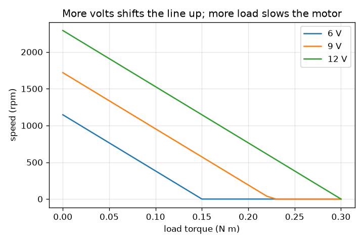
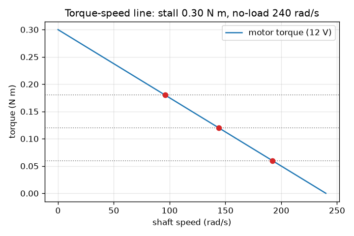

# அமர்வு 1: அதிகச் சுமை, மெதுவான மோட்டார்: முறுக்கு-வேகக் கோடு

[Session 1 — हिन्दी](README.hi.md) · [Session 1 — മലയാളം](README.ml.md) · [Session 1 — தமிழ்](README.ta.md)

*நிலை 1 (கருத்தியல் ஊடாடும் மாதிரி) · சுமார் 60 நிமிடங்கள் · opendcmotor*

> இது எளிமைப்படுத்தப்பட்ட ஒரு கல்வி மாதிரி. இது சரிபார்க்கப்பட்ட (validated) வடிவமைப்புக் கருவி அல்ல; உண்மையான கட்டமைப்புகள், மின் நிறுவல்கள், வாகனங்கள், தொழில்துறை செயல்முறைகள் அல்லது மருத்துவ முடிவுகளுக்கு இதைப் பயன்படுத்தக் கூடாது.

**முன்தேவைகள் (Prerequisites)**

- ஒரு நேர்கோட்டு வரைபடத்தைப் படித்தல்.
- நீங்கள் PRIMER.md-ஐப் படித்து `python start.py 1`-ஐ ஒருமுறை இயக்கியிருக்கிறீர்கள்.

**கற்றல் நோக்கங்கள் (Learning objectives).** இந்த அமர்வுக்குப் பிறகு நீங்கள்:

- முறுக்குவிசை (torque), வேகம் (speed) என்றால் என்ன என்பதை விளக்கி, rad/s மற்றும் rpm-ஐப் பயன்படுத்த முடியும்.
- ஒரு மோட்டாரின் முறுக்கு-வேகக் கோட்டிலிருந்து ஸ்டால் முறுக்கையும் (stall torque) சுமையற்ற வேகத்தையும் (no-load speed) படிக்க முடியும்.
- ஒரு குறிப்பிட்ட சுமை முறுக்கின் கீழ் மோட்டாரின் நிலையான வேகத்தைக் கண்டறிய முடியும்.
- விநியோக மின்னழுத்தம் மாறும்போது கோட்டிற்கு என்ன நடக்கிறது என்பதை விளக்க முடியும்.

## A. நிஜ உலகச் சிக்கல்
ஒரு சிறிய 12 V மோட்டார் ஒரு பொம்மைச் சக்கரத்தை வேகமாகச் சுழற்றுகிறது. அதில் கனமான சுமையைத் தொங்கவிட்டால் அது மெதுவாகிறது. தண்டை (shaft) கையால் பிடித்தால் அது நின்று, ரீங்கரித்து, விரைவில் சூடாகிறது. வேகம் சுமையை எப்படிச் சார்ந்துள்ளது, அதை ஒரே எளிய படத்தில் பிடிக்க முடியுமா? இங்குள்ள அனைத்தும் எளிமைப்படுத்தப்பட்ட, குறைந்த மின்னழுத்தக் கல்வி மாதிரி, வடிவமைப்புக் கருவி அல்ல.

## B. கருத்தும் கோட்பாடும்
முறுக்குவிசை என்பது ஒரு தண்டின் திருப்பு முயற்சி, நியூட்டன் மீட்டரில் (N m) அளக்கப்படுகிறது. வேகம் என்பது அது எவ்வளவு வேகமாகச் சுழல்கிறது என்பது: ரேடியன் பெர் செகண்டில் (rad/s) அல்லது நிமிடத்திற்குச் சுழற்சிகளில் (rpm); ஒரு சுற்று 2 pi ரேடியன், எனவே rpm = rad/s x 60 / (2 pi). ஒரு தூரிகை DC மோட்டாருக்கு (brushed DC motor) நேரான முறுக்கு-வேகக் கோடு உண்டு. பூஜ்ய வேகத்தில் (தண்டு பிடிக்கப்பட்டிருக்கும்போது) மோட்டார் அதன் மிகப் பெரிய முறுக்கான ஸ்டால் முறுக்கைத் தருகிறது. வேகம் கூடும்போது அது தரக்கூடிய முறுக்கு குறைந்து, சுமையற்ற வேகத்தில் எதுவும் தருவதில்லை. மோட்டார் ஒரு நிலையான சுமையை இயக்கும்போது, சுமை முறுக்கு கோட்டைச் சந்திக்கும் இடத்தில் அது நிலைபெறுகிறது. ஸ்டால் முறுக்கை விட அதிகமான சுமையைச் சுழற்ற முடியாது. விநியோக மின்னழுத்தத்தை உயர்த்துவது கோட்டை உயர்த்துகிறது: ஸ்டால் முறுக்கும் சுமையற்ற வேகமும் மின்னழுத்தத்திற்கு விகிதசமமாக வளர்கின்றன (அமர்வு 2 இதை வருவிக்கிறது). 12 V-இல் உள்ள உதாரண மோட்டாருக்கு 0.30 N m ஸ்டால் முறுக்கும் 240 rad/s சுமையற்ற வேகமும் உள்ளன.

| குறியீடு | பொருள் | அலகு |
|---|---|---|
| T | மோட்டார் தரும் முறுக்கு | N m |
| w | தண்டு வேகம் | rad/s |
| T_stall | பூஜ்ய வேகத்தில் முறுக்கு | N m |
| w_noload | பூஜ்ய முறுக்கில் வேகம் | rad/s |
| T_load | சுமை கேட்கும் முறுக்கு | N m |
| P | இயந்திரத் திறன், முறுக்கு பெருக்கல் வேகம் | W |

**அனுமானங்கள் (Assumptions)**

- முறுக்கு-வேகத் தொடர்பு ஒரு துல்லியமான நேர்கோடு (இலட்சியத் தூரிகை DC மோட்டாருக்கு உண்மை, உண்மையான மோட்டார்களுக்குத் தோராயமாக உண்மை).
- சுமை முறுக்கு நிலையானது, இயக்கத்தை எதிர்க்கிறது.
- விநியோக மின்னழுத்தம் நிலையானது, குறைவானது (12 V அல்லது அதற்குக் குறைவு); வெப்பநிலை விளைவுகள் புறக்கணிக்கப்படுகின்றன.

$$ T(\omega)=T_{\mathrm{stall}}\left(1-\frac{\omega}{\omega_{\mathrm{noload}}}\right) $$

$$ \omega=\omega_{\mathrm{noload}}\left(1-\frac{T_{\mathrm{load}}}{T_{\mathrm{stall}}}\right)\quad(T_{\mathrm{load}}<T_{\mathrm{stall}}) $$

$$ \mathrm{rpm}=\omega\,\frac{60}{2\pi} $$

$$ P=T_{\mathrm{load}}\,\omega $$

## C. காட்சி விளக்கம்
முதல் படம் ஓய்வில் 0.30 N m-இலிருந்து 240 rad/s-இல் பூஜ்யம் வரை இறங்கும் 12 V முறுக்கு-வேகக் கோட்டைக் காட்டுகிறது; மூன்று சுமைகள் புள்ளியிட்ட கிடைக்கோடுகளாகவும், அவை கோட்டைச் சந்திக்கும் இயக்கப் புள்ளிகளும் (operating points) வரையப்பட்டுள்ளன. இரண்டாவது படம் 6, 9, 12 V-க்குச் சுமைக்கு எதிராக வேகத்தை வரைகிறது: சுமை கூடும்போது இறங்கி, மின்னழுத்தத்துடன் மேலே நகரும், இணையாகத் தோன்றும் மூன்று கோடுகள். எந்தப் படத்தைப் படித்தாலும்: கனமான சுமை என்றால் மெதுவான மோட்டார், ஒரு மோட்டார் ஒருபோதும் அதன் சுமையற்ற வேகத்தை விட வேகமாக ஓடுவதில்லை.

*6, 9, 12 V-க்குச் சுமைக்கு எதிராக வேகம்: கனமான சுமை, மெதுவான மோட்டார்; அதிக வோல்ட், வேகமான மோட்டார்.*

*மூன்று சுமைகளுக்கான இயக்கப் புள்ளிகளுடன் 12 V முறுக்கு-வேகக் கோடு.*

## D. ஊடாடும் உருவகப்படுத்தல்
பாடத்தை இயக்கவும் (`python start.py 1`), பிறகு நேரடி செயலியைத் திறக்கவும்: [அமர்வு 1: சுமையும் வேகமும்](https://krunalpanchal1995.github.io/pan-iit-oss/opendcmotor/session-01/) (அல்லது இந்தக் கோப்புறையில் உள்ள `app.html`). சுமையை நழுவச் செய்து முள்ளையும் கோட்டில் உள்ள சிவப்புப் புள்ளியையும் கவனிக்கவும், பிறகு மின்னழுத்தத்தை மாற்றிக் கோடு நகர்வதைப் பார்க்கவும். ஸ்டால் முறுக்கை விடப் பெரிய சுமையை முயற்சிக்கவும்.

**சவால்.** குறைந்தது 0.15 N m சுமையைச் சுமந்துகொண்டு தண்டு 1000 rpm அல்லது அதற்கு மேல் சுழலச் செய்யவும்.

## E. தீர்க்கப்பட்ட உதாரணமும் சோதனையும்
**சிக்கல்.** 12 V மோட்டார் (ஸ்டால் முறுக்கு 0.30 N m, சுமையற்ற வேகம் 240 rad/s) 0.12 N m சுமையை இயக்குகிறது. அதன் வேகத்தை rad/s மற்றும் rpm-இலும், இயந்திரத் திறனையும் கண்டறியவும்.

1. ஸ்டாலின் பின்னமாகச் சுமை: 0.12 / 0.30 = 0.4.
2. வேகம் = 240 x (1 - 0.4) = 144 rad/s.
3. rpm = 144 x 60 / (2 pi) = 1375 rpm (4 இலக்கங்களுக்கு, 1375.1).
4. திறன் = முறுக்கு x வேகம் = 0.12 x 144 = 17.28 W.
5. நியாயச் சோதனை (sanity check): வேகம் 0-க்கும் 240 rad/s-க்கும் இடையில் உள்ளது, சுமை ஸ்டால் முறுக்கிற்குக் கீழே உள்ளது, எனவே மோட்டார் சுழல்கிறது.

**விடை.** 144 rad/s, சுமார் 1375 rpm, 17.28 W தருகிறது.

**சோதனை.** ஒரு சிறிய பொழுதுபோக்குக் கியர் மோட்டாரையும் 12 V விநியோகத்தையும் எடுத்துக்கொண்டு (பெரியவர்களின் உதவியுடன்), தொலைபேசி ஸ்ட்ரோப் செயலி மூலமோ குறியிட்ட சுற்றுகளை எண்ணியோ தடையின்றி ஓடும் வேகத்தை அளக்கவும். பிறகு துணியில் சுற்றிய விரலால் தண்டை லேசாக அழுத்தவும்: மாதிரி சொல்வது போல வேகம் குறைகிறது. உண்மையான மோட்டார்கள் சற்று வளைந்த கோட்டைத் தருகின்றன, உராய்வைக் காட்டுகின்றன, சூடாகின்றன, சுமையின் கீழ் மின்னழுத்தம் தொய்கிறது. மாதிரி முக்கிய நேர்கோட்டுப் போக்கை மட்டுமே வைத்திருக்கிறது; இது ஒரு வகுப்பறை மாதிரி, எந்தக் குறிப்பிட்ட மோட்டாரின் அளவீடும் அல்ல.

## F. மதிப்பீடும் வடிவமைப்புச் சவாலும்
**கேள்வி வகை A: கருத்தியல்.** சுமை கூடும்போது மோட்டார் ஏன் மெதுவாகிறது? அது ஏன் ஒருபோதும் சுமையற்ற வேகத்தை விட வேகமாகச் சுழல்வதில்லை?

குறிப்பு

நேர்கோடு வேக அச்சை எங்கே கடக்கிறது, அங்கு என்ன முறுக்கு மீதம் உள்ளது?

படிப்படியான தீர்வு

மோட்டார் அதன் தற்போதைய வேகத்தில் கோடு அனுமதிக்கும் முறுக்கை மட்டுமே தர முடியும். கனமான சுமை அதிக முறுக்கைக் கேட்கிறது, அதைக் கோடு குறைந்த வேகத்தில் மட்டுமே தருகிறது, எனவே மோட்டார் மெதுவாக நிலைபெறுகிறது. சுமையற்ற வேகத்தில் மோட்டார் பூஜ்ய முறுக்கைத் தருவதாகக் கோடு சொல்கிறது, எனவே அதை இன்னும் வேகமாகத் தள்ள எதுவும் மீதமில்லை. எனவே பூஜ்யச் சுமை மிக உயர்ந்த வேகமான சுமையற்ற வேகத்தைத் தருகிறது.

**கேள்வி வகை B: எண்ணியல்.** 12 V மோட்டார் 0.21 N m சுமையை இயக்குகிறது. வேகத்தை rad/s மற்றும் rpm-இல் கண்டறியவும். பிறகு சுமையற்ற வேகத்தின் சரியாகப் பாதியைத் தரும் சுமை முறுக்கைக் கண்டறியவும்.

குறிப்பு

வேகம் = 240 x (1 - சுமை / 0.30) பயன்படுத்தவும். பாதி வேகம் என்றால் (1 - சுமை / 0.30) = 0.5.

படிப்படியான தீர்வு

ஸ்டாலின் பின்னம்: 0.21 / 0.30 = 0.7, எனவே வேகம் = 240 x 0.3 = 72 rad/s, அதாவது 72 x 60 / (2 pi) = 687.5 rpm. சுமையற்ற வேகத்தின் பாதிக்கு (120 rad/s) 1 - சுமை / 0.30 = 0.5 தேவை, எனவே சுமை = 0.15 N m. நியாயச் சோதனை: நேர்கோடு கோருவது போல 0.15 என்பது ஸ்டால் முறுக்கின் பாதி.

**கேள்வி வகை C: வரைபடம் மற்றும் உருவகப்படுத்தல் விளக்கம்.** வேகம்-சுமை வரைபடத்தில், 12 V கோட்டுடன் ஒப்பிடும்போது 6 V கோடு என்ன செய்கிறது? ஒவ்வொன்றும் எந்தச் சுமையில் பூஜ்ய வேகத்தை அடைகிறது?

குறிப்பு

ஸ்டால் முறுக்கும் சுமையற்ற வேகமும் மின்னழுத்தத்துடன் அளவிடப்படுகின்றன என்பதை நினைவில் கொள்ளுங்கள்.

படிப்படியான தீர்வு

6 V கோடு பாதி வேகத்தில் தொடங்குகிறது (சுமையற்ற நிலையில் 2292 rpm-க்கு எதிராக 1146 rpm), பாதிச் சுமையில், 0.30 N m-க்குப் பதிலாக 0.15 N m-இல், பூஜ்ய வேகத்தை அடைகிறது. 9 V கோடு இடையில் உள்ளது, 0.225 N m-இல் ஸ்டால் ஆகிறது. எனவே குறைந்த மின்னழுத்தம் உச்ச வேகத்தையும் மோட்டார் சுமக்கக்கூடிய சுமையையும் சுருக்குகிறது.

**கேள்வி வகை D: வடிவமைப்பு மற்றும் உகப்பாக்கச் சவால்.** ஒரு சுமைக்கு 1000 rpm-க்குக் (104.7 rad/s) குறையாமல் 0.15 N m தேவை. 12 V மோட்டாரால் அதைச் செய்ய முடியுமா? 0.5 V படிகளில் அதைச் செய்யும் மிகக் குறைந்த மின்னழுத்தம் எது?

குறிப்பு

மின்னழுத்தம் V-இல் கோட்டிற்கு ஸ்டால் முறுக்கு 0.025 V மற்றும் சுமையற்ற வேகம் 20 V. வேகம் = 20 V (1 - 0.15 / (0.025 V)) >= 104.7-ஐத் தீர்க்கவும்.

படிப்படியான தீர்வு

12 V-இல் வேகம் 240 x (1 - 0.15 / 0.30) = 120 rad/s = 1146 rpm, இது 1000 rpm-க்கு மேல், எனவே முடியும். மின்னழுத்தம் V-இல் வேகம் 20 V - 120, எனவே 20 V - 120 >= 104.7 என்பது V >= 11.24 தருகிறது; 0.5 V படிகளில் மிகக் குறைந்த மின்னழுத்தம் 11.5 V. சமரசம் (trade-off): அப்போது மோட்டார் அதன் வரம்புகளுக்கு அருகில் ஓடுகிறது; பெரிய ஸ்டால் முறுக்கு உள்ள மோட்டார் குளிர்ச்சியாக ஓடும்.

[RUBRIC.md](../../RUBRIC.md) கொண்டு உங்களை நீங்களே மதிப்பிடுங்கள். தாளில் செய்ய [செயல்பாட்டுத் தாளை](activity_sheet.md) அச்சிடுங்கள்.

## பொதுவான தவறான கருத்துகள்
| பொதுவான தவறான கருத்து | உண்மையில் சரியானது |
|---|---|
| ஒரு மோட்டாருக்கு ஒரே நிலையான வேகம் உண்டு. | ஒரு மோட்டாருக்கு ஒவ்வொரு சுமைக்கும் ஒரு வேகம் உண்டு; சுமை உயரும்போது வேகம் ஒரு கோட்டின் வழியே குறைகிறது. |
| அதிகச் சுமை எப்போதும் அதிகத் திறனைத் தரும். | திறன் என்பது முறுக்கு பெருக்கல் வேகம். அது சுமையற்ற நிலையில் பூஜ்யம், ஸ்டாலில் பூஜ்யம், இடையில் மிகப் பெரியது (இங்கு 0.15 N m-இல் 18 W). |
| முறுக்கும் வேகமும் ஒன்றே. | முறுக்கு என்பது திருப்பு முயற்சி (N m); வேகம் என்பது சுழல் வீதம் (rad/s அல்லது rpm). கோடு ஒன்றை மற்றொன்றுக்குப் பரிமாறுகிறது. |
| ஸ்டால் ஆன மோட்டார் நகராததால் பாதுகாப்பானது. | ஸ்டால் ஆன மோட்டார் இன்னும் அதன் மிகப் பெரிய மின்னோட்டத்தை இழுத்து அனைத்தையும் வெப்பமாக மாற்றுகிறது. எவ்வளவு என்பதை அமர்வு 3 காட்டுகிறது. |

## சொற்களஞ்சியம் (Glossary)
- **முறுக்குவிசை (torque)**: ஒரு தண்டின் திருப்பு முயற்சி, நியூட்டன் மீட்டரில் (N m)
- **rad/s**: ரேடியன் பெர் செகண்ட்; ஒரு முழுச் சுற்று 2 pi ரேடியன்
- **rpm**: நிமிடத்திற்குச் சுழற்சிகள்
- **ஸ்டால் முறுக்கு (stall torque)**: பூஜ்ய வேகத்தில் முறுக்கு, மோட்டார் தரக்கூடிய அதிகபட்சம்
- **சுமையற்ற வேகம் (no-load speed)**: சுழற்ற எதுவும் இல்லாதபோது வேகம், மோட்டார் அடையக்கூடிய அதிகபட்சம்
- **இயக்கப் புள்ளி (operating point)**: மோட்டார் கோடும் சுமையும் சந்திக்கும் வேகமும் முறுக்கும்

## நிறைவு
1. [exercises.md](exercises.md)-இல் உள்ள மூன்று நிரலாக்கப் பணிகளைச் செய்யவும்.
2. உங்கள் மாற்றங்களுக்குப் பிறகு `python start.py 1`-ஐ மீண்டும் இயக்கவும். அது சோதனைச்சாவடியுடன் (checkpoint) முடிகிறது; அது `PASS` என அச்சிடும்போது நீங்கள் முடித்துவிட்டீர்கள். (சோதனைச்சாவடி மட்டும்: `python start.py check 1`.)

அடுத்து: [அமர்வு 2](../session-02/README.md)
