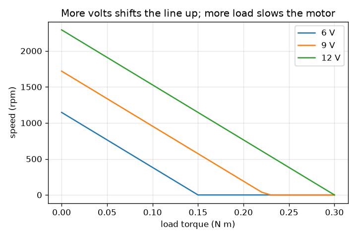
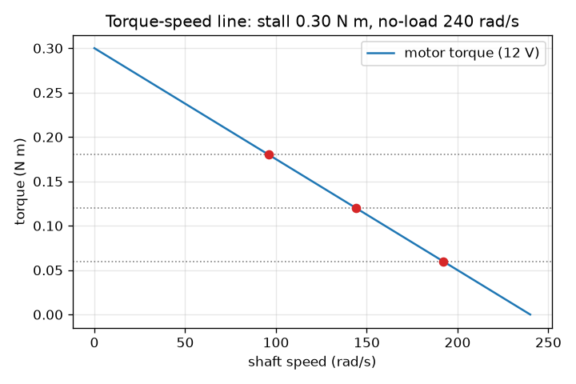

# సెషన్ 1: ఎక్కువ భారం, నెమ్మదైన మోటార్: టార్క్-వేగ రేఖ

[Session 1 — हिन्दी](README.hi.md) · [Session 1 — മലയാളം](README.ml.md) · [Session 1 — தமிழ்](README.ta.md) · [Session 1 — తెలుగు](README.te.md)

*స్థాయి 1 (భావనాత్మక ఇంటరాక్టివ్ నమూనా) · సుమారు 60 నిమిషాలు · opendcmotor*

> ఇది సరళీకరించిన విద్యా నమూనా. ఇది ధృవీకరించబడిన (validated) డిజైన్ సాధనం కాదు; నిజమైన నిర్మాణాలు, విద్యుత్ సంస్థాపనలు, వాహనాలు, పారిశ్రామిక ప్రక్రియలు లేదా వైద్య నిర్ణయాల కోసం దీన్ని ఉపయోగించకూడదు.

**ముందస్తు జ్ఞానం (Prerequisites)**

- సరళ రేఖ గ్రాఫ్ చదవడం.
- మీరు PRIMER.md చదివి `python start.py 1` ఒకసారి నడిపారు.

**అభ్యసన లక్ష్యాలు (Learning objectives).** ఈ సెషన్ తర్వాత మీరు:

- టార్క్ (torque), వేగం (speed) అంటే ఏమిటో వివరించి, rad/s మరియు rpm వాడగలరు.
- ఒక మోటార్ టార్క్-వేగ రేఖ నుండి స్టాల్ టార్క్ (stall torque) మరియు నో-లోడ్ వేగం (no-load speed) చదవగలరు.
- ఇచ్చిన లోడ్ టార్క్ కింద మోటార్ స్థిర వేగాన్ని కనుగొనగలరు.
- సరఫరా వోల్టేజ్ మారినప్పుడు రేఖకు ఏమవుతుందో వివరించగలరు.

## A. వాస్తవ ప్రపంచ సమస్య
ఒక చిన్న 12 V మోటార్ బొమ్మ చక్రాన్ని వేగంగా తిప్పుతుంది. దానిపై బరువైన లోడ్ వేలాడదీస్తే అది నెమ్మదిస్తుంది. షాఫ్ట్‌ను చేత్తో పట్టుకుంటే అది ఆగి, హమ్ చేసి, త్వరలో వేడెక్కుతుంది. వేగం లోడ్‌పై ఎలా ఆధారపడుతుంది, దాన్ని ఒకే సరళమైన చిత్రంలో పట్టుకోగలమా? ఇక్కడ ఉన్నదంతా సరళీకరించిన, తక్కువ వోల్టేజ్ విద్యా నమూనా, డిజైన్ సాధనం కాదు.

## B. భావన మరియు సిద్ధాంతం
టార్క్ అంటే ఒక షాఫ్ట్ యొక్క తిప్పే ప్రయత్నం, న్యూటన్ మీటర్లలో (N m) కొలుస్తారు. వేగం అంటే అది ఎంత వేగంగా తిరుగుతుంది: రేడియన్లు పర్ సెకను (rad/s) లో లేదా నిమిషానికి భ్రమణాలు (rpm) లో; ఒక భ్రమణం 2 pi రేడియన్లు, కాబట్టి rpm = rad/s x 60 / (2 pi). బ్రష్డ్ DC మోటార్‌కు (brushed DC motor) సరళమైన టార్క్-వేగ రేఖ ఉంటుంది. సున్నా వేగం వద్ద (షాఫ్ట్ పట్టుకున్నప్పుడు) మోటార్ తన అతి పెద్ద టార్క్, స్టాల్ టార్క్, ఇస్తుంది. వేగం పెరిగే కొద్దీ అది ఇవ్వగల టార్క్ తగ్గుతుంది, నో-లోడ్ వేగం వద్ద ఏమీ ఇవ్వదు. మోటార్ ఒక స్థిర లోడ్‌ను నడిపినప్పుడు, లోడ్ టార్క్ రేఖను కలిసే చోట అది స్థిరపడుతుంది. స్టాల్ టార్క్ కంటే ఎక్కువ లోడ్‌ను తిప్పలేదు. సరఫరా వోల్టేజ్ పెంచడం రేఖను పైకి లేపుతుంది: స్టాల్ టార్క్, నో-లోడ్ వేగం రెండూ వోల్టేజ్‌కు అనుపాతంలో పెరుగుతాయి (సెషన్ 2 దీన్ని ఉత్పాదిస్తుంది). 12 V వద్ద ఉదాహరణ మోటార్‌కు 0.30 N m స్టాల్ టార్క్, 240 rad/s నో-లోడ్ వేగం ఉన్నాయి.

| గుర్తు | అర్థం | యూనిట్ |
|---|---|---|
| T | మోటార్ ఇచ్చే టార్క్ | N m |
| w | షాఫ్ట్ వేగం | rad/s |
| T_stall | సున్నా వేగం వద్ద టార్క్ | N m |
| w_noload | సున్నా టార్క్ వద్ద వేగం | rad/s |
| T_load | లోడ్ అడిగే టార్క్ | N m |
| P | యాంత్రిక సామర్థ్యం (power), టార్క్ గుణకారం వేగం | W |

**ఊహలు (Assumptions)**

- టార్క్-వేగ సంబంధం ఖచ్చితమైన సరళ రేఖ (ఆదర్శ బ్రష్డ్ DC మోటార్‌కు నిజం, నిజమైన వాటికి సుమారుగా నిజం).
- లోడ్ టార్క్ స్థిరంగా ఉంటుంది, చలనాన్ని వ్యతిరేకిస్తుంది.
- సరఫరా వోల్టేజ్ స్థిరంగా, తక్కువగా ఉంటుంది (12 V లేదా తక్కువ); ఉష్ణోగ్రత ప్రభావాలు విస్మరించబడతాయి.

$$ T(\omega)=T_{\mathrm{stall}}\left(1-\frac{\omega}{\omega_{\mathrm{noload}}}\right) $$

$$ \omega=\omega_{\mathrm{noload}}\left(1-\frac{T_{\mathrm{load}}}{T_{\mathrm{stall}}}\right)\quad(T_{\mathrm{load}}<T_{\mathrm{stall}}) $$

$$ \mathrm{rpm}=\omega\,\frac{60}{2\pi} $$

$$ P=T_{\mathrm{load}}\,\omega $$

## C. దృశ్య వివరణ
మొదటి చిత్రం విశ్రాంతి వద్ద 0.30 N m నుండి 240 rad/s వద్ద సున్నా వరకు దిగే 12 V టార్క్-వేగ రేఖను చూపిస్తుంది; మూడు లోడ్‌లు చుక్కల క్షితిజ సమాంతర రేఖలుగా, అవి రేఖను కలిసే ఆపరేటింగ్ బిందువులు (operating points) గీయబడ్డాయి. రెండో చిత్రం 6, 9, 12 V కు లోడ్‌కు వ్యతిరేకంగా వేగాన్ని ప్లాట్ చేస్తుంది: లోడ్ పెరిగేకొద్దీ దిగే, వోల్టేజ్‌తో పైకి జరిగే, సమాంతరంగా కనిపించే మూడు రేఖలు. ఏ చిత్రం చదివినా: బరువైన లోడ్ అంటే నెమ్మదైన మోటార్, ఒక మోటార్ ఎప్పుడూ తన నో-లోడ్ వేగం కంటే వేగంగా నడవదు.

*6, 9, 12 V కు లోడ్‌కు వ్యతిరేకంగా వేగం: బరువైన లోడ్, నెమ్మదైన మోటార్; ఎక్కువ వోల్ట్‌లు, వేగవంతమైన మోటార్.*

*మూడు లోడ్‌ల ఆపరేటింగ్ బిందువులతో 12 V టార్క్-వేగ రేఖ.*

## D. ఇంటరాక్టివ్ సిమ్యులేషన్
పాఠాన్ని నడపండి (`python start.py 1`), తర్వాత లైవ్ యాప్‌ను తెరవండి: [సెషన్ 1: లోడ్ మరియు వేగం](https://krunalpanchal1995.github.io/pan-iit-oss/opendcmotor/session-01/) (లేదా ఈ ఫోల్డర్‌లోని `app.html`). లోడ్‌ను స్లైడ్ చేసి సూదిని, రేఖపై ఎరుపు బిందువును గమనించండి, తర్వాత వోల్టేజ్ మార్చి రేఖ కదలడం చూడండి. స్టాల్ టార్క్ కంటే పెద్ద లోడ్‌ను ప్రయత్నించండి.

**సవాలు.** కనీసం 0.15 N m లోడ్ మోస్తూ షాఫ్ట్ 1000 rpm లేదా అంతకంటే ఎక్కువ తిరిగేలా చేయండి.

## E. సాధించిన ఉదాహరణ మరియు ప్రయోగం
**సమస్య.** 12 V మోటార్ (స్టాల్ టార్క్ 0.30 N m, నో-లోడ్ వేగం 240 rad/s) 0.12 N m లోడ్‌ను నడుపుతుంది. దాని వేగాన్ని rad/s మరియు rpm లో, యాంత్రిక సామర్థ్యాన్ని కనుగొనండి.

1. స్టాల్ యొక్క భిన్నంగా లోడ్: 0.12 / 0.30 = 0.4.
2. వేగం = 240 x (1 - 0.4) = 144 rad/s.
3. rpm = 144 x 60 / (2 pi) = 1375 rpm (4 అంకెలకు, 1375.1).
4. సామర్థ్యం = టార్క్ x వేగం = 0.12 x 144 = 17.28 W.
5. సహేతుకత తనిఖీ (sanity check): వేగం 0 మరియు 240 rad/s మధ్య ఉంది, లోడ్ స్టాల్ టార్క్ కంటే తక్కువ, కాబట్టి మోటార్ తిరుగుతుంది.

**సమాధానం.** 144 rad/s, సుమారు 1375 rpm, 17.28 W అందిస్తుంది.

**ప్రయోగం.** ఒక చిన్న హాబీ గేర్ మోటార్, 12 V సరఫరా తీసుకోండి (పెద్దల సహాయంతో), ఫోన్ స్ట్రోబ్ యాప్‌తో లేదా గుర్తు పెట్టిన భ్రమణాలను లెక్కించి స్వేచ్ఛగా నడిచే వేగాన్ని కొలవండి. తర్వాత గుడ్డలో చుట్టిన వేలితో షాఫ్ట్‌ను తేలికగా నొక్కండి: నమూనా చెప్పినట్లు వేగం తగ్గుతుంది. నిజమైన మోటార్లు కొంచెం వంగిన రేఖను ఇస్తాయి, ఘర్షణ చూపిస్తాయి, వేడెక్కుతాయి, లోడ్ కింద వోల్టేజ్ పడిపోతుంది. నమూనా ప్రధాన సరళ రేఖ ధోరణిని మాత్రమే ఉంచుతుంది; ఇది తరగతి గది నమూనా, ఏ నిర్దిష్ట మోటార్ కొలత కాదు.

## F. మూల్యాంకనం మరియు డిజైన్ సవాలు
**ప్రశ్న రకం A: భావనాత్మక.** లోడ్ పెరిగినప్పుడు మోటార్ ఎందుకు నెమ్మదిస్తుంది? అది ఎందుకు ఎప్పుడూ నో-లోడ్ వేగం కంటే వేగంగా తిరగదు?

సూచన

సరళ రేఖ వేగ అక్షాన్ని ఎక్కడ దాటుతుంది, అక్కడ ఏ టార్క్ మిగిలి ఉంది?

దశలవారీ పరిష్కారం

మోటార్ తన ప్రస్తుత వేగం వద్ద రేఖ అనుమతించే టార్క్‌ను మాత్రమే ఇవ్వగలదు. బరువైన లోడ్ ఎక్కువ టార్క్ అడుగుతుంది, దాన్ని రేఖ తక్కువ వేగం వద్ద మాత్రమే ఇస్తుంది, కాబట్టి మోటార్ నెమ్మదిగా స్థిరపడుతుంది. నో-లోడ్ వేగం వద్ద మోటార్ సున్నా టార్క్ ఇస్తుందని రేఖ చెబుతుంది, కాబట్టి దాన్ని మరింత వేగంగా నెట్టడానికి ఏమీ మిగలదు. కాబట్టి సున్నా లోడ్ అత్యధిక వేగం, నో-లోడ్ వేగం, ఇస్తుంది.

**ప్రశ్న రకం B: సంఖ్యాత్మక.** 12 V మోటార్ 0.21 N m లోడ్‌ను నడుపుతుంది. వేగాన్ని rad/s మరియు rpm లో కనుగొనండి. తర్వాత నో-లోడ్ వేగంలో సరిగ్గా సగం ఇచ్చే లోడ్ టార్క్‌ను కనుగొనండి.

సూచన

వేగం = 240 x (1 - లోడ్ / 0.30) వాడండి. సగం వేగం అంటే (1 - లోడ్ / 0.30) = 0.5.

దశలవారీ పరిష్కారం

స్టాల్ యొక్క భిన్నం: 0.21 / 0.30 = 0.7, కాబట్టి వేగం = 240 x 0.3 = 72 rad/s, అంటే 72 x 60 / (2 pi) = 687.5 rpm. నో-లోడ్ వేగంలో సగానికి (120 rad/s) 1 - లోడ్ / 0.30 = 0.5 కావాలి, కాబట్టి లోడ్ = 0.15 N m. సహేతుకత తనిఖీ: సరళ రేఖ కోరినట్లు 0.15 అనేది స్టాల్ టార్క్‌లో సగం.

**ప్రశ్న రకం C: గ్రాఫ్ మరియు సిమ్యులేషన్ వ్యాఖ్యానం.** వేగం-లోడ్ గ్రాఫ్‌లో, 12 V రేఖతో పోలిస్తే 6 V రేఖ ఏమి చేస్తుంది? ఒక్కొక్కటి ఏ లోడ్ వద్ద సున్నా వేగాన్ని చేరుతుంది?

సూచన

స్టాల్ టార్క్, నో-లోడ్ వేగం రెండూ వోల్టేజ్‌తో స్కేల్ అవుతాయని గుర్తుంచుకోండి.

దశలవారీ పరిష్కారం

6 V రేఖ సగం వేగంతో మొదలవుతుంది (నో-లోడ్ వద్ద 2292 rpm కి వ్యతిరేకంగా 1146 rpm), సగం లోడ్ వద్ద, 0.30 N m కి బదులుగా 0.15 N m వద్ద, సున్నా వేగాన్ని చేరుతుంది. 9 V రేఖ మధ్యలో ఉంటుంది, 0.225 N m వద్ద స్టాల్ అవుతుంది. కాబట్టి తక్కువ వోల్టేజ్ గరిష్ఠ వేగాన్ని, మోటార్ మోయగల లోడ్‌ను రెండింటినీ కుదిస్తుంది.

**ప్రశ్న రకం D: డిజైన్ మరియు ఆప్టిమైజేషన్ సవాలు.** ఒక లోడ్‌కు 1000 rpm (104.7 rad/s) కంటే తక్కువ కాకుండా 0.15 N m కావాలి. 12 V మోటార్ దాన్ని చేయగలదా? 0.5 V అడుగులలో దాన్ని చేసే అతి తక్కువ వోల్టేజ్ ఏది?

సూచన

వోల్టేజ్ V వద్ద రేఖకు స్టాల్ టార్క్ 0.025 V, నో-లోడ్ వేగం 20 V. వేగం = 20 V (1 - 0.15 / (0.025 V)) >= 104.7 ను సాధించండి.

దశలవారీ పరిష్కారం

12 V వద్ద వేగం 240 x (1 - 0.15 / 0.30) = 120 rad/s = 1146 rpm, ఇది 1000 rpm కంటే ఎక్కువ, కాబట్టి అవును. వోల్టేజ్ V వద్ద వేగం 20 V - 120, కాబట్టి 20 V - 120 >= 104.7 అనేది V >= 11.24 ఇస్తుంది; 0.5 V అడుగులలో అతి తక్కువ వోల్టేజ్ 11.5 V. రాజీ (trade-off): అప్పుడు మోటార్ తన పరిమితులకు దగ్గరగా నడుస్తుంది; పెద్ద స్టాల్ టార్క్ ఉన్న మోటార్ చల్లగా నడుస్తుంది.

[RUBRIC.md](../../RUBRIC.md) తో మిమ్మల్ని మీరు అంచనా వేసుకోండి. కాగితంపై పని చేయడానికి [కార్యాచరణ పత్రాన్ని](activity_sheet.md) ప్రింట్ చేయండి.

## సాధారణ అపోహలు
| సాధారణ అపోహ | నిజానికి సరైనది |
|---|---|
| ఒక మోటార్‌కు ఒకే స్థిర వేగం ఉంటుంది. | ఒక మోటార్‌కు ప్రతి లోడ్‌కు ఒక వేగం ఉంటుంది; లోడ్ పెరిగేకొద్దీ వేగం ఒక రేఖ వెంబడి తగ్గుతుంది. |
| ఎక్కువ లోడ్ ఎల్లప్పుడూ ఎక్కువ సామర్థ్యం ఇస్తుంది. | సామర్థ్యం అంటే టార్క్ గుణకారం వేగం. అది నో-లోడ్ వద్ద సున్నా, స్టాల్ వద్ద సున్నా, మధ్యలో అతి పెద్దది (ఇక్కడ 0.15 N m వద్ద 18 W). |
| టార్క్, వేగం ఒకటే. | టార్క్ అంటే తిప్పే ప్రయత్నం (N m); వేగం అంటే తిరిగే రేటు (rad/s లేదా rpm). రేఖ ఒకదాన్ని మరొకదానికి మార్పిడి చేస్తుంది. |
| స్టాల్ అయిన మోటార్ కదలడం లేదు కాబట్టి సురక్షితం. | స్టాల్ అయిన మోటార్ ఇంకా తన అతి పెద్ద కరెంట్‌ను లాగి, మొత్తాన్నీ ఉష్ణంగా మారుస్తుంది. ఎంతో సెషన్ 3 చూపిస్తుంది. |

## పదకోశం (Glossary)
- **టార్క్ (torque)**: ఒక షాఫ్ట్ యొక్క తిప్పే ప్రయత్నం, న్యూటన్ మీటర్లలో (N m)
- **rad/s**: రేడియన్లు పర్ సెకను; ఒక పూర్తి భ్రమణం 2 pi రేడియన్లు
- **rpm**: నిమిషానికి భ్రమణాలు
- **స్టాల్ టార్క్ (stall torque)**: సున్నా వేగం వద్ద టార్క్, మోటార్ ఇవ్వగల గరిష్ఠం
- **నో-లోడ్ వేగం (no-load speed)**: తిప్పడానికి ఏమీ లేనప్పుడు వేగం, మోటార్ చేరగల గరిష్ఠం
- **ఆపరేటింగ్ బిందువు (operating point)**: మోటార్ రేఖ, లోడ్ కలిసే వేగం మరియు టార్క్

## ముగింపు
1. [exercises.md](exercises.md) లోని మూడు కోడింగ్ పనులు చేయండి.
2. మీ మార్పుల తర్వాత `python start.py 1` ను మళ్ళీ నడపండి. అది చెక్‌పాయింట్‌తో ముగుస్తుంది; అది `PASS` అని ప్రింట్ చేసినప్పుడు మీరు పూర్తి చేశారు. (చెక్‌పాయింట్ మాత్రమే: `python start.py check 1`.)

తదుపరి: [సెషన్ 2](../session-02/README.md)
