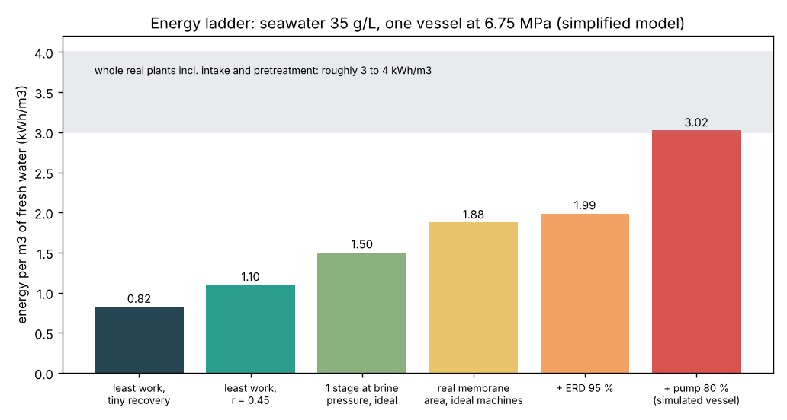
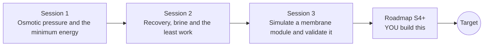

# opendesalination

[](https://github.com/KrunalPanchal1995/pan-iit-oss/actions/workflows/tests.yml)   [](https://colab.research.google.com/github/KrunalPanchal1995/pan-iit-oss/blob/main/opendesalination/sessions/session-01/lesson.ipynb) [](https://krunalpanchal1995.github.io/pan-iit-oss/opendesalination/)

**Estimate the energy to turn seawater into drinking water, in three sessions.**

opendesalination teaches why making fresh water from the sea costs a minimum amount of energy set by physics, from osmotic pressure to the least work of separation and a simulated reverse osmosis membrane, using only Python and a browser.

- **Start from zero.** Session 1 needs only school arithmetic and the mole: grams of salt, moles, and pressure times volume.
- **See the push.** Every session ships a slider app that runs in the browser, with a membrane picture and labelled graphs.
- **Know you got it right.** Each session ends with a checkpoint that prints PASS or FAIL against hand calculations, the salt balance and the second law.
- **Build the missing half.** The repo stops at Session 3 on purpose; the roadmap shows the path to the Target.

[Target](#the-target) · [Who is this for](#who-is-this-for) · [Quick start](#quick-start) · [Sessions](#sessions) · [Roadmap](#roadmap) · [Contribute](#contribute) · [Explainer PDF](docs/explainer.pdf)

> **This repo is incomplete on purpose.** Sessions 1 to 3 are here and fully working. The finished Target below is a preview of what the community can build next. We show you the path, not the code. Sessions 4 and up are yours.

## The Target

A whole seawater desalination plant on one energy ladder. Starting from the physical floor (0.82 kWh per cubic metre for 35 g/L seawater at 25 degrees C), each bar adds one real step: the recovery the plant chooses, pushing at the brine pressure, a membrane of finite size, the energy recovery device and the high-pressure pump. Session 3 already builds this ladder for one pressure vessel, ending at about 3.0 kWh/m3. Your goal over the coming sessions: extend it to a full plant (real seawater osmotic pressure, pressure drop, two stages, a second pass for boron, intake and pretreatment) and land inside the 3 to 4 kWh/m3 that real seawater plants report.



*Target: the energy ladder from the 0.82 kWh/m3 physical minimum to a simulated seawater RO vessel at about 3 kWh/m3*

Try it live:

- [Math Visual Studio: the second law and entropy (Atlas S54)](https://krunalpanchal1995.github.io/studio/#atlas?ch=S54&ex=1)
- [Math Visual Studio: the first law of thermodynamics (Atlas S53)](https://krunalpanchal1995.github.io/studio/#atlas?ch=S53&ex=1)

How to go from the vessel to the whole plant is shown only as a path in [promo/roadmap.md](promo/roadmap.md).

## Who is this for
**diploma / undergraduate to advanced undergraduate (levels 5-6).** Topic area: Chemical, Environmental and Process Engineering.

Prerequisites:

- School chemistry (the mole, molar mass) and physics (pressure, work = force x distance).
- Python 3.10 or newer; if `python --version` works, you are ready. PRIMER.md explains the rest.
- No prior GitHub, thermodynamics or calculus experience is needed; Sessions 2 and 3 explain the area-under-a-curve and step-by-step methods they use.

New to Python? Read [PRIMER.md](PRIMER.md) first (10 minutes).

## Quick start

No installation knowledge needed. You need [Git](https://git-scm.com/downloads) and [Python 3.10+](https://www.python.org/downloads/) (Windows: tick "Add Python to PATH"). On Mac and Linux type `python3` wherever this page says `python`.

```bash
git clone https://github.com/KrunalPanchal1995/pan-iit-oss.git
cd pan-iit-oss/opendesalination
python start.py 1
```

`start.py` creates a private environment, installs what is needed and runs Session 1 with its checkpoint. Next: `python start.py 2`, `python start.py 3`, or `python start.py test` to check everything. Only a checkpoint: `python start.py check 1`.

<!-- friendly-help -->
<details>
<summary><b>Not working? Common fixes (no Git, "python not found", no internet)</b></summary>

- **No Git?** You do not need it. On the main page of this collection click the green **Code** button, then **Download ZIP**, unzip it, open a terminal inside the folder `pan-iit-oss-main/opendesalination` and run `python start.py 1`. The ZIP holds every project, so it is large; the live apps need no download at all.
- **"python is not recognized" or "command not found".** On Windows try `py start.py 1`. On Mac and Linux try `python3 start.py 1`. If neither works, install Python from [python.org](https://www.python.org/downloads/) and tick "Add Python to PATH".
- **Needs internet once.** The first run downloads NumPy and Matplotlib into a private folder (`.venv`); after that it works offline.
- **Rather not install anything?** Open the [live apps](https://krunalpanchal1995.github.io/pan-iit-oss/opendesalination/) in your browser, or use the Colab badge at the top of this page.
- **Still stuck?** [Open an issue](https://github.com/KrunalPanchal1995/pan-iit-oss/issues/new?title=%5Bopendesalination%5D%20) with your operating system and the message you see. Questions from beginners are welcome.

</details>

Four lines turn the idea of Sessions 1 and 2 into a result (they work as they are): Save it as `try.py` and run it with `python start.py run try.py` (this uses the private environment, where NumPy is installed):

```python
import numpy as np
pi = 2 * 35 / 58.44 * 1000 * 8.314 * 298.15 / 1000   # osmotic pressure of seawater, kPa
print(np.round(pi / 3600, 3))                         # -> 0.825  kWh/m3, the physical minimum
print(np.round(pi * np.log(2) / 0.5 / 3600, 3))       # -> 1.143  kWh/m3 at 50 percent recovery
```

Every session also opens in your browser with sliders (no install): [live apps](https://krunalpanchal1995.github.io/pan-iit-oss/opendesalination/). Or use the Colab badge above for the notebook.

## Sessions

| # | Session | Model level | Time | Live app |
|---|---|---|---|---|
| 1 | [Osmotic pressure and the minimum energy](sessions/session-01/README.md) | Level 1: conceptual interactive model | 60 min | [open](https://krunalpanchal1995.github.io/pan-iit-oss/opendesalination/session-01/) |
| 2 | [Recovery, brine and the least work](sessions/session-02/README.md) | Level 2: mathematical design model | 75 min | [open](https://krunalpanchal1995.github.io/pan-iit-oss/opendesalination/session-02/) |
| 3 | [Simulate a membrane module and validate it](sessions/session-03/README.md) | Level 3: simulation and validation | 90 min | [open](https://krunalpanchal1995.github.io/pan-iit-oss/opendesalination/session-03/) |

Each session follows the same six steps: A real-world problem, B concept and theory, C visual explanation, D interactive simulation, E worked example and experiment, F assessment and design challenge. Each ends with `checkpoint.py`, which prints `PASS` or `FAIL` against reference numbers. Session 3 also contains the real-world mini-project: **Choose the feed pressure for a seawater RO vessel**.

## Architecture



| Folder or file | What is inside |
|---|---|
| `sessions/` | three sessions: README (A-F), `lesson.py`, notebook, live app, exercises, activity sheet, checkpoint |
| `promo/` | the Target: media, live links, and the roadmap (path only) |
| `docs/` | `explainer.tex` and the built `explainer.pdf` |
| `tests/` | runs every lesson and checkpoint headless |
| `start.py` | one command to set up and run anything |
| `QUALITY.md`, `RUBRIC.md` | the quality checklist and the scoring rubric |
| `.github/` | CI, PDF build, Pages deploy, issue and PR templates |

## Roadmap

| Milestone | What you will build | Difficulty |
|---|---|---|
| Session 4: Real seawater osmotic pressure | An osmotic coefficient (Pitzer-style fit) in place of the ideal van 't Hoff law. | intermediate |
| Session 5: Pressure drop and a two-stage vessel train | A friction pressure drop along each element and a second stage fed by the first stage's brine. | intermediate |
| Session 6: Concentration polarisation from mass transfer | CP computed from the local flux and a mass-transfer coefficient, CP = exp(Jw / k). | intermediate |
| Session 7: Second pass and boron | A second RO pass on part of the permeate, with boron rejection that depends on pH. | advanced |
| Session 8: The whole plant and the cost of water | Intake, pretreatment, pumps and ERD in one energy and cost model, in rupees per m3. | advanced |

Full detail with a checkpoint per milestone: [promo/roadmap.md](promo/roadmap.md).

## Contribute
New to GitHub? Read [CONTRIBUTING.md](CONTRIBUTING.md); it starts from zero. Pick an issue labelled `good first issue`. Translations into Hindi, Telugu, Tamil and Malayalam are welcome.

<details>
<summary>Development</summary>

```bash
python start.py test        # runs every lesson and checkpoint
```
Lessons use `# %%` cell markers so they open as notebooks in VS Code. See [QUALITY.md](QUALITY.md) for the standard every session meets.
</details>

## License
MIT. See [LICENSE](LICENSE). Media in `promo/media` is (c) Krunal Panchal, CC BY 4.0.

## Acknowledgments
Part of the [PAN IIT OSS](https://hellofoss.tech-iitb.org/projects) open-source teaching collection, modelled on the structure of [openspline](https://github.com/openspline/openspline). Built on ideas from the Math Visual Studio at https://krunalpanchal1995.github.io/studio/.
