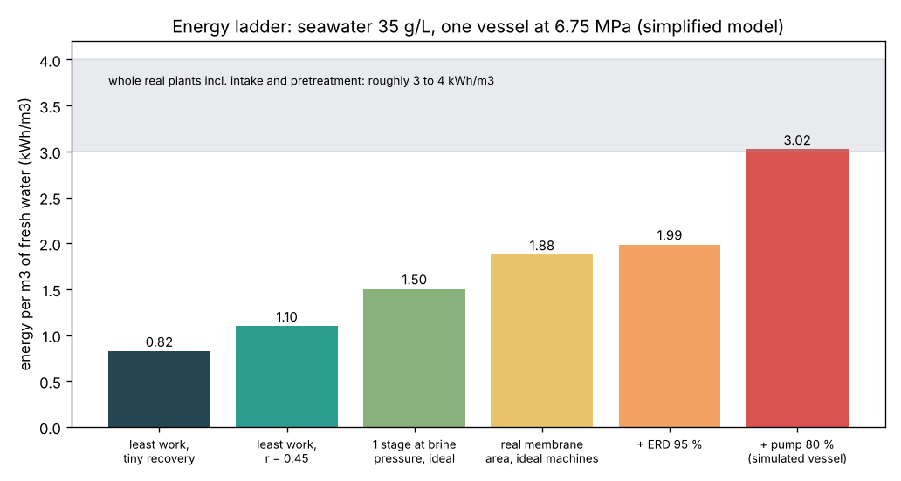

# What you are building toward

A whole seawater desalination plant on one energy ladder. Starting from the physical floor (0.82 kWh per cubic metre for 35 g/L seawater at 25 degrees C), each bar adds one real step: the recovery the plant chooses, pushing at the brine pressure, a membrane of finite size, the energy recovery device and the high-pressure pump. Session 3 already builds this ladder for one pressure vessel, ending at about 3.0 kWh/m3. Your goal over the coming sessions: extend it to a full plant (real seawater osmotic pressure, pressure drop, two stages, a second pass for boron, intake and pretreatment) and land inside the 3 to 4 kWh/m3 that real seawater plants report.

*Target: the energy ladder from the 0.82 kWh/m3 physical minimum to a simulated seawater RO vessel at about 3 kWh/m3*

The figure above comes from Session 3 of this repo. The whole-plant version is not published; the roadmap shows the path so you can build your own.

Live links:

- [Math Visual Studio: the second law and entropy (Atlas S54)](https://krunalpanchal1995.github.io/studio/#atlas?ch=S54&ex=1)
- [Math Visual Studio: the first law of thermodynamics (Atlas S53)](https://krunalpanchal1995.github.io/studio/#atlas?ch=S53&ex=1)
