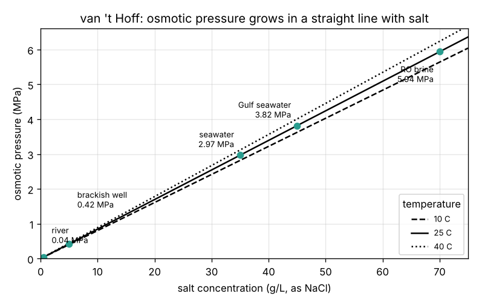
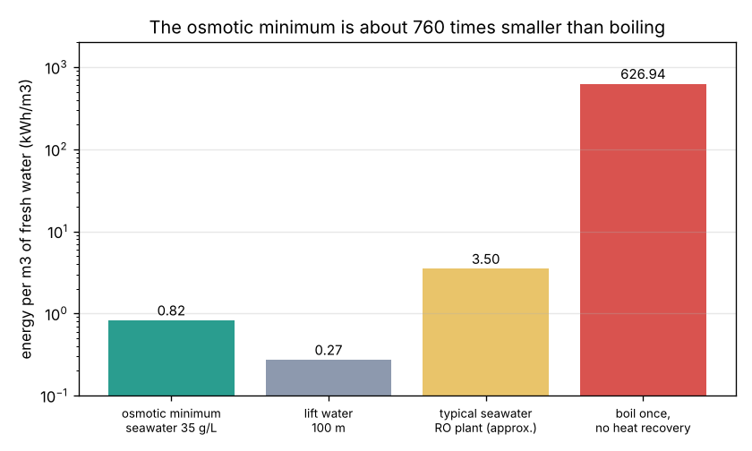

# Session 1: Osmotic pressure and the minimum energy

*Level 1 (conceptual interactive model) · about 60 minutes · opendesalination*

> This is a simplified educational model. It is not a validated design tool and must not be used for real structures, electrical installations, vehicles, industrial processes or medical decisions. Never drink water from a home-made filter or membrane experiment.

**Prerequisites**

- School arithmetic, the mole, and the idea of pressure (force per area).
- You have read PRIMER.md and run `python start.py 1` once.

**Learning objectives.** After this session you can:

- Convert a salt concentration in g/L into mol/m3 and count dissolved particles.
- Use the van 't Hoff law pi = i c R T to find the osmotic pressure of seawater, with T in kelvin.
- Explain why pressure times volume is energy and turn kPa into kWh per m3.
- Compare the minimum energy of desalination with boiling the water and pumping it uphill.

## A. Real-world problem
Chennai gets part of its drinking water from seawater plants on the coast at Minjur and Nemmeli. Pulling the salt out of the sea costs electricity, and electricity costs money and fuel. Is there a smallest possible energy bill for each cubic metre of fresh water, one that no clever machine, however good, can beat? And is it closer to the energy of boiling the water or to the energy of pumping it up a hill? (General education only: this is a simplified model, not a plant design method.)

## B. Concept and theory
A **semi-permeable membrane** lets water molecules through but holds back salt ions. Put pure water on one side and salt water on the other: water flows into the salty side by itself (**osmosis**), because mixing is the natural direction of change. The pressure you must apply on the salty side to stop that flow is the **osmotic pressure** pi. For dilute solutions it follows the van 't Hoff law pi = i c R T, which looks like the ideal gas law: each dissolved particle "pushes" like a gas molecule. Here c is the salt concentration in mol/m3, i is the number of particles each salt unit splits into (2 for NaCl: Na+ and Cl-) and T is the absolute temperature. Push harder than pi and water flows the other way, out of the salt water: this is **reverse osmosis** (RO). Pushing a volume V of water against a pressure P costs the work W = P V, and 1 kPa x 1 m3 = 1 kJ. So the least energy to take a small amount of fresh water out of a large amount of seawater is pi per cubic metre. Since 1 kWh = 3600 kJ, the minimum in kWh/m3 is pi (in kPa) / 3600.

| Symbol | Meaning | Unit |
|---|---|---|
| S | salt concentration (mass per volume; 1 g/L = 1 kg/m3) | g/L |
| M | molar mass of NaCl, 58.44 | g/mol |
| c | molar concentration S / M x 1000 | mol/m3 |
| i | dissolved particles per salt unit (van 't Hoff factor), 2 for NaCl | no unit |
| R | gas constant, 8.314 | J/(mol K) |
| T | absolute temperature (degrees C + 273.15) | K |
| pi | osmotic pressure | kPa |
| E_min | least energy per m3 of fresh water | kWh/m3 |

**Assumptions**

- All the salt in seawater is counted as NaCl (real seawater also has magnesium, sulfate, calcium and others).
- The ideal (dilute) van 't Hoff law; real seawater gives about 10 percent less (osmotic coefficient about 0.9). We keep the ideal law so every number can be checked by hand.
- A "small sip": we take only a tiny amount of fresh water, so the seawater does not get saltier. Session 2 removes this.
- The membrane is perfect: it passes no salt at all.

$$ c = \frac{S}{M}\times 1000 $$

$$ \pi = i\,c\,R\,T $$

$$ W = P\,V,\qquad 1\ \mathrm{kPa}\times 1\ \mathrm{m^3} = 1\ \mathrm{kJ} $$

$$ E_{\min} = \frac{\pi\ [\mathrm{kPa}]}{3600}\ \ \mathrm{kWh/m^3} $$

## C. Visual explanation
The first figure shows the osmotic pressure against salt content at 10, 25 and 40 degrees C. It is a straight line: river water (0.5 g/L) needs only 42 kPa, a brackish well (5 g/L) 424 kPa, seawater (35 g/L) 2969 kPa (about 30 times the air pressure) and the brine a seawater plant throws away (70 g/L) 5938 kPa. The second figure (log scale) puts the seawater minimum of 0.82 kWh/m3 next to lifting water 100 m (0.27 kWh/m3), a typical real seawater RO plant (roughly 3 to 4 kWh/m3) and boiling the water once without heat recovery (627 kWh/m3), which is about 760 times the minimum.

*Osmotic pressure against salt concentration at three temperatures, with common waters marked.*

*The osmotic minimum compared with lifting water, a real RO plant and boiling (log scale).*

## D. Interactive simulation
Run the lesson (`python start.py 1`), then open the live app: [Session 1: osmotic pressure](https://krunalpanchal1995.github.io/pan-iit-oss/opendesalination/session-01/) (or `app.html` in this folder). Change the salt content, the temperature and the pressure you apply. In the U-tube picture, watch the water flow towards the salty side when you push less than pi and away from it (reverse osmosis) when you push more. Open the energy view to read the minimum energy and compare it with boiling.

**Challenge.** Make fresh water by reverse osmosis from Gulf seawater (at least 45 g/L) at 30 degrees C or warmer, pushing no more than 200 kPa above its osmotic pressure.

## E. Worked example and experiment
**Problem.** Seawater holds 35 g of salt per litre at 25 degrees C. Find its osmotic pressure, the least energy to take a small amount of fresh water out of it, and the height of a water column that would give the same pressure.

1. Molar concentration: c = 35 / 58.44 x 1000 = 598.9 mol/m3.
2. Temperature in kelvin: T = 25 + 273.15 = 298.15 K.
3. Osmotic pressure: pi = 2 x 598.9 x 8.314 x 298.15 = 2 969 150 Pa = 2969 kPa (about 29.7 bar).
4. Minimum energy: 2969 kPa x 1 m3 = 2969 kJ per m3; divided by 3600 gives 0.825 kWh/m3.
5. Water column: h = P / (rho g) = 2 969 150 / (1000 x 9.81) = 303 m. Seawater pushes back as hard as a 300 m tower of water.

**Answer.** pi = 2969 kPa, E_min = 0.825 kWh/m3, equal to a water column of 303 m.

**Experiment.** Put potato or cucumber slices in plain water and in strong salt water (two spoons of salt in a glass) for 30 minutes. The slices in salt water go soft and lose weight: water leaves the cells (whose walls act like a membrane) towards the saltier side. Weigh them before and after. The model says water flows towards higher salt; real cell walls also leak a little salt and have their own pressure, so the numbers will not match the van 't Hoff law exactly, only the direction.

## F. Assessment and design challenge
**Question type A: Conceptual.** Why must there be a minimum energy for desalination, even with a perfect machine that has no friction and no leaks?

Hint

Which way does water flow by itself across a membrane, and what must you do to make it go the other way?

Step-by-step solution

Mixing salt and fresh water happens by itself; un-mixing does not. Across a membrane, water flows into the salt water on its own. To make it flow out of the salt water you must push at least the osmotic pressure pi, and pushing a volume V against pi costs pi V of work. A perfect machine can avoid every other loss, but not this one: it is set by the salt content and temperature (the second law), not by the machine.

**Question type B: Numerical.** A brackish well in Rajasthan has 5 g/L of salt at 25 degrees C. Find the osmotic pressure and the minimum energy, and compare with seawater.

Hint

pi is proportional to the salt content, so you can scale the seawater answer by 5 / 35.

Step-by-step solution

c = 5 / 58.44 x 1000 = 85.6 mol/m3. pi = 2 x 85.6 x 8.314 x 298.15 = 424 kPa. E_min = 424 / 3600 = 0.118 kWh/m3. Check: 2969 x 5 / 35 = 424 kPa. It is 7 times smaller than seawater, which is why brackish desalination is much cheaper.

**Question type C: Graph and simulation interpretation.** In the osmotic pressure figure, the 40 degrees C line is above the 10 degrees C line. By what factor, and why is it not 40 / 10 = 4?

Hint

The law uses T in kelvin.

Step-by-step solution

pi is proportional to T in kelvin: 313.15 / 283.15 = 1.106, so only about 11 percent higher. Using Celsius (40 / 10 = 4) would be badly wrong. (In real plants warm water still helps a little, because warm membranes let water through more easily, a separate effect.)

**Question type D: Design and optimisation challenge.** Design: a coastal town of 50 000 people needs 100 litres per person per day from 35 g/L seawater at 25 degrees C. What is the minimum power (kW) that physics demands? A real plant uses 3.5 kWh/m3: what power does it need, and how many times the minimum is that?

Hint

Volume per day = 50 000 x 0.1 m3; power = energy per day / 24 h.

Step-by-step solution

Water = 50 000 x 0.1 = 5000 m3/day. Minimum: 5000 x 0.825 = 4124 kWh/day, divided by 24 h = 172 kW. Real plant: 5000 x 3.5 = 17 500 kWh/day = 729 kW, about 4.2 times the minimum. Trade-off: the minimum assumes a tiny recovery and a perfect machine; a real plant takes about half of the feed as fresh water and has pumps, finite membranes and pretreatment. Sessions 2 and 3 explain where the factor comes from.

Score yourself with [RUBRIC.md](../../RUBRIC.md). Print the [activity sheet](activity_sheet.md) to work on paper.

## Common misconceptions
| Common misconception | What is actually true |
|---|---|
| Osmotic pressure depends on the grams of salt. | It depends on the number of dissolved particles: NaCl splits into 2 ions, so i = 2; 35 g/L of sugar would give far less. |
| A better machine could desalinate with no energy at all. | Un-mixing always needs at least the osmotic work; good machines only reduce the extra losses on top. |
| Boiling is the natural way to remove salt, so it must be cheap. | Boiling once needs about 627 kWh/m3, hundreds of times the osmotic minimum; thermal plants survive only by reusing the heat many times. |
| You can use Celsius in the van 't Hoff law. | It needs kelvin; using Celsius would make water at 0 degrees C have no osmotic pressure at all. |

## Glossary
- **osmosis**: flow of water through a membrane towards the saltier side
- **osmotic pressure**: the pressure needed to stop osmosis, pi = i c R T for dilute solutions
- **reverse osmosis**: pushing harder than pi so that fresh water leaves the salt water
- **semi-permeable membrane**: a thin film that lets water pass but holds back salt
- **kWh/m3**: kilowatt-hours of energy per cubic metre (1000 L) of fresh water

## Finish
1. Do the three coding tasks in [exercises.md](exercises.md).
2. Run `python start.py 1` again after your changes. It ends with the checkpoint; when it prints `PASS`, you are done. (Checkpoint only: `python start.py check 1`.)

Next: [Session 2](../session-02/README.md)
