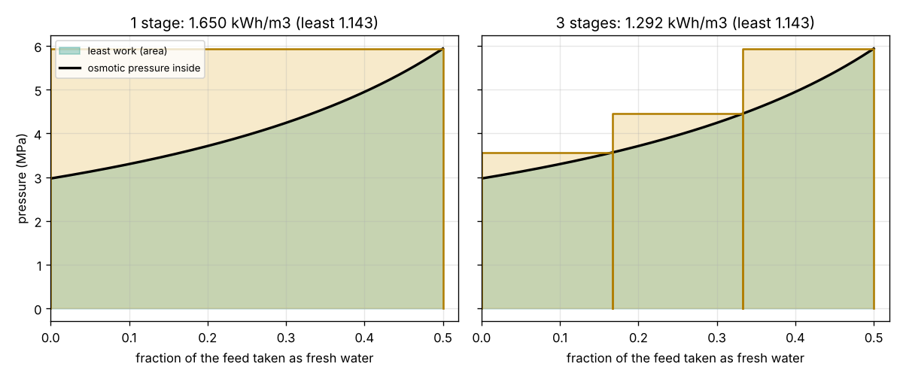
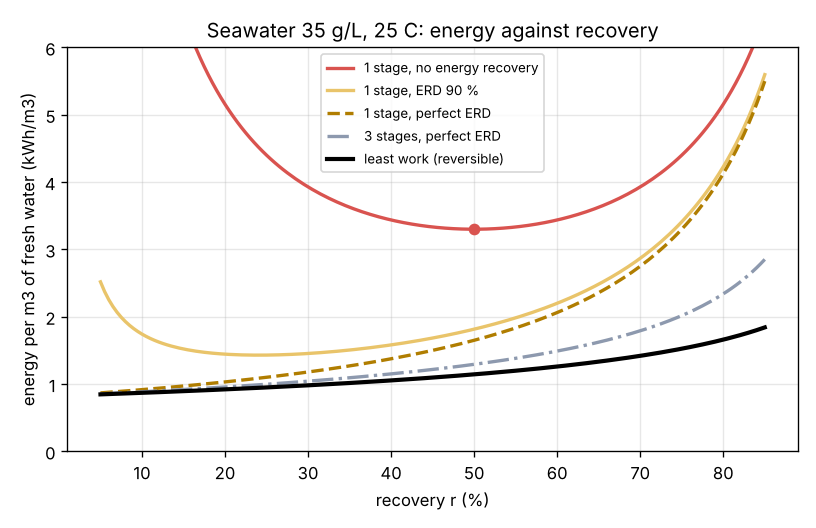

# Session 2: Recovery, brine and the least work

*Level 2 (mathematical design model) · about 75 minutes · opendesalination*

> This is a simplified educational model. It is not a validated design tool and must not be used for real structures, electrical installations, vehicles, industrial processes or medical decisions. High-pressure water (60 bar and more) can cause serious injury; never build a pressurised rig without supervision.

**Prerequisites**

- Session 1: osmotic pressure pi = i c R T and E = pi / 3600.
- The natural logarithm ln; the integral as an area under a curve is explained in Section B.

**Learning objectives.** After this session you can:

- Use a salt balance to find the brine concentration at a given recovery.
- Derive and use the least (reversible) work W_rev = pi_f ln(1 / (1 - r)) / r as the area under a pressure curve.
- Compute the energy of a one-stage plant with and without an energy recovery device (ERD).
- Explain why more stages bring a plant closer to the least work, and choose a recovery.

## A. Real-world problem
A seawater plant does not take a tiny sip of fresh water. It pumps in seawater and takes out about 40 to 50 percent of it as fresh water; the rest leaves as brine, carrying all the salt. The brine is saltier than the sea and pushes back harder. How does the minimum energy grow when we take more of the feed? Why do plant designers settle near 50 percent, and how much does an energy recovery device save? (Simplified ideal model; not a plant design method.)

## B. Concept and theory
**Salt balance.** Feed a volume V with salt cf; take out a fraction r (the **recovery**) as fresh water. A perfect membrane keeps all the salt, so the brine (1 - r) V holds it all: cb = cf / (1 - r). Since pi is proportional to c, pi_b = pi_f / (1 - r). **Least work.** Picture a cylinder whose base is a membrane, holding seawater. Push the piston very slowly, always only just above the osmotic pressure of what is left. After a fraction x has gone, the pressure is pi(x) = pi_f / (1 - x). As for a gas pushed by a pump, the work is the area under this curve; summing thin strips (an integral) gives pi_f ln(1 / (1 - r)) per unit of feed, or W_rev = pi_f ln(1 / (1 - r)) / r per unit of fresh water. This is the reversible work: no process can use less (second law). As r tends to 0 it becomes pi_f, the Session 1 answer. **One-stage plant.** A real plant is a steady flow, not a slow piston. The membrane only gives water while the push P is above the local osmotic pressure, and the last bit of membrane sees brine, so P must be at least pi_b. With no energy recovery the pump lifts all the feed (1 / r per unit fresh water) to pi_b: W = pi_f / (r (1 - r)), smallest at r = 0.5 where it is 4 pi_f. The brine leaves at high pressure; an **ERD** (a pressure exchanger) hands a share e of that pressure energy back to the incoming feed: W = pi_f (1 - e (1 - r)) / (r (1 - r)). With e = 1 only pi_b remains. **Stages.** n stages in series, each at its own outlet pressure, make a staircase under the curve pi(x); as n grows, the staircase hugs the curve and the work falls towards W_rev.

| Symbol | Meaning | Unit |
|---|---|---|
| r | recovery: fresh water / feed | no unit |
| cf, cb | salt in feed and brine | g/L |
| pi_f, pi_b | osmotic pressure of feed and brine | kPa |
| x | fraction of the feed removed so far | no unit |
| W_rev | least (reversible) work per m3 of fresh water | kWh/m3 |
| e | energy recovery device efficiency | no unit |
| n | number of stages | no unit |

**Assumptions**

- Perfect membrane (no salt passes) and as much membrane area as needed.
- Ideal van 't Hoff law, as in Session 1 (pi proportional to salt).
- Pump with no losses; the ERD efficiency e is the only machine loss here.
- Steady operation at 25 degrees C; the fresh water leaves at atmospheric pressure.

$$ c_b = \frac{c_f}{1-r},\qquad \pi_b = \frac{\pi_f}{1-r} $$

$$ W_{\mathrm{rev}} = \frac{1}{r}\int_0^r \frac{\pi_f}{1-x}\,dx = \frac{\pi_f}{r}\ln\frac{1}{1-r} $$

$$ W_{1} = \frac{\pi_f}{r(1-r)}\quad\text{(no ERD)},\qquad W_{1,e} = \frac{\pi_f\,[1-e(1-r)]}{r(1-r)} $$

$$ W_n = \frac{1}{r}\sum_{k=1}^{n}\frac{\pi_f}{1-k r/n}\,\frac{r}{n}\ \ \to\ W_{\mathrm{rev}}\ \text{as}\ n\to\infty $$

## C. Visual explanation
The first figure is the pressure staircase at r = 0.5 for seawater. The black curve is the osmotic pressure of the water left inside, rising from 2.97 MPa to 5.94 MPa. The green area under it is the least work, 1.143 kWh/m3. One stage pushes everything at the top pressure (the full yellow rectangle, 1.650 kWh/m3); three stages fit a staircase under the curve and need 1.292 kWh/m3. The second figure shows energy against recovery: without an ERD the one-stage plant has a clear minimum of 3.30 kWh/m3 at r = 50 percent; a 90 percent ERD drops it to 1.81 kWh/m3 and moves the best recovery higher; the least work curve lies below them all.

*Pressure staircase: the least work is the area under the curve; stages fit a staircase under it.*

*Energy against recovery for one stage with and without energy recovery, three stages and the least work.*

## D. Interactive simulation
Run the lesson (`python start.py 2`), then open the live app: [Session 2: recovery and the least work](https://krunalpanchal1995.github.io/pan-iit-oss/opendesalination/session-02/) (or `app.html` in this folder). Change the feed salt, the recovery, the ERD efficiency and the number of stages. The staircase view shows the area being paid for; the curve view shows where your plant sits against the least work.

**Challenge.** Produce fresh water from 35 g/L seawater at a recovery of at least 50 percent for at most 1.5 kWh/m3, using no more than 3 stages.

## E. Worked example and experiment
**Problem.** Seawater (35 g/L, 25 degrees C, pi_f = 2969 kPa) is desalinated at a recovery of 50 percent. Find the brine salt, the least work, and the energy of a one-stage plant without an ERD, with a 90 percent ERD and with a perfect ERD.

1. Brine: cb = 35 / (1 - 0.5) = 70 g/L, so pi_b = 2 x 2969 = 5938 kPa.
2. Least work: W_rev = 2969 x ln(2) / 0.5 = 2969 x 0.6931 / 0.5 = 4116 kJ/m3 = 1.143 kWh/m3.
3. One stage, no ERD: W = 2969 / (0.5 x 0.5) = 11 877 kJ/m3 = 3.299 kWh/m3 (4 times pi_f).
4. With a 90 percent ERD: W = 2969 x (1 - 0.9 x 0.5) / 0.25 = 6532 kJ/m3 = 1.815 kWh/m3.
5. With a perfect ERD: W = pi_b = 5938 kJ/m3 = 1.650 kWh/m3, still 44 percent above the least work because one stage pushes everything at the brine pressure.

**Answer.** cb = 70 g/L; W_rev = 1.143 kWh/m3; one stage needs 3.30 (no ERD), 1.81 (90 percent ERD) and 1.65 kWh/m3 (perfect ERD).

**Experiment.** Look up the published specific energy of a large seawater RO plant (many plants report 3 to 4 kWh/m3 for the whole plant, and about 2 to 2.5 kWh/m3 for the RO step alone). Compare with the numbers above. The model is a floor: real plants are higher because the membrane needs extra push to give water at a useful rate, pumps and motors waste 15 to 25 percent, and intake and pretreatment use energy too. Session 3 adds the membrane.

## F. Assessment and design challenge
**Question type A: Conceptual.** Why does the least work grow with recovery, even though each cubic metre of fresh water is the same pure water?

Hint

What happens to the salt in the water left behind as you take more fresh water out?

Step-by-step solution

All the salt stays in less and less water, so the remaining water gets saltier and its osmotic pressure rises as pi_f / (1 - x). The last cubic metres must be pushed against a much higher pressure than the first, so the average work per cubic metre, W_rev = pi_f ln(1 / (1 - r)) / r, grows with r and goes to infinity as r tends to 1 (you can never take all the water out).

**Question type B: Numerical.** Find the least work at r = 0.4 for seawater (pi_f = 2969 kPa) and the energy of one stage without an ERD at the same recovery. Check the units.

Hint

ln(1 / 0.6) = 0.5108; divide kJ/m3 by 3600 for kWh/m3.

Step-by-step solution

W_rev = 2969 x 0.5108 / 0.4 = 3792 kJ/m3 = 1.053 kWh/m3. One stage: 2969 / (0.4 x 0.6) = 12 371 kJ/m3 = 3.437 kWh/m3. Units: kPa x m3 = kJ, per m3 of fresh water. Sanity check: the one-stage value is above the least work, as the second law requires.

**Question type C: Graph and simulation interpretation.** In the energy-against-recovery figure, why does the red curve (one stage, no ERD) have a minimum at 50 percent, while the least work curve keeps rising?

Hint

At low r you pump a lot of feed per unit of fresh water; at high r the pressure is high.

Step-by-step solution

Without an ERD, W = pi_f / (r (1 - r)). At low recovery you pressurise much more feed than you keep (1 / r large), and all that pressure energy is thrown away with the brine. At high recovery the brine pressure 1 / (1 - r) is large. The product r (1 - r) is biggest at r = 0.5, giving the minimum 4 pi_f. The least work has no wasted brine pressure, so it only feels the rising pressure and keeps going up.

**Question type D: Design and optimisation challenge.** Design: a plant must run at r = 0.5 on 35 g/L seawater. The pump can deliver at most 6900 kPa. Is one stage possible? Choose between 1 stage with a 95 percent ERD and 2 stages with a 95 percent ERD, and give the energy of each.

Hint

One stage needs P at least pi_b; use w_staged(35, 0.5, n, 0.95).

Step-by-step solution

pi_b = 5938 kPa, below 6900 kPa, so one stage is possible (with 962 kPa left over to make water flow through a real membrane). One stage, 95 percent ERD: 2969 x (1 - 0.95 x 0.5) / 0.25 = 6235 kJ/m3 = 1.732 kWh/m3. Two stages: (2969 x (0.25 / 0.75 + 0.25 / 0.5) + 0.05 x 2969) / 0.5 = 5245 kJ/m3 = 1.457 kWh/m3, about 16 percent less. Trade-off: the second stage needs an extra booster pump, more piping and control, so the saving must pay for the extra equipment. Highest pressure is the same (pi_b) in both.

Score yourself with [RUBRIC.md](../../RUBRIC.md). Print the [activity sheet](activity_sheet.md) to work on paper.

## Common misconceptions
| Common misconception | What is actually true |
|---|---|
| The minimum energy is the same at every recovery. | It grows with recovery: 0.82 kWh/m3 at a tiny sip, 1.14 kWh/m3 at 50 percent, and without limit as r tends to 1. |
| Higher recovery always saves energy because less seawater is pumped. | Without an ERD the energy is lowest near 50 percent; above that the rising brine pressure wins. |
| An ERD makes the energy free. | Even a perfect ERD leaves pi_b per unit fresh water for one stage; only many stages approach the least work. |
| The least work depends on the membrane or the pump. | It depends only on salt, temperature and recovery; machines can only add to it. |

## Glossary
- **recovery**: the share of the feed water that leaves as fresh water
- **brine**: the salty water left over, carrying all the salt
- **reversible (least) work**: the smallest possible work, from an infinitely slow process
- **energy recovery device (ERD)**: a machine that passes the brine's pressure energy back to the feed
- **stage**: one section of membranes working at one pressure

## Finish
1. Do the three coding tasks in [exercises.md](exercises.md).
2. Run `python start.py 2` again after your changes. It ends with the checkpoint; when it prints `PASS`, you are done. (Checkpoint only: `python start.py check 2`.)

Next: [Session 3](../session-03/README.md)
