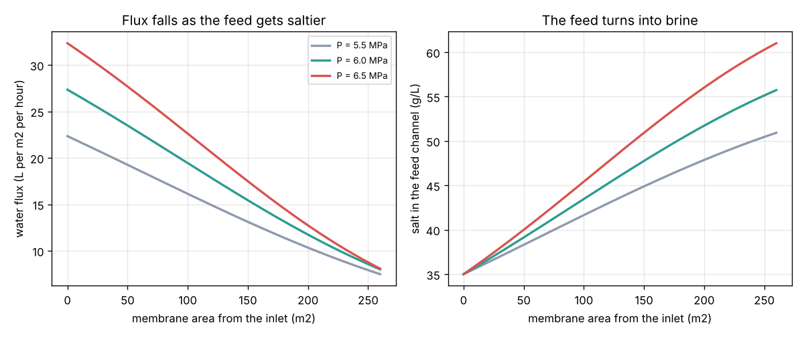
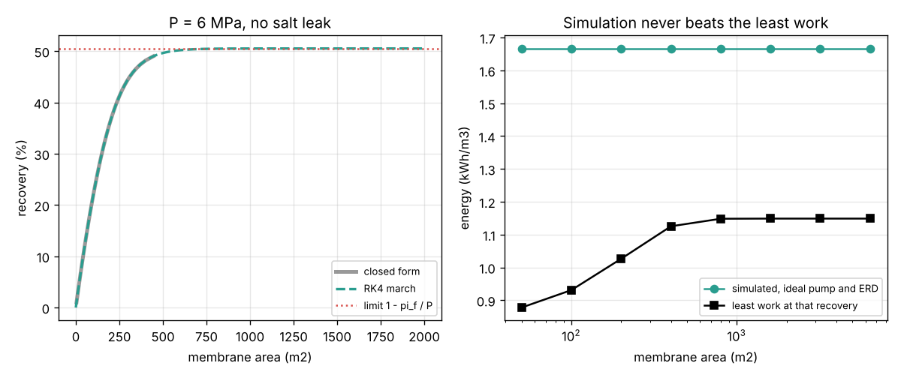
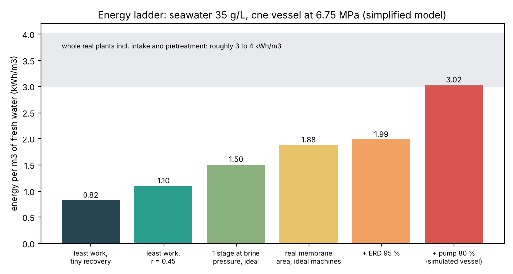

# Session 3: Simulate a membrane module and validate it

*Level 3 (simulation and validation) · about 90 minutes · opendesalination*

> This is a simplified educational model. It is not a validated design tool and must not be used for real structures, electrical installations, vehicles, industrial processes or medical decisions. Drinking-water quality must be confirmed by an accredited laboratory, never by a model.

**Prerequisites**

- Session 1: osmotic pressure and pressure x volume = energy.
- Session 2: recovery, brine, least work and energy recovery.
- Idea of a numerical step-by-step solution (adding up small pieces); explained in Section B.

**Learning objectives.** After this session you can:

- Write the water and salt flux laws of a reverse osmosis membrane and explain concentration polarisation.
- March along a membrane with Runge-Kutta 4 and get recovery, brine salt and fresh-water salt.
- Validate the simulation against a closed-form answer, the salt balance and the Session 2 limits.
- Count the real energy (pump and ERD) and choose a feed pressure that meets recovery and water-quality limits.

## A. Real-world problem
Session 2 assumed endless membrane area and perfect machines. A real seawater plant is built from pressure vessels, each holding about seven spiral-wound elements (roughly 260 m2 of membrane), fed by a high-pressure pump that wastes about 20 percent of its power and an energy recovery device (ERD) that returns most, not all, of the brine's push. The membrane also lets a little salt through. Can we simulate one vessel step by step, prove that the simulation obeys the balances and the limits we already know, and choose the feed pressure for a seawater plant? (A simplified teaching model, not a design tool.)

## B. Concept and theory
**Flux laws (solution-diffusion model).** Through each square metre of membrane the water flux is Jw = A (P - CP pi(c)): proportional to the push above the osmotic pressure at the membrane wall, and zero if the push is smaller. The salt flux is Js = B CP c: salt diffuses through in proportion to the salt at the wall. A and B are measured for each membrane. **Concentration polarisation.** Water leaves through the wall but salt stays, so salt piles up in a thin layer next to the wall; the wall is CP times saltier than the bulk (CP about 1.05 to 1.2), which raises the osmotic pressure that the pump must beat. **Marching.** Follow the feed channel from inlet to outlet. In a small area da, the water flow Q and the salt flow S drop by Jw da and Js da, and the bulk salt is c = S / Q. These two equations dQ/da = -Jw and dS/da = -Js are solved with the Runge-Kutta 4 method (four slope samples per step, weighted 1, 2, 2, 1). **Validation.** With B = 0 and CP = 1 the salt flow is fixed and dQ/da = -A (P - pi_f Qf / Q) can be integrated by hand; the simulation must match it. No area can push the brine above P, so the recovery can never exceed 1 - pi_f / P (the Session 2 limit), and the simulated energy can never be below the least work. **Energy.** The pump lifts all the feed to P with efficiency eta_p; the ERD returns e of the brine's pressure energy P Qb: SEC = (P Qf / eta_p - e P Qb) / Qp, in kJ per m3 (divide by 3600 for kWh/m3).

| Symbol | Meaning | Unit |
|---|---|---|
| P | feed pressure (gauge; fresh side at 0) | kPa |
| A | water permeability, 1e-5 (= 1 L/(m2 h bar)) | m3/(m2 h kPa) |
| B | salt permeability, 8e-5 (illustrative) | m3/(m2 h) |
| CP | concentration polarisation factor | no unit |
| Jw, Js | water flux and salt flux | m3/(m2 h), kg/(m2 h) |
| Q, S | water flow and salt flow in the feed channel | m3/h, kg/h |
| a | membrane area from the inlet | m2 |
| SEC | specific energy consumption per m3 of fresh water | kWh/m3 |
| eta_p, e | pump efficiency and ERD efficiency | no unit |

**Assumptions**

- One pressure vessel of 260 m2 with 12 m3/h of 35 g/L seawater at 25 degrees C.
- Ideal van 't Hoff law (about 10 percent high for real seawater); CP is a fixed number.
- No pressure drop along the vessel; the fresh water leaves at atmospheric pressure.
- Intake, pretreatment, post-treatment and a second pass are left out.

$$ J_w = A\,\big(P - CP\,\pi(c)\big),\qquad J_s = B\,CP\,c $$

$$ \frac{dQ}{da} = -J_w,\qquad \frac{dS}{da} = -J_s,\qquad c = \frac{S}{Q} $$

$$ a(Q) = \frac{1}{A}\left[\frac{Q_f - Q}{P} + \frac{\pi_f Q_f}{P^2}\ln\frac{P Q_f - \pi_f Q_f}{P Q - \pi_f Q_f}\right]\quad (B = 0,\ CP = 1) $$

$$ r \le 1 - \frac{\pi_f}{P} $$

$$ \mathrm{SEC} = \frac{P\,Q_f/\eta_p - e\,P\,Q_b}{3600\,Q_p} $$

## C. Visual explanation
The first figure shows what happens inside one vessel at 5.5, 6.0 and 6.5 MPa (CP = 1.1): the water flux is highest at the inlet (about 35 L per m2 per hour at 6.75 MPa) and falls along the membrane as the feed turns into brine; the salt in the channel climbs from 35 g/L to 51, 56 and 61 g/L. The second figure is the validation: the RK4 march sits on top of the closed-form curve, the recovery levels off at the limit 1 - pi_f / P = 50.5 percent however much membrane you add, and the simulated energy (ideal pump and ERD) always stays above the least work. The third figure is the energy ladder for the chosen vessel: 0.82 (least work, tiny recovery), 1.10 (least work at r = 0.45), 1.50 (one ideal stage at brine pressure), 1.88 (real membrane area), 1.99 (plus a 95 percent ERD) and 3.02 kWh/m3 (plus an 80 percent pump).

*Water flux and channel salt along the membrane at three feed pressures.*

*Validation: RK4 against the closed form and the recovery limit; simulated energy against the least work.*

*Energy ladder from the physical minimum to the simulated vessel.*

## D. Interactive simulation
Run the lesson (`python start.py 3`), then open the live app: [Session 3: a reverse osmosis vessel](https://krunalpanchal1995.github.io/pan-iit-oss/opendesalination/session-03/) (or `app.html` in this folder). Move the feed pressure, the feed salt, concentration polarisation, the pump and ERD efficiencies. The vessel picture shows the channel turning into brine; the profile view shows the flux along the membrane; the ladder shows where the energy goes.

**Challenge.** Run the vessel on 35 g/L seawater at a recovery of at least 45 percent with fresh water below 500 mg/L, for at most 3.1 kWh/m3, and with the pump at no more than 6900 kPa.

## E. Worked example and experiment
**Problem.** One vessel at P = 6000 kPa takes Qf = 12 m3/h of 35 g/L seawater (pi_f = 2969 kPa, A = 1e-5 m3/(m2 h kPa), B = 0, CP = 1). How much membrane gives 30 percent recovery? Check the simulation, find the brine salt and the energy with an 80 percent pump and a 95 percent ERD.

1. Flows: Qp = 0.3 x 12 = 3.6 m3/h, Qb = 12 - 3.6 = 8.4 m3/h. Constant k = pi_f Qf = 2969 x 12 = 35 630 kPa m3/h.
2. Closed form: (Qf - Q) / P = 3.6 / 6000 = 0.000600; ln((6000 x 12 - 35 630) / (6000 x 8.4 - 35 630)) = ln(36 370 / 14 770) = ln(2.462) = 0.9011; k / P^2 x 0.9011 = 35 630 / 36 000 000 x 0.9011 = 0.000892. Area = (0.000600 + 0.000892) / 1e-5 = 149.2 m2.
3. RK4 march over 149.2 m2 in 400 steps gives recovery 0.300000 (difference below 1e-6). Brine: 35 / 0.7 = 50 g/L, so pi_b = 4242 kPa, below P as it must be.
4. Energy: pump 6000 x 12 / 0.8 = 90 000 kJ/h; ERD returns 0.95 x 6000 x 8.4 = 47 880 kJ/h; net 42 120 kJ/h for 3.6 m3/h = 11 700 kJ/m3 = 3.25 kWh/m3.
5. Compare: least work at r = 0.3 is 0.98 kWh/m3; the vessel needs 3.3 times that.

**Answer.** Area 149.2 m2, simulation agrees to 1e-6, brine 50 g/L, SEC 3.25 kWh/m3 (least work 0.98 kWh/m3).

**Experiment.** If your lab has a small RO water purifier, measure the feed and fresh-water flows with a measuring jug and a stopwatch, and the salt with a TDS meter, at two or three feed pressures. Compute the recovery and the salt rejection. Fit A from Jw = A (P - pi) using the membrane area from the data sheet. The model differs from reality because tap water is brackish (low pi), real membranes foul, the pressure drops along the element and CP changes with flow.

## Real-world application and mini-project: Choose the feed pressure for a seawater RO vessel
A coastal plant uses vessels like the one above (260 m2, 12 m3/h feed, A = 1e-5, B = 8e-5, CP = 1.1, pump 80 percent, ERD 95 percent). The owner wants at least 45 percent recovery (to keep intake pumping and pretreatment small), fresh water below 500 mg/L of salt from the first pass, and the high-pressure piping is rated for 6900 kPa. Use `choose_pressure` from Session 3 (steps of 250 kPa). These are illustrative values, not a membrane data sheet.

**Deliverable:** A script that prints, for 35 g/L seawater, the lowest-energy feed pressure that meets every limit with its recovery, brine salt, fresh-water salt and SEC; does the same for 45 g/L Gulf seawater; and saves the energy ladder figure.

**Success looks like:** For 35 g/L the answer is P = 6750 kPa, recovery 0.453, brine 64 g/L, fresh water 210 mg/L and SEC 3.02 kWh/m3; for 45 g/L no pressure up to 6900 kPa reaches 45 percent recovery (at 6750 kPa it gives only 32 percent), so the report must recommend a lower recovery target, more membrane or a second stage.

## F. Assessment and design challenge
**Question type A: Conceptual.** Why does the water flux fall along the membrane, even though the feed pressure is the same everywhere?

Hint

What happens to the salt in the channel as water leaves?

Step-by-step solution

Water leaves through the membrane but the salt stays in the channel, so the feed gets saltier towards the outlet. Its osmotic pressure rises, so the net push P - CP pi(c) shrinks, and Jw = A (P - CP pi) falls. At the outlet of a long vessel the push is almost used up, which is why recovery levels off at 1 - pi_f / P.

**Question type B: Numerical.** At the inlet of a vessel at 6000 kPa with 35 g/L feed and CP = 1.1, find the water flux in L per m2 per hour. What is it at the outlet if the brine there is 56 g/L?

Hint

pi = 84.83 x c kPa; Jw = 1e-5 x (P - 1.1 pi) m3/(m2 h); 1 m3 = 1000 L.

Step-by-step solution

Inlet: pi = 84.83 x 35 = 2969 kPa; CP pi = 3266 kPa; Jw = 1e-5 x (6000 - 3266) = 0.0273 m3/(m2 h) = 27.3 L/(m2 h). Outlet: pi = 84.83 x 56 = 4751 kPa; CP pi = 5226 kPa; Jw = 1e-5 x 774 = 0.0077 m3/(m2 h) = 7.7 L/(m2 h). The flux drops to less than a third along the vessel.

**Question type C: Graph and simulation interpretation.** In the energy ladder, which step costs the most energy, and which is a choice rather than a law of physics?

Hint

Take differences between neighbouring bars: 0.82, 1.10, 1.50, 1.88, 1.99, 3.02.

Step-by-step solution

The pump inefficiency costs the most: 3.02 - 1.99 = 1.03 kWh/m3, because the pump lifts all the feed (more than twice the fresh water). Then come the finite membrane (0.38), one stage at brine pressure (0.40) and choosing r = 0.45 instead of a tiny sip (0.27); the ERD loss is small (0.11). Only the first bar (0.82) is set by physics; the second is the physics of the recovery we chose; every later step is a design or equipment choice that designers can improve.

**Question type D: Design and optimisation challenge.** Design: with the mini-project vessel, compare a pump of 80 percent and one of 85 percent at P = 6750 kPa. How much energy does the better pump save, and how much power is that for a 100 MLD (100 000 m3/day) plant?

Hint

specific_energy(res, eta_pump, 0.95); power = SEC x m3 per hour.

Step-by-step solution

80 percent: 3.02 kWh/m3. 85 percent: 2.72 kWh/m3, a saving of 0.30 kWh/m3 (10 percent). A 100 MLD plant makes 4167 m3/h, so the saving is 0.30 x 4167 = about 1.3 MW, all day, every day. Trade-off: a better pump costs more to buy; the saving must repay it. Recovery and water quality are unchanged because the pressure is the same.

Score yourself with [RUBRIC.md](../../RUBRIC.md). Print the [activity sheet](activity_sheet.md) to work on paper.

## Common misconceptions
| Common misconception | What is actually true |
|---|---|
| A simulation is right because it looks right. | It must be validated: here against a closed-form answer, the salt and water balances, the recovery limit and the least work. |
| More membrane area always gives more water. | Recovery levels off at 1 - pi_f / P; beyond that, extra area adds cost but almost no water. |
| The pressure only needs to beat the seawater's osmotic pressure. | It must beat the brine's osmotic pressure at the outlet, raised further by concentration polarisation, plus enough extra to make water flow. |
| RO fresh water has no salt at all. | A little salt diffuses through (here about 210 mg/L); plants add a second pass or blend and then re-mineralise. |

## Glossary
- **water permeability A**: how easily water passes the membrane per unit of push
- **salt permeability B**: how easily salt diffuses through the membrane
- **concentration polarisation**: salt piling up at the membrane wall, CP times the bulk value
- **pressure vessel**: a tube holding several membrane elements in series
- **specific energy consumption (SEC)**: electrical energy per cubic metre of fresh water

## Finish
1. Do the three coding tasks in [exercises.md](exercises.md).
2. Run `python start.py 3` again after your changes. It ends with the checkpoint; when it prints `PASS`, you are done. (Checkpoint only: `python start.py check 3`.)

Next: the [roadmap](../../promo/roadmap.md). Session 4 is yours to build.
